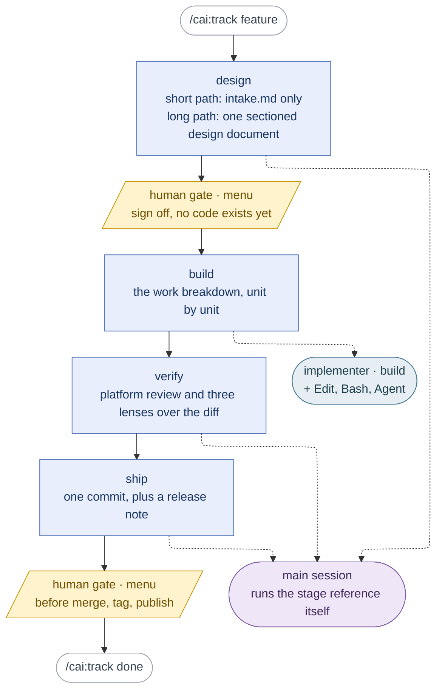
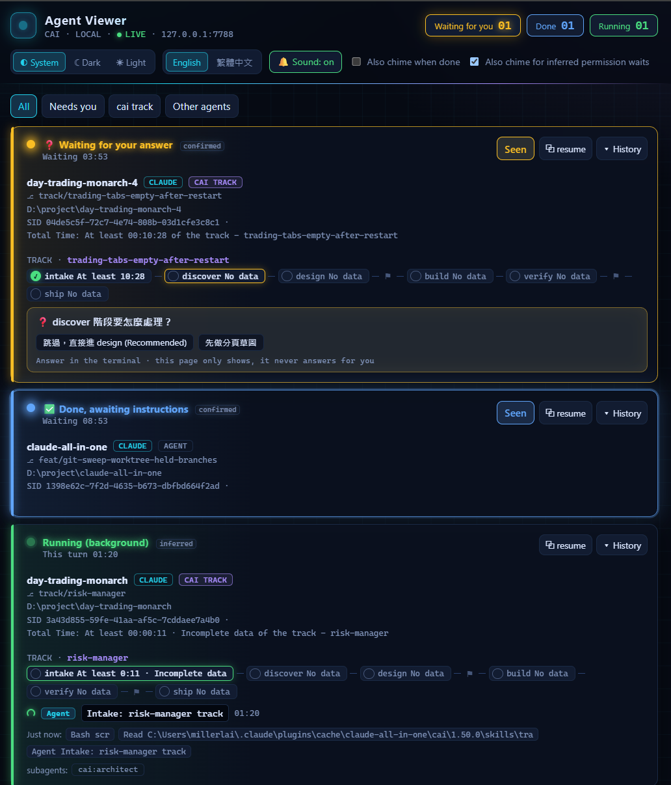

# claude-all-in-one

English | [繁體中文](README.zh-TW.md)

A [Claude Code](https://claude.com/claude-code) plugin — with a generated
Codex CLI counterpart, `cai-codex` — that installs a working set of everyday
capabilities into every project on your machine: cheaper model routing, safer
git, and a shared set of behavioural rules. Its centre is `/cai:track`, which
carries one feature through four SDLC stages and keeps its state on disk, so a
new session can resume it where the last one stopped.

## How it fits together

Four layers, plus one underneath all of them.

- **The track.** `/cai:track <feature>` carries one feature through four SDLC
  stages, keeping state in `.cai/track/<feature>/state.md` so a new session
  with no memory of this conversation can resume it.
- **The four stages.** `design`, `build`, `verify`, `ship` — each also runs
  alone, track or no track. `design` takes a short path (a change with nothing
  hard to undo stops at the track's `intake.md`) or a long one (one sectioned
  design document). Exactly two stop for a human sign-off, both as a menu you
  pick from: after `design`, before any code exists, and before the
  irreversible steps inside `ship` — merging, tagging, publishing.
  `/cai:discover` is a standalone command, never a stage.
- **The tools.** Reachable any time, with no track running — see
  [Commands](#commands).
- **The knowledge.** Reference files that cost nothing until something reads
  them: 72 named refactoring cards, the smell-to-refactoring routing table, the
  four stage procedures, and a template for each kind of design document.

Underneath all of it, small scripts (`preflight.py`, `track_state.py`,
`design_probe.py`, `options_lint.py`, `validate.py`) settle what a
deterministic check can — may this stage start, where did the track stop —
before anything reaches a model, and `ledger.py` keeps an append-only record of
every attempt at every stage.

Stages run in order, top to bottom. The dotted line off each one names the
subagent it dispatches to — `stages.json` decides that, never judgement,
because the model tier rides on the agent. Agent colour is that tier: purple
is `think`, teal is `build`, grey is `chore`. Amber is a person: exactly two
boundaries wait for one.



Why an agent is picked by tool grant rather than by tier: [REFERENCE.md](REFERENCE.md#what-the-stage-diagram-cannot-show).

## Commands

The four stages, each also runnable on its own:

| Command | What it does |
|---|---|
| `/cai:track <feature>` | Create or resume a track. Also `status`, `skip <stage> --reason "<why>"`, and `done`. |
| `/cai:design` | Turn a request into an acceptance-testable problem statement and, when something is hard to undo, a design document for review — diagnosis, stance, decisions, detail, or delta. |
| `/cai:build` | Build a design's work breakdown unit by unit, test-first. |
| `/cai:verify` | The platform's own review for correctness plus three read-only lenses over a diff, then fix Blockers and Majors test-first. |
| `/cai:ship` | Squash to one conventional commit and write a release note; stops before merge, tag or publish until a person confirms. |

Tools, reachable any time:

| Command | What it does |
|---|---|
| `/cai:discover` | Surface what you don't know before writing code. Standalone: the track's `design` stage recommends it but never runs it. |
| `/cai:debug` | Find the root cause of a bug before proposing any fix. |
| `/cai:fix` | Fix a GitHub issue, the issues you pick from a list, a pull request's review threads, or one Jira ticket, and push the result with no stop in between: it pushes, opens pull requests and replies to review threads itself, and never merges. |
| `/cai:fix-unclaim` | Clear one named local session claim left by `/cai:fix`, without waiting for it to expire. |
| `/cai:codemap` | Build, refresh, check or query an optional index of the repository's files and symbols under `.cai/codemap/`; once it exists, the track hands the read-side agents its state line so they start from it instead of re-reading the same files, and outside the track a `SubagentStart` hook hands `cai:explorer` and `cai:architect` the same line while the index is fresh (Claude Code only; it never refreshes the index, so after an edit run `/cai:codemap update`). It ignores itself in git and can be deleted at any time. |
| `/cai:refactor` | Restructure code without changing its behaviour; every one of Fowler's 72 named refactorings is also its own `/cai:<name>`. |
| `/cai:git` | Run git and `gh` operations on the `chore` tier instead of the main session model. |
| `/cai:chore` | Run a mechanical one-off — renames, formatting, lookups — on the `chore` tier. |
| `/cai:quiz` | Quiz you on your own branch diff before you merge it. |
| `/cai:plan-review` | Read a plan, design doc, or spec the way a senior architect would. |
| `/cai:options` | Lay out two or more ways forward so a person can actually choose between them. |
| `/cai:usage` | Token usage and equivalent API spend for one track, or across projects. |
| `/cai:models` | Put each model tier on the model and reasoning effort you choose, for you alone. |
| `/cai:viewer` | Open the [Agent Viewer](#agent-viewer). |

`/cai:fix` starts only when you type it. Given an issues URL it asks once which
issues to fix; a Jira ticket needs `acli` signed in the official way first, and
nothing is written back to Jira. It carries no pre-approved permissions, so
Claude Code asks before each `git push` and `gh pr create` unless you have
saved allow rules such as `Bash(git push *)` and `Bash(gh pr create *)`; a
rule matches the text of a command and is not a safety boundary.

`/cai:fix` also records which session is working on which item, so two
sessions do not fix the same one. That claim lives only on your machine, in
`config_root()/cai/` (`CLAUDE_CONFIG_DIR`, or `~/.claude` when unset), and is
visible only to sessions with the same `config_root()`; nothing is written to
the issue or the ticket. Two sessions resumed from the same conversation share
one session ID and do not block each other. A claim older than 30 minutes no
longer blocks; to clear one sooner, type `/cai:fix-unclaim` with the issue URL
and the three words the blocked item's `detail` shows (platform, session, start
time). It starts only when typed and deletes only an exact match.

What to type when: [MANUAL.md](MANUAL.md#what-to-type). Full descriptions, the
subagents, and the guard and hooks that are always on:
[REFERENCE.md](REFERENCE.md).

## Agent Viewer

<p align="center">
  
</p>

`/cai:viewer` opens a local-only web page (by default `127.0.0.1:7788`) that
lists every running Claude Code and Codex main session: which are waiting for
your answer, which have finished and wait for instructions, and which are still
running. A session that belongs to a `cai` track also shows its stages and
the time recorded in each. Filter by *Needs you*, *cai track* or *Other
agents*, switch theme and language (English / 繁體中文), and optionally have it
chime when a session needs you. The page only shows; you answer in the
terminal. `/cai:viewer stop` closes it.

## Install

Needs Claude Code CLI 2.1.283 or later (installed and authenticated), Git, and
Python 3 on `PATH` — `python3` on macOS/Linux, `python` or the `py` launcher on
Windows. The bash guard needs it; `/cai:setup` tells you if it's missing.
Optional: the GitHub CLI (`gh`), authenticated, for the pull request `ship`
opens and for ticket mirroring.

Inside any Claude Code session:

```
/plugin marketplace add millerlai/claude-all-in-one
/plugin install cai@claude-all-in-one
```

Restart the session, then run:

```
/cai:setup
```

Setup copies the rule files into `~/.claude/rules/`, asks which language you
want Claude to reply in, sets up your global `~/.claude/CLAUDE.md`, offers a
project CLAUDE.md for the current repo, verifies the bash guard actually
fires, and offers to install the status line. Restart once more so the new
rules load.

Agents, commands, and the guard work in every project from then on. The rules
apply to every project too, since they live at user scope.

### Codex CLI

`cai-codex` is the generated counterpart for Codex CLI — the same cost-tiered
agents, skills, and rules, kept in sync automatically. It needs `codex-cli`
0.157.1 or later (`codex --version`); an older one drops the marketplace entry
silently.

Install it from a shell:

```
codex plugin marketplace add millerlai/claude-all-in-one
codex plugin add cai-codex@claude-all-in-one
```

Then start Codex in the **asking mode** below and run `$setup` inside it. It
writes into `~/.codex`, outside the sandbox, so approve that when asked; then
run `/hooks`, trust the cai entry, and restart Codex. Skills work the same way
with `$` in place of `/cai:` — `$track <feature>`, `$design`, `$verify`.

#### Starting Codex

Start every session with `--enable default_mode_request_user_input`: it is what
makes `$setup`'s language question, the track's two human gates and the
open-items menu render as menus instead of text you type an answer into. Pick
the approval mode by what the session will do:

| Mode | Command | Use it for |
|---|---|---|
| Asking | `codex --sandbox workspace-write --ask-for-approval on-request --enable default_mode_request_user_input` | Install, update and `$setup`; any session that commits, pushes or opens a pull request (`$track` once it reaches `ship`, `$git`, `$fix`); `$viewer`. |
| Unattended | `codex --sandbox workspace-write --ask-for-approval never --enable default_mode_request_user_input` | Work that stays inside the repository: designing, editing, running tests, `$verify`, chores. |

`--sandbox workspace-write` lets Codex edit files and run commands in the
current workspace with the network off. `--ask-for-approval never` turns off
every approval prompt, so a step that needs to leave the sandbox does not ask
— it fails. Per Codex's own documentation that covers writing `~/.codex`
(`$setup`), anything needing the network (a push, `gh`), and writes to
`.git`, which Codex keeps read-only even inside the workspace — so a commit
fails too. Start such a session in the asking mode instead. (How each of those
fails under `never` has not yet been exercised end to end with cai.)

What is equivalent, what is degraded, and the human gates:
[`plugins/cai-codex/README.md`](plugins/cai-codex/README.md). The full
install, update and uninstall steps:
[REFERENCE.md](REFERENCE.md#using-it-with-codex-cli).

## Updating

The marketplace is cloned locally, so refresh it first — otherwise an update
re-serves the cached commit:

```
/plugin marketplace update claude-all-in-one
/plugin update cai
```

Restart the session — running sessions don't hot-reload plugin agents or
hooks. If the update changed the rules, run `/cai:setup` to copy them into
`~/.claude/rules/` and restart once more, since rules are read at startup.

An update that doesn't take, or a cache that looks corrupted:
[REFERENCE.md](REFERENCE.md#where-the-installed-copy-lives).

### Codex CLI

Three steps, in this order — upgrade the marketplace, install, then `$setup`:

```
codex plugin marketplace upgrade
codex plugin add cai-codex@claude-all-in-one
```

Then start Codex in the asking mode ([Starting Codex](#starting-codex)) and
run `$setup` again, so the rules, agents and hooks it copied into `~/.codex`
match the new version; restart Codex afterwards. The first line refreshes
Codex's local copy of this repository — without it, `add` reinstalls the
cached version. No `remove` is needed in between.

## Model tiers

No component names a model. They name a **tier**, and one file says what each
tier currently resolves to: `chore` (`haiku`) for work that needs no judgement
on any given run, `build` (`sonnet`) for engineering judgement inside a fixed
contract, `think` (`opus`) for design trade-offs and repair. `/cai:models` puts
a tier on another model or reasoning effort for you alone, and the choice survives
`/plugin update`. The full table, how re-tiering works, and what happens when
your account cannot run a tier's model:
[REFERENCE.md](REFERENCE.md#model-tiers).

## Compatibility

One version number, in `plugins/cai/.claude-plugin/plugin.json`, covers both
`cai` and its generated `cai-codex` counterpart — they always ship together
at the same version.

That version follows [SemVer](https://semver.org/) against a public
interface: skill names, `/cai:setup`'s write locations, the model-choice
save format, and the two platform floors below.

| Change | Bump | Example |
|---|---|---|
| Removing or renaming a skill; an old save file no longer loading; raising a platform floor | MAJOR | Dropping `/cai:quiz` |
| Adding a skill; adding an omittable field to an old save file; a track-format change | MINOR | Adding a new tool, or changing what `.cai/track/<feature>/state.md` records (called out on that release's GitHub Release page) |
| A script bug fix that doesn't change format; rewording a rule | PATCH | Fixing a guard regex |

Platform floors: Claude Code 2.1.283 or later, codex-cli 0.157.1 or later.

## More documentation

| Document | Read it when |
|---|---|
| [`MANUAL.md`](MANUAL.md) | You want to know what to type, what happens next, and what every refusal means. |
| [`REFERENCE.md`](REFERENCE.md) | You want the long form: every subagent, the always-on guard and hooks, how a test command is resolved, runtime verification, ticket mirroring, the rules, the status line, and what the plugin deliberately leaves out. |
| [`GUIDE.md`](GUIDE.md) | You are extending the plugin and need to know which component a new piece of guidance belongs in. |
| [`CONTRIBUTING.md`](CONTRIBUTING.md) | You are changing this repo: testing an unreleased checkout, the checks to run before pushing, and cutting a release. |
| [`plugins/cai-codex/README.md`](plugins/cai-codex/README.md) | You use Codex CLI: what maps onto what, and Windows-specific notes. |
| [`CHANGELOG.md`](CHANGELOG.md) | You want to know what changed in a release. |
