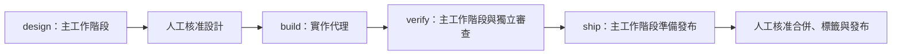

# 現行架構

核對日期：2026-11-02。本專案把開發程序、防護與確定性檢查交給兩個程式代理平台使用。

術語：外掛（plugin）是平台載入的套件；技能（skill）是按需讀取的程序；代理（agent）是被委派工作的一個執行者；事件掛鉤（hook）在平台事件發生時啟動腳本；工作軌道（track）保存一項功能的跨階段狀態。

## 套件與維護邊界

| 位置 | 責任 | 權威來源 |
|---|---|---|
| `plugins/cai/` | 給 Anthropic 的程式代理（Claude Code）的技能、代理、規則、範本、腳本與掛鉤 | 人工維護的主要來源 |
| `plugins/cai-codex/` | 給 OpenAI 的程式代理（Codex）的對應套件 | 由產生器轉換，少數手寫檔例外 |
| `scripts/`、`tests/`、`.github/` | 產生、驗證、評估與發版 | 維護者使用，不隨外掛安裝 |
| 根目錄文件、`docs/`、`.claude/skills/`、`.agents/skills/` | 操作說明、設計依據及本專案維護程序 | 不得成為出貨元件依賴的本機路徑 |

邊界定義見 [CLAUDE.md](../CLAUDE.md)；新指引的放置判準見 [GUIDE.md](../GUIDE.md)。評估案例位於 `plugins/cai/evals/`，是因評估工具要求放在外掛根目錄內，不代表它們會自動執行。

## 四層責任

| 層 | 解決什麼 | 實際來源 |
|---|---|---|
| 規則 | 每次工作都應遵守的簡短約束 | [rules](../plugins/cai/rules) |
| 技能與參考程序 | 某項工作如何執行、如何交付 | [skills](../plugins/cai/skills) |
| 代理 | 需要委派或獨立判斷的工作 | [agents](../plugins/cai/agents) |
| 程式與掛鉤 | 狀態解析、輸入檢查、防護、量測等可重現判定 | [scripts](../plugins/cai/scripts)、[hooks.json](../plugins/cai/hooks/hooks.json) |

先用程式完成能確定判定的工作；剩餘工作才依判斷需求選擇機械工作層（chore）、工程實作層（build）或設計取捨層（think）。層級與具體模型分開，見 [model-selection.md](../plugins/cai/rules/model-selection.md) 與 [models.json](../plugins/cai/models.json)。

## 階段與執行者

設計（design）、驗證（verify）、發布準備（ship）由主工作階段（main session）讀取程序直接執行。建置（build）在軌道下派給實作代理（implementer）。需要獨立判斷的架構或變更審查仍另外委派，並非所有工作都留在同一對話內。

階段配置的唯一來源是 [stages.json](../plugins/cai/skills/track/stages.json)。原需求盤點（intake）與探索（discover）不再是獨立階段；探索技能仍可單獨使用。完整狀態與核准規則見 [工作流程](workflow.md)。

## 專案內資料

[cai_paths.py](../plugins/cai/scripts/cai_paths.py) 定義 `.cai/track/`、設定檔 `.cai/cai.json`、共用詞彙與慣例 `.cai/cai-context.md`、審查政策 `.cai/cai-review.md`。`.cai/` 預設忽略自己的內容；舊 `.claude/` 資料由程式遷移，不能把舊路徑繼續當作新資料位置。

狀態表回答目前進度，僅追加帳本保存嘗試與核准證據，兩者責任不同。這些是現行檔案，並不是第二版提案中的狀態檔與任務圖；後者見 [提案狀態](design/README.md)。
