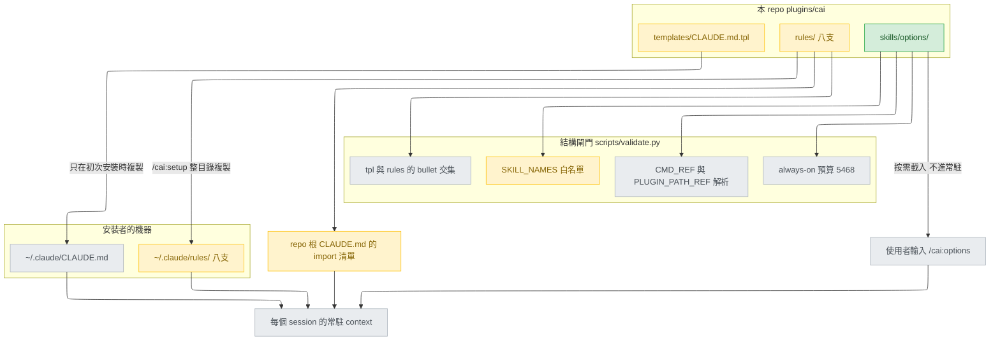
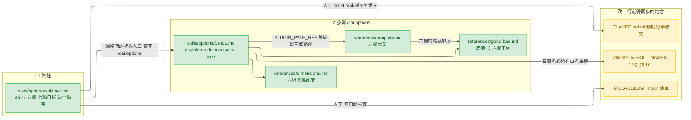
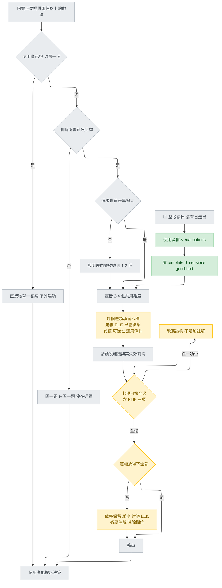
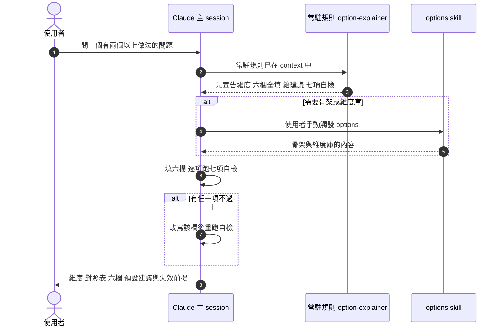
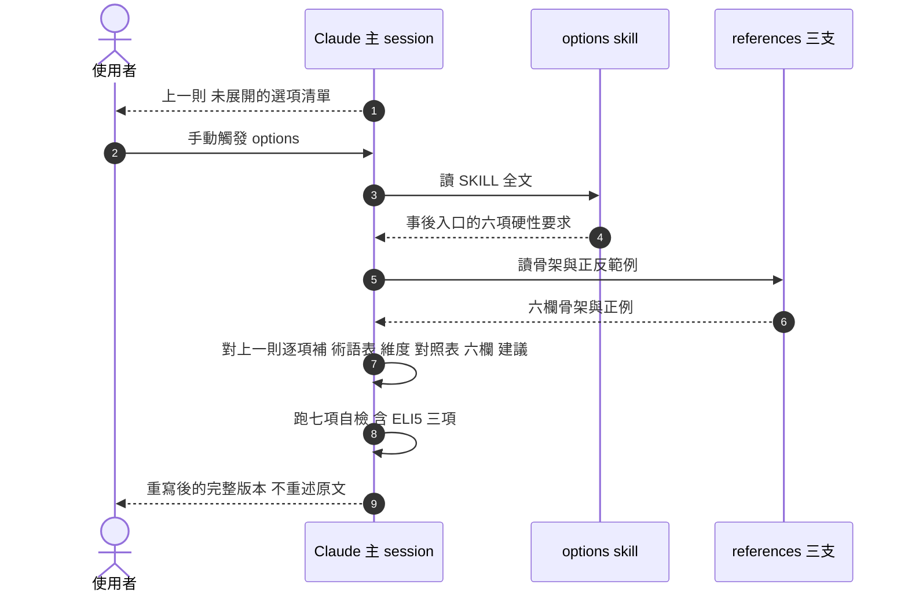

# option-explainer with ELI5 — detail design

## 維護說明（2026-10-27）

本檔是歷史設計紀錄，保留決策、驗收依據與實作偏差；不是待執行計畫。原簽核狀態、版本、行號及未驗證標記描述撰寫當時，整併不代表重新簽核或重做實測。

名詞：設計立場（stance）說明取捨；決策紀錄（decisions）保存選擇理由；細部設計（detail）記錄建造規格；需求盤點（intake）保存驗收條件。下方英文標題與識別碼沿用原文，便於對照歷史。

六欄選項與白話比喻規則仍在使用。早期驗收清單的模型輸出與「發布後才能跑」只記錄當時結果，不代表本次已重跑；現行規則以 [`plugins/cai/rules/option-explainer.md:20`](../../plugins/cai/rules/option-explainer.md#L20) 為準。

已併入並移除的同主題文件：`2026-08-29-option-explainer-with-eli5-T1-T7-checklist.md`、`2026-08-29-option-explainer-with-eli5-high-level.md`。

補充段落保留原文與原決策編號，避免把不同時點同號的決策當成一項；重複的概覽圖、施工排程與階段交接文字不再複製。

## Reference

High Level Design doc: docs/design/2026-08-29-option-explainer-with-eli5-detail.md
Status: approved 2026-08-29

上游輸入（**歷史文件，本次不修改正文**）：
`docs/design/2026-08-29-option-explainer-spec.md`，頂端已加 superseded 註記
（`docs/design/2026-08-29-option-explainer-spec.md:3`–7）。本文件所有 spec 行號都
是在加註後的檔案上重新讀過的，未沿用任何舊值。

### Traceability

| From the high-level design | Satisfied by | Status |
|---|---|---|
| UC1 事前入口 | 規則檔 L8–L28（維度 → 六欄 → 預設建議）＋ SKILL.md「Procedure」步驟 1–5；驗收見 T1、T5 | covered |
| UC2 事後補救入口 | SKILL.md frontmatter 的雙語事後觸發詞＋「When the entrance is the remedial one」段；驗收見 T4 | covered |
| UC3 反向情境 | 規則檔 L2–L3「If the user has already said "you pick", decide and answer — do not list」；驗收見 T6 | covered |
| UC4 資訊不足 | 規則檔 L15＋SKILL.md 步驟 2（一次一題）；驗收見 T3 | covered |
| UC5 湊數選項 | 規則檔 L14＋SKILL.md 步驟 1；驗收見 T2 | covered |
| UC6 ELI5 可自檢 | 規則檔 L35–L37 三個是/否欄位＋SKILL.md「The ELI5 field, specifically」；驗收見 T7 | covered |
| UC7 常駐層送到每個安裝者 | 交付物 A 落在 `plugins/cai/rules/`（`plugins/cai/skills/setup/SKILL.md:27`–28 複製整個目錄）＋ Unit 3 的根 `CLAUDE.md` import diff | covered |
| UC8 預算不上升 | SKILL.md frontmatter 帶 `disable-model-invocation: true`，被 `scripts/validate.py:214`–216 排除；`ALWAYS_ON_CEILING` 一字不改 | covered |
| UC9 規則檔 ≤ 45 行且理由在檔內 | 規則檔逐字內容共 45 行，理由在 L44–L45 的註解 | covered |
| UC10 六欄四處一致 | 規則檔 L17–L24 / `template.md` 骨架 / `good-bad.md` 正例 / SKILL.md 步驟 4，四份清單同序同名；`## Verification` 的 V10 是逐欄比對項 | covered |
| UC11 九處裂縫逐一改寫 | `## Design decisions` 的「十一處裂縫的改寫落點」表（九處＋F6＋§9.1） | covered |
| UC12 結構檢查全綠 | `## Change points` 的 `scripts/validate.py` diff＋`## Verification` 的 V1–V8 | covered |

## Requirement

**問題**：AI 丟出「方案 A / B / C」時，使用者無法據以決策。spec 把成因拆成五個失效
模式（`docs/design/2026-08-29-option-explainer-spec.md:40`–44），HLD 追加第六個：
**F6「懂了每個字，但不知道這東西在幹嘛」**（HLD Decision 5）。

**對誰**：每一個安裝 cai 的使用者。因此常駐層必須落在
`plugins/cai/rules/`——那是本 repo 唯一會被 `/cai:setup` 整個目錄複製出去的來源
（`plugins/cai/skills/setup/SKILL.md:27`–28）。

**怎麼知道有效**：`python scripts/validate.py` 與 `python -m pytest` 全綠（結構面
V1–V8），六欄清單四處逐欄相同（V10），以及 T1–T7 七個行為案例——其中 T6 是反向
測試（沒有過度觸發）、T7 專測 ELI5 的三個是/否判準。

本次交付**不改變 AI 的技術判斷，只改變呈現方式**（沿用 spec §2.3，
`docs/design/2026-08-29-option-explainer-spec.md:78`–82）。

## Glossary

| Term | Definition | Where it lives |
|---|---|---|
| L1 常駐規則層 | 每個 session 都載入、且被 `/cai:setup` 複製到 `~/.claude/rules/` 的規則檔集合 | plugins/cai/skills/setup/SKILL.md:27 |
| option-explainer 規則檔 | 本設計新增的常駐規則，只管「既然要列選項，怎麼列」 | new — plugins/cai/rules/option-explainer.md |
| options skill | 本設計新增的按需層，唯一入口是 `/cai:options`，同時服務事前與事後 | new — plugins/cai/skills/options/SKILL.md |
| template.md | options skill 的輸出骨架參考檔，六欄的權威排序來源之一 | new — plugins/cai/skills/options/references/template.md |
| dimensions.md | 比較維度庫，spec §5.3 的六組場景 | new — plugins/cai/skills/options/references/dimensions.md |
| good-bad.md | 正反範例；正例按六欄整段重寫 | new — plugins/cai/skills/options/references/good-bad.md |
| 六欄 | 每個選項必填的六個欄位，順序固定 | concept |
| ELI5 欄 | 六欄之一：用一個日常生活類比說明同一件事，措辭不得與第一欄重複 | concept |
| 三個是/否自檢 | 判定 ELI5 是否完成的三條機械判準，取代「五歲小孩也懂」這種不可驗證的形容 | concept |
| F6 | 新增的失效模式：懂了每個字，但不知道這東西在幹嘛 | concept |
| 退化路徑 | 空間不夠時放棄規則的順序；本次把 ELI5 插進第 3 順位 | docs/design/2026-08-29-option-explainer-spec.md:575 |
| disable-model-invocation | frontmatter 旗標；帶它的元件其 description 被預算加總排除 | scripts/validate.py:216 |
| always-on description 預算 | 所有可被模型自動觸發的 description 字元總和，硬上限 5468 | scripts/validate.py:210 |
| SKILL_NAMES | `skills/` 目錄名的寫死白名單，不同步更新就直接 FAIL | scripts/validate.py:166 |
| import 清單 | repo 根 `CLAUDE.md` 以 `@` 匯入規則檔的六行，無任何自動檢查 | CLAUDE.md:8 |
| bullet 交集檢查 | 禁止 `CLAUDE.md.tpl` 與任何 rules 檔共用 `- ` 條目；只看條目，看不到散文 | scripts/validate.py:241 |
| tpl 規則列舉散文 | `CLAUDE.md.tpl` 中逐一列出七支規則名字的那句話，多一支就過時 | plugins/cai/templates/CLAUDE.md.tpl:5 |
| 事前入口 | 回覆尚未送出、正要列出兩個以上做法的時刻 | concept |
| 事後補救入口 | 看不懂的選項清單已經送出，使用者主動要求展開的時刻 | concept |
| T7 | 本文件新增的第七個驗收案例，專測 ELI5 | new — 本文件 `## Verification` |

## Budgets

| What | Number | Where it comes from |
|---|---|---|
| 常駐規則檔行數上限 | 45 | HLD Decision 4（intake 已裁決）；本文件的規則檔逐字內容剛好用滿 |
| 現況 `rules/` 最長一支的行數 | 43 | plugins/cai/rules/model-selection.md:43 為該檔末行（HLD C8） |
| 現況 `rules/` 七支合計行數 | 178 | HLD C8 的逐檔計數 |
| 新增後 `rules/` 合計行數 | 223 | 178 + 45 |
| always-on description 上限 | 5468 | scripts/validate.py:210 |
| 新 skill 的 description 計入預算的字元數 | 0 | scripts/validate.py:214–216 以 `disable-model-invocation: true` 排除整支檔案 |
| 現況 always-on 用量 | 5451 | intake 階段回報的 `validate.py` 輸出；design 階段無 shell，**未重跑**（HLD:71–76 同一註記） |
| 每則輸出宣告的比較維度數 | 2–4 | 規則檔 L9；沿用 spec `docs/design/2026-08-29-option-explainer-spec.md:171` |
| 每個選項的必填欄位數 | 6 | HLD「六欄的職責切分」 |
| ELI5 的是/否判準數 | 3 | HLD（UC6） |
| 規則檔自檢清單的勾選項數 | 7 | 規則檔 L31–L37；SKILL.md 步驟 6 引用同一個數字 |
| 資訊不足時一次提問數上限 | 1 | 規則檔 L15；沿用 spec `docs/design/2026-08-29-option-explainer-spec.md:187` |
| `SKILL_NAMES` 名字數 | 16 | 現況 15（scripts/validate.py:166）加 `options` |
| references 檔數 | 3 | HLD 交付形狀表 |
| dimensions.md 場景組數 | 6 | spec `docs/design/2026-08-29-option-explainer-spec.md:290`–323 的六個 `##` 段 |
| 驗收案例數 | 7 | spec 的 T1–T6（`docs/design/2026-08-29-option-explainer-spec.md:542`–547）加 T7 |
| 需人工確認、無自動檢查的項目數 | 4 | `## Failure modes` 的 FM1–FM4 |

## Design decisions

HLD 已裁決的八項（兩層交付、六欄、三個 ELI5 判準、F6、退化順序、45 行、預算不動、
內文英文）不在此重開。以下只列**這份 detail 自己做的決定**，以及它們服務的需求。

### D1 — 六欄的英文標籤

交付物內文是英文（HLD Decision 8），因此六欄必須有英文標籤，而 HLD 只裁決了中文
職責。**使用者於 design 階段裁決（2026-08-29）為 B 組**：

`What it literally is` / `ELI5` / `What actually changes` / `What it costs` /
`How reversible` / `When it fits`

選 B 而非直譯組（`One-sentence definition` / `Concrete consequences` / `Cost` /
`Reversibility` / `Applies when`）的理由是語氣一致：規則檔要求選項描述用白話，欄位
名本身若是抽象名詞（"Concrete consequences"），模型會照著那個語氣把內容也寫成官腔。
代價是這六個標籤與 HLD 的中文欄名不是字面一對一，覆核 UC10 時要多一次對照——對照表
就是上面那兩行。

這是四個檔案共用的同一組字串（規則檔、`template.md`、`good-bad.md` 正例、SKILL.md），
UC10 要求四份逐欄相同。

### D2 — `skills/options/SKILL.md` 不宣告 `model:`

現況只有六支 skill 宣告 `model:`（`plugins/cai/skills/git/SKILL.md:4`、
`plugins/cai/skills/chore/SKILL.md:4`、`plugins/cai/skills/setup/SKILL.md:4`、
`plugins/cai/skills/quiz/SKILL.md:5`、`plugins/cai/skills/refactor/SKILL.md:4`、
`plugins/cai/skills/plan-review/SKILL.md:4`），其餘一律不宣告。本 skill 跟著後者，
理由不是慣例而是語意：它的工作是**把當前這一輪的回覆重新排版**，UC2 更是直接依賴
「上一則訊息還在眼前」。而 skill 的 model 覆寫會延續整輪
（`plugins/cai/skills/goal/SKILL.md:35`「a skill's model override holds for the rest
of the turn」），換模型等於換掉正在說話的人。不宣告 `model:` 也就不必進
`plugins/cai/models.json`——該檢查只針對「有宣告的」（`scripts/validate.py:1119`–1121）。

### D3 — `SKILL_NAMES` 的註解必須跟著改，不只是清單

`scripts/validate.py:162`–165 的註解寫著「the design's target is 14 skills, not 15」。
只加一個名字會讓那段註解與清單互相矛盾，下一個讀它的人會以為有人違規。因此 diff 含
一段新註解說明「為什麼往上加一支」（HLD Decision 2 的 costs 欄已預告要這麼做）。同時
`scripts/validate.py:170` 的訊息字串硬寫著 `15`，不改就會印出說謊的訊息。

### D4 — 規則檔用三行寫死與既有兩條常駐規則的分工（HLD C13）

`plugins/cai/rules/communication.md:4`–5 要求「alternatives only when they'd change
the conclusion or action」，`plugins/cai/rules/epistemics.md:12` 已經有「Then name the
options; don't pick silently」。三份都常駐，不寫分工線就會互相打架。分工線寫進規則檔
L4–L6：**epistemics 管「何時該停下來問」，本規則只管「既然要列，怎麼列」，而
communication 的簡潔要求仍然生效——空間不夠時砍的是選項數，不是欄位數。** T6 因此
不只防過度觸發，也是這三條規則沒打架的證據。

### D5 — 交付順序：skill 先於 rule，import 最後

規則檔 L42 會寫出 `/cai:options`。若規則檔先落地，這個 checkout 在兩次 commit 之間
會有一條指向不存在指令的常駐規則，而 `scripts/validate.py:150`–155 的 `CMD_REF` 檢查
**只掃 `skills/*/SKILL.md`**，抓不到 rules 裡的死指令。所以 Unit 1 是 skill＋白名單，
Unit 2 才是規則檔。詳見 `## Work breakdown`。

### D6 — 十一處裂縫的改寫落點

HLD 點名九處，加上 F1–F5 表新增 F6、§9.1 插入 ELI5，共十一處。**全部發生在新交付物
裡，spec 正文一字不動**（HLD `## Out of scope`）。落點如下——每一列的「spec 位置」
都是在加註後的檔案上重新讀過的行號：

| # | spec 位置（已重讀） | 裂在哪 | 改寫後落在哪 |
|---|---|---|---|
| 1 | `docs/design/2026-08-29-option-explainer-spec.md:62` | FR-3 寫「五個固定欄位（白話定義 / 具體後果 / 代價 / 可逆性 / 適用條件）」 | 規則檔 L17–L24 的六項；SKILL.md 步驟 4 逐字列同一組 |
| 2 | `docs/design/2026-08-29-option-explainer-spec.md:175`–180 | R3 的必填欄位只有五項 | 規則檔 L17–L24（`# Six fields per option, all filled`） |
| 3 | `docs/design/2026-08-29-option-explainer-spec.md:158`–198 | 規則區塊 39 行、自訂上限 40，只剩 1 行 | 規則檔共 45 行，放寬理由寫在 L44–L45 的 HTML 註解裡 |
| 4 | `docs/design/2026-08-29-option-explainer-spec.md:189`–193 | R6 自檢清單四項，沒有 ELI5 對應項 | 規則檔 L30–L37 共七項，末三項是 ELI5 的三個是/否 |
| 5 | `docs/design/2026-08-29-option-explainer-spec.md:267`–269 | §5.2 執行流程寫「五個欄位全填，不得留空」 | SKILL.md `## Procedure` 步驟 4：六欄、依 template.md 的順序、不得留空 |
| 6 | `docs/design/2026-08-29-option-explainer-spec.md:353`–359、363、374 | template 骨架列五欄，且「同上五欄」「直接用五欄描述」兩處措辭同樣是舊值 | `references/template.md` 的 `## Option A` 六欄骨架、`[the same six fields...]`、以及 `## Using this` 第一條 |
| 7 | `docs/design/2026-08-29-option-explainer-spec.md:421`–434 | good-bad **正例**按舊五欄寫好；spec 自稱正例約束力最強（`docs/design/2026-08-29-option-explainer-spec.md:381`），不補會直接教模型少寫一欄 | `references/good-bad.md` 的正例**整段按六欄重寫**（不是加一行），並附一張「兩條 ELI5 逐項過三個判準」的表 |
| 8 | `docs/design/2026-08-29-option-explainer-spec.md:471`–485 | §6.2 補救入口的五項硬性要求完全沒提 ELI5 | SKILL.md `## When the entrance is the remedial one`，六項，ELI5 在第四項的六欄裡 |
| 9 | `docs/design/2026-08-29-option-explainer-spec.md:542`–547 | T1–T6 沒有一條測 ELI5 | 本文件 `## Verification` 的 T7 |
| 10 | `docs/design/2026-08-29-option-explainer-spec.md:40`–44 | F1–F5 表沒有 ELI5 的歸屬 | 本文件 `## Failure modes` 的 F6 列；`references/good-bad.md` 的反例診斷同步加一條 F6 |
| 11 | `docs/design/2026-08-29-option-explainer-spec.md:579`–584 | §9.1 退化路徑四條，ELI5 沒有順位 | 規則檔 L39–L42：shared dimensions → the pick → ELI5 → term glosses → remaining fields |

### D7 — 只補兩個便宜的自動檢查，不寫貴的那個

**使用者於 design 階段裁決（2026-08-29）**，推翻本文件原本「一個都不寫」的提案。分界
線是成本，不是重要性：

- **寫**：`rules/*.md` 的行數上限（關掉 FM4）。一行行數比較，`scripts/validate.py:120`
  已經對 `plugins/cai/skills/goal/SKILL.md` 做過同樣的事，照抄即可。
- **寫**：根 `CLAUDE.md` 的 import 清單與 `plugins/cai/rules/*.md` 的 glob 必須一一對應
  （關掉 FM1）。兩個集合相減，與 `scripts/validate.py:239`–242 既有的 bullet 交集檢查
  同一種寫法。
- **不寫**：四份清單的六欄一致性（FM3 保留）。要寫成程式得先定義「一份欄位清單」在
  markdown 裡的語法，那是比本需求更大的一筆改動。
- **不寫**：`CLAUDE.md.tpl` 散文列舉的同步（FM2 保留）。散文沒有可比對的結構。

淨效果：四個「全綠但錯」的失效模式降為兩個。FM3、FM4 → FM3 仍在，FM4 關掉；
FM1 關掉，FM2 仍在。剩下的 FM2、FM3 留在 `## Verification` 的人工列（V10、V13）。
**這仍是本設計最大的一個已知妥協，只是範圍縮小了一半。**

## Diagrams

> **五張圖都已渲染驗證**（design 階段補跑，`mmdc` 11.16.0，五張逐一 exit 0 並產出
> SVG：三張 flowchart 與兩張 sequenceDiagram）。語法刻意只用 HLD 兩張圖已渲染通過的
> 子集（label 一律雙引號、labelled edge 一律 `-->|"..."|`、`classDef` 與 `class` 分開
> 寫；sequence 圖的 participant 別名不含斜線與句點、訊息文字不含冒號與括號）。

### Architecture



### Component



### Flow



### Sequence — UC1 事前入口



### Sequence — UC2 事後補救入口



**沒有畫的十個 sequence，以及理由**：UC3、UC4、UC5 的呼叫序列在 Flow 圖上已經是三條
獨立的分支，畫成 sequence 只會把同一條線重畫一次；UC6 是 UC1 內模型自呼叫那一步的
判準內容，屬於文字而非呼叫順序；UC7–UC12 是結構檢查，沒有執行期呼叫者可畫——它們的
「順序」是 `## Work breakdown` 的單元順序，已在該表。

## Implementation spec

### 交付物 A — `plugins/cai/rules/option-explainer.md`

- **Responsibility**：在「AI 已經要列選項」的那一刻，規定選項怎麼排版，並在漏掉時
  把使用者導向 `/cai:options`。
- **Interface**：一支純 Markdown 規則檔，無 frontmatter（現況七支 rules 皆然，例如
  `plugins/cai/rules/communication.md:1` 直接就是 `# Communication`）。它的「介面」是
  六個 `#` 段名與六欄的順序，`references/template.md` 與 `good-bad.md` 依這個順序
  對齊。
- **Data**：進來的是模型正要輸出的草稿；出去的是同一份草稿的排版約束。無檔案 I/O。
- **Errors**：規則沒生效不會報錯，只會安靜地輸出未展開的清單——這正是 L2 存在的理由
  （FM5）。
- **Concurrency**：常駐檔，與其餘七支 rules 同時載入。唯一的共享狀態是 context 預算
  與**互相矛盾的指令**，後者由 L4–L6 的分工線處理（D4）。
- **Observability**：無執行期訊號。可觀察的只有輸出本身是否有六欄——T1/T5/T7 就是這個
  觀察。
- **Where it lives**：`plugins/cai/rules/option-explainer.md`，**今天不存在**。
- **What it reuses**：`plugins/cai/skills/setup/SKILL.md:27`–28 的整目錄複製，因此不必
  在 setup 裡新增任何一行；`scripts/validate.py:224`–225 的 glob 也會自動收進去。段落
  一律用 `#`（不是 `##`），跟著既有 rules 的寫法，如
  `plugins/cai/rules/epistemics.md:1`、9、15 三個同級標題。

**逐字內容（英文，共 45 行；第一行是 `# Presenting options`，第 45 行是註解結尾
`-->`）**：

```markdown
# Presenting options
- Only when a reply is about to offer two or more ways forward. If the user
  has already said "you pick", decide and answer — do not list.
- `epistemics.md` decides whether to stop and ask; this file starts after
  that and governs only how the options are laid out. `communication.md`'s
  brevity still binds: drop options, not fields.

# Before the list
- Name 2-4 comparison dimensions first, then the options. Describe every
  option on the same ones; "not applicable" needs a reason, not a blank.
- Gloss every term, abbreviation and package name on first use, in words that
  introduce no new term. A gloss that needs its own gloss is not one.
- Too many terms to gloss inline? Write the background first, then list.
- Two options barely differ, or one is plainly worse: say so and cut to 1-2.
- Missing a fact the choice turns on? Ask one question — one — and stop there.

# Six fields per option, all filled
1. What it literally is — the thing itself, one sentence, no jargon.
2. ELI5 — the same thing as one everyday-life analogy, in different words.
3. What actually changes — which files appear or change, what is different to
   operate afterwards. Observable facts, not "cleaner" or "more flexible".
4. What it costs — time, complexity, what has to be learned.
5. How reversible — low/medium/high, and what replacing it later costs.
6. When it fits — the condition that makes this option the right one.

# Close with a pick
- End with "if you would rather not weigh it, pick X, because ...", plus the
  condition that would make X the wrong pick. Never end on "it depends".

# Self-check before sending — any no, do not send
- [ ] Every option described on the same dimensions.
- [ ] Every first-use term glossed, no gloss introducing a new term.
- [ ] Every "what actually changes" observable, not an adjective.
- [ ] A pick, and the condition that voids it.
- [ ] ELI5 carries no proper noun, abbreviation or package name.
- [ ] ELI5 contains one everyday-life analogy.
- [ ] ELI5 worded differently from field 1.

# When there is not room for all of it
- Keep in this order: shared dimensions, the pick, ELI5, term glosses, the
  remaining fields. Drop a gloss before dropping the analogy.
- A list already went out that nobody can act on: `/cai:options` rewrites it.

<!-- 45 lines by validate.py's count; wc -l agrees only with the trailing
newline. Six fields plus three ELI5 checks do not fit in 40. Cut a field. -->
```

行數確認方式（人工，V11）：`(Get-Content <file>).Count` 必須是 `45`。行號對照：
L1 標題、L2–L6 適用範圍與分工線、L8–L15 列之前、L17–L24 六欄、L26–L28 預設建議、
L30–L37 七項自檢、L39–L42 退化路徑、L44–L45 放寬理由。

### 交付物 B — `plugins/cai/skills/options/SKILL.md`

- **Responsibility**：提供 45 行裝不下的東西（骨架、維度庫、範例），並在 L1 漏掉時
  作為 100% 生效的補救入口。
- **Interface**：frontmatter 四個鍵（`name`、`description`、`argument-hint`、
  `disable-model-invocation`）＋ `$ARGUMENTS`；三條
  `${CLAUDE_PLUGIN_ROOT}/skills/options/references/*.md` 引用。後者是**自動檢查**：
  `scripts/validate.py:156`–160 會驗每一條都指到真實檔案。
- **Data**：進來的是 `$ARGUMENTS`（要比較什麼，或空字串代表「展開上一則」）；出去的
  是一則六欄輸出。
- **Errors**：`$ARGUMENTS` 為空且上一則沒有選項清單 → 依 SKILL.md 的指示回一句
  「上一則沒有可展開的選項」並停，不得自行編一組選項。
- **Concurrency**：使用者手動觸發，一次一則，無共享狀態。與 L1 同時生效時兩者不衝突：
  L1 是約束，L2 是同一組約束的展開版。
- **Observability**：`validate.py` 對本檔跑四項檢查（frontmatter、死指令、死路徑、
  `plugins/cai/scripts/` 字串），全部會印出 PASS/FAIL。
- **Where it lives**：`plugins/cai/skills/options/SKILL.md`，**今天不存在**。
- **What it reuses**：`plugins/cai/skills/design/SKILL.md:1`–6 的 frontmatter 形狀
  （`name` + 帶 `Usage:` 的 description + `argument-hint` + `disable-model-invocation:
  true`）；`plugins/cai/skills/refactor/SKILL.md:56`–69 的「哪個情境讀哪個 reference」
  表格寫法。

**逐字內容**：

```markdown
---
name: options
description: "Lay out two or more ways forward so a person can actually choose between them: shared comparison dimensions, six fields per option including an everyday-life ELI5 analogy, a recommendation and the condition that voids it. Use before a list of options goes out, and after one already did and the reader could not act on it — 看不懂 / 這是什麼意思 / 差在哪 / 幫我展開 / 講白話一點 / 比較一下 / expand that / what is the difference / explain it simply / which should I pick. Usage: /cai:options <what to compare, or nothing to rewrite the previous message>"
argument-hint: "<what to compare — or nothing, to expand the previous message>"
disable-model-invocation: true
---

Lay out options someone can actually choose between: $ARGUMENTS

Two entrances, one procedure. **Before** — a reply is about to offer two or
more ways forward. **After** — one already went out and the reader could not
act on it; rewrite that message, never restate it.

The always-on half of this lives in `rules/option-explainer.md` and applies
whether or not this skill was invoked. This file is what does not fit in 45
lines: the skeleton, the dimension library, and a worked example.

If `$ARGUMENTS` is empty and the previous message holds no option list, say so
and stop. Do not invent a set of options to expand.

## Which reference to read

| Situation | Read |
|---|---|
| You need the output skeleton | `${CLAUDE_PLUGIN_ROOT}/skills/options/references/template.md` |
| You are unsure what to compare on | `${CLAUDE_PLUGIN_ROOT}/skills/options/references/dimensions.md` |
| You want the worked good and bad pair | `${CLAUDE_PLUGIN_ROOT}/skills/options/references/good-bad.md` |

Read the one you need, not all three.

## Procedure

1. **Is there a choice at all?** One reasonable way forward — say so and stop.
   An option that is plainly worse — name it, say why it is excluded, leave it
   out. Never pad to three.
2. **Missing a fact the choice turns on?** Ask one question — one — and stop
   there. Do not list options against a guess.
3. **Pick 2-4 dimensions** from `dimensions.md` before writing any option. Do
   not invent a set when one there fits.
4. **Fill all six fields for every option**, in `template.md`'s order:
   `What it literally is`, `ELI5`, `What actually changes`, `What it costs`,
   `How reversible`, `When it fits`. No blanks; "not applicable" carries its reason.
5. **Pick one**, and state the condition that would make it the wrong pick.
6. **Run the self-check** in the rules file — all seven boxes, including the
   three ELI5 ones. A no is a rewrite of that field, not a caveat under it.

## The ELI5 field, specifically

It is not field 1 with friendlier words. That field
says what the thing *is*; the ELI5 says what it is *like*. Three yes/no checks
decide whether it is done, and the rules file's self-check carries the same
three:

1. No proper noun, abbreviation, or package name anywhere in it.
2. One everyday-life analogy is actually present.
3. Worded differently from field 1.

Check 3 is the one that fails: writing the same sentence twice in softer words
is how the sixth field quietly becomes a copy of the first.

## When the entrance is the remedial one

The reader still has the previous message on screen, so restating it is worth
nothing. Add, in this order:

1. A glossary of every term that message used, one plain sentence each.
2. The 2-4 dimensions it never declared, and what each one measures.
3. A same-axis table of the surviving options.
4. All six fields for each surviving option.
5. The pick, and the condition that voids it.
6. If those options barely differ, say so and collapse them. Being asked to
   expand a list is not an instruction to keep every item in it.

## Hard prohibitions

- No option list before the dimensions are named.
- No ending on "it depends", "both have their merits", "up to you".
- No option kept for symmetry.
- No ELI5 that repeats field 1 in other words.
```

**frontmatter 的三個約束**（全部有自動檢查）：`name` + `description` 存在
（`scripts/validate.py:126`）；`disable-model-invocation: true` 讓 description 不計入
預算（`scripts/validate.py:214`–216）；全檔不得出現字串 `plugins/cai/scripts/`
（`scripts/validate.py:479`–482）與 model family 名稱（`scripts/validate.py:1131`–1143，
本檔與三支 references 都在掃描範圍內）。

### 交付物 C — `plugins/cai/skills/options/references/template.md`

- **Responsibility**：六欄輸出骨架的權威排序。
- **Interface**：Markdown 骨架，佔位符一律 `[...]`。
- **Data**：無 I/O；被 SKILL.md 步驟 4 指名讀取。
- **Errors**：不適用（純文字參考檔）。
- **Concurrency**：不適用。
- **Observability**：`scripts/validate.py:156`–160 驗這條路徑存在；
  `scripts/validate.py:1135` 掃它有無 model family 名稱。
- **Where it lives**：新檔。
- **What it reuses**：spec `docs/design/2026-08-29-option-explainer-spec.md:328`–377 的
  骨架結構（背景 → 維度 → 對照表 → 逐選項 → 建議 → 使用說明），欄位由五改六。

```markdown
# Output skeleton

Fill top to bottom. Nothing is skipped; "not applicable" is written out with
its reason, never left blank.

---

## Background — only when the terms cannot be glossed inline

[Everything the reader needs before the options make sense, in plain words.]

## Dimensions compared here

1. **[dimension]** — [what it measures, stated as something observable]
2. **[dimension]** — [...]
3. **[dimension]** — [...]

## Side by side

| | Option A | Option B |
|---|---|---|
| [dimension 1] | | |
| [dimension 2] | | |
| [dimension 3] | | |

## Option A — [name]

- **What it literally is**: [literally what it does. One sentence, no jargon.]
- **ELI5**: [one everyday-life analogy for the same thing, worded differently
  from the line above]
- **What actually changes**: [which files appear or change, what is different
  to operate afterwards]
- **What it costs**: [time, complexity, what has to be learned]
- **How reversible**: [low / medium / high] — [what replacing it later costs]
- **When it fits**: [the condition that makes this the right option]

## Option B — [name]

[the same six fields, in the same order]

## The pick

If you would rather not weigh it, pick [X], because [reason].
That stops being the right pick when [condition changes]; then it is [Y].

---

## Using this

- Two options: the side-by-side table is optional, the six fields are not.
- Three or more: the table is required.
- A dimension every option scores the same on has no discriminating power —
  drop it from the table.
- The ELI5 line is the one most likely to collapse into the definition line.
  Read the two back to back before sending: if either could be deleted without
  losing information, one of them is not doing its job.
```

### 交付物 D — `plugins/cai/skills/options/references/dimensions.md`

- **Responsibility**：讓模型從預定義清單取用比較維度，而不是每次自行發明。
- **Interface**：六個 `##` 場景段，每段四條維度（通用備選段三條）。
- **Data / Errors / Concurrency**：同交付物 C。
- **Observability**：同交付物 C 的兩項檢查。
- **Where it lives**：新檔。
- **What it reuses**：spec `docs/design/2026-08-29-option-explainer-spec.md:285`–324 的
  六組場景，逐條英譯，**不增刪維度**。

```markdown
# Dimension library

Pick 2-4 per question. Do not mix sets from different situations, and do not
invent a set when one below fits — a stable axis is what makes two options
comparable at all.

## Picking a library or tool
- Ecosystem maturity: community size, documentation quality, the odds of
  finding an answer when stuck
- Lock-in: how hard it is to replace later
- Debuggability: whether the error messages mean anything, whether you can read
  the source when they do not
- Team familiarity: how much the people here would have to learn

## Architecture decisions
- Blast radius: how many files or modules have to change
- Reversibility: what backing out costs
- Performance: the actual order of magnitude, never "faster"
- Test cost: how many tests have to exist before it is safe to change

## Refactoring routes
- Step count: how many independently committable steps it splits into
- Verifiability per step: whether the tests can run after each one
- Safe to stop halfway: whether the code still works if the route is abandoned
  mid-way
- Prerequisites: which other refactorings have to land first

## Data and storage
- Volume ceiling: how many records before it starts to hurt
- Consistency: whether a reader can see stale data
- Backup and restore: whether it can actually be recovered after an incident
- Migration cost: how much data has to move if this is changed later

## Deployment and environment
- First-time setup: how long to get it running once
- Ongoing operations: how much attention it needs per week
- Visibility on failure: whether you find out when it breaks
- Cost shape: a fixed fee, or billed by usage

## Generic fallback — when none of the above fits
- What has to be learned
- How hard it is to diagnose when it goes wrong
- Whether it still makes sense to whoever reads it three months later
```

### 交付物 E — `plugins/cai/skills/options/references/good-bad.md`

- **Responsibility**：以一組對照範例施加比規則描述更強的約束（spec
  `docs/design/2026-08-29-option-explainer-spec.md:381`）。**正例整段按六欄重寫。**
- **Interface**：反例 → 診斷（含 F6）→ 正例（六欄）→ 正例做對了什麼 → ELI5 三判準
  逐條驗算表。
- **Data / Errors / Concurrency**：同交付物 C。
- **Observability**：同交付物 C 的兩項檢查。注意本檔會出現套件名（Redux Toolkit、
  Zustand、Jotai），但 `scripts/validate.py:1131` 掃的是 model family 名稱，不含這些。
- **Where it lives**：新檔。
- **What it reuses**：spec `docs/design/2026-08-29-option-explainer-spec.md:383`–450 的
  同一個案例與同一份反例；正例的五欄段落（421–434）被六欄版取代。

```markdown
# Worked example, good and bad

## The question: which state management library for a small app

### Bad — F1 plus F2 plus F3 plus F4, and F6

> Three options:
> - **Redux Toolkit**: industry standard, complete ecosystem, good for large projects
> - **Zustand**: lightweight, clean API, no boilerplate
> - **Jotai**: atomic design, fine-grained updates, better performance
>
> They all have their merits — it depends on your project's needs.

What is wrong with it:

- **F1 bare terms**: boilerplate, atomic, fine-grained updates — none glossed
- **F2 different axes**: ecosystem, then simplicity, then speed
- **F3 abstract consequences**: "good for large projects" names nothing you
  could observe afterwards
- **F4 refuses to pick**: ends on "depends on your needs"
- **F6 every word understood, still no picture**: a reader who knows what
  "boilerplate" means still cannot say what any of the three *is*

### Good — same question, six fields per option

> **Straight answer**: at your size, Zustand. Reasoning at the bottom.
>
> **Background**: a state management library solves "one piece of data, many
> screens need it". Without one, the data is handed down by hand through every
> layer, so changing it in one place touches many files.
>
> **The three dimensions compared here**:
> 1. **Fixed-format code per piece of state** — extra lines typed for each new
>    piece of data
> 2. **What you can see while debugging** — whether you can see who changed the
>    data and to what
> 3. **Cost of handing it to someone new** — how long before they can change it
>    safely
>
> | | Redux Toolkit | Zustand |
> |---|---|---|
> | Fixed-format code | 15-20 lines per piece of state | 3-5 lines |
> | Debug visibility | A browser add-on replays every change | Add your own logging |
> | Handover cost | Half a day to a day | About an hour |
>
> **Redux Toolkit**
> - **What it literally is**: keeps all the data in one place, and every
>   change to it has to be submitted as a described, recorded change.
> - **ELI5**: like a company where nobody takes cash out of the safe directly —
>   you fill in a slip, it gets stamped, and the ledger keeps every slip ever
>   filed. Slower to get a dollar out; you can always find out who took it.
> - **What actually changes**: adds a `store/` directory with one file per
>   feature; changing one field usually touches 2-3 files.
> - **What it costs**: three concepts to learn — slice, reducer, dispatch — about half a
>   day.
> - **How reversible**: low — the style spreads into every component, so
>   replacing it later is a rewrite.
> - **When it fits**: more than about five people touch the code, or you need to
>   trace exactly why a number changed.
>
> **Zustand**
> - **What it literally is**: creates one shared box of data that any part of
>   the screen can read from and write to directly.
> - **ELI5**: like a whiteboard in a shared kitchen — anyone can read it, anyone
>   can wipe a line and rewrite it. Nothing to fill in first, and nothing that
>   remembers who wrote what.
> - **What actually changes**: usually one extra `store.js`; changing a field
>   touches only that file.
> - **What it costs**: almost no new concepts, about an hour with the documentation.
> - **How reversible**: medium — usage stays close to plain React, so swapping it
>   out is a contained change.
> - **When it fits**: one to three people, and no need to trace the history of a
>   value.
>
> **On Jotai**: it differs from Zustand mainly in update efficiency at very
> large component counts, which your size does not reach. Listing it would add
> a decision without adding a choice, so it is left out.
>
> **The pick**: Zustand. At your size, the extra code Redux asks for buys
> nothing you can use. If the team passes five people, or you start needing the
> history of a value, moving to Redux later is still open.

### What the good version does

1. Answer first, so nobody reads to the end to find out what to do
2. Background before options — the degradation path when terms are dense
3. Three dimensions, every one defined as something observable
4. Same-axis table, so the options can be read across
5. All six fields for both options, none blank
6. Jotai excluded on the record, with the reason
7. A pick, plus the condition that would void it

### The two ELI5 lines, checked against the three

| Check | Redux Toolkit | Zustand |
|---|---|---|
| No proper noun, abbreviation, or package name | pass — safe, slip, ledger | pass — whiteboard, kitchen |
| One everyday-life analogy present | pass — the safe and the slips | pass — the shared whiteboard |
| Worded differently from the definition | pass — the definition says "recorded change", the analogy says who took the dollar | pass — the definition says "shared box", the analogy says wipe and rewrite |
```

### 交付物 F — `scripts/validate.py` 的 `SKILL_NAMES`

- **Responsibility**：讓白名單認得新目錄，並解釋為何往上加。
- **Interface**：`SKILL_NAMES` 這個 list 與 `scripts/validate.py:170` 的訊息字串。
- **Data**：`skill_dirs` 是 `sorted()` 的目錄名；`options` 落在 `intake` 與
  `plan-review` 之間。
- **Errors**：漏改 → `skills/ holds exactly the ... names` FAIL，訊息會印出兩份清單。
- **Concurrency**：與 Unit 1 的其他改動同檔，兩個人同時改會衝突——所以白名單與新
  skill 在**同一個 unit、同一次 commit**。
- **Observability**：`validate.py` 的 PASS/FAIL 行。
- **Where it lives**：`scripts/validate.py:162`–171，**存在**。
- **What it reuses**：`scripts/validate.py:169` 的 `skill_dirs` 計算，不動。

**實際 diff**：

```diff
-# R1: the design's target is 14 skills, not 15 -- it is 15 today only because
-# `goal` stays until someone has actually run a track end to end, which has
-# not happened yet (Unit 8 decision, 2026-08-27). Once that condition is met
-# and `goal` retires, this list drops to 14 and loses that name.
-SKILL_NAMES = ["build", "chore", "debug", "design", "discover", "git", "goal",
-               "intake", "plan-review", "quiz", "refactor", "setup", "ship",
-               "track", "verify"]
+# R1: the design's target is 14 skills -- it is 16 today for two separate
+# reasons. `goal` stays until someone has actually run a track end to end,
+# which has not happened yet (Unit 8 decision, 2026-08-27); once it retires
+# this list drops to 15. `options` is an addition rather than a leftover: the
+# always-on rule it backs (rules/option-explainer.md) has to fit in 45 lines,
+# and the skeleton, dimension library and worked example do not
+# (docs/design/2026-08-29-option-explainer-with-eli5-detail.md,
+# Decision 2). It carries `disable-model-invocation: true`, so it costs the
+# always-on budget below nothing.
+SKILL_NAMES = ["build", "chore", "debug", "design", "discover", "git", "goal",
+               "intake", "options", "plan-review", "quiz", "refactor", "setup",
+               "ship", "track", "verify"]
 skill_dirs = sorted(os.path.basename(os.path.dirname(p)) for p in skills)
-check(f"skills/ holds exactly the 15 names {SKILL_NAMES} ({skill_dirs})",
+check(f"skills/ holds exactly the 16 names {SKILL_NAMES} ({skill_dirs})",
       skill_dirs == SKILL_NAMES)
```

### 交付物 G — repo 根 `CLAUDE.md` 的 import 清單

- **Responsibility**：讓這個 checkout 裡工作的人也載入到新規則。
- **Interface**：`CLAUDE.md:8`–13 的六行 `@` import。
- **Data**：一行純文字。
- **Errors**：**漏加不會有任何錯誤**——`scripts/validate.py:222`–244 是全檔唯一觸及
  `rules/` 的區塊，只做「目錄非空」（224–225）與「template 不重述 rules 條目」
  （239–242）兩件事，兩者都與 import 清單無關。所以漏加會以「全綠」的外觀通過
  （FM1）。
- **Concurrency**：不適用。
- **Observability**：無。只能人工看檔。
- **Where it lives**：`CLAUDE.md:13` 之後，**存在**。
- **What it reuses**：既有的 `@plugins/cai/rules/*.md` 寫法。

**實際 diff**：

```diff
 @plugins/cai/rules/memory.md
 @plugins/cai/rules/documentation.md
+@plugins/cai/rules/option-explainer.md
```

（接在 `CLAUDE.md:13` 之後。現有六行不是字母序，是既有的排序，因此新的一支接在末尾，
不重排。）

### 交付物 H — `plugins/cai/templates/CLAUDE.md.tpl` 的規則列舉散文

- **Responsibility**：讓新安裝者的 `~/.claude/CLAUDE.md` 說得出「有幾支規則、分別管
  什麼」。
- **Interface**：`plugins/cai/templates/CLAUDE.md.tpl:5`–7 那一句散文。
- **Data**：純文字。
- **Errors**：漏改不會被擋——`scripts/validate.py:239`–242 比對的是 `- ` 開頭的條目
  交集，而這句是散文，沒有 `- `（FM2）。
- **Concurrency**：不適用。
- **Observability**：無。
- **Where it lives**：`plugins/cai/templates/CLAUDE.md.tpl:5`，**存在**。
- **What it reuses**：同一句話的既有措辭與換行寬度。

**實際 diff**（第 5–7 行整段替換；措辭刻意用「laying out options」而不是檔名，與句中
其他七項的寫法一致）：

```diff
-The detailed rules — communication, epistemics, coding, workflow, model
-selection, memory, documentation — live in `~/.claude/rules/`, installed by
-`/cai:setup`. They load automatically alongside this file, so do not
+The detailed rules — communication, epistemics, coding, workflow, model
+selection, memory, documentation, laying out options — live in
+`~/.claude/rules/`, installed by `/cai:setup`. They load automatically
+alongside this file, so do not
 paste them in here: a second copy is sent to the model in every session and the
 two drift apart as soon as one is edited.
```

**新增的 `- ` 條目與這份 tpl 沒有交集**：tpl 全檔僅有的兩個 `- ` 開頭行是
`plugins/cai/templates/CLAUDE.md.tpl:15`–16 的 HTML 註解佔位符，與規則檔的任何一行都
不相同，`scripts/validate.py:241` 的交集仍為空。

## Naming

| Name | What it is | Chosen by |
|---|---|---|
| `options` | skill 目錄名，同時是 `/cai:options` 的名字 | 使用者（intake 裁決，HLD「交付形狀」表 L2 列） |
| `option-explainer.md` | 常駐規則檔名 | 使用者（intake 裁決，HLD「交付形狀」表 L1 列） |
| `template.md` / `dimensions.md` / `good-bad.md` | 三支 references 的檔名 | 沿用 spec `docs/design/2026-08-29-option-explainer-spec.md:507`–510 的同名檔 |
| `references/` | skill 底下放按需檔案的目錄名 | 沿用既有慣例，`plugins/cai/skills/refactor/SKILL.md:60` 起每一條路徑 |
| `What it literally is` / `ELI5` / `What actually changes` / `What it costs` / `How reversible` / `When it fits` | 六欄的英文標籤，會出現在四個檔案與每一則輸出 | 使用者（design 階段裁決 2026-08-29，見 D1）。對應 HLD 中文職責：一句話定義 / ELI5 / 具體後果 / 代價 / 可逆性 / 適用條件 |
| F6 "Understood every word, still cannot tell what the thing does" | 新失效模式的英文名 | 使用者（HLD Decision 5 的中文原句「懂了每個字，但不知道這東西在幹嘛」直譯） |
| T7 | 新增驗收案例編號 | 沿用 spec `docs/design/2026-08-29-option-explainer-spec.md:542`–547 的 T 序列 |
| 規則檔的六個 `#` 段名（Presenting options / Before the list / Six fields per option, all filled / Close with a pick / Self-check before sending / When there is not room for all of it） | 規則檔的內部結構 | 沿用既有 rules 每段用 `#` 的寫法，如 `plugins/cai/rules/epistemics.md:1`、9、15 |

## Change points

| Path | Change | Exists today |
|---|---|---|
| `plugins/cai/rules/option-explainer.md` | 新增，45 行，交付物 A 的逐字內容 | no |
| `plugins/cai/skills/options/SKILL.md` | 新增，交付物 B 的逐字內容 | no |
| `plugins/cai/skills/options/references/template.md` | 新增，交付物 C | no |
| `plugins/cai/skills/options/references/dimensions.md` | 新增，交付物 D | no |
| `plugins/cai/skills/options/references/good-bad.md` | 新增，交付物 E | no |
| `scripts/validate.py` | `SKILL_NAMES` 加 `options`、註解改寫、第 170 行訊息 15→16 | yes |
| `CLAUDE.md` | import 清單末尾加一行 | yes |
| `plugins/cai/templates/CLAUDE.md.tpl` | 第 5–7 行的規則列舉散文加一項 | yes |
| `README.md` | **納入本次交付**（使用者於 design 階段裁決 2026-08-29）。兩處：`README.md:120`–127 的「The other tools」表補上 `/cai:options` 一列；`README.md:173` 的「Seven instruction files covering how Claude should communicate, verify claims, write code, run its workflow, choose models, use memory, and write docs.」改成八支並補上新規則對應的那一項。**兩處都沒有任何自動檢查**，只能人工確認 | yes |
| `plugins/cai/models.json` | **不動**。本 skill 不宣告 `model:`，故不觸發 `scripts/validate.py:1119`–1121 的 orphan 檢查（D2） | yes |
| `plugins/cai/.claude-plugin/plugin.json` | **不動**。`plugins/cai/.claude-plugin/plugin.json:9` 的 `"skills"` 只額外掛 `./refactoring-catalog`，主線 `skills/` 是目錄掃描 | yes |
| `plugins/cai/skills/setup/SKILL.md` | **不動**。第 27–28 行是「複製整個 `rules/`」，新增一支自動被涵蓋 | yes |
| `plugins/cai/skills/goal/SKILL.md` | **不動**。全檔沒有 skill 清單，只點名 `/cai:design` 與兩支 stage 參考檔 | yes |
| `tests/` | **不動**。本次不碰 `plugins/cai/scripts/`，`python -m pytest` 的對象不變 | yes |

**新依賴**：無。全部是純文字檔，符合 spec NFR-4
（`docs/design/2026-08-29-option-explainer-spec.md:76`）。

## Failure modes

| Situation | What happens | What the caller sees |
|---|---|---|
| ~~**FM1**~~ **已由 D7 的 import 對應檢查關掉**。（原文保留供對照）規則檔建好但漏加根 `CLAUDE.md` 的 import（C7） | ~~`scripts/validate.py` 全綠~~ 現在是 **FAIL**，訊息列出對不上的檔名。原本會是：全綠——它唯一觸及 `rules/` 的區塊（222–244）只驗目錄非空與 bullet 不重複。**安裝者**仍會拿到規則（setup 複製整個目錄），但**在這個 repo 裡工作的人不會**，於是自己開發時規則不生效 | 沒有任何訊號。只有人工比對 `CLAUDE.md:8`–13 與 `plugins/cai/rules/*.md` 才看得到（V12） |
| **FM2** `CLAUDE.md.tpl:5`–6 的散文沒跟著加（C12） | 新安裝者的 `~/.claude/CLAUDE.md` 說有七支規則，實際八支。bullet 交集檢查看不到散文 | 全綠。只有人工讀那句話才看得到（V13） |
| **FM3** 六欄清單在四個地方漂移（UC10） | 沒有任何檢查。模型會照它先讀到的那一份寫，通常是 `good-bad.md` 的正例——spec 自己說正例約束力最強（`docs/design/2026-08-29-option-explainer-spec.md:381`） | 全綠。輸出少一欄，且看起來完全正常（V10） |
| ~~**FM4**~~ **已由 D7 的行數檢查關掉**。（原文保留供對照）規則檔被改到超過 45 行 | ~~沒有任何檢查~~ 現在 `rules/*.md` 與 `plugins/cai/skills/goal/SKILL.md`（`scripts/validate.py:120`）同樣受行數上限約束 | **FAIL**，訊息印出實際行數。原本會是：全綠，常駐成本安靜上升 |
| **FM5** L1 規則整段沒生效（長對話衰減） | 輸出未展開的清單 | 使用者看不懂 → 打 `/cai:options`（UC2 的補救路徑，100% 生效） |
| **FM6** skill 日後改名，規則檔 L42 的 `/cai:options` 變成死指令 | `scripts/validate.py:150`–155 的 `CMD_REF` 檢查**只掃 `skills/*/SKILL.md`**，掃不到 `rules/` | 全綠。使用者打了指令沒反應。改名時必須手動 grep `rules/` |
| **FM7** 新 SKILL.md 忘了帶 `disable-model-invocation: true` | description 被計入預算；現況用量由 intake 回報為 5451、上限 5468（`scripts/validate.py:210`），任何一段像樣的 description 都會直接爆掉 | **FAIL**，訊息印出實際字元數。這一項是機械擋住的 |
| **FM8** `references/` 三支有任何一支沒建，SKILL.md 卻已引用 | `scripts/validate.py:156`–160 的 `PLUGIN_PATH_REF` 比對失敗 | **FAIL**，訊息列出不存在的路徑 |
| **FM9** ELI5 寫成「一句話定義」的換句話說（F6 沒被解掉） | 三個是/否自檢的第三項為否 | T7 判定不通過；規則檔要求改寫該欄而非加註解 |
| **FM10** 規則過度觸發：使用者已授權決斷還被丟出六欄 | 規則檔 L2–L3 明文排除 | T6 判定不通過（UC3） |

## Rollout

- **能否分批出？** 能，切成三個 unit（見 `## Work breakdown`），每個 unit 自己就是
  一次 `python scripts/validate.py` 全綠的 commit。**但 Unit 1 內部不可再切**：
  `skills/options/` 目錄一出現而 `SKILL_NAMES` 未更新，`scripts/validate.py:170` 立刻
  FAIL；SKILL.md 引用的三支 references 少一支，`scripts/validate.py:156`–160 也 FAIL。
  最小可用的第一塊就是整個 Unit 1。
- **既有資料怎麼辦？** 沒有資料。全部是新增檔案與三行單行編輯，無 migration、無
  backfill。
- **在途的呼叫者會壞掉什麼？** 沒有。既有 15 支 skill 的名字、`/cai:` 路徑、預算數字
  全部不變；新規則只在「正要列兩個以上做法」時才有話說（規則檔 L2）。
- **既有安裝者何時才拿得到？** 只有再跑一次 `/cai:setup` 才會拿到新規則檔——Step 2 是
  整目錄覆寫（`plugins/cai/skills/setup/SKILL.md:30`–31）。而他們的
  `~/.claude/CLAUDE.md` **不會**被覆寫（`plugins/cai/skills/setup/SKILL.md:73`
  「never overwrite it」），所以交付物 H 那句散文對既有使用者仍是舊的七項；這是既有
  行為，不由本次改動修。
- **rollback**：`git revert` 三個 commit。沒有任何東西被寫進使用者的機器（除非他們期間
  跑過 `/cai:setup`；那時 revert 後再跑一次 setup 即可把 `~/.claude/rules/` 還原）。

## Verification

| Criterion | Level | What it needs | Green before |
|---|---|---|---|
| V1 規則檔存在於 `plugins/cai/rules/` | 結構（自動） | `python scripts/validate.py` | unit 2 merges |
| V2 SKILL.md frontmatter 有 `name`+`description`+`disable-model-invocation: true` | 結構（自動，`scripts/validate.py:126`、214–216） | 同上 | unit 1 merges |
| V3 `SKILL_NAMES` 為 16 個名字且 `skill_dirs` 相等（UC12） | 結構（自動，`scripts/validate.py:170`） | 同上 | unit 1 merges |
| V4 `ALWAYS_ON_CEILING` 仍為 5468 且預算檢查通過（UC8） | 結構（自動，`scripts/validate.py:219`） | 同上，並肉眼確認印出的用量沒有上升 | unit 1 merges |
| V5 `plugins/cai/commands/` 仍不存在 | 結構（自動，`scripts/validate.py:188`） | 同上 | unit 1 merges |
| V6 SKILL.md 不含 `plugins/cai/scripts/`；SKILL.md 與三支 references 不含 model family 名稱 | 結構（自動，`scripts/validate.py:481`、1131–1143） | 同上 | unit 1 merges |
| V7 SKILL.md 內每個 `/cai:` 與 `${CLAUDE_PLUGIN_ROOT}` 都解析得到 | 結構（自動，`scripts/validate.py:152`–160） | 同上 | unit 1 merges |
| V8 無 BOM、`.cmd` 維持純 ASCII、`python -m pytest` 仍全綠（intake 回報基準為 42 passed；本階段未重跑） | 結構（自動） | `python scripts/validate.py` 與 `python -m pytest` | 每個 unit |
| V9 規則檔六欄與 SKILL.md 步驟 4 的六欄同名同序 | 人工（逐欄比對） | 兩份檔案並排 | unit 2 merges |
| V10 **四份清單逐欄相同**（UC10）：規則檔 L17–L24、`template.md` 的 `## Option A`、`good-bad.md` 正例、SKILL.md 步驟 4 | 人工（逐欄比對，**無自動檢查**，FM3） | 四份檔案並排，六欄逐一打勾 | unit 2 merges |
| V11 規則檔 ≤ 45 行（UC9） | 結構（**自動**，D7 新增的行數檢查） | `python scripts/validate.py` | unit 3 merges |
| V11b 放寬理由寫在檔內 | 人工 | 讀規則檔 L44–L45 | unit 2 merges |
| V12 **根 `CLAUDE.md` 的 import 清單與 `rules/*.md` 一一對應**（UC7 的一半） | 結構（**自動**，D7 新增的 import 對應檢查） | `python scripts/validate.py` | unit 3 merges |
| V13 **`CLAUDE.md.tpl` 的規則列舉散文已更新**（C12，**無自動檢查**，FM2） | 人工 | 讀 `plugins/cai/templates/CLAUDE.md.tpl:5`–7 | unit 3 merges |
| V14 失效模式表已有 F6，退化順序為 同軸對比 → 預設建議 → ELI5 → 術語規則 → 必填欄位 | 人工 | 讀規則檔 L39–L42 與 `good-bad.md` 反例診斷 | unit 2 merges |
| T1–T6 | 行為（人工，結果寫進 `state.md` 的 verify note） | 逐條照 spec `docs/design/2026-08-29-option-explainer-spec.md:542`–547 的提示詞跑一次真實 session | unit 4 closes |
| **T7（新增）** | 行為（人工） | 見下方 | unit 4 closes |

### T7 — ELI5 專測（UC6、F6）

| 項目 | 內容 |
|---|---|
| 測試提示 | 「我這個 Python 專案要不要導入型別檢查工具？講一下有哪些做法。」——刻意選一個術語密度高、且很容易只寫「一句話定義」就交差的題目 |
| 期望行為 | 每個選項六欄齊備，其中 ELI5 是一段日常生活類比 |
| 檢查點 1 | ELI5 整段不含任何專有名詞、縮寫、套件名。出現 `mypy`、`type hint`、`CI` 任一者即為否 |
| 檢查點 2 | ELI5 含且只含一個日常生活類比（例如「像出貨前先量一次尺寸」）。沒有類比、或整段只是換句話說，即為否 |
| 檢查點 3 | ELI5 與同一選項的「一句話定義」措辭不重複。把兩行並排，若刪掉任一行不損失資訊，即為否 |
| 判定 | 三項全為是才算過。任一項為否，依規則檔的要求**改寫該欄**，不得以加註解或加形容詞的方式補救 |
| 為什麼是三個是/否而不是「五歲小孩也懂」 | spec NFR-3（`docs/design/2026-08-29-option-explainer-spec.md:75`）明文禁止「盡量」「適當」這類無法驗證的措辭；「五歲小孩也懂」正是那種形容 |

T6 仍然是反向測試（spec `docs/design/2026-08-29-option-explainer-spec.md:547`），且
本次多背一個責任：它同時是「新規則沒有和 `plugins/cai/rules/communication.md:4`–5 的
簡潔優先、`plugins/cai/rules/epistemics.md:12` 的『何時停下來問』打架」的證據（D4）。

## Work breakdown

| Unit | Depends on | Can run alongside | Done when |
|---|---|---|---|
| 1 — L2 按需層：建 `plugins/cai/skills/options/SKILL.md` 與三支 references，同一次 commit 改 `scripts/validate.py` 的 `SKILL_NAMES` 與第 170 行訊息 | 無（OQ-D1 已答：B 組） | 無——這是唯一會動 `scripts/validate.py` 的 unit | `python scripts/validate.py` 全綠且 V2–V8 逐條 PASS；`python -m pytest` 仍全綠 |
| 2 — L1 常駐層：建 `plugins/cai/rules/option-explainer.md`（45 行逐字內容） | unit 1（規則檔 L42 寫死 `/cai:options`，該指令必須先存在，見 D5） | 無 | V1、V9、V10、V11、V14 全過；`validate.py` 仍全綠（bullet 交集為空） |
| 3 — 假綠修補與新檢查：根 `CLAUDE.md` 加 import、`CLAUDE.md.tpl` 改散文、`README.md` 兩處（OQ-D2）、**並在 `scripts/validate.py` 補 D7 的兩個檢查**（`rules/*.md` 行數上限、import 清單與 `rules/*.md` 一一對應） | unit 2（規則檔與 import 都要先存在，否則新檢查自己會 FAIL） | 無 | V11、V12 由 `validate.py` 自動判定；V13 與 README 兩處人工確認過；`validate.py` 與 `python -m pytest` 仍全綠 |
| 4 — 行為驗收：T1–T7 各跑一次真實 session，結果寫進 `state.md` 的 verify note | unit 2（規則要生效才測得到 L1）、unit 3（本 repo 內測試需要 import 生效） | 無 | T1–T6 符合 spec §8.1 期望，T7 三個判準全為是 |

**切在哪、為什麼**：切點就是 `## Implementation spec` 已經切開的介面。Unit 1 是**風險
最高且沒有未滿足依賴**的一塊（它是唯一碰結構閘門的），所以排第一。Unit 1 內部不可再
切的理由寫在 `## Rollout` 第一條。

**實作時發現本文件有錯**：照 `plugins/cai/skills/track/references/stage-build.md` 已經
定義的 deviation 格式記錄，不要另立一套，也不要默默改範圍。

### Upstream blockers

| What | Owned by | Needed before |
|---|---|---|
| ~~OQ-D1 六欄英文標籤~~ | 使用者 | **已答 2026-08-29**：B 組。unit 1 解除阻擋 |
| ~~OQ-D2 `README.md` 是否納入~~ | 使用者 | **已答 2026-08-29**：納入，unit 3 一起改兩處 |
| 無其他外部依賴 | — | — |

## Open questions

> 兩題都已由使用者於 design 階段裁決（2026-08-29），**無未決項**。裁決內容已回寫到
> `## Design decisions` 的 D1、`## Naming` 與 `## Change points`；此處保留原題與答案，
> 供 build 階段對照。

### OQ-D1 — 六欄的英文標籤要用哪一組？ **已答**

**答：B 組。**

`What it literally is` / `ELI5` / `What actually changes` / `What it costs` /
`How reversible` / `When it fits`

選 B 而非直譯組的理由是語氣一致：規則檔要求選項描述用白話，欄位名本身若是抽象名詞
（"Concrete consequences"），模型會照著那個語氣把內容也寫成官腔。代價是這六個標籤與
HLD 中文欄名不是字面一對一，覆核 UC10 時要多一次對照；對照表寫在 D1。

全文已完成取代，`## Naming` 已記為已決。dimensions.md 裡三處**同字不同義**的字串刻意
未動，因為它們是比較維度而非欄位標籤：`- Reversibility: what backing out costs`、
`- Cost shape: a fixed fee, or billed by usage`、
`3. **Cost of handing it to someone new**`。

### OQ-D2 — `README.md` 的兩處過時是否納入本次交付？ **已答**

**答：納入，unit 3 一起改。**

- `README.md:120`–127 的「The other tools」表補上 `/cai:options` 一列。
- `README.md:173` 的「**Shared rules** | Seven instruction files covering how Claude
  should communicate, verify claims, write code, run its workflow, choose models, use
  memory, and write docs.」改成八支，並在列舉裡補上新規則對應的那一項。

範圍因此比 HLD 寫下的交付形狀略大——HLD 沒點名 `README.md`。這是刻意接受的擴張：
兩處都**沒有任何自動檢查**，不改就是第三個「假綠」，而且沒有東西會提醒下一個人。
兩處都必須列入 unit 3 的人工確認項。


## 整併補充：option-explainer-with-eli5-T1-T7-checklist

來源為原 `2026-08-29-option-explainer-with-eli5-T1-T7-checklist.md`；以下僅保留上游背景或實作補充，現況以本檔維護說明為準。

### T1–T7 行為驗收清單（unit 4）

**怎麼跑**：在**這個 repo 的目錄下**開一個**全新 session**（不要沿用寫這套規則的那個），
逐條貼提示詞，照下面的檢查點打勾。

**規則目前只在這個 repo 裡活著。** 生效的是 `D:\project\claude-all-in-one\CLAUDE.md`
第 14 行新增的 `@plugins/cai/rules/option-explainer.md`——那是 repo 自己的 CLAUDE.md，
只對工作目錄在此的 session 有效。使用者全域的 `~/.claude/rules/` 目前仍是 7 支、沒有
`option-explainer.md`；`~/.claude/CLAUDE.md` 也還寫著「七支」。要讓規則在其他專案生效
得跑 `/cai:setup` 重新複製 `plugins/cai/rules/`——**但那會改動全域設定，屬於 ship 之後
的事，不要在驗收階段做**。

副作用要知道：在這個 repo 跑，session 會同時載入 repo 的其他六支規則與「Working on this
repo」那段，環境比一般專案重。這是規則唯一活著的地方，所以是可接受的取捨；若某條測試
的結果看起來受了其他規則影響（特別是 T6），把那個懷疑一起回報。

> **每一條各開一個全新 session — 但 T6 例外，見下。** 2026-08-29 第一次實測時 T1–T3
> 跑在同一個 session，T1 的「小型部落格」情境與 T2 的未答問題都跟到了 T3，導致 T3 的
> 「未提供專案規模」前提不成立、結果無法判定。這些測試量的是**模型在沒有前文的情況下**
> 會不會自發遵守常駐規則；同一個 session 裡的第二個問題已經有前文了。
>
> **T6 反過來：它必須有前文。** 提示詞「這三個做法我都可以接受，你選一個」在全新
> session 裡沒有指涉對象，模型只會反問你在說哪三個——那測到的是它會不會亂猜，不是
> 規則有沒有過度套用。T6 測的是**選項已經攤開、使用者才授權決斷**的情境，所以它天生
> 是一個兩回合的測試，跑在 T7 之後（見 T6 段）。

#### 已知的實測結果（2026-08-29 第一輪）

| | 結果 | 判定 |
|---|---|---|
| T1 | 符合預期 | **PASS** |
| T2 | 反問專案細節（是這個 repo 還是那個部落格） | **R5 生效**（規則 L15）。不是 T2 原本要測的收斂，但不是缺陷。FR-6「資訊不足先問」由此證明有交付 |
| T3 | 第一輪直接給答案（作廢）；**改寫提示詞後重測：只問一題就停** | **PASS**。原第三個勾選項「附預設值」已刪除——規則與 FR-6 都沒有這項要求，是我從 stage-intake.md 誤植 |
| T4 | 沒有 `/cai:options` | **ship 前測不了**，非缺陷 |
| T5 | 先宣告四個面向再列選項，兩者同組六欄同順序 | **PASS** |
| T7 | 三個做法各三個判準全過（C 的拼字檢查類比靠近邊界） | **PASS** |
| T6 | 第一句即單一答案，未重列六欄、未反問 | **PASS**（檢查點外：它接著自行開始實作，屬 workflow 層、非本規則職責） |

**為什麼不能由寫規則的 session 跑**：那個 session 知道標準答案，會照著規則的措辭作答，
測到的是「模型記不記得剛寫過什麼」，不是「常駐規則有沒有改變模型的自發行為」。

**注意 T4 的提示詞已改**：spec 原文寫 `/expand`，但本 repo 沒有那個指令（`commands/` 已
退役），補救入口併進了 `/cai:options`。

---

#### T1 — 基本形狀

**提示詞**：我要做一個小型部落格，資料庫用什麼好？

- [ ] 列出 2–3 個選項（不是四個以上，也不是直接給答案）
- [ ] **先宣告 2–4 個比較維度**，再列選項
- [ ] 每個選項六欄齊備
- [ ] 每個首次出現的術語都有白話註解，且註解沒有引入新術語
- [ ] 結尾有預設建議，並說明該建議失效的前提

#### T2 — 收斂

**提示詞**：這個專案要不要導入 TypeScript？

- [ ] **只有兩個選項**，或直接給結論
- [ ] 沒有為了湊數而生出第三個選項
- [ ] 若收斂了，有說明為什麼

#### T3 — 資訊不足先問

> **spec 原本的提示詞「幫我選一個狀態管理套件」已作廢，不要用。** 兩個理由：
> 1. 「幫我選一個」字面上就是授權決斷，正好撞上規則 L2–3 的排除條款
>    （`If the user has already said "you pick", decide and answer — do not list`）。
>    模型照規則直接回答是**正確**的，這條測不到 R5。2026-08-29 實測時模型還把觸發
>    條件講了出來：「你說『幫我選一個』，所以我直接給答案，不攤選項。」
> 2. spec 寫 T3 時還沒有「授權即決斷」這條規則，T3 與 T6 因此在用相同措辭測相反的事。

**提示詞（改寫版）**：狀態管理套件有哪些選擇？

**這條必須在一個乾淨的 session 裡跑，而且是那個 session 的第一個問題。**
只要前面問過任何帶專案規模的問題（例如 T1 的「小型部落格」），規模就已經給了，
「資訊不足」的前提就不存在，這條就作廢。

- [x] **先問一題**，不直接列選項
- [x] 只問一題，不是一串

> **原本這裡還有第三條「問題附了一個預設值（我會假設 X）」，已刪除——那不是需求。**
> 規則檔 L15 全文是 `Missing a fact the choice turns on? Ask one question — one — and
> stop there.`，spec FR-6 是「資訊不足以判斷時，先提問而非先編選項；一次最多問一題」。
> 兩處都沒有要求附預設值（grep 規則檔、SKILL.md、三支 references 與 spec 皆無）。
> 那句要求來自 `stage-intake.md` 的訪談程序，是另一份文件在管另一件事，誤植進來會變成
> 拿需求沒寫的標準扣分。

**2026-08-29 重測結果：PASS。** 模型先讀了 repo（確認沒有 `package.json`、沒有
`.tsx/.vue/.svelte`），據此說明無法從專案推斷生態系，然後只問「哪個生態系」一題就停住。

觀察（不扣分，但記下）：它在問題的選項描述裡點了套件名（Zustand、Jotai、Pinia、
Riverpod…）。嚴格讀 FR-6「先提問而非先編選項」，這是個邊界。判斷為不算——那些名字是
用來讓人認出自己的生態系，沒有附六欄、也沒有給任何推薦。這是判斷，不是規則明文擋掉的。

#### T4 — 事後補救入口 ⚠️ **ship 之後才跑得了**

> 2026-08-29 實測 `/cai:options` 不存在，原因不是實作有問題，是**載入的 plugin 是
> cache 那份**：`~/.claude/plugins/cache/claude-all-in-one/cai/1.15.0/skills/` 只有 15 個
> skill，沒有 `options`。repo 裡的 `plugins/cai/skills/options/` 是原始碼，不是被載入的
> 東西；cache 從 GitHub 裝，而這次改動還沒 commit、沒 push。
>
> **所以這條要等 ship（commit + push + 重裝或更新 plugin）之後才測得了。**
> 在那之前它必然失敗，且失敗不代表任何事。

**做法**：先貼一段充滿術語、看不懂的技術回覆（隨便找一段都行），然後打
`/cai:options`（**不是 spec 寫的 `/expand`**，本 repo 沒有那個指令）。

- [ ] 指令**確實生效**（這是 `disable-model-invocation: true` 保留 slash command 的實證）
- [ ] 輸出術語表
- [ ] 輸出同軸對照表
- [ ] 六欄描述
- [ ] 沒有只是把原文換句話說

#### T5 — 同軸對比

**提示詞**：Redis 和 Memcached 差在哪？

- [x] 兩者用**同一組維度**描述，不是各講各的賣點
- [x] 沒有出現「A 講效能、B 講生態」這種異軸並列

**2026-08-29 結果：PASS。** 先宣告四個面向（資料形狀／重開後還在不在／能不能吃滿多
核心／附帶什麼）再列選項，兩者用同一組六欄同一順序描述；四個面向在兩邊都有著落。
沒有並排表格是對的——`template.md` 寫明兩個選項時表格可省，六欄不可省。

順帶生效的三條：術語先解釋且註解未引入新術語；給了預設建議與失效條件；結尾主動標註
「以上是通用知識，不是從這個 repo 查證來的」，那是 `epistemics.md` 的
`Label unverified claims as assumptions`。**三條常駐規則沒有打架**——這是 T6 想確認的
同一件事的正面證據。

觀察（不扣分）：六欄在輸出裡被翻成中文（「字面上是什麼」「實際會改變什麼」「要付
什麼」「可逆性」「什麼時候該選它」）。這是對的，`communication.md` 要求繁中回應。但
規則檔只把標籤釘在英文，**沒有釘中文譯法**，不同 session 可能翻得不一樣。UC10 管的是
四個原始檔一致、不管輸出呈現，所以不是缺陷；但它是 FM3「六欄漂移」漂在輸出層的變體。

#### T6 — 反向測試（規則有沒有過度觸發）⚠️ **需要前文，不要單獨開 session**

**做法**：**接在 T7 後面，同一個 session 的第二回合。** T7 會生出幾個做法，那就是 T6
需要的前文。

**第二回合的提示詞**：這幾個做法我都可以接受，你選一個

> 用「這幾個」而不是 spec 原文的「這三個」——T7 實際生出幾個選項無法預先知道，寫死
> 三個會在只出現兩個時變成一句假話，模型就得先處理你數錯了這件事，而不是處理授權。

- [x] **直接給單一答案**，不再列選項
- [x] 沒有把六欄重列一遍
- [x] 沒有反過來問你「你比較在意哪個面向」之類的問題（那也是不接受授權）

**2026-08-29 結果：PASS。** 第一句就是「選 B：mypy 寬鬆設定起步」，沒有重列六欄、
沒有反問。規則 L2–3 的「授權即決斷」在**選項已經在桌上**的情境下也成立——這正是 T6
要測而 T3 測不到的那一半。

**檢查點外的觀察（不影響 T6 判定）**：它接著開始動手了——跑 shell、發現 mypy 未安裝，
然後說「先裝 mypy 跑基準線」。使用者只說「你選一個」，那是授權**做決定**，不是授權
**開始實作**。這不是 option-explainer 的問題：該規則的職責到 `decide and answer` 為止，
L2–3 照做了。越界的是範圍判斷，屬於 `workflow.md` 那一層，且是既有行為，非本次改動
引入。記在這裡是因為它會在真實使用中出現，不是因為它該由本規則負責。

> **為什麼不能單獨開 session**：全新 session 裡沒有「這幾個做法」的指涉對象，模型只會
> 反問你在說什麼。那測到的是它會不會亂猜，不是規則有沒有過度套用。
>
> 另外，「授權即決斷」這條排除在**沒有前文時也會生效**——2026-08-29 的 T3 已經證明
> （模型直接作答，並主動說明「你說『幫我選一個』，所以我直接給答案，不攤選項」）。
> T6 要測的是**另一個情境**：選項已經在桌上時，模型會不會又攤一次。

> T6 這次多背一個責任：它同時是「新規則沒有和 `plugins/cai/rules/communication.md:4`–5
> 的簡潔優先、`plugins/cai/rules/epistemics.md:12` 的『何時停下來問』打架」的證據。
> 如果 T6 失敗，問題可能不在新規則本身，而在三條常駐規則的分工線。

#### T7 — ELI5 專測（新增）

**提示詞**：我這個 Python 專案要不要導入型別檢查工具？講一下有哪些做法。

（刻意選一個術語密度高、很容易只寫「一句話定義」就交差的題目）

對**每一個選項**的 ELI5 欄逐項判斷：

- [x] **判準 1**：整段不含任何專有名詞、縮寫、套件名。出現 `mypy`、`type hint`、`CI`
      任一者即為**否**
- [x] **判準 2**：含且只含一個日常生活類比。沒有類比、或整段只是換句話說，即為**否**
- [x] **判準 3**：與同一選項的 `What it literally is` 措辭不重複。兩行並排，若刪掉任一行
      不損失資訊，即為**否**

**三項全為是才算過。** 任一項為否，依規則檔的要求**改寫該欄**，不得以加註解或加形容詞
的方式補救。

**2026-08-29 結果：PASS**，三個做法各三個判準全過。

| | 判準1 | 判準2 | 判準3 |
|---|---|---|---|
| A 不導入 | 過 | 過（小廚房、鹽罐糖罐） | 過 |
| B mypy | 過（ELI5 裡沒出現 mypy） | 過（校稿員、整本書） | 過 |
| C pyright | 過（沒出現 pyright、VS Code） | **邊界**（拼字檢查） | 過 |

C 的類比是三者最弱：拼字檢查是**用軟體工具比喻軟體工具**，不算日常生活。判準 2 的用意
是「不要用技術概念換句話說」，拼字檢查對會打字的人夠普及，判為過，但它靠近邊界。
A 的小廚房與 B 的校稿員才是這條判準想要的形狀。

其餘同時生效的：先查證專案現況才作答（18 個 `.py`、4347 行、164 個 `def` 只有 2 個標了
回傳型別、全 stdlib）；先宣告四個維度再列選項；給了預設建議與失效條件；標明兩點不確定
（時間是估計值、新一代檢查器未查證）。

**T7 順帶發現一件與本 track 無關但屬實的事**：`.github/workflows/validate.yml:14` 只跑
`python scripts/validate.py`，**CI 不跑 pytest**，所以 `tests/` 底下 42 個測試在 PR 上
沒有把關。已查證。不在本次交付範圍，記在這裡以免遺失。

---

#### 回報

把每條的結果告訴我（過 / 沒過 + 沒過的話實際輸出長什麼樣），我寫進
`.claude/track/option-explainer-with-eli5/state.md` 的 verify note。

`ship` 之前不需要全過——沒過的項目照實記錄，是資訊不是阻擋。真正該擋的是
**T6 沒過**：那代表規則會在使用者已經授權決斷時還硬套模板，那是讓每個安裝者都變吵的
迴歸，比少一欄嚴重得多。


## 整併補充：option-explainer-with-eli5-high-level

來源為原 `2026-08-29-option-explainer-with-eli5-high-level.md`；以下僅保留上游背景或實作補充，現況以本檔維護說明為準。

#### Use cases / Issues

> **編號慣例**：本文件用 `UC<n>` 統一編號使用情境與工程議題。**刻意不沿用 spec 那套
> 以大寫 R 開頭的規則編號**——spec 的常駐規則本身就用那個字母
> （`docs/design/2026-08-29-option-explainer-spec.md:164` 起的七條）。兩套編號同形會
> 讓 detail 階段的追溯表指錯對象，因為那張表是用同一個正規式抓 id 的。

行為面（每一條都指向 spec §8.1 的驗收測試編號）：

- UC1 — **事前入口**：使用者要在兩個以上的技術方案之間做選擇。成功判準：輸出先宣告
  2–4 個共用比較維度、每個選項填滿六欄、結尾有預設建議與其失效前提。對應 T1、T5。
- UC2 — **事後補救入口**：上一則回覆已經丟出看不懂的選項，使用者主動要求展開。成功
  判準：`/cai:options` 100% 生效，輸出術語表、同軸對照表、六欄描述，且不重述原文。對應 T4。
- UC3 — **反向情境**：使用者已明確授權「你選一個」。成功判準：直接給單一答案，不再
  列選項、不套模板。對應 T6，這是確認規則沒有過度觸發的那一條。
- UC4 — **資訊不足**：缺少關鍵判斷資訊時，先問一題，不先編選項。對應 T3。
- UC5 — **湊數選項**：選項實質差異過小或有明顯劣選時，主動收斂並說明理由。對應 T2。
- UC6 — **ELI5 可自檢**：ELI5 欄的品質由三個是/否判斷決定，不由「五歲小孩也懂」這種
  無法驗證的形容詞決定。成功判準：新增的 T7 逐項通過那三個判準。對應 T7（新增）。

結構面（工程議題，由 `python scripts/validate.py` 與 `python -m pytest` 判定）：

- UC7 — 常駐層必須隨 `/cai:setup` 送到每一個安裝者手上，且被 repo 根 `CLAUDE.md`
  的 import 清單納入。成功判準：新規則檔存在於 `plugins/cai/rules/`，且 import 清單
  有它。
- UC8 — always-on description 預算不得因為這次新增而上升。成功判準：
  `ALWAYS_ON_CEILING` 維持 5468 不變，且預算檢查通過。
- UC9 — 常駐規則檔行數 ≤ 45，且放寬的理由寫在規則檔內。成功判準：人工讀該檔的註記。
- UC10 — 六欄清單在四個地方完全一致：常駐規則的必填欄位、`references/template.md`
  的骨架、`references/good-bad.md` 的**正例**、以及 skill 補救入口的硬性要求。成功判準：
  四份清單逐欄比對相同。這條專門擋 spec §5.5 與 §6.2 沒跟著改的漏。
- UC11 — spec 有九處會因為加入 ELI5 而裂開（見「High-level design / 九處裂縫」），
  detail 階段必須逐一指定改寫後的內容。成功判準：detail 文件對九處各有一筆對應。
- UC12 — 結構檢查全綠：`SKILL_NAMES` 更新為 16 個名字、`plugins/cai/commands/` 仍不
  存在、新 SKILL.md 不含 `plugins/cai/scripts/` 字串與 model family 名稱、所有 `/cai:`
  與 `${CLAUDE_PLUGIN_ROOT}` 引用都解析得到、無 BOM、`.cmd` 維持純 ASCII。

#### Feasibility

| Id | Capability | Verdict | Evidence |
|---|---|---|---|
| C1 | 帶 `disable-model-invocation: true` 的元件，其 description 不計入 always-on 預算 | verified | `scripts/validate.py:214` 的加總以 `if "disable-model-invocation: true" not in read_text(p)` 過濾，見 `scripts/validate.py:214`–216；設計意圖寫在 `scripts/validate.py:198` 起的註解 |
| C2 | 預算上限是硬閘門，值為 5468，設計目標 4673 | verified | `scripts/validate.py:210` `ALWAYS_ON_CEILING = 5468`；`scripts/validate.py:219` 的 `check(... always_on_total <= ALWAYS_ON_CEILING)` |
| C3 | 帶該 flag 的 skill 仍可被使用者以 `/cai:<name>` 呼叫 | verified | `scripts/validate.py:175`–176 註解明寫「keeps their descriptions out of the always-on budget while leaving them user-invocable」；`plugins/cai/skills/design/SKILL.md:5` 帶 flag 而 `plugins/cai/skills/design/SKILL.md:3` 的 description 寫著 `Usage: /cai:design`；`docs/design/2026-08-29-capability-gap-analysis.md:243` 記錄 `cai:design` 在 88 個 session log 中實際被呼叫過 1 次 |
| C4 | `skills/` 目錄名是寫死白名單，新增 skill 不同步改就直接失敗 | verified | `scripts/validate.py:166` 的 `SKILL_NAMES` 共 15 個名字，`scripts/validate.py:170` 斷言 `skill_dirs == SKILL_NAMES`；`scripts/validate.py:162` 起的註解說設計目標是 14 個，方向是往下收 |
| C5 | `plugins/cai/commands/` 被斷言不存在，spec 的 `commands/expand.md` 在本 repo 無法成立 | verified | `scripts/validate.py:188` `check(f"{PLUGIN}/commands is gone", not os.path.isdir(...))`；理由在 `scripts/validate.py:185`–187：同名 command 與 skill 會產生 slash command 衝突 |
| C6 | `/cai:setup` 把整個 `rules/` 目錄複製到 `~/.claude/rules/`，新增一支就等於發給每個安裝者 | verified | `plugins/cai/skills/setup/SKILL.md:27`–28「copy every `.md` file from `<plugin-root>/rules/` into it」；`scripts/validate.py:224` 以 glob 收集 `rules/*.md` |
| C7 | repo 根 `CLAUDE.md` 以 `@` import 七支規則中的六支，而**沒有任何自動檢查**驗證這份清單 | verified | `CLAUDE.md:8`–13 是那六行 import；`scripts/validate.py:222`–244 是全檔唯一觸及 `rules/` 的區塊，只做「目錄非空」與「template 不重述 rules 條目」兩件事 |
| C8 | `rules/` 目前七支合計 178 行，最長一支 43 行 | verified | ripgrep 逐行計數：workflow 40、model-selection 43、documentation 36、memory 11、communication 5、epistemics 22、coding 21，合計 178；最長者末行為 `plugins/cai/rules/model-selection.md:43` |
| C9 | Skill 自動觸發在本安裝上實測不可靠：15 支 configured、僅 4 支曾被呼叫 | verified | `docs/design/2026-08-29-capability-gap-analysis.md:240` 的表（skills 15/4/11、agents 9/4/5）；spec 自己也承認「Skill 低觸發」於 `docs/design/2026-08-29-option-explainer-spec.md:570` |
| C10 | `skills/*/SKILL.md` 不得含 `plugins/cai/scripts/` 字串；`skills/*/references/*.md` 會被掃 model family 名稱；`rules/*.md` 不在該掃描範圍 | verified | `scripts/validate.py:479`–482 是前者；`scripts/validate.py:1133`–1136 的 glob 只含 agents、skills SKILL.md、skills references、catalog，不含 `rules/`，理由在 `scripts/validate.py:1129` |
| C11 | SKILL.md 內每個 `/cai:<name>` 與 `${CLAUDE_PLUGIN_ROOT}/<path>` 都必須解析得到 | verified | `scripts/validate.py:135`–136 的兩條 regex，`scripts/validate.py:152`–160 逐檔檢查；可解析名單由 `scripts/validate.py:141` 的 `invocable_names()` 從 `skills/` 目錄名產生，所以 `skills/options/` 一旦存在，`/cai:options` 即合法 |
| C12 | `templates/CLAUDE.md.tpl` 不得與任何 rules 檔共用 `- ` 條目，且其散文逐一列舉了七支規則的名字 | verified | `scripts/validate.py:239`–242 的 bullet 交集檢查；`plugins/cai/templates/CLAUDE.md.tpl:5`–6 列舉「communication, epistemics, coding, workflow, model selection, memory, documentation」 |
| C13 | 既有常駐規則已經有兩條與本設計方向相反或相鄰：簡潔優先、以及「何時該停下來問」 | verified | `plugins/cai/rules/communication.md:4`–5「surface uncertainty/assumptions/alternatives only when they'd change the conclusion or action」；`plugins/cai/rules/epistemics.md:12`「Then name the options; don't pick silently」；兩者都經 `plugins/cai/skills/setup/SKILL.md:27` 發給使用者 |
| C14 | spec 的 L1 規則區塊正好 39 行，貼著它自訂的 40 行上限 | verified | `docs/design/2026-08-29-option-explainer-spec.md:159` 至 197 為 fence 內容（fence 本身在 158 與 198），197−159+1 = 39；上限寫在 `docs/design/2026-08-29-option-explainer-spec.md:73` |
| C15 | `disable-model-invocation` 的**官方文件語意**（它是否只關掉 model 自動觸發、而確定保留 slash command） | verified | 官方 skills 文件 https://code.claude.com/docs/en/skills.md 的 frontmatter reference：「Set to `true` to prevent Claude from **automatically loading this skill**. Use for workflows you want to trigger manually with `/name`. Also prevents the skill from being preloaded into subagents.」；同文件 "Control who invokes a skill" 段：「**Only you can invoke the skill.** Use this for workflows with side effects... like `/commit`, `/deploy`」。design 階段以 `claude-code-guide` 查證 |
| C16 | 帶 flag 的 skill，其 description **在平台端**是否仍進入常駐 context | UNVERIFIED | 官方文件只說 description 供 Claude 判斷「何時套用 skill」（同上文件 frontmatter reference），**沒有說明帶 flag 後 description 的去留**。這不影響驗收：`ALWAYS_ON_CEILING` 是本 repo 自訂的尺，按 flag 排除（`scripts/validate.py:214`–216），所以驗收標準第 4 條是機械保證的。真正未證實的是「這把尺量的是不是平台的真實成本」——那是該檢查本來就有的性質（已套用於 6 支 main-line skill 與 72 支 catalog alias），非本次改動引入 |

**關於現況預算數字的出處**：intake 階段回報 `python scripts/validate.py` 印出
`always-on description budget: 5451 chars (design target: 4673)`，也就是距 C2 的
5468 只剩 17 字元。本階段沒有可執行 shell 的工具，未重跑該指令，因此這個數字以
「intake 回報」的身分出現，不列為 C 列的 verified 證據。設計並不依賴它為真：真正
承重的是 C1（flag 讓新 description 成本為 0）與 C2（上限維持 5468）。即使餘裕不是
17 而是 170，做法 B 的結論不變。

**C9 的反向讀法必須一起記下**：`docs/design/2026-08-29-capability-gap-analysis.md:252`–260
自己指出這把尺的盲點——那 11 支「從未被呼叫」的 skill 有一部分是因為 `cai:track`
本身沒被跑過，而不是因為它們沒用；且 track 的 stage 是**讀 reference 檔**而非 Skill
呼叫，在這個計數法下永遠是 0。所以 C9 支持的結論只有一句：**不能把自動觸發當成唯一
防線**。它不足以證明「skill 一定不會被觸發」。

#### Architecture decisions

Decision 1–4 是 **intake 階段已裁決**的項目，這裡把當時的選項與代價寫下來供覆核，
不重新開放。Decision 5 沒有裁決，交給 Open questions。

標記慣例：一列標 `(recommended)` 表示它是本文件在該題上支持的選項，且它依賴的每個
capability 都是 verified。

##### Decision 1 — 常駐層放在哪裡

| Option | Rests on | Costs | Fails when |
|---|---|---|---|
| A 新增 `plugins/cai/rules/option-explainer.md` 並加進 repo 根 `CLAUDE.md` 的 import 清單 **(recommended)** | C6, C7, C8, C12 | 每個安裝者的每個 session 都多載入最多 45 行，是既有 178 行的約 25%；import 清單無自動檢查，漏加不會被擋；`templates/CLAUDE.md.tpl` 的規則列舉散文變成過時 | 使用者只想在單一專案試用、不想改變全體安裝者的常駐內容時 |
| B 只貼進 repo 根 `CLAUDE.md`，不進 `rules/` | C6, C7 | 常駐成本只落在這個 checkout；但 `/cai:setup` 不會發給任何人，等於這個功能只有本 repo 的維護者拿得到，與「讓 AI 解釋清楚選項」的受眾完全錯位 | 目的本來就只是自用時 |
| C 寫進 `templates/CLAUDE.md.tpl` | C12 | 只影響**新**安裝者的 `~/.claude/CLAUDE.md` 初始內容，既有使用者不會拿到；且 tpl 與 rules 的 `- ` 條目不得重疊，規則本身是條列式，會直接撞上該檢查 | 只想影響全新安裝、且規則不是條列式時 |

**Chosen:** A — intake 已裁決。理由是受眾：這條規則要在「AI 正要丟出選項」的那一刻
生效，而那一刻在每個安裝者的每個 session 都可能發生，只有 `rules/` 這條路徑（C6）
覆蓋得到。代價（常駐體積 +25%）由 Decision 4 的行數上限承接。

##### Decision 2 — 第二層做成什麼形狀

| Option | Rests on | Costs | Fails when |
|---|---|---|---|
| A 照 spec：獨立 `skills/option-explainer/` + `commands/expand.md` | C5 | 不可行——`commands/` 被斷言不存在，且理由是同名 command 與 skill 的 slash command 衝突已經發生過一次 | 永遠不成立於本 repo |
| B 單一 skill `skills/options/`，帶 `disable-model-invocation: true`，入口 `/cai:options`，同時服務事前與事後 **(recommended)** | C1, C2, C3, C4, C10, C11 | 放棄語意自動觸發：使用者不打 `/cai:options` 就只剩 L1 常駐規則；白名單從 15 加到 16，與 `scripts/validate.py:162` 起註解所寫「往 14 收」的方向相反，需要在該處說明為何加 | 若使用者從不記得這個指令存在，第二層等於不存在，全部壓力回到 L1 |
| C 一般 skill（不帶 flag），保留語意自動觸發 | C2, C9 | description 進 always-on 預算，而預算上限是硬閘門且現況幾乎沒有餘裕；要塞進去必須先砍別支的 description，那是一筆與本需求無關的改動 | 若預算餘裕充足、且自動觸發實測可靠，這才是較好的選項 |
| D 只做 L1，不做第二層 | C9 | 範例與維度庫塞不進 45 行，而 spec 認為範例的約束力最強；且 UC2 的補救入口消失，L1 一漏就沒有第二次機會 | 若 L1 規則實測幾乎不漏，多的一層就只是維護負擔 |

**Chosen:** B — intake 已裁決。決定性的是兩件事：C5 讓 A 直接出局；C9 的實測
（15 支 skill 只有 4 支曾被呼叫）說明把可靠度押在自動觸發上沒有依據，既然如此，
自動觸發帶來的預算成本（C2）就買不到對應的東西，於是 C 也出局。B 用 flag 把成本
降為 0（C1）並保留使用者主動入口（C3）。

**C15 已於 design 階段查證為真**：官方 skills 文件明文「Use for workflows you want to
trigger manually with `/name`」與「Only you can invoke the skill」，Option B 不倒塌，
`/cai:options` 打得出來。原本標為「本設計唯一建立在未查證平台語意上的地方」的風險已
關閉。

**剩下的是 C16，而它不承重**：官方文件沒有說明帶 flag 後 description 在平台端是否仍
進入常駐 context。這不改變任何選項的排序——驗收標準第 4 條盯的是本 repo 自訂的
`ALWAYS_ON_CEILING`，而該檢查按 flag 排除（`scripts/validate.py:214`–216），所以 B 對
那條閘門的效果是機械保證的。C16 為假只代表本 repo 這把尺量的不是平台真實成本，而那是
該檢查本來就有的性質（已套用於 6 支 main-line skill 與 72 支 catalog alias），不是本次
改動引入的，也不該由本次改動負責修。

##### Decision 3 — ELI5 用什麼形狀進欄位表

| Option | Rests on | Costs | Fails when |
|---|---|---|---|
| A 六欄，「一句話定義」與 ELI5 職責切開 **(recommended)** | C13, C14 | 欄位從五變六，四個地方的清單都要同步（UC10）；規則區塊行數必破 40（C14），需 Decision 4 承接 | 當兩欄的差異在實作時說不清楚，模型會把它們寫成同一句話的兩種說法 |
| B 六欄但職責合併（「白話定義（含比喻）」一欄） | C13 | 行數壓力較小，但把「限一句、不含術語」與「必須有比喻、不得重複」兩組互斥約束塞進一欄，自檢會互相打架 | 當使用者其實只需要一句白話、比喻反而變成贅字時 |
| C 維持五欄，把 ELI5 降為對「一句話定義」的措辭要求 | C13 | 幾乎不增加行數；但 ELI5 就變回一條風格建議，正是 spec §1.3 判定為無效的那種軟性要求 | 當常駐體積是唯一的硬限制時，這是唯一塞得下的選項 |

**Chosen:** A — intake 已裁決。B 的失敗模式（互斥約束同居一欄）與 C 的失敗模式
（退回風格建議）都指向同一件事：ELI5 要能被自檢，就必須有自己的欄位與自己的判準。
與 `plugins/cai/rules/communication.md:4`–5 的簡潔優先原則（C13）的張力，由 UC3 的
反向測試 T6 把關——授權即決斷時不套模板。

##### Decision 4 — 常駐規則檔的行數上限

| Option | Rests on | Costs | Fails when |
|---|---|---|---|
| A 上限放寬為 45 行，並在檔內註明放寬理由 **(recommended)** | C8, C14 | 成為 `rules/` 最長的一支（現況最長 43 行），使常駐總量從 178 增至約 223；註明理由本身也佔行數 | 當實際寫下來仍然超過 45，代表欄位或自檢設計過重，該回頭砍而不是再放寬 |
| B 硬守 spec 的 40 行 | C14 | 39 行只剩 1 行餘裕，加一個欄位加三個自檢判準至少需要 5–6 行，必然得砍掉既有規則的內容（例如術語規則的退化路徑，或自檢清單的某幾項），砍哪一條沒有依據 | 當常駐 token 成本是真正的瓶頸時 |
| C 不設上限 | C8 | 失去 NFR-1 的成本閘門；常駐內容一旦沒有上限，之後每次「再加一條就好」都沒有東西擋 | 當這份規則不常駐、只按需載入時 |

**Chosen:** A — intake 已裁決。45 這個數字的來源是算術而非偏好：C14 的 39 行 + 一個
新欄位（1 行）+ 三個是/否自檢（3 行）+ 「一句話定義」與 ELI5 職責切分所需的補充
（1–2 行）= 44–45。放寬理由寫在檔內，是為了讓下一個想再放寬的人先讀到這次的算術。

##### Decision 5 — ELI5 在失效模式表裡的歸屬

| Option | Rests on | Costs | Fails when |
|---|---|---|---|
| A ELI5 是 FR-1 的強化，不新增 F 編號 | C13, C14 | 失效模式表維持 F1–F5 不動，改動最小；但 FR 表會出現「一個 F 編號對到兩條 FR」的不對稱，且 ELI5 在 §9.1 退化路徑裡沒有天然位置——它會跟著術語規則一起被降級 | 當「懂了每個字卻不知道這東西在幹嘛」實際上是獨立於 F1 的失效，把它綁在 F1 底下會讓它跟著術語規則的退化路徑一起被砍掉 |
| B 新增 F6「懂了每個字，但不知道這東西在幹嘛」 | C13, C14 | 失效模式表、FR 對應表、§9.1 退化路徑三處都要改；換到的是 ELI5 有獨立編號、獨立退化順位，可被單獨保留或單獨放棄 | 當 F6 與 F1 在實際輸出上分不開，多一個編號只是多一份維護負擔 |

**Chosen:** B — 使用者於 design 階段裁決（2026-08-29）。新增失效模式
**F6「懂了每個字，但不知道這東西在幹嘛」**，ELI5 對應到一條新的 FR，取得獨立編號與
獨立退化順位。

連帶裁決的 §9.1 退化順序（`docs/design/2026-08-29-option-explainer-spec.md:579` 至 584
的改寫目標）：

1. 同軸對比（核心，最後放棄）
2. 預設建議
3. **ELI5** ← 新增的順位
4. 術語規則（可退化為只解釋最關鍵的 2–3 個術語）
5. 必填欄位（可退化為只填「具體會發生什麼」）

也就是空間不夠時，**寧可少解釋幾個術語，也要保住那段類比**。選 B 而非 A 的代價是三處
表格要改（失效模式表、FR 對應表、§9.1）；換到的是 ELI5 不會跟著術語規則一起被降級——
而那正是 A 的失敗模式。

#### Open questions

- ~~**OQ1 — ELI5 屬於既有的 F1，還是需要一個新的 F6？**~~
  **已答（2026-08-29，使用者裁決）**：新增 F6「懂了每個字，但不知道這東西在幹嘛」。
  詳見 Decision 5。
- ~~**OQ2（依附 OQ1）— ELI5 在 §9.1 退化路徑裡排第幾？**~~
  **已答（2026-08-29，使用者裁決）**：排在預設建議之後、術語規則之前，即第 3 順位。
  空間不夠時寧可少解釋幾個術語，也要保住那段類比。驗收標準第 12 條照這個順序對照。
  詳見 Decision 5。

#### Out of scope

- 不做 spec §10.2 的自動化評分腳本（未定義術語密度、維度一致性的機器可讀分數）。
- 不改變 AI 的技術判斷，只改變呈現方式——沿用 spec §2.3 的排除項。
- 不新增獨立的 `/cai:expand` skill；補救入口併入 `/cai:options`。
- 不照 spec §7.3 的三階段導入（先補救指令、再常駐規則、再 skill），一次交付兩層。
- 不在本文件寫出規則檔的逐字內容、SKILL.md 的 description 原文、或三支 references
  的內文。那些是 detail 階段的產出，包含 `SKILL_NAMES` 那一行的實際 diff 也是。
- **不修改 spec 檔本身。** 它以「歷史輸入」的身分留在 `docs/design/`，九處裂縫的改寫
  發生在新交付物裡，不回頭改 spec。這是本文件自行採取的假設而非裁決；代價是 spec 從
  此與實作不一致，讀到它的人可能照著五欄版本實作。若不接受，處理方式應該是在 spec
  頂端加一行指向本文件的 superseded 註記，那筆改動需要另行授權。
- 本文件寫出了 `plugins/cai/rules/option-explainer.md` 與 `plugins/cai/skills/options/`
  這兩個尚不存在的路徑。stage-design 的高階模式原則上不寫尚不存在的檔案路徑，這裡是
  刻意的例外：這兩個路徑是 intake 已裁決的**元件邊界**（哪一層放在會被 `/cai:setup`
  發送的目錄裡、哪一層放在按需載入的目錄裡），而不是實作細節。檔案的**內容**仍然全部
  留給 detail 階段。
