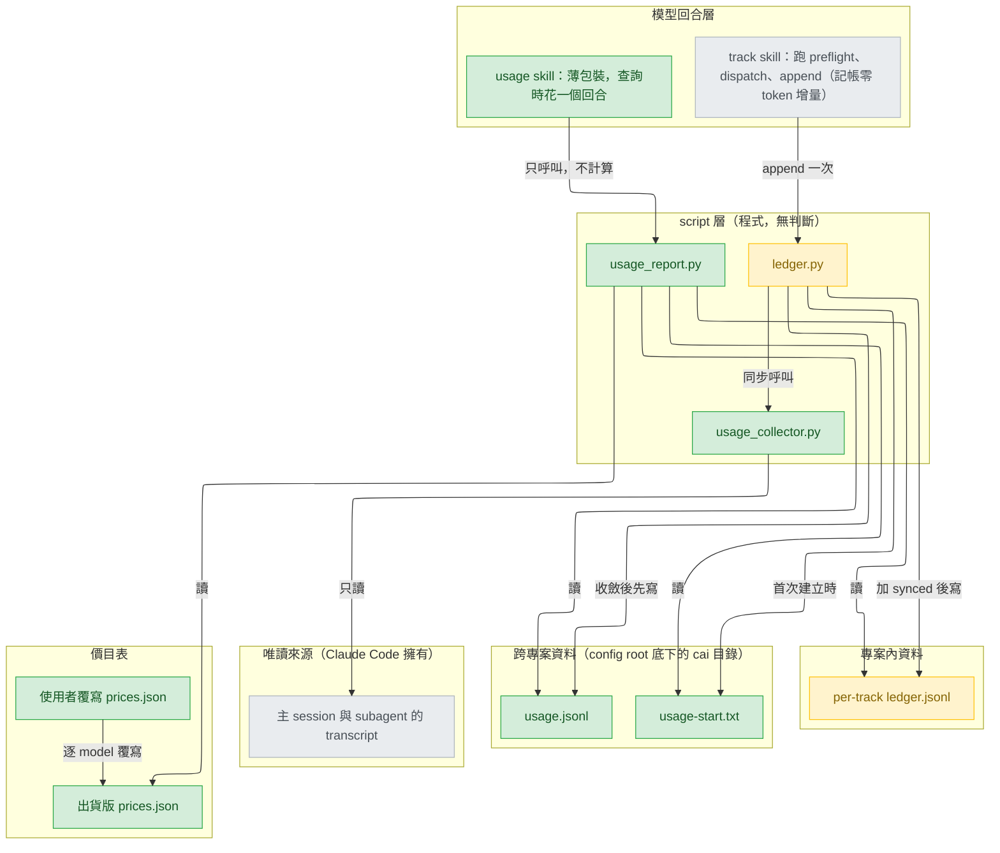
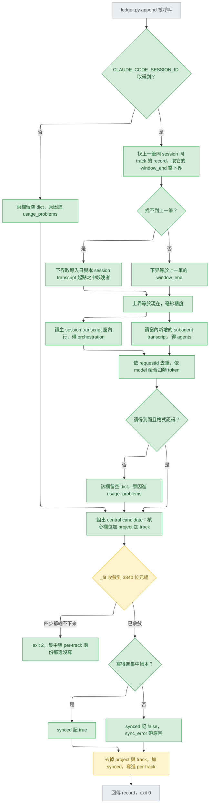
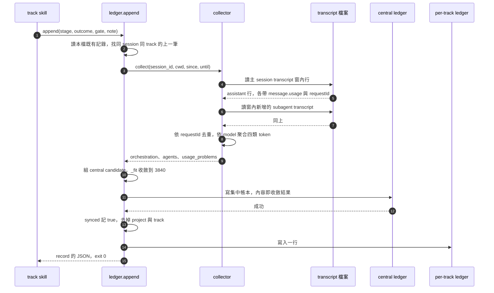
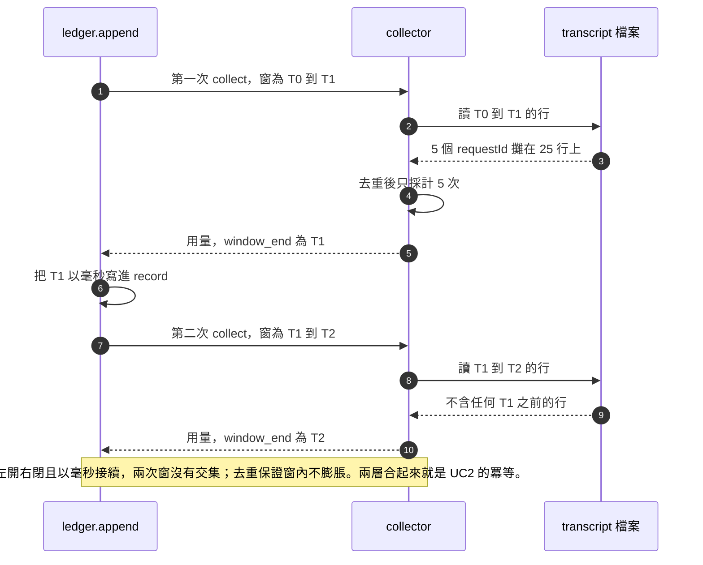
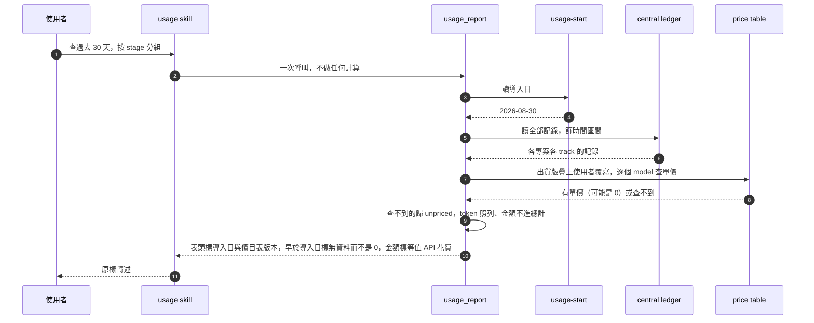
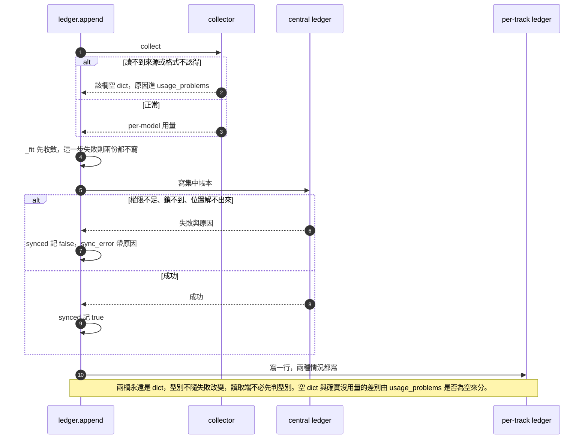

# track usage accounting — detail design

## 維護說明（2026-10-27）

本檔是歷史設計紀錄，保留決策、驗收依據與實作偏差；不是待執行計畫。原簽核狀態、版本、行號及未驗證標記描述撰寫當時，整併不代表重新簽核或重做實測。

名詞：設計立場（stance）說明取捨；決策紀錄（decisions）保存選擇理由；細部設計（detail）記錄建造規格；需求盤點（intake）保存驗收條件。下方英文標題與識別碼沿用原文，便於對照歷史。

實作修正優先於原規格：快取寫入依 1 小時／5 分鐘拆分；用量時間窗按同一對話跨所有工作流程去重；報表以 spend_equiv 標示估算。原進度表與過往價格不作為現況。參見 [`plugins/cai/scripts/ledger.py:142`](../../plugins/cai/scripts/ledger.py#L142)、[`plugins/cai/scripts/usage_collector.py:336`](../../plugins/cai/scripts/usage_collector.py#L336)；後續切行與記錄縮減修正另見 [JSONL 診斷](2026-09-26-jsonl-split-on-newline-diagnosis.md)。

已併入並移除的同主題文件：`2026-08-29-track-usage-accounting-high-level.md`、`2026-08-30-track-usage-accounting-implementation-notes.md`。

補充段落保留原文與原決策編號，避免把不同時點同號的決策當成一項；重複的概覽圖、施工排程與階段交接文字不再複製。

## Reference

High Level Design doc: docs/design/2026-08-30-track-usage-accounting-detail.md
Status: approved 2026-08-30

### Traceability

| From the high-level design | Satisfied by | Status |
|---|---|---|
| UC1 per-model 四類 token | collector 的 `aggregate()`；record 的 `orchestration` 與 `agents` 兩欄；Sequence — UC1 | covered |
| UC2 重跑逐字相同 | `aggregate()` 的 requestId 去重 + D4 的毫秒窗界（窗不重疊）；Sequence — UC2 | covered |
| UC3 單 track 每 stage 與總計 | report 的 `track_report()`；per-track ledger 為唯一來源 | covered |
| UC4 跨專案 7/30/60 天按 stage 分組 | report 的 `range_report()`；集中帳本；Sequence — UC4 | covered |
| UC5 GAP-02 四問 | `range_report()` 的四個欄位：stage、model 數、未定價金額、嘗試次數（後者由既有 `records()` 數 `plugins/cai/scripts/ledger.py:210`） | covered |
| UC6 金額標示等值 API 花費 | report 的表頭常數；D9 | covered |
| UC7 unpriced 不得當 0 | `resolve_price()` 回 `None` 即 unpriced，與單價 0 是兩種結果（D12）；Sequence — UC4 的最後一步 | covered |
| UC8 資料起始日 | `~/.claude/cai/usage-start.txt`；`range_report()` 的表頭與「無資料」列；D10 | covered |
| UC9 集中帳本帶 project 與 track，per-track 仍自足 | 集中記錄多 `project` 與 `track` 兩個欄位；per-track 記錄不引用集中檔；D6 | covered |
| R1 記不成帳一律留痕 | 讀不到 → 該欄為空 dict、原因進 `usage_problems`；寫不進集中帳本 → `synced` 為 false 加 `sync_error`（D6 的寫入順序讓這個標記寫得出來）；Sequence — R1 | covered |
| R2 零 token 成本 | 記帳全部在 `ledger.py append` 這一次既有呼叫內完成，不新增模型回合、不註冊 hook。`/cai:usage` 是查詢入口不是記帳路徑，見 D13 | covered |
| R3 不回填 | collector 的窗下界永不早於導入日標記；Rollout 的「既有資料」段 | covered |
| R4 Windows 與 POSIX、ASCII、無 BOM | 不新增 `.cmd`；新檔皆為 `.py`、`.json` 與一個 `SKILL.md`；`scripts/validate.py:500-503` 與 `scripts/validate.py:510-522` 仍是閘門 | covered |
| R5 集中帳本並發安全 | 沿用 `ledger._write_line()` 的 byte-0 lock（`plugins/cai/scripts/ledger.py:136-166`），且集中記錄與 per-track 記錄寫的是同一份已收斂內容，兩份都在單次原子寫入的尺寸內（D7）；Verification 的併發測試靠 `CAI_USAGE_LEDGER` 把路徑傳給子程序（D14） | covered |

## Requirement

`plugins/cai/scripts/ledger.py:122-124` 的 record 有七個欄位，全部在講「發生了什麼」，沒有一個在講「花了多少」。因此四個問題目前無解：這次嘗試是哪些 model 花的、花了多少 token、多少換算成錢、以及跨專案跨時間的總量。

本設計在**不新增任何模型回合**的前提下補上前三個答案：`ledger.py append` 這一步 track 每次收尾本來就會跑（`plugins/cai/skills/track/SKILL.md:62-66`），記帳掛在它身上，同時把同一筆寫一份到跨專案的集中帳本。查詢由 `/cai:usage` 這個薄包裝 skill 提供，把 token 換算成「等值 API 花費」。

做完的判準是上面 Traceability 表的 14 列，加上 `## Verification` 表逐條的 Green before。

## Glossary

| Term | Definition | Where it lives |
|---|---|---|
| record | ledger 的一行，一次 stage 嘗試的完整紀錄，本設計為它增加用量欄位 | plugins/cai/scripts/ledger.py:122 |
| window | 一次記帳涵蓋的時間區間，左開右閉，下界是同一 session 同一 track 上一筆 record 的 `window_end`，上界是這次記帳的當下 | concept |
| `window_end` | 寫進 record 的毫秒精度時間點，等於該次記帳窗的上界，供下一次記帳當下界用 | new — plugins/cai/scripts/ledger.py |
| `orchestration` | 用量的第一欄，來自主 session 自己那份 transcript 的窗內行。永遠是 dict | new — plugins/cai/scripts/ledger.py |
| `agents` | 用量的第二欄，來自窗內新增的 subagent transcript。永遠是 dict | new — plugins/cai/scripts/ledger.py |
| `usage_problems` | 兄弟欄位，帶取數失敗的原因清單，每一則指名是哪一欄出的問題。空 list 代表兩欄都讀得乾淨 | new — plugins/cai/scripts/ledger.py |
| collector | 讀 transcript、去重、依 model 聚合的新模組，被 `ledger.append()` 同步呼叫 | new — plugins/cai/scripts/usage_collector.py |
| aggregate | collector 的核心函式：吃 transcript 行，吐 per-model 的四類 token 加總 | new — plugins/cai/scripts/usage_collector.py |
| requestId dedup | 同一個 `requestId` 的多行只採計一次，實測不做會膨脹到 5 倍且不報錯 | docs/design/2026-08-30-track-usage-accounting-detail.md:690 |
| encoded project dir | `~/.claude/projects/` 底下的目錄名，工作目錄路徑把非英數字元換成 `-` | concept |
| config root | 集中資料的根，`CLAUDE_CONFIG_DIR` 有值就用它，沒有就用 `~/.claude` | new — plugins/cai/scripts/usage_collector.py |
| central ledger | 跨專案的單一 append-only JSONL，每筆是 per-track record 的已收斂內容加上 `project` 與 `track` | new — ~/.claude/cai/usage.jsonl |
| central candidate | 送進 `_fit` 收斂的那份物件：核心欄位加 `project` 加 `track`，是兩份寫入裡較大的一份，所以拿它當收斂對象 | concept |
| `synced` 與 `sync_error` | per-track record 上的一對欄位，記「這一筆有沒有成功寫進集中帳本」與失敗原因，在 `_fit` 之後才加上 | new — plugins/cai/scripts/ledger.py |
| `usage_collapsed` | 標記：這一筆的 per-model 明細被 `_fit` 第三步收合成總和了 | new — plugins/cai/scripts/ledger.py |
| data start date | 集中帳本第一次建立時寫下的日期，之後不變；報表用它區分「無資料」與 0 | new — ~/.claude/cai/usage-start.txt |
| price table | model 識別字到四類 token 單價的對照資料檔，只在查詢端讀 | new — plugins/cai/prices.json |
| price override | 使用者放在 config root 的價目表，逐 model 覆寫出貨版（D12） | new — ~/.claude/cai/prices.json |
| unpriced | 查詢端的分類：這個 model 在價目表裡**查不到**單價，其 token 照列、金額不計入總計。與「單價是 0」是兩件事 | concept |
| equivalent API spend | 報表金額的口徑：token 乘以價目表單價，訂閱制下不等於實付 | concept |
| report | 讀 per-track ledger、集中帳本與價目表，產出三種查詢輸出的新模組 | new — plugins/cai/scripts/usage_report.py |
| usage skill | 查詢入口 `/cai:usage`，薄包裝：只負責叫 script 與轉述輸出，不做任何計算（D13） | new — plugins/cai/skills/usage/SKILL.md |
| `CAI_USAGE_LEDGER` | 環境變數，覆寫集中帳本的檔案路徑；導入日標記取它的同目錄兄弟檔（D14） | new — plugins/cai/scripts/usage_collector.py |
| `_fit` | 把 record 縮到指定位元組數以內的既有函式，本設計為它加一個收合用量的步驟與一個上限參數 | plugins/cai/scripts/ledger.py:169 |
| show | 既有的人可讀輸出，欄寬固定，本設計以續行方式擴充而不動原本那一行 | plugins/cai/scripts/ledger.py:280 |
| streak | 某 stage 自最後一筆 passed 或 skipped 之後的所有紀錄 | plugins/cai/scripts/ledger.py:240 |
| deviation | 實作偏離本設計時要記的格式，沿用既有定義不另發明 | plugins/cai/skills/track/references/stage-build.md:183 |

## Budgets

| What | Number | Where it comes from |
|---|---|---|
| 單筆 record 編碼後硬上限（位元組） | 4096 | `plugins/cai/scripts/ledger.py:49` 的 `MAX_RECORD`，不改 |
| note 寫入前的預切上限（位元組） | 3840 | `plugins/cai/scripts/ledger.py:50` 的 `MAX_NOTE`，不改（理由見 D5） |
| sync marker 的保留額度（位元組） | 256 | 本文件計算：`synced` 加最長 200 位元組的 `sync_error`，取整留餘裕。它在 `_fit` 之後才加進 per-track 記錄，所以必須先扣起來 |
| `_fit` 的收斂目標（位元組） | 3840 | 4096 減 256。**與上面 `MAX_NOTE` 同為 3840 是巧合**：一個是 note 的預切，一個是整筆記錄的收斂目標，兩者無關 |
| `sync_error` 字串上限（位元組） | 200 | 本文件決定。這個字串由本設計自己產生，可截，不像 note 是別人寫的 |
| `project` 與 `track` 兩欄在本 repo 的實際大小（位元組） | 72 | 本文件計算：`project` 欄 43（JSON 轉義後的 `D:\project\claude-all-in-one`）加 `track` 欄 29（`gap02-usage-ledger`）。深層路徑下這個數字會大很多，後果見 D7 |
| `window_end` 與 `session_id` 兩個新欄位（位元組） | 96 | 本文件計算：毫秒 ISO 時間字串加鍵約 46，session 識別加鍵約 50 |
| 一個 track 的 stage 數 | 6 | `plugins/cai/skills/track/stages.json:2` 的列數 |
| 同時活躍的 track 數上限 | 5 | `plugins/cai/skills/track/SKILL.md:36` |
| 同一 stage 的重試上限（預設） | 5 | `plugins/cai/scripts/preflight.py:30` 的 `DEFAULT_MAX_ATTEMPTS` |
| 2026-08-29 觀察到的相異 model 數 | 7 | 主 session 2026-08-29 實測（M8）。**這是某一天的觀察值，不是上限**——Anthropic 每出一個新版就多一個識別字，這個數字只會成長 |
| 一個 model 在 record 裡佔的位元組（單欄，最長 model 名 25 字元加四個六位數 token 欄位） | 105 | 本文件計算：鍵 28 加值物件 76 加分隔逗號 1，算式見下 |
| 一個 model 兩欄佔的位元組（最壞情況） | 294 | 主 session 2026-08-30 實測。以今天最長的 25 字元識別字計算；**識別字長度本身也是觀察值**，若出現更長的識別字，294 會變大、收合門檻會再往下 |
| 兩欄用量的位元組，實測，今天實際的識別字組合（長短混合） | 1588 | 主 session 2026-08-30 對 `ledger._encode()` 實測，7 個 model 兩欄。除以 7 得每個 model 227 位元組，但那是**今天混合長度的平均，不可當最壞情況用** |
| 兩欄用量的位元組，實測，全部用最長識別字（最壞情況） | 2060 | 主 session 2026-08-30 實測。凡是要表達最壞情況的地方都用這個數字 |
| N2a 選定的長鍵，7 個 model 兩欄的位元組 | 2043 | 主 session 2026-08-30 實測，鍵名為 `input_tokens` 等四個來源欄位名 |
| N2a 未選的短鍵，同樣條件的位元組 | 1483 | 主 session 2026-08-30 實測。短鍵的收合門檻是 17 個 model、note 預算約 1916——長鍵的代價就是少 5 個 model 的餘裕，換到的是與來源逐字相同、對帳不需對照層 |
| 用量進來後 note 還剩的位元組（7 個 model、全為最長識別字） | 1356 | 3840 減 256（sync 保留）減 2060（兩欄用量，最壞）減 96（`window_end` 與 `session_id`）減 72（`project` 與 `track`）。**以今天實際的 1588 計算則為 1828**，兩個數字都留著才看得出差距從哪來 |
| 本 repo 既有 15 筆 ledger 記錄中 note 超過 1356 的筆數 | 3 | 主 session 2026-08-30 實測，三筆分別是 1823、1484、1617 位元組。也就是五分之一的既有 note 在新格式下會被截斷——這是 D-B 的決定性證據 |
| `_fit` 收合步驟被觸發所需的相異 model 數 | 12 | 主 session 2026-08-30 對 limit=3840、note 已清空、artifact 已縮成 basename 的 central candidate 實測：10 個 model 得 3308、11 個得 3598、12 個得 3888——12 超過 3840，收合在這裡觸發 |
| 窗重複涵蓋上限，不修正時（毫秒） | 1000 | 帳本 `ts` 為秒精度（`plugins/cai/scripts/ledger.py:70`），transcript 為毫秒精度 |
| 窗重複涵蓋上限，採 D4 之後（毫秒） | 0 | 窗界以毫秒存進 record，下一個窗從同一個點接續 |
| 記帳耗時實測（毫秒） | 36 | 主 session 2026-08-30 實測：掃本 session 的主 transcript 加 4 個 subagent transcript，共 4,340,033 位元組（4.1 MB），去重後 195 個 requestId |
| 本機最大單一 transcript（MB） | 23 | 主 session 2026-08-30 實測。線性外推約 200 毫秒，仍在下面那條警戒線之內 |
| 記帳耗時警戒線（毫秒） | 500 | 實測 36 毫秒的約 14 倍餘裕。**這不是效能目標，是 tripwire**：超過它代表「每次全掃」這個架構已經不對，該改成增量讀取，而不是把這個數字調大 |
| 2026-08-29 觀察到的本專案 28 天 assistant 行數 | 8477 | 主 session 2026-08-29 實測（M8）。**觀察值，不是界**——它每天成長。單一窗必定小於「一個 session 在保留期內的行數」，而那個數字本設計沒有量到 |
| 集中帳本的修剪門檻 | 0 | 不修剪，append-only，與 per-track ledger 同一取捨 |
| 價目表初版必須解析的 model 識別字數 | 7 | 主 session 2026-08-29 實測（M8）的七個值，含三個別名與一個 `<synthetic>`。同樣是觀察值，價目表要能長 |

**105 的算式。** 最長的實測 model 識別字是 `claude-haiku-4-5-20251001`，25 字元；加上引號與冒號是 28 位元組。值物件 `{"input":999999,"output":999999,"cache_creation":999999,"cache_read":999999}` 是 76 位元組。兩者加一個分隔逗號等於 105。這是**單欄**的數字；兩欄合計的實測最壞值是每個 model 294。

**`_fit` 今天不會拒絕任何東西，這是量出來的。** 主 session 2026-08-30 直接對 `ledger._fit()` 餵資料實測，四個結果：今天的形狀（3800 位元組的 note）寫得進去、不需截斷；加上兩欄 7 個 model 的用量後**仍然寫得進去**，走的是第一個縮減步驟「截 note」；兩欄用量的實際大小是 1588 位元組（全用最長識別字則是 2060）；用最大的 note 實際跑 `append()` 成功，沒有 `LedgerError`。

要走到拒絕那一步，得讓**用量自己**吃掉整個預算——對 4096 上限實測約需 17 個相異 model，對本設計 3840 的收斂目標則是 12 個（實測階梯見上表）。所以「記錄會被拒絕、那次嘗試沒有紀錄、`attempts()` 少算」在今天的數字下**不會發生**，那是一個必須誠實劃掉的假設。

**今天真正會發生的是另一件事。** 導入之後，人寫的 note 會比以前**提早 1588 到 2060 位元組**被截斷，因為用量佔走了那段預算。既有 15 筆記錄裡已經有 3 筆會踩到。這是實測到的行為改變，處置見 D5 末段。

## Design decisions

**D1 — collector 是獨立模組，`ledger.py` 匯入它。** `plugins/cai/scripts/ledger.py:14-19` 立下「這個檔不匯入本 repo 任何東西」的規則，理由寫得很清楚：`track_state → preflight → ledger` 已經是一條鏈，任何一條回指的邊都會成環。新模組是這條鏈的葉子，只被 `ledger` 匯入、自己什麼都不匯入，不成環。條件是那段 docstring 要跟著更新，否則下一個讀者會以為慣例被隨手破壞。

**D2 — 用量不能經由 CLI 傳入。** `tests/test_ledger.py:189-195` 把 `--ts`、`--sha256`、`--attempt` 釘成 usage error，對應的原則是「除了 note 以外沒有一個欄位由模型提供」。用量是可重現的計算，若開一個用量旗標，模型就能寫任何數字進帳本，整份帳本立刻失去它存在的理由。所以 `append()` 自己呼叫 collector。

**D3 — 拿不到 session id 就記空 dict 加原因，而不是不記。** `CLAUDE_CODE_SESSION_ID` 是未記載的行為（高階設計 C21）。取不到時 `orchestration` 與 `agents` 都是空 dict、`usage_problems` 帶原因，`append()` 照常寫記錄。這同時讓既有測試維持可預期：測試環境沒有這個變數，所以每筆都是空 dict 加原因，沒有測試需要造 transcript 就能通過。

**D4 — 窗界以毫秒另存 `window_end`，`ts` 一個字元都不動。** 高階設計留下的秒與毫秒落差有三種解法：把 `ts` 改成毫秒、記下已採計的 requestId、另存毫秒窗界。第一種改的是既有欄位的格式，`tests/test_ledger.py:153` 這類固定字串會跟著壞，而且 `ts` 是別人也在讀的欄位；第二種要存不定長度的 id 集合，直接撞 4096 上限。第三種只加一個定長欄位，且讓相鄰兩個窗**完全接續**：下一個窗的下界就是上一個窗的上界，不重不漏。

**D5 — `_fit` 加兩個新的縮減步驟：截 `usage_problems`、收合用量；順序改成先砍 note、再截 `usage_problems`、再收合用量、最後才簡化 artifact，最後才拒絕（P1 選項 B，`docs/design/2026-09-26-jsonl-split-on-newline-diagnosis.md`）。** 既有砍 note 那一步不動。`usage_problems` 跟 per-model 明細一樣沒有上限——每遇到一則壞行、一則缺時間戳、一個讀不到的檔就多一則——所以它自己也要有縮減步驟：找得到就保留前 K 則、補一則「N more omitted」；收合把 per-model 明細換成該欄四類 token 的總和，並寫上 `usage_collapsed`。原本排第二的「簡化 artifact 成 basename」搬到收合之後：`preflight.py` 的 `artifact_unchanged` 靠記錄上 artifact 的完整路徑（含目錄）去找檔，提早砍成 basename 會讓它在專案子目錄下的檔案找不到而 FAIL，所以這一步要撐到真的沒有其他欄位可縮時才被犧牲。

收合步驟**不是為今天的數字寫的**——Budgets 的實測已經說明今天的形狀根本走不到它。它為的是一件確定會發生的事：**相異 model 數沒有上限**。7 是 2026-08-29 那天的觀察值，每出一個新版就多一個識別字。

**而距離不遠。** 實測的階梯是 10 個 model 得 3308 位元組、11 個得 3598、12 個得 3888——**12 個就超過 3840 的收斂目標**。今天是 7 個。Anthropic 再出三個 model、多兩個別名就到 12。這不是為遙遠未來寫的防禦性程式碼，是**一兩年內就會踩到**的路徑。N2a 選了長鍵（與來源逐字相同）又把這個門檻從短鍵的 17 拉到 12——那是使用者為「對帳不需對照層」付的價，付得清楚。

到那時，用量自己就吃掉整個收斂預算，前兩個步驟全部失效，而那時若沒有第三步，`_fit` 就會回 `None`、`append()` 丟 `LedgerError`（`plugins/cai/scripts/ledger.py:126-128`）、CLI 回 exit 2——一次真實發生的嘗試因此沒有紀錄，`attempts()` 少算，重試上限失效。第三步存在的意義是讓那一天永遠不會到來：收合後的用量只有數十位元組，且收合過的記錄看得出來被收合過，不是 0，也不是靜默（R1）。

**為什麼先砍 note 而不是先收合用量（D-B，使用者 2026-08-30 裁決）。** 這個順序的代價是實測到的：本 repo 既有 15 筆記錄裡有 3 筆的 note 超過 1356 位元組（1823、1484、1617），也就是五分之一的既有 note 在新格式下會被截。使用者知情後仍選這個順序，理由是一個不對稱：**被截的 note 在 `state.md` 的 note 欄與當時的對話裡還有替代來源；被收合的 per-model 明細沒有——它的來源是 transcript，30 天就過期**（高階設計 C14）。截掉可以重建的東西，保住不能重建的東西。

**D6 — 順序是：`_fit` 收斂 → 寫集中 → 定 `synced` → 寫 per-track。** 這個順序由兩個約束夾出來，兩個都不能讓步。

第一個約束來自 R1：「寫不進集中帳本時，在 per-track 那一筆留下未同步標記」。ledger 是 append-only，寫出去的行改不了，所以 `synced` 的值必須在寫 per-track 那一行**之前**就知道——集中寫入因此必須排在 per-track 寫入之前。

第二個約束是尺寸：`_fit` 必須排在**兩次寫入之前**。若 `_fit` 排在集中寫入之後，一旦它回 `None`，集中帳本已經寫進去了而 per-track 沒有——孤兒就不再是罕見的 I/O 意外，而是每一次 `_fit` 拒絕的**必然**產物。把 `_fit` 提前之後，`None` 這條路上兩份都還沒寫，exit 2 之後檔案系統乾乾淨淨。

兩個約束不衝突：`_fit` 在最前面跑完，`synced` 仍然是在集中寫入之後、per-track 寫入之前才決定。剩下的孤兒只有一種來源——集中寫成功之後 per-track 寫入真的失敗（磁碟滿、權限被改），那是真正的 I/O 意外，方向也仍然可接受：per-track 是真相來源（UC9 說刪掉集中檔仍能回答 UC3），衍生資料多一筆比少一筆容易發現。

**D7 — 收斂對象是集中記錄那一份，不是 per-track 那一份。** 集中記錄是 per-track 的內容**再加** `project` 與 `track`，因此它是兩份裡較大的一份。只收斂 per-track 的形狀，等於讓集中記錄在 per-track 剛好卡在上限時必定超過上限——而 `MAX_RECORD` 存在的唯一理由就寫在 `plugins/cai/scripts/ledger.py:45-48`：「A record has to land in one write, and one write is only atomic up to a size the platform decides.」超過就不再是單次原子寫入，直接違反 R5。

所以 `_fit` 收斂的是 central candidate，目標 3840 位元組，也就是 `MAX_RECORD` 減去 sync marker 的保留額度 256。兩份寫入因此都在 4096 之內：集中那份就是收斂結果本身（3840 以內）；per-track 那份是收斂結果**去掉** `project` 與 `track`、**加上** `synced` 與 `sync_error`（最多 256），所以最壞情況是 3840 減 72 加 256 等於 4024。

**4024 這個算式的前提是收斂已經成功。** 未收斂的記錄不適用——主 session 2026-08-30 拿一個未收斂的 15-model 記錄實測得 4930 位元組，那不是反例，那種記錄本來就會先被第三步收合掉。算式描述的是 `_fit` 回傳成功之後的狀態，不是任意一份候選記錄的狀態。

兩份寫的是同一份已收斂的核心內容，所以 note 在兩邊逐字一致，不會出現「集中版被截得比較短」這種對不起來的情況。

**深層專案路徑的後果，方向與直覺相反。** `project` 欄越長，per-track 那份被**減掉**的越多，所以 per-track 反而更小：以 `project` 加 `track` 合計 300 位元組估，per-track 是 3840 減 300 加 256 等於 3796，比本 repo 的 4024 更安全。深層路徑真正的代價在另一邊——它吃掉 central candidate 的收斂預算，**讓收合更早觸發**，也就是 12 這個門檻會往下掉。所以路徑長度影響的是「什麼時候開始只剩總和」，不是「會不會超過 4096」。

集中帳本的並發安全沿用 `ledger._write_line()`：R5 的情境跟 per-track 完全一樣，而那一題已經被解過，連 Windows 上 `O_APPEND` 不原子這件事都被實測過（`plugins/cai/scripts/ledger.py:136-166`，測試在 `tests/test_ledger_concurrent.py:42`）。集中帳本被更多程序寫，只是同一個問題的更大規模，不是另一個問題。

**D8 — `show` 用續行擴充，不動既有那一行。** `plugins/cai/scripts/ledger.py:291-295` 是固定欄寬的單行輸出，把 per-model 明細塞進去會讓每一行變成幾百字元。改法是原本那一行原封不動，在它下面加縮排續行印用量。既有三個測試（`tests/test_ledger.py:229-245`、`tests/test_ledger.py:114-122`、`tests/test_cli_encoding.py:53-63`）都是子字串斷言，續行不會動到它們。

**D9 — 金額只在 report 裡出現，帳本裡沒有錢。** 高階設計 Decision 5 已裁決。實作口徑：report 每一處印金額都連著印口徑字樣，且印出它用的價目表版本（含使用者覆寫了幾筆，見 D12），否則「不同日子查給出不同金額」在使用者眼裡是無法解釋的差異。

**D10 — 導入日是寫下來的，不是推出來的。** 集中帳本第一次建立時同時寫 `~/.claude/cai/usage-start.txt`；報表讀它。用「帳本最早一筆的時間」推導在帳本為空時給不出日期，也分不出「還沒裝」與「裝了沒跑過」——而 UC8 的判準要的正是後者也顯示得出來。

**D11 — 缺欄位一律視為「沒有資料」，永不視為 0。** 既有兩條 track 的 ledger.jsonl 沒有任何用量欄位。`records()` 全程用 `.get()`（`plugins/cai/scripts/ledger.py:230-237`），讀舊記錄不會壞；report 遇到沒有用量欄的記錄，把它算進「未涵蓋」而不是加 0。這條同時服務 R3（不回填）與 UC8。

**D12 — 價目表逐 model 覆寫，不是整份取代；`<synthetic>` 是 priced 且單價為 0。** 出貨版在 `plugins/cai/prices.json`，使用者版在 `~/.claude/cai/prices.json`。合併規則是**以 model 識別字為鍵逐筆覆寫**：使用者檔裡有的識別字用使用者的單價，沒有的沿用出貨版。選這個而不是整份取代，是因為 N4 的理由（「價格變了使用者自己改不必等發版」）只有在使用者能只寫一筆時才成立；整份取代等於逼他每次發版都重抄一份完整表，而抄漏的那幾筆會靜默變成 unpriced。使用者檔不存在、讀不開、或不是物件時，一律當成沒有覆寫並在報表表頭說明，不讓一個壞掉的覆寫檔把整份價目表變成 unpriced。

`<synthetic>` 不需要第三種分類，資料自己回答了這題：主 session 2026-08-30 把所有 `<synthetic>` 記錄撈出來看，它們是 Claude Code 自己產生的通知訊息（內容形如 `Please run /login — API Error: 401`、`You've hit your session limit`），**四類 token 全部是 0**，根本不是 API 呼叫。歸 0 或歸 unpriced 的金額總計相同（0 乘任何單價都是 0），但歸 unpriced 會讓「多少 spend 未定價」混進一個定義上就是零的項目，**反而降低 AC3 的誠實度**。所以出貨版明確給它一列單價 0——它是 priced，不是 unpriced，`resolve_price()` 回一個 0 而不是 `None`。這個區別就是 UC7 的型別落點：`None` 是「不知道」，0 是「知道，而且是零」。

**D13 — `/cai:usage` 是薄包裝，計算全部留在 script 裡。** skill 只負責把使用者的問法轉成一次 script 呼叫、再把 script 印的東西轉述出來；任何加總、去重、查價、換算都不准搬進 skill 的 prose。理由有兩層：一是可測——script 的輸出進得了 pytest，skill 的輸出進不了；二是可重現——同一份帳本查兩次必須逐字相同，而模型當場算的數字做不到這件事，那正是 GAP-03 整節在講的問題（`docs/design/2026-08-29-capability-gap-analysis.md:147`）。

叫一次 `/cai:usage` 會花一個模型回合，這**不牴觸 R2**：R2 管的是「記帳不得佔用模型回合」，而記帳走的是 `ledger.py append`，與這個 skill 無關。查詢是使用者主動發起的動作，本來就在他的預期內。

**D14 — 覆寫用環境變數 `CAI_USAGE_LEDGER`，完整支援而不是測試後門。** 命名對齊既有的 `CAI_TRACK_MAX_ATTEMPTS`（`plugins/cai/scripts/preflight.py:31`）。它必須是真正支援的介面，理由是測試本身逼出來的：`## Verification` 裡 R5 那條要 spawn 8 個子程序寫同一個集中帳本（形狀照 `tests/test_ledger_concurrent.py:47-51`），R1 那條要把路徑指到不可寫的位置——**子程序吃不到 pytest 的 monkeypatch**，路徑只能靠環境變數傳進去。一個「只有測試在用」的旗標和一個「使用者也能用」的旗標在這裡是同一段程式碼，把它標成內部反而是自欺。

它指的是**集中帳本的檔案路徑**；導入日標記取同目錄的兄弟檔，這樣一個變數就把兩個檔一起搬走，不必再開第二個變數。

## Diagrams

### Architecture



### Component

```mermaid
---
config:
  flowchart:
    defaultRenderer: "elk"
---
flowchart LR
  SK["track skill"] -- "append(stage, outcome, gate, note)" --> AP["ledger.append()"]
  AP -- "collect(session_id, cwd, since, until)" --> CO["collector.collect()"]
  CO -- "session_transcript 與 subagent_transcripts" --> LO["路徑解析：encoded project dir"]
  CO -- "aggregate(lines)" --> AG["requestId 去重、依 model 聚合"]
  AG -- "orchestration、agents、usage_problems" --> AP
  AP -- "_fit(central_candidate, 3840)" --> FT["四步縮減：note、artifact、收合用量、拒絕"]
  FT -- "已收斂的核心內容" --> AP
  AP -- "_write_line 到 CAI_USAGE_LEDGER" --> CL["central ledger"]
  AP -- "加 synced 後 _write_line 到 track dir" --> PT["per-track ledger"]
  SU["usage skill"] -- "一次呼叫，不計算" --> RP["usage_report.py"]
  RP -- "track_report()" --> PT
  RP -- "range_report()" --> CL
  RP -- "resolve_price(model)" --> PR["price table：出貨版加逐 model 覆寫"]
  classDef existing fill:#e9ecef,stroke:#adb5bd,color:#495057
  classDef modified fill:#fff3cd,stroke:#ffc107,color:#856404
  classDef added fill:#d4edda,stroke:#28a745,color:#155724
  class SK existing
  class AP,FT,PT modified
  class CO,LO,AG,CL,SU,RP,PR added
```



### Flow



### Sequence — UC1



### Sequence — UC2

同一份來源重跑要逐字相同。這張圖畫的是「為什麼第二次不會多算」。



### Sequence — UC4



### Sequence — R1

兩條失敗路徑畫在同一張，因為它們的共通點才是重點：兩種都留痕，兩種都不寫 0。



**捨棄的 sequence 與理由。** 高階設計有 UC1–UC9 與 R1–R5 共 14 條，上限是六張，這裡畫了四張。捨棄的十條分兩類：**已被上面四張涵蓋呼叫順序的**——UC3 與 UC5 的呼叫順序與 UC4 完全相同，只差 report 讀的是 per-track 還是集中檔；UC9 是 UC1 的寫入端，順序已在 UC1 圖裡；UC6 與 UC7 是 UC4 圖最後兩步的內容，已標在該圖上。**根本沒有呼叫順序可畫的**——UC8 是報表表頭的一個欄位；R2 是「沒有新增任何一步」，畫出來會是一張空圖；R3 是窗下界的一個比較；R4 是 CI 檢查；R5 的並發行為在既有的 `tests/test_ledger_concurrent.py:42` 已有可執行的規格，圖不會比它更精確。

## Implementation spec

### usage_collector.py

- **Responsibility** — 給定一個 session 與一段時間窗，回答這段時間內主 session 與其 subagent 各用掉多少 token，依 model 分開。
- **Interface**
  ```
  collect(session_id, cwd, since, until, projects_root=None)
      -> (orchestration, agents, problems)
  session_transcript(projects_root, cwd, session_id) -> str or None
  subagent_transcripts(projects_root, cwd, session_id, since, until) -> list of str
  aggregate(line_iter) -> dict
  encoded_project_dir(cwd) -> str
  config_root() -> str
  central_ledger_path() -> str
  data_start_path() -> str
  session_id_from_env() -> str or None
  ```
  函式與參數名屬模組內部，可自由更名，不影響任何已出貨的資料格式；命名沿用本目錄既有風格（`plugins/cai/scripts/ledger.py:65-88`）。`central_ledger_path()` 讀 `CAI_USAGE_LEDGER`，沒設則回 config root 底下的 `cai/usage.jsonl`；`data_start_path()` 一律回前者的同目錄兄弟檔（D14）。
- **Data**
  - 進：`session_id` 字串；`cwd` 絕對路徑字串；`since` 與 `until` 為毫秒精度的 UTC 時間字串（`since` 可為 `None`，代表「這個 session 的第一次」）；`projects_root` 可選，僅測試會傳。
  - 出：`orchestration` 與 `agents` 皆為 `{model_id: {四個 token 鍵: int}}`，四個鍵是 `input_tokens`、`output_tokens`、`cache_creation_input_tokens`、`cache_read_input_tokens`，與 transcript 的 `message.usage` **逐字相同**（N2a），固定、缺一不可、值為非負整數。**兩者永遠是 dict**，讀不到就是空 dict，型別不隨失敗改變（N2b）；**model 數不設上限**，7 只是 2026-08-29 的觀察值。`problems` 是原因字串的 list，每一則指名是哪一欄出的問題，正常時為空 list。
  - 空 dict 與「讀不到」是兩件事，差別在 `problems` 是否為空：兩者都空代表這段時間確實沒有用量；dict 空而 `problems` 非空代表讀不到、不知道有沒有。
- **Errors** — 任何 OSError、JSON 解析錯、欄位缺失都不往外丟：轉成 `problems` 裡的一個字串，該來源當作沒有資料。目錄不存在、檔案被鎖、`message.usage` 缺欄位、`requestId` 缺席各自有可辨識的字串。這是 R1 的落點。
- **Concurrency** — 只讀，不寫，沒有共享狀態，重跑同一組參數結果相同。Claude Code 可能正在往同一份 transcript 追加，所以讀取要能容忍最後一行不完整（照 `plugins/cai/scripts/ledger.py:222-231` 既有的壞行處理方式：跳過並記進 `problems`，不拋例外）。
- **Observability** — 正常時什麼都不印。失敗時不自己印，把原因交給 `ledger.append()` 寫進記錄——這個模組沒有 stdout。
- **Where it lives** — `plugins/cai/scripts/usage_collector.py`，新檔。
- **What it reuses** — 路徑解析規則來自高階設計 C5；壞行容忍照抄 `plugins/cai/scripts/ledger.py:222-231`；UTF-8 讀取方式同 `plugins/cai/scripts/ledger.py:216-222`。

### ledger.append（既有，修改）

- **Responsibility** — 維持原職責（寫一筆嘗試紀錄），並在寫之前把這次的用量算出來、把同一份已收斂的內容送進集中帳本。
- **Interface**
  ```
  append(track_dir, stage, outcome, artifact=None, gate="auto", note="") -> dict
  ```
  簽名一個字都不變。用量與 session 由函式內部取得，不從參數進來（D2）。
- **Data** — 回傳的 dict 在既有七個鍵（`plugins/cai/scripts/ledger.py:122-124`）之外多七個：`orchestration`、`agents`、`usage_problems`、`window_end`、`session_id`、`synced`、`sync_error`；收合發生時再多一個 `usage_collapsed`。集中帳本那一份是同樣的內容**加** `project` 與 `track`、**減** `synced` 與 `sync_error`。
- **Errors** — 既有的四種 `LedgerError`（未知 outcome、未知 gate、未知 stage、artifact 讀不到）行為不變。新增的失敗全部不丟例外：collector 失敗進 `usage_problems`、集中帳本失敗進 `sync_error`。唯一新增的致命路徑是 `_fit` 四步都縮不下來——那時**兩份都還沒有寫**（D6），exit 2 之後檔案系統維持原狀。
- **Concurrency** — 對 per-track 檔的保證不變（`plugins/cai/scripts/ledger.py:136-166`）。集中帳本寫入用同一個 `_write_line()`，因此同樣安全，且 D7 保證兩份都在單次原子寫入的尺寸內。兩次寫入不是一個交易：集中寫成功之後 per-track 寫入若真的失敗（磁碟滿、權限被改），會留下孤兒；`_fit` 提前之後這是孤兒的唯一來源。
- **Observability** — stdout 仍只印那一行 record JSON（`plugins/cai/scripts/ledger.py:342`）。`_fit` 收合用量時的說明走 stderr，與既有的截斷說明同一條路（`plugins/cai/scripts/ledger.py:129-130`）。
- **Where it lives** — `plugins/cai/scripts/ledger.py`，已存在。
- **What it reuses** — `_write_line()`、`_fit()`、`_encode()`、`_now()` 全部沿用。

### `_fit`（既有，修改）

- **Responsibility** — 把一份記錄縮到指定的位元組數以內，且永遠不因為太大而讓一次真實發生的嘗試沒有紀錄。
- **Interface** — `_fit(record, limit=MAX_RECORD) -> (line_bytes or None, explanation)`。**多一個有預設值的參數**：呼叫端傳 3840，既有呼叫方式不傳則行為與今天相同。
- **Data** — 收斂對象是 central candidate（D7）。多一個縮減步驟排在既有兩步之後：per-model 明細換成該欄四類 token 的總和，並設 `usage_collapsed`。
- **Errors** — 只有第四步（收合後仍超過）才回 `None`。以 Budgets 的實測，今天的形狀連第三步都走不到；第三步在 12 個相異 model 時被觸發，深層專案路徑會讓這個門檻再往下。回 `None` 時呼叫端還沒寫任何一份檔案。
- **Concurrency** — 純函式，無狀態。
- **Observability** — 回傳的 explanation 字串多一種：說明明細被收合。
- **Where it lives** — `plugins/cai/scripts/ledger.py:169`。
- **What it reuses** — 既有的 `_cut()` 與 `TRUNCATED` 標記（`plugins/cai/scripts/ledger.py:51`、`plugins/cai/scripts/ledger.py:78-82`）。

### show（既有，修改）

- **Responsibility** — 讓人直接讀完整帳本，現在包含用量。
- **Interface** — `show(track_dir, stage=None) -> int`，簽名不變。
- **Data** — 既有那一行（`plugins/cai/scripts/ledger.py:291-295`）逐字不變；有用量的記錄在它下面加縮排續行，`orchestration` 與 `agents` 各一段，每個 model 一行。沒有用量欄的舊記錄不印續行；`usage_problems` 非空時印出來。
- **Errors** — 無新增；缺欄位一律當「沒有這一段」而不是 0（D11）。
- **Concurrency** — 只讀。
- **Observability** — 這個函式就是輸出本身。
- **Where it lives** — `plugins/cai/scripts/ledger.py:280`。
- **What it reuses** — 既有的 UTF-8 stdout 重設（`plugins/cai/scripts/ledger.py:315-316`），這是 `tests/test_cli_encoding.py:53` 在守的行為。

### usage_report.py

- **Responsibility** — 把帳本裡的 token 換算成等值 API 花費，並回答單 track、跨專案兩類查詢。
- **Interface**
  ```
  track_report(track_dir, prices) -> str
  range_report(central_path, days, prices) -> str
  load_prices(shipped_path, override_path) -> dict
  resolve_price(model_id, prices) -> dict or None
  data_start_date(path) -> str or None
  ```
- **Data**
  - `track_report`：每個 stage 一列，欄位為 stage、嘗試次數、相異 model 數、`orchestration` token、`agents` token、等值花費、未定價金額；最後一列總計。
  - `range_report`：先按 stage 分組，每組跨全部專案；表頭帶導入日、價目表版本與覆寫筆數、口徑字樣。
  - `load_prices` 逐 model 覆寫（D12），回傳的 dict 另帶版本字串與覆寫筆數供表頭用。
  - `resolve_price` 回 `None` 代表 unpriced，回一個四類單價的 dict（其中可以全是 0，例如 `<synthetic>`）代表 priced——**`None` 與 0 是兩種結果**，這個型別上的區別就是 UC7 的落點。
- **Errors** — 集中帳本不存在則印「尚未有跨專案資料」與導入日，exit 0（沒有資料不是錯誤）。出貨版價目表讀不到則全部 model 皆 unpriced 並在表頭明說；使用者覆寫檔讀不到或不是物件則忽略覆寫、表頭說明，**不讓一個壞掉的覆寫檔把整份表變成 unpriced**（D12）。查詢區間早於導入日則該段標「無資料」。遇到 `usage_collapsed` 的記錄，per-model 那一層答不出來，報表要說這一筆只有總和。
- **Concurrency** — 只讀。可能與 `ledger.append` 的寫入並行，因此讀到最後一行不完整時照 `plugins/cai/scripts/ledger.py:222-231` 的方式跳過並在輸出裡註記。
- **Observability** — 輸出即報表；stdout 需與其他三個 CLI 一樣重設為 UTF-8（`plugins/cai/scripts/ledger.py:315-316`），否則 Windows 上被管線接走時無法解碼，這是 `tests/test_cli_encoding.py:1-11` 記下的教訓。
- **Where it lives** — `plugins/cai/scripts/usage_report.py`，新檔。
- **What it reuses** — `ledger.records()` 讀 per-track（`plugins/cai/scripts/ledger.py:210`）；`ledger.stage_ids()` 取 stage 順序（`plugins/cai/scripts/ledger.py:60`）；collector 的 `central_ledger_path()` 與 `data_start_path()`。

### usage skill

- **Responsibility** — 把使用者的問法轉成一次 script 呼叫，並轉述輸出。不做任何計算（D13）。
- **Interface** — `/cai:usage [track|7|30|60]`；skill body 呼叫 `${CLAUDE_PLUGIN_ROOT}/scripts/usage_report.py`，**必須用這個變數而不是 repo 內路徑**，因為 `scripts/validate.py:531-534` 會擋掉後者（裝在 marketplace cache 的使用者跑不動）。
- **Data** — 進：使用者的自然語言問法。出：script 的 stdout，原樣轉述。
- **Errors** — script 非零退出時把 stderr 原樣轉述，不自行解釋或補算。
- **Concurrency** — 無狀態。
- **Observability** — 就是它轉述的那段輸出。
- **Where it lives** — `plugins/cai/skills/usage/SKILL.md`，新檔。frontmatter 需要 `name` 與 `description`（`scripts/validate.py:124-126`），並在 `plugins/cai/models.json` 的 `assignments` 加一列 `skills/usage/SKILL.md`，否則 `scripts/validate.py:1171-1175` 會判它 unassigned。tier 取 `chore`——它做的正是「執行一個已知指令並轉述輸出」。body **不得出現任何 model 家族名**（`scripts/validate.py:1183-1195` 會擋）。
- **What it reuses** — 其他 skill 的 frontmatter 形狀，例如 `plugins/cai/skills/track/SKILL.md:1-5`。

### price table（資料檔）

- **Responsibility** — 把 model 識別字換成四類 token 的單價，並讓「查不到」與「單價是 0」是兩種可分辨的結果。
- **Interface** — 資料檔，無函式；由 `load_prices()` 讀兩份再逐 model 合併。
- **Data** — 每個條目要能表達四類 token 各自的單價（cache 讀寫與 input、output 單價不同），另有一個版本字串供表頭用。必須涵蓋 2026-08-29 實測的七個識別字：三個完整版本名、三個別名、一個 `<synthetic>`（單價 0，D12）；**而且必須能長**——識別字集合會隨新版增加。別名解析是查表不是前綴比對，`sonnet` 對到哪一個完整版本是資料，不是規則。
- **Errors** — 查不到即 unpriced（`resolve_price` 回 `None`），永不退回 0（UC7）。
- **Concurrency** — 只讀。
- **Observability** — 版本字串與覆寫筆數必須印在報表表頭（D9）。
- **Where it lives** — 出貨版 `plugins/cai/prices.json`（與 `plugins/cai/models.json` 同層，沿用該慣例）；使用者覆寫 `~/.claude/cai/prices.json`。
- **What it reuses** — 檔案形狀參考 `plugins/cai/models.json:24-37` 的「一個 JSON 物件、鍵是識別字、值是設定」，但那是 tier 到別名，不是別名到單價，只能當格式參考。

## Naming

| Name | What it is | Chosen by |
|---|---|---|
| `orchestration` | record 裡主 session 用量那一欄 | the user, 2026-08-30（N1） |
| `agents` | record 裡 subagent 用量那一欄 | the user, 2026-08-30（N1） |
| `input_tokens`、`output_tokens`、`cache_creation_input_tokens`、`cache_read_input_tokens` | 兩欄內部的四個 token 鍵，與 transcript 的 `message.usage` 逐字相同 | the user, 2026-08-30（N2a） |
| 兩欄永遠是 dict，失敗原因另設兄弟欄位 | record 的型別約定 | the user, 2026-08-30（N2b） |
| config root 底下的 `cai` 目錄 | 集中帳本與導入日標記的目錄 | the user, 2026-08-30（N3） |
| `CAI_USAGE_LEDGER` | 覆寫集中帳本路徑的環境變數，完整支援 | the user, 2026-08-30（N6）；風格對齊 `plugins/cai/scripts/preflight.py:31` |
| 出貨版價目表加使用者覆寫 | 價目表的兩層落點 | the user, 2026-08-30（N4） |
| `/cai:usage` | 查詢入口，薄包裝 skill | the user, 2026-08-30（N5） |
| `<synthetic>` 單價 0，屬 priced | 價目表的一列 | 資料本身回答（D12）：四類 token 皆為 0，主 session 2026-08-30 實測 |
| `usage.jsonl`、`usage-start.txt`、`prices.json` | config root 的 `cai` 目錄與 plugin 根目錄底下的檔名 | 使用者把這一層授權為內部細節（2026-08-30）；`prices.json` 沿用 `plugins/cai/models.json` 的同層慣例 |
| `usage_problems`、`window_end`、`session_id`、`synced`、`sync_error`、`usage_collapsed`、`project`、`track` | record 的其餘新欄位名 | the user, 2026-08-30 — 本文件依 N1、N2a、N2b 的詞彙推導後逐一提交確認；採用的理由是它們與 N2b 選定的模式一致：旗標與原因分成兩個欄位、型別穩定（`synced` 恆為 bool、`sync_error` 恆為字串或缺席） |
| `usage_collector.py`、`usage_report.py`、`skills/usage/` | 新檔與新目錄名 | follows the convention at `plugins/cai/scripts/ledger.py:1` 與 `plugins/cai/skills/track/SKILL.md:1` |
| record 的既有七個鍵 | `ts`、`stage`、`outcome`、`artifact`、`sha256`、`gate`、`note` | follows `plugins/cai/scripts/ledger.py:122-124`，本設計不動 |
| collector 與 report 的內部函式名、`_fit` 新增參數名 | 模組內部，改名不影響任何已出貨格式 | follows `plugins/cai/scripts/ledger.py:65-88` 的既有風格 |
| `CAI_TRACK_MAX_ATTEMPTS` | 既有環境變數，本設計不動 | `plugins/cai/scripts/preflight.py:31` |

**為什麼 N1 選 `agents` 而不是 `stage`。** record 裡已經有一個叫 `stage` 的鍵（`plugins/cai/scripts/ledger.py:122`），值是 stage id；同一個 JSON 物件裡不可能有兩個同名鍵。`orchestration` 與 `agents` 依角色命名，兩邊對稱且都不撞名。

## Change points

| Path | Change | Exists today |
|---|---|---|
| `plugins/cai/scripts/ledger.py` | `append()` 呼叫 collector；record 多七到八個欄位；`_fit` 多一個上限參數與第四步；寫入順序改為收斂、寫集中、定 `synced`、寫 per-track；`show` 加續行；模組 docstring 的「不匯入本 repo」那段要改（D1） | yes |
| `plugins/cai/scripts/usage_collector.py` | 新模組，零相依 | no |
| `plugins/cai/scripts/usage_report.py` | 新模組，被 skill 呼叫 | no |
| `plugins/cai/prices.json` | 出貨版價目表，含 `<synthetic>` 單價 0 | no |
| `plugins/cai/skills/usage/SKILL.md` | 新 skill，薄包裝；frontmatter 要 `name` 與 `description`（`scripts/validate.py:124-126`）；body 用 `${CLAUDE_PLUGIN_ROOT}/scripts/...`（`scripts/validate.py:531-534`）；不得出現 model 家族名（`scripts/validate.py:1183-1195`） | no |
| `plugins/cai/models.json` | `assignments` 加一列 `skills/usage/SKILL.md` 對到 `chore`，否則 `scripts/validate.py:1171-1175` 判它 unassigned；之後跑 `python plugins/cai/scripts/gen-models.py` 寫回 frontmatter，`scripts/validate.py:1130-1133` 會檢查有沒有 drift | yes |
| `tests/test_usage_collector.py` | collector 的單元測試，含 fixture transcript | no |
| `tests/test_ledger_usage.py` | record 新欄位、`_fit` 第四步與上限參數、兩份寫入的尺寸、深層路徑、`show` 續行 | no |
| `tests/test_usage_report.py` | 三種查詢輸出、unpriced 與單價 0 的分別、價目表合併、導入日 | no |
| `plugins/cai/skills/track/SKILL.md` | 不動。append 的指令一個字都沒變；若日後想在這裡提 `/cai:usage`，路徑必須寫成 `${CLAUDE_PLUGIN_ROOT}/scripts/...` | yes |
| `scripts/validate.py` | **不動。** `scripts/validate.py:122` 是 `glob.glob` 而不是手寫清單，新 skill 自動被納入；本 repo 也沒有 skill 數量的硬編碼檢查（`scripts/validate.py:462` 的固定數量只針對 `agents/`） | yes |
| `plugins/cai/scripts/gen-commands.py` | **不動，也不必重跑。** 它的唯一輸入是 `skills/refactor/references/catalog-index.md`（`plugins/cai/scripts/gen-commands.py:15`），輸出只有 `refactoring-catalog/`（`plugins/cai/scripts/gen-commands.py:26`），與一般 skill 無關 | yes |
| `plugins/cai/hooks/hooks.json` | 不動。本設計零 hook | yes |
| `.gitignore` | 不動。集中帳本在專案外，per-track 已被 `.gitignore:11` 蓋住 | yes |

**新相依：無。** 本 repo 的 script 全部零外部相依（`plugins/cai/scripts/ledger.py:2` 的「Zero deps」），本設計需要的 JSON 解析、時間處理、路徑處理標準庫都有；唯一會誘人加相依的是時間字串解析，`datetime.fromisoformat` 已足夠。

## Failure modes

| Situation | What happens | What the caller sees |
|---|---|---|
| `CLAUDE_CODE_SESSION_ID` 不存在（改版移除、非 Claude Code 環境、測試） | 不取數，兩欄留空 dict，原因進 `usage_problems`；記錄照寫 | record 照樣寫出，`usage_problems` 說 no session id；exit 0 |
| transcript 目錄或檔案不存在 | 該來源當作沒有資料，原因進 `usage_problems` | 該欄空 dict，原因指名哪個路徑 |
| transcript 格式改了，`message.usage` 認不得（高階設計 C6） | 認不得的行跳過，計數與原因一起回報 | 該欄空 dict，`usage_problems` 說明認不得的行數 |
| transcript 最後一行寫到一半 | 跳過該行，記進 `usage_problems`，其餘照算 | 用量正常，`usage_problems` 註明跳過一行 |
| `requestId` 欄位缺席 | 該行無法去重，不採計並記原因；不猜、不當成新的一次 | 該欄用量偏低且明說有幾行無法去重 |
| note 加用量超過收斂目標（**今天就會發生**，既有 15 筆有 3 筆會踩到） | `_fit` 第一步截 note，用量完整保留（D5 的不對稱理由） | exit 0，stderr 說明 note 被截；note 比導入前提早 1588 到 2060 位元組被截 |
| 相異 model 數成長到 12 個，用量自己吃掉整個收斂預算 | 前兩步失效，第三步把 per-model 明細收合成總和並設 `usage_collapsed` | exit 0，stderr 說明明細被收合；報表對這一筆只給總和 |
| 專案路徑很深，`project` 欄位很長 | 吃掉 central candidate 的收斂預算，**收合比 12 個 model 更早觸發**；per-track 那份因為要減掉 `project` 與 `track`，反而更小 | exit 0；提早只剩總和，但兩份都不會超過 4096 |
| 全部步驟之後仍超過收斂目標 | `_fit` 回 `None`，`append()` 丟 `LedgerError`，**兩份都還沒寫**；單是 `usage_problems` 爆量不會走到這一列——它自己的截斷步驟先把清單縮短，仍是 exit 0 | exit 2；檔案系統維持原狀，不產生孤兒 |
| 集中帳本所在目錄不可寫、被鎖、位置解不出來 | per-track 照寫，`synced` 記 false、`sync_error` 帶原因 | exit 0；跨專案報表把這一筆算成未涵蓋而不是 0 |
| 集中寫成功之後 per-track 寫入真的失敗（磁碟滿、權限被改） | 集中帳本多一筆 per-track 沒有的孤兒。`_fit` 提前之後這是孤兒的唯一來源 | `ledger.py append` exit 2 報錯，人會看到；報表可由 `project` 加 `track` 加 `ts` 比對出來 |
| 舊 track 的 ledger 沒有用量欄位 | `records()` 用 `.get()` 讀不會壞；report 算成未涵蓋 | 舊記錄照常顯示，用量欄留白不是 0 |
| 出貨版價目表讀不到或解不開 | 全部 model 視為 unpriced | 報表表頭明說價目表讀不到，金額欄空白 |
| 使用者覆寫檔壞掉或不是物件 | 忽略覆寫，只用出貨版（D12） | 表頭說明覆寫被忽略；**不會因此把整份表變成 unpriced** |
| 價目表沒有的新 model（新版上市，價目表還沒更新） | 該 model 歸 unpriced，token 照列 | 未定價金額欄多一筆；補上價格之後重查就有了（D9 的查詢時計價） |
| `<synthetic>` 記錄 | 出貨版給它單價 0，屬 priced | 金額 0，**不進未定價計數**——它的四類 token 本來就是 0，混進 unpriced 會降低 AC3 的誠實度（D12） |
| 查詢區間早於導入日 | 該段標「無資料」 | 不出現 0，不會被誤讀成那段沒花錢 |
| 兩個 session 同時推同一條 track | 各自的窗只掃各自 session 的 transcript，不重疊 | 兩筆記錄各自正確；集中帳本靠 `_write_line` 的鎖不交錯 |

## Rollout

**能不能分批出，最小有用的第一塊是什麼。** 能。第一塊是 collector 加 record 新欄位加 `show` 續行——出到這裡就已經滿足 UC1、UC2、R1 的讀取端與 R2，使用者可以在自己的 track 裡看到用量，而集中帳本與報表都還沒出。第二塊是集中帳本、導入日標記與 `CAI_USAGE_LEDGER`（UC9 與 UC8 的資料端），`_fit` 的上限參數與 D7 的收斂對象也在這一塊落地。第三塊是價目表、`usage_report.py` 與 `/cai:usage`（UC3 到 UC7）。三塊之間的介面在 `## Implementation spec` 已經定死，可以分開合併。

**既有資料怎麼辦：不遷移、不回填。** 這是使用者已裁決的（高階設計 R3）。既有兩條 track 的 `ledger.jsonl` 沒有任何用量欄位，讀取端本來就用 `.get()`（`plugins/cai/scripts/ledger.py:230-237`），舊行讀起來不會壞。舊記錄在報表裡算成「未涵蓋」，不是 0（D11）。集中帳本從第一次寫入當天開始，`usage-start.txt` 記的就是那一天。

**上線瞬間對進行中的呼叫者有什麼影響。** `append()` 的簽名不變，CLI 的旗標不變，所以 `plugins/cai/skills/track/SKILL.md:62-66` 那段指令一個字都不用改，正在跑的 track 不會中斷。可觀察的變化有四個：每次 append 多花時間（實測 36 毫秒，警戒線 500）；**人寫的 note 會比導入前提早 1588 到 2060 位元組被截斷**，既有 15 筆裡有 3 筆會踩到，這是實測到的不是推測（D5）；`show` 的輸出多出續行；多一個 `/cai:usage` 指令。第一次 append 時因為沒有上一筆 `window_end`，窗下界會落在導入日，所以那一次的用量只涵蓋導入日之後——這是不回填的直接後果，不是 bug。

**怎麼退。** 三個層次。程式層：revert 那幾個 commit 即可，`append()` 簽名沒變、CLI 沒變、`_fit` 的新參數有預設值，沒有呼叫端要跟著改；`plugins/cai/models.json` 的那一列要跟著移除，否則 `scripts/validate.py:1146-1148` 會判它 dangling。資料層：已經寫進 per-track ledger 的用量欄位留在那裡，`records()` 對多餘欄位一律照收（`plugins/cai/scripts/ledger.py:226-231`），舊版程式讀新記錄不會壞——這是 append-only JSONL 換來的，不必寫遷移腳本。集中資料層：config root 底下的 `cai` 目錄在專案之外，退版後留著不影響任何專案，要清就刪那一個目錄——這正是 N3 開一層子目錄換到的東西。

## Verification

| Criterion | Level | What it needs | Green before |
|---|---|---|---|
| UC1 per-model 四類 token 分開記 | unit | fixture：一份含兩個 model、四類 token 皆非零的假 transcript；斷言鍵名與 `message.usage` 逐字相同 | unit 1 merges |
| UC2 同一份來源跑兩次逐字相同 | unit | 同一 fixture 跑兩次斷言 dict 完全相等；另造 25 行對 5 個 requestId 的 fixture，斷言只採計 5 次 | unit 1 merges |
| UC2 兩個相鄰窗不重疊 | unit | 造兩筆記錄，第二次的下界等於第一次的 `window_end`，斷言邊界那一毫秒只被算一次 | unit 2 merges |
| UC3 單 track 每 stage 與總計 | integration | 一個造好的 track 目錄，六個 stage 各有記錄 | unit 6 merges |
| UC4 跨專案按 stage 分組 | integration | 造兩個專案的記錄寫進同一個集中帳本，路徑用 `CAI_USAGE_LEDGER` 指定 | unit 6 merges |
| UC5 四問都有欄位 | integration | 同上，另含 failed 與 blocked 記錄以驗嘗試次數 | unit 6 merges |
| UC6 金額必帶口徑字樣 | unit | 斷言輸出中每個金額位置都伴隨口徑字串 | unit 6 merges |
| UC7 unpriced 不進總計，且與單價 0 分得開 | unit | 價目表缺一個 model、另含 `<synthetic>` 單價 0；斷言前者 `resolve_price` 回 `None` 且進未定價計數，後者回 dict、金額 0、**不進**未定價計數 | unit 5 merges |
| UC8 導入日與「無資料」 | unit | 導入日設為今天，查 30 天，斷言前 29 天標無資料 | unit 6 merges |
| UC9 刪掉集中帳本仍能答 UC3 | integration | 刪檔後跑 `track_report` | unit 6 merges |
| R1 讀不到時兩欄仍是 dict | unit | 把 transcript 改成認不得的內容，斷言兩欄**型別仍是 dict**、內容為空、`usage_problems` 非空、沒有任何 0 被寫進去 | unit 1 merges |
| R1 寫不進集中帳本時標未同步 | integration | `CAI_USAGE_LEDGER` 指到不可寫的位置，斷言 exit 0、`synced` 為 false、`sync_error` 非空 | unit 3 merges |
| R2 零 token 成本 | e2e | 人工：跑一次 stage，比對模型訊息數與導入前相同 | unit 7 merges |
| R3 不回填 | unit | 導入日設為今天，造一筆昨天的 transcript 行，斷言不被算進去 | unit 3 merges |
| R4 ASCII 與 BOM、新 skill 的形狀 | e2e | `python scripts/validate.py` exit 0，含 `skills/usage/` 的 frontmatter、plugin-root 路徑、models.json 指派、無 model 家族名 | 每個 unit |
| R5 兩份寫入都在單次原子寫入的尺寸內 | unit | 造最壞情況記錄，斷言集中那份與 per-track 那份**各自**編碼後都不超過 4096 | unit 3 merges |
| R5 集中帳本並發安全 | integration | 照 `tests/test_ledger_concurrent.py:47-51` 的形狀 spawn 8 個子程序各寫 50 筆，路徑靠 `CAI_USAGE_LEDGER` 傳（子程序吃不到 monkeypatch） | unit 3 merges |
| 價目表逐 model 覆寫 | unit | 覆寫檔只寫一個 model 的單價，斷言該 model 用新價、其餘沿用出貨版、表頭印出覆寫筆數 | unit 5 merges |
| 覆寫檔壞掉不得毀掉整份表 | unit | 覆寫檔放非 JSON 與放一個 list，兩種都斷言只用出貨版、表頭說明、沒有任何 model 變成 unpriced | unit 5 merges |
| 記帳耗時在警戒線內 | integration | 造一份約 4 MB 的 transcript，斷言 `collect()` 在 500 毫秒內完成 | unit 1 merges |
| 今天的形狀不會被拒絕（Major-2 的回歸防護） | unit | 7 個 model 兩欄加 3800 位元組 note，斷言 `append()` 成功、走的是截 note 那一步、用量完整保留 | unit 2 merges |
| `_fit` 第四步在 model 數成長時被觸發 | unit | 造 20 個相異 model 的用量（實測門檻 12，取 20 以確保越過），斷言寫得出來、`usage_collapsed` 為真、`attempts()` 有數到 | unit 2 merges |
| 深層專案路徑：收合提早觸發，兩份仍在界內 | unit | 用接近 Windows 路徑上限的 cwd 造記錄，斷言收合**有被觸發**，且兩份各自都不超過 4096 | unit 3 merges |
| `_fit` 回 None 時兩份都沒寫 | unit | 把上限參數調到極小逼出 `None`，斷言集中帳本與 per-track 檔都不存在或行數未增 | unit 3 merges |
| `/cai:usage` 只呼叫不自算（可機械檢查的部分） | unit | 斷言 `skills/usage/SKILL.md` 的 body 含 `${CLAUDE_PLUGIN_ROOT}/scripts/usage_report.py`，且不含 `plugins/cai/scripts/`。「body 裡沒有算術指示」這一半機器判不了，留給 code review | unit 7 merges |
| 既有測試不回歸 | unit | `python -m pytest` 全綠，特別是 `tests/test_ledger.py:216` 的截斷測試與 `tests/test_cli_encoding.py:53` 的 UTF-8 測試 | 每個 unit |

## Work breakdown

| Unit | Depends on | Can run alongside | Done when |
|---|---|---|---|
| 1 `usage_collector.py`：路徑解析、`CAI_USAGE_LEDGER`、窗內取行、requestId 去重、per-model 聚合、problems | 無 | 無，其他單元都等它的回傳型別 | UC1、UC2、R1 讀取端、耗時警戒線四條測試綠；對假 transcript 的輸出可重現 |
| 2 record 新欄位、`_fit` 的上限參數與第四步 | 1 的回傳型別 | 4 | 今天形狀不被拒絕、20 個 model 觸發收合、相鄰窗不重疊三條測試綠；既有 `tests/test_ledger.py` 全綠 |
| 3 集中帳本寫入、D7 的收斂對象、`synced`、導入日標記 | 2 | 4 | R1 寫入端、R3、兩條 R5、深層路徑、`_fit` 回 None 不留孤兒，六條測試綠 |
| 4 `show` 續行 | 2 | 3、5 | 既有三條 show 與編碼測試仍綠，新記錄印得出兩欄用量與 `usage_problems` |
| 5 `prices.json` 出貨版、逐 model 覆寫、別名與 `<synthetic>` 解析 | 使用者提供單價數字 | 1、2、3、4 | UC7、逐 model 覆寫、覆寫檔壞掉三條測試綠；七個實測識別字每一個都有明確歸類 |
| 6 `usage_report.py` 三種查詢 | 3、5 | 7 | UC3 到 UC9 的 integration 測試綠 |
| 7 `/cai:usage` skill、`models.json` 指派、`ledger.py` docstring | 6 | 無 | `python scripts/validate.py` 與 `python -m pytest` 皆 exit 0；skill 的兩條機械斷言綠 |

最先做 unit 1，因為它同時是風險最高且沒有未滿足相依的一個：高階設計兩個未經證實項（C6 的 transcript 格式、C21 的 session 變數）全部落在它身上，去重的正確性也只在它裡面；它若做不出來，後面六個單元的前提都不成立。

實作發現本文件寫錯時，依 `plugins/cai/skills/track/references/stage-build.md:183` 定義的偏離格式記錄，不另發明第二種。

### Upstream blockers

| What | Owned by | Needed before |
|---|---|---|
| 價目表的實際單價數字：四類 token 各自的單價，涵蓋 2026-08-29 實測的七個識別字（`<synthetic>` 已定為 0，其餘六個待填） | 使用者（需求原文為「自維護價目表」） | unit 5 |

只剩這一項，且它不擋任何其他單元：unit 5 可以與 1 到 4 並行開發，用假單價跑測試，真單價到位再填進出貨版 `prices.json`。合併規則已由 D12 定死，不必等使用者再回答。


## 整併補充：track-usage-accounting-high-level

來源為原 `2026-08-29-track-usage-accounting-high-level.md`；以下僅保留上游背景或實作補充，現況以本檔維護說明為準。

#### Use cases / Issues

每一條的「判準」是：不做到這件事，任何人都無法從產出物看出它成功了。

- UC1 — 一次 stage 嘗試結束後，帳本能說出這次用了哪些 model、每個 model 各多少 input / output / cache_creation / cache_read token。判準：帳本裡出現該次嘗試的 per-model 四類 token，四類分開不合併。（AC1）
- UC2 — 同一份來源資料重跑記帳，結果逐字相同。判準：對同一份 transcript 跑兩次記帳，產出的 token 數完全一致，且與人工用 requestId 去重的數字相同。（AC2）
- UC3 — 回答「這條 track 的每個 stage 花多少、整條 track 總計多少」。判準：查詢輸出對 6 個 stage 各給一列與一個總計列，且 stage 用量與編排用量分成兩欄（Decision 1）。
- UC4 — 回答「過去 7 / 30 / 60 天、跨這台機器上所有專案、按 stage 分組的用量」。判準：在兩個以上有 `.claude/track/` 的專案（實測目前有 2 個：`claude-all-in-one`、`day-trading-monarch`，主 session 2026-08-29 實測 M10）跑同一個查詢，兩邊得到同一份跨專案結果。
- UC5 — 回答 GAP-02 原文四問：是哪一個 stage 花的、實際跑了幾個 model、有多少 spend 尚未定價、以及跑了幾次嘗試（含 `failed` / `blocked` 的重試）。判準：一次查詢輸出同時含這四個欄位（`docs/design/2026-08-29-capability-gap-analysis.md:130`）。（AC5）
- UC6 — 金額欄位在報表上明確標示為「等值 API 花費（訂閱制，非實付）」。判準：報表任何出現金額的地方都帶這個標示，不出現無標示的裸金額。（AC4）
- UC7 — 價目表涵蓋不到的 model 在報表上標為 `unpriced`，總計旁邊另外顯示有多少 spend 未定價。判準：塞一個價目表沒有的 model 進去，總計不變、`unpriced` 計數加一，且該筆金額不被當成 0 併入總計。（AC3）
- UC8 — 報表頂端顯示資料起始日；查詢區間早於起始日的部分顯示「無資料」，不顯示 0。判準：導入後第 3 天查 30 天，報表標出起始日並對前 27 天標「無資料」。（AC6，使用者裁決 2）
- UC9 — 集中帳本每一筆都帶得出是哪個專案、哪條 track；per-track 那一份仍然留在該 track 目錄下。判準：刪掉集中帳本後，per-track 那份仍能單獨回答 UC3。（AC7）
- R1 — 記不成帳一律留痕，永遠不寫 0。涵蓋兩種失敗：**讀不到**（來源不存在、格式不認得）→ 該欄記 `unavailable` 與原因；**寫不進集中帳本**（權限不足、鎖不到、位置解不出來）→ 在 per-track 那一筆標記「未同步」，報表把它算成未涵蓋而不是 0。判準：分別破壞來源與集中帳本位置，兩次都在帳本裡看得到痕跡，總計都不因此變動。（AC8）
- R2 — 對既有 track 流程零 token 成本：記帳全部在 script 內完成，不佔用任何模型回合。判準：跑完一個 stage，模型的訊息數與導入前相同。（AC9）
- R3 — 不回填歷史，從導入日起累積。判準：導入當天查詢，結果為空並標出起始日，而不是把既有 transcript 掃進來。（使用者裁決 2）
- R4 — Windows 與 POSIX 都要能執行；任何新增的 `.cmd` 必須純 ASCII，任何文字檔不得帶 UTF-8 BOM。判準：`python scripts/validate.py` 通過（`scripts/validate.py:500-503` 檢查 ASCII、`scripts/validate.py:510-522` 檢查 BOM）。
- R5 — 集中帳本是跨專案共用的單一檔案，會被不同專案、不同 session 同時寫入；**並發安全由既有的 `ledger.py` 負責**，集中帳本沿用它的 append 與 byte-0 lock（`plugins/cai/scripts/ledger.py:136-166`），不另寫第二套鎖。判準：多程序並發寫入後，記錄數等於寫入次數，沒有互相覆蓋。

#### Feasibility

在下面任何一個選項被權衡之前先結案。「主 session 2026-08-29 實測」指的是派這份設計的主 session 當天在這台機器上直接執行指令觀察到的結果；它證明的是「今天在這個版本上是這樣」，不證明「未來版本也會是這樣」——後者由 C6、C21 兩列單獨處理，而它們是本設計僅存的兩個未經證實項。

| Id | Capability | Verdict | Evidence |
|---|---|---|---|
| C1 | plugin 可在 `hooks/hooks.json` 註冊 `SubagentStop` / `Stop` / `SessionStart` / `SessionEnd` 等事件 | verified | https://code.claude.com/docs/en/hooks.md 原文「Define plugin hooks in `hooks/hooks.json` ... When a plugin is enabled, its hooks merge with your user and project hooks.」；本 repo 既有寫法在 `plugins/cai/hooks/hooks.json:3-13` |
| C2 | 每個 hook 的輸入都帶 `session_id`、`transcript_path`、`cwd`；subagent 情境另帶 `agent_id`、`agent_type` | verified | https://code.claude.com/docs/en/hooks.md 的 Common input fields 一節，`agent_id` / `agent_type` 標註為 subagent context only |
| C3 | 沒有任何 hook payload 帶 token 或 cost 欄位 | verified | https://code.claude.com/docs/en/hooks.md 全頁 payload 欄位表無 token / cost 欄位，故用量必須另外取得 |
| C4 | `SubagentStop` 的 `transcript_path` 指向 subagent 自己的 transcript 還是主 session 的 | 已無關 — 選定方案不依賴此能力 | 這個問題只在「以 `SubagentStop` 事件觸發」的路線上才需要答案（Decision 2 選項 A）。定案走選項 B，一個 hook 都不註冊，來源路徑由 C19 的 session id 依 C5 的佈局自組，因此它不再是未知數而是無關項。原始狀態：https://code.claude.com/docs/en/hooks.md 只給 common input fields，未給逐事件 schema |
| C5 | transcript 為 JSONL；主 session 的檔與同名目錄下的 subagent 檔並存——`<projects>/<encoded-cwd>/<session-id>.jsonl` 與 `<projects>/<encoded-cwd>/<session-id>/subagents/agent-<id>.jsonl` 同時存在，後者旁有同名 `.meta.json` 帶 `agentType`；`type=assistant` 行帶 `message.usage`，內含 `input_tokens` / `cache_creation_input_tokens` / `cache_read_input_tokens` / `output_tokens` 與 `requestId` | verified | 主 session 2026-08-29 實測（M3 / M4 / M6 / M9，並存關係另由 E4 實測確認）；父層路徑另見 https://code.claude.com/docs/en/sessions.md 原文「Claude Code stores transcripts as JSONL at `~/.claude/projects/<project>/<session-id>.jsonl`」 |
| C6 | 上一列那個格式在 Claude Code 改版後仍成立 | UNVERIFIED | https://code.claude.com/docs/en/sessions.md 原文「The entry format is internal to Claude Code and changes between versions, so scripts that parse these files directly can break on any release.」官方明說會壞；`subagents/` 那層目錄更是全文未記載 |
| C7 | 一次 API 回應會散落在多行、每行各帶一份 usage，不依 `requestId` 去重會膨脹且不報錯 | verified | 主 session 2026-08-29 實測（M2）：某 subagent transcript 的 25 個 `type=assistant` 行只對應 5 個不重複 `requestId`；本 track 另一次量測見 `.claude/track/gap02-usage-ledger/ledger.jsonl:2`（input 2.69x / cache_creation 3.16x / cache_read 2.61x / output 1.05x） |
| C8 | OpenTelemetry 有 `claude_code.token.usage` metric，帶 `type`(input/output/cacheRead/cacheCreation) 與 `model` 屬性 | verified | https://code.claude.com/docs/en/monitoring-usage.md 的 metric 表 |
| C9 | 用 OTel 把用量歸到某一個 cai stage 與某一條 track | infeasible | https://code.claude.com/docs/en/monitoring-usage.md 原文：`agent.name` 為「Built-in/official-marketplace names verbatim; user-defined names replaced with "custom"」、`plugin.name` / `skill.name` 同樣把第三方換成 "third-party"。cai 是第三方 plugin，五個 stage agent 全被打成 custom；該頁也沒有任何 working directory / project 屬性 |
| C10 | `claude -p --output-format json` 會回傳該次執行的 usage 與 cost | verified | https://code.claude.com/docs/en/sessions.md 原文「the result, session ID, usage, and cost of a non-interactive run as structured JSON」——限非互動 `-p` 執行，track 的 stage 跑在互動 session 內，不適用 |
| C11 | hook 被 spawn 出來的程序會拿到 `CLAUDE_PLUGIN_DATA` 環境變數 | verified | https://code.claude.com/docs/en/hooks.md 原文「both export them as the environment variables `CLAUDE_PROJECT_DIR`, `CLAUDE_PLUGIN_ROOT`, and `CLAUDE_PLUGIN_DATA` on the spawned process」 |
| C12 | 非 hook 程序（模型 Bash 工具或使用者手動執行的 script）拿得到 `CLAUDE_PLUGIN_DATA` | verified — 結論為拿不到 | 主 session 2026-08-29 實測（E2）：Bash 工具的執行環境中 `CLAUDE_PLUGIN_DATA`、`CLAUDE_PLUGIN_ROOT`、`CLAUDE_PROJECT_DIR` 三者全部未設定。官方只對 hook 的 spawned process 作保證（同 C11，https://code.claude.com/docs/en/hooks.md）。定案的寫入端與查詢端都不是 hook 程序，因此以這個變數定位集中帳本是確定不可行，不是有風險 |
| C13 | 儲存位置不可寫死：`CLAUDE_CONFIG_DIR` 可把 `~/.claude` 整個搬走，`CLAUDE_CODE_PROJECT_DIR_NAME` 可改 `<project>` 目錄名 | verified | https://code.claude.com/docs/en/sessions.md 的環境變數一節 |
| C14 | transcript 是約 30 天的滾動視窗，因此 60 天回溯在來源端根本不存在 | verified | https://code.claude.com/docs/en/sessions.md 原文「Change the 30-day retention — `cleanupPeriodDays` — `settings.json`」；主 session 2026-08-29 實測（M1）最舊 session 檔為 2026-08-01（28 天），且 user 與 project 兩份 settings.json 都沒設這個值 |
| C15 | 同一台機器上出現的 model 識別字含別名與合成值，價目表必須先解析再查價 | verified | 主 session 2026-08-29 實測（M8）：`claude-opus-5`(5806)、`claude-sonnet-5`(2201)、`claude-haiku-4-5-20251001`(446)、`sonnet`(16)、`haiku`(4)、`<synthetic>`(3)、`opus`(1)；別名會出現在 transcript 是因為 cai 自己的元件就是以別名指派 model 的（`plugins/cai/models.json:26`、`:30`、`:34`） |
| C16 | 既有 ledger 是 append-only JSONL，讀取端寬容（缺欄位不炸、壞行降級為 malformed），顯示端欄位固定，且已解過 Windows 並發追加 | verified | `plugins/cai/scripts/ledger.py:210-237` 讀取、`plugins/cai/scripts/ledger.py:280-296` 顯示、`plugins/cai/scripts/ledger.py:136-166` Windows byte-0 lock、`plugins/cai/scripts/preflight.py:176-186` 壞行只報不擋 |
| C17 | 單筆記錄有 4096 位元組上限，超過時先砍 note、再砍 artifact 路徑，砍不動就拒寫 | verified | `plugins/cai/scripts/ledger.py:49` 的 `MAX_RECORD`、`plugins/cai/scripts/ledger.py:169-207` 的縮減順序——用量欄位併進同一筆記錄會吃掉 note 的預算 |
| C18 | 光靠 `agent_type` 推不出是哪個 stage：`intake` 與 `discover` 共用同一個 agent | verified | `plugins/cai/skills/track/stages.json:3-6` 兩列的 `agent` 都是 `architect` |
| C19 | 非 hook 程序有辦法知道自己在哪個 session：`CLAUDE_CODE_SESSION_ID` 存在於 Bash 工具環境，其值即該 session transcript 的檔名 | verified | 主 session 2026-08-29 實測（E3）：該變數有值，`~/.claude/projects/<encoded-cwd>/<值>.jsonl` 存在，同名目錄下的 `subagents/` 也在，內含各 subagent 的 `.jsonl` 與 `.meta.json`；官方未記載，延續性另見 C21，路徑編碼規則見 https://code.claude.com/docs/en/sessions.md |
| C20 | 巢狀 subagent（`spawnDepth` ≥ 1）是否各自觸發 `SubagentStop` | 已無關 — 選定方案不依賴此能力 | 同 C4：只有事件觸發的路線（Decision 2 選項 A）才需要答案。定案的取數方式是掃描本 session 目錄下窗內的所有 subagent 檔，巢狀與否都在同一棵目錄裡，不靠事件計數。原始狀態：https://code.claude.com/docs/en/hooks.md 未說明巢狀情形 |
| C21 | `CLAUDE_CODE_SESSION_ID` 這個未記載的變數在未來版本仍存在 | UNVERIFIED | https://code.claude.com/docs/en/hooks.md 列出的環境變數為 `CLAUDE_PROJECT_DIR`、`CLAUDE_PLUGIN_ROOT`、`CLAUDE_PLUGIN_DATA`、`CLAUDE_EFFORT`、`CLAUDE_CODE_REMOTE`、`CLAUDE_CODE_BRIDGE_SESSION_ID`，不含它；官方未記載的行為沒有相容性承諾。備援路徑是文件化的：註冊一個 `SessionStart` hook 把 payload 的 `session_id`（C2）落到檔案上，代價是 `hooks.json` 與 `scripts/validate.py:464-472` 都要動 |
| C22 | 集中帳本存絕對路徑不構成新增暴露：Claude Code 自己已在同一棵目錄樹裡以完整絕對路徑當目錄名 | verified | 主 session 2026-08-29 實測（E5）：`~/.claude/projects/` 底下 27 個目錄名編著完整絕對路徑，其中 5 個含使用者名稱（形如 `C--Users-millerlai-projects-...`）；編碼規則見 https://code.claude.com/docs/en/sessions.md 原文「where `<project>` is your working directory path with non-alphanumeric characters replaced by `-`」 |
| C23 | transcript 行的時間戳與帳本記錄的時間戳可以直接比較（同一種表示、同一個時區），但兩端精度不同——帳本是秒，transcript 是毫秒 | verified | 主 session 2026-08-30 實測，同一時刻取三個值：transcript 的 `timestamp` 為 `2026-08-30T05:54:23.898Z`，`ledger._now()`（`plugins/cai/scripts/ledger.py:69-70`）為 `2026-08-30T05:54:25Z`，Python `datetime.now(timezone.utc)` 同樣是 `2026-08-30T05:54:25Z`。兩端都是帶 `Z` 的 ISO 8601 UTC，解析出的時區都是 UTC，都不經過本地時間（本機為 UTC-4，同一刻的 local 是 `01:54:25`），1.1 秒的差是真實經過時間而非時區偏移 |

#### Architecture decisions

六個選擇都已由使用者裁決。C6 與 C21 兩個未經證實項落在定案路徑上，這是使用者在知情下接受的：對應的緩解是 R1（讀不到就寫 `unavailable`）與 C21 那列寫下的備援路徑。

##### Decision 1 — 「一條 track 花了多少」要不要含主 session 編排這條 track 燒掉的 token

追溯到 UC3 的「整條 track 總計多少」：沒有這一題的答案，那個總計沒有定義。以事件為準的記帳只看得到 subagent；主 session 讀 state.md、跑 preflight、寫 ledger、以及在兩個人為 gate 前後與使用者往返的那些回合，不在任何 subagent 裡。

| Option | Rests on | Costs | Fails when |
|---|---|---|---|
| A 只算 stage subagent 的用量 | C2, C5 | 實作最小；但 track 總計會少掉編排開銷，且少多少是未知數（本設計沒有量到這個比例） | 使用者想知道的是「這條 track 真正花了多少」——此時報表系統性偏低，而且看不出偏低 |
| B 主 session 與 subagent 都算，合成一個總計 | C3, C5, C19 | 需要能定位主 session 的 transcript（C19 已證實非 hook 程序也做得到）；但兩種用量混成一個數字後，任一邊的異常都被另一邊稀釋 | 有人要追「為什麼這條 track 特別貴」——合成的數字答不出是編排還是 stage |
| C 兩者都記但分開呈現（stage 用量、編排用量兩欄） | C3, C5, C19 | 成本同 B，另加報表多一個維度；換到的是偏差可見：低估與誤記都能從兩欄的比例上看出來 | 使用者要的是一個數字而不是一張表——多一欄等於多一個要解釋的東西 |

**Chosen:** C — 兩欄分開呈現，因為 UC3 的總計只有在能被拆開檢查時才可信；合成一個數字會讓 C5 那條鏈上任何一邊的取數錯誤永遠不被發現。

##### Decision 2 — 用量從哪裡取、由什麼觸發記帳

| Option | Rests on | Costs | Fails when |
|---|---|---|---|
| A `SubagentStop` hook，事件觸發，讀該 subagent 自己的 transcript | C1, C2, C4, C5, C6, C7, C18, C20 | 事件邊界天然對齊一次 subagent 執行，不必比對兩個來源的時間戳；但 stage 判定不能用 `agent_type`（C18 兩個 stage 共用 architect），`transcript_path` 指向何處官方未給 schema（C4），巢狀 subagent 是否觸發也沒有答案（C20），而且事件觸發時 track 還沒決定 outcome，用量與 outcome 會是兩筆要事後對起來的記錄 | 巢狀 subagent 不觸發事件時靜默少算；且它天生看不到主 session 的編排用量，選了它就等於選了 Decision 1 的 A |
| B 記帳併進 `ledger.py append`，以「本 session 本 track 上一筆記錄到現在」為窗 | C3, C5, C6, C7, C16, C17, C19, C21, C23 | stage 不必推論——它就是 `--stage` 的參數值；session 定位由 C19 直接給，**一個 hook 都不必註冊**，`hooks.json` 與 `scripts/validate.py` 都不動；代價是主路徑依賴一個官方未記載的環境變數（C21）、窗的兩端要跨來源比時間戳（C23 已量測可直接比，僅餘秒與毫秒的精度落差），且用量欄位要擠進 4096 位元組的單筆上限（C17） | `CLAUDE_CODE_SESSION_ID` 在某次改版後消失——此時退到 C21 那列寫的備援：註冊 `SessionStart` hook 把 payload 的 `session_id` 落到檔案上 |
| C OpenTelemetry 加本機 collector | C8, C9 | 官方介面、抗改版；但 C9 已判 infeasible——第三方 plugin 的 agent 名一律被換成 custom，且無 project 屬性，UC5「是哪一個 stage 花的」與 UC9「哪個專案」都答不出來；另需常駐一個 collector 程序 | 這個選項在 UC5 與 UC9 成立的前提下就已經出局，只有在需求縮到「這台機器總共花多少」時才回到桌上 |
| D `claude -p --output-format json` | C10 | 官方直接給 usage 與 cost，不必解析 transcript；但只在非互動 `-p` 執行下存在，而 track 的 stage 跑在互動 session 內 | 前提不成立——列在這裡是為了把「官方明明有一個給 usage 的介面，為什麼不用」交代清楚 |

**Chosen:** B — 單一進入點，零 hook、零常駐程序，且 stage 歸屬是查參數而不是推論。E3 的實測把 C19 從未知數變成可用能力，是這個選項勝出的直接原因。C23 已於 2026-08-30 量掉：兩端同為 UTC ISO 8601、可直接比較，只留下秒與毫秒的精度落差要在 detail design 收斂。主路徑上剩下的沒有保證的相依只有 C6 與 C21，而 C21 有文件化的備援可退。

##### Decision 3 — per-track 的用量寫在哪

| Option | Rests on | Costs | Fails when |
|---|---|---|---|
| A 用量欄位併進既有帳本記錄，同一筆同時帶 outcome 與用量 | C16, C17 | 一個檔、一把鎖、一份讀取程式，且用量與它所屬的那次嘗試天然綁在一起，不必事後配對；代價是動到已出貨的檔案格式，顯示端欄位要跟著改，而且新欄位會吃掉 note 在 4096 位元組上限裡的預算（C17） | 已出貨的檔案格式再改一次——GAP-01 的結論是「資料格式是最貴的一種後悔」（`docs/design/2026-08-29-capability-gap-analysis.md:120`） |
| B 在 track 目錄下另開一份用量檔 | C16 | 既有帳本一行不動，讀取端零風險；代價是同一個 track 有兩個 append-only 檔，兩邊要各自處理鎖與壞行，且用量與 outcome 分屬兩檔，要靠時間戳配對 | 有人只看既有帳本就以為看到了全部 |

**Chosen:** A — 用量與 outcome 是同一次嘗試的兩面，拆成兩個檔就要重新發明配對規則，而 Decision 2 已經把兩者放在同一個時刻產生。格式改動一次的代價由「只改一次」來限制：這是 GAP-02 唯一一次動這個格式的機會。

##### Decision 4 — 跨專案集中帳本放哪

| Option | Rests on | Costs | Fails when |
|---|---|---|---|
| A plugin 的資料目錄（`CLAUDE_PLUGIN_DATA`） | C11, C12 | 已由 E2 淘汰：C12 實測非 hook 程序拿不到這個變數，而 Decision 2 定案後寫入端與查詢端都不是 hook 程序 | 前提不成立——兩端都解不出位置，不是有風險而是不可行 |
| B 使用者設定目錄底下自己的一層（有 `CLAUDE_CONFIG_DIR` 就用它，沒有就用 `~/.claude`） | C13, C22 | 寫入端與查詢端用同一條規則解位置，兩邊一致，且不依賴任何 hook 專屬變數；代價是把檔案放進 Claude Code 自己的設定目錄，那不是 plugin 的地盤 | 使用者搬了 `CLAUDE_CONFIG_DIR` 而舊帳本留在原處——帳本分裂成兩份，兩邊都不完整 |
| C 由使用者明確指定一個路徑，沒設就不做集中記帳（只留 per-track） | C12, C13 | 位置永遠明確，也不會有人被動地在專案外多出一個檔；代價是多一個要設定的東西，沒設就沒有 UC4 | 使用者沒設而以為有——導入後 60 天才發現跨專案報表一直是空的 |

**Chosen:** B — A 已被 E2 的實測排除，C 把 UC4 變成一個要記得開的選項。B 讓集中帳本落在 `~/.claude/projects/` 的同一棵樹裡，這也正是 Decision 6 成立的前提。

##### Decision 5 — 金額什麼時候算出來、價目表放哪

| Option | Rests on | Costs | Fails when |
|---|---|---|---|
| A 寫入當下就計價，金額凍進記錄 | C15, C17 | 記錄是當日的誠實快照，事後不會變；代價是價目表更新或修錯之後舊記錄改不動，`unpriced` 永遠是 `unpriced`，而且金額欄還要跟 token 欄一起擠 4096 位元組（C17） | 價目表打錯字或漏一個別名（C15 的 `sonnet`、`haiku`、`opus`、`<synthetic>` 都要處理）——錯誤永久固化在帳本裡 |
| B 記錄只存 token，金額在查詢時依當時的價目表算 | C14, C15 | 補一個價格就能把過去的 `unpriced` 全部救回；帳本欄位少，對 C17 的上限壓力小；報表頂端本來就要標導入日（C14 說明 60 天回溯在來源端不存在，只能靠累積），與此一致；代價是同一份帳本在不同日子查會給出不同金額 | 有人拿兩份不同日期的報表對帳——數字對不起來，而報表沒說是價目表變了 |

**Chosen:** B — 價目表因此是查詢端相依，`unpriced` 是查詢端的分類而非記錄上的旗標。報表必須標出它用的是哪一版價目表，否則「不同日子查給出不同金額」就變成無法解釋的差異。價目表檔案本身放哪、以什麼形式讓使用者維護（需求原文寫的是「自維護價目表」），是可逆的落點決定，留給 detail design。

##### Decision 6 — 集中帳本怎麼識別「哪個專案」

追溯到 AC7 與 UC9：集中帳本每一筆都要帶得出是哪個專案。這一題被單獨提出來，是因為它把每個專案的位置資訊寫到專案之外，而集中帳本位在任何專案的 `.gitignore` 管不到的地方（本 repo 的 `.gitignore` 只蓋得住 `.claude/track/`）。

| Option | Rests on | Costs | Fails when |
|---|---|---|---|
| A 存絕對路徑 | C13, C22 | 最直接，報表可讀，查詢端不必維護任何對照；新增暴露為零——C22 實測 Claude Code 自己已在同一棵目錄樹裡用完整絕對路徑當目錄名（27 個，5 個含使用者名稱），集中帳本依 Decision 4 就落在那棵樹裡 | 使用者把整棵 `~/.claude` 樹交出去給別人——但那時洩漏的路徑早已由 Claude Code 自己的目錄名決定，這個選項不是差異來源 |
| B 存路徑的雜湊，另存一份本機對照表把雜湊翻回名字 | C13 | 集中檔不含可讀路徑；代價是多一份對照表，且對照表遺失後歷史資料再也認不出是哪個專案，而它擋不住的暴露（同一棵樹的目錄名）依然存在 | 使用者換機器或重灌——雜湊還在，對照不回去 |
| C 存使用者自己為該專案宣告的短名，未宣告則不寫進集中帳本 | C2, C13 | 名字由使用者決定；代價是每個專案要多做一次宣告，忘了宣告就少一個專案的資料 | 使用者忘記宣告而以為有記——UC4 的跨專案結果缺一塊且看不出來 |

**Chosen:** A — B 與 C 都在為一個不存在的新增暴露付代價：C22 實測顯示同一棵目錄樹裡已經有 27 個編著絕對路徑的目錄名，是 Claude Code 自己建的。多一層雜湊或多一次宣告只會製造「認不回來」與「忘了宣告」兩種新的失敗，換不到任何隱私增益。

#### Open questions

六題全數由使用者裁決完畢，答案已寫進上面各 Decision 的 `Chosen:`。留在這裡是為了讓後續文件看得到問過什麼、答案是什麼。

- **Q1（Decision 1）** track 總計含不含主 session 的編排用量？ → **已裁決：C，兩欄分開呈現**，理由是偏差可見。
- **Q2（Decision 2）** 用量由什麼觸發、從哪裡取？ → **已裁決：B，全部併進 `ledger.py append`**，不註冊任何 hook；主 session 用量進編排欄，窗內產生的 subagent transcript 進 stage 欄。
- **Q3（Decision 3）** per-track 用量寫進既有帳本還是另開一份？ → **已裁決：A，併進既有記錄**，同一筆同時帶 outcome 與用量。
- **Q4（Decision 4）** 集中帳本放哪？ → **已裁決：B，跟 `CLAUDE_CONFIG_DIR` 走**（沒設則 `~/.claude`）。選項 A 另由 E2 的實測確定不可行。
- **Q5（Decision 5）** 金額何時算？ → **已裁決：B，查詢時算**；帳本只存 token，價目表是查詢端相依。
- **Q6（Decision 6）** 集中帳本怎麼識別專案？ → **已裁決：A，存絕對路徑**；E5 的實測顯示新增暴露為零。

這六題之外，C23 是設計定案後浮出來的量測項，不是要使用者裁決的選擇，2026-08-30 已量掉：窗的兩端同為 UTC ISO 8601、可直接比較，不需要任何換算。留下來的是精度落差（帳本秒、transcript 毫秒）造成最多約一秒的重複涵蓋，收斂方式由 detail design 決定，不影響上面任何一個裁決。

#### Out of scope

- **回填歷史。** 使用者已裁決不回填；C14 也說明來源端只有約 30 天的滾動視窗，60 天回溯在導入前根本不存在。報表以導入日表達這件事（UC8）。
- **追回從未記帳的 session 的用量。** 一個 session 在某條 track 上做了事卻沒跑到 `ledger.py append`，那段用量不會被任何一次記帳宣告。設計只負責把「有幾個 session 從未出現在帳本裡」報出來，不負責把它們的用量補回去。
- **實付金額與訂閱帳單對帳。** 使用者為 Pro/Max 訂閱制，本設計產出的一律是「等值 API 花費」（UC6），不宣稱與任何帳單一致。
- **把 transcript 的訊息內容讀出來或存下來。** 記帳只取 usage 與 model 識別，不取任何對話內容。
- **匯出到外部監控系統。** OTel 這條路由 C9 判為無法歸屬到 stage 與 track，本版不做；若日後需求縮成「這台機器總共花多少」，它才回到桌上。
- **成本上限、預算告警、dry-run 預設。** dry-run 是 GAP-04 的題目（`docs/design/2026-08-29-capability-gap-analysis.md:174`），相依於本項但不在本項內。
- **把 verify 的判定綁上帳本。** GAP-03 要求把評分表版本寫進 ledger（`docs/design/2026-08-29-capability-gap-analysis.md:167`），那是另一種記錄，不在本設計的用量記錄範圍內。
- **記錄 wall-clock duration。** GAP-02 來源提到 tokens、duration、model 三項，本版只做 tokens 與 model；duration 沒有出現在使用者拍板的 9 條 AC 裡。


## 整併補充：track-usage-accounting-implementation-notes

來源為原 `2026-08-30-track-usage-accounting-implementation-notes.md`；以下僅保留上游背景或實作補充，現況以本檔維護說明為準。

#### 從歸屬圖發現的一處設計文件錯誤

設計文件 `## Work breakdown` 的 `Can run alongside` 欄寫著 unit 2 可與 4 並行、
unit 3 可與 4 並行。**這三個 unit 都改 `plugins/cai/scripts/ledger.py`**，歸屬集合
相交，依 `stage-build.md` Step 4 的條件 2 它們不能並行；該檔也明說「歸屬圖與
`Alongside` 衝突時以歸屬圖為準」。

unit 5 標的「可與 1–4 並行」則是對的：它只碰 `prices.json` 與自己的測試，與
`usage_collector.py`／`ledger.py` 不相交。

本次選擇順序執行，所以這個錯誤不影響執行；記在這裡是為了不讓它被下一個人當成
可信的並行依據。設計文件本身不改（改了會打壞 `artifact_unchanged`）。

#### 交給 verify stage 裁決的事項

- **`project` 取 `os.getcwd()`，`track` 取自 `--track-dir`，兩個識別來自不同輸入**
  （`plugins/cai/scripts/ledger.py:211-212`）。設計 Decision 6 寫的是「hook payload 的 `cwd`
  直接給」——那是還有 hook 的版本留下的措辭；Q2 選了零 hook 之後，`cwd` 變成**程序的**工作目錄。
  正規流程（track skill 以相對路徑 `--track-dir .claude/track/<feature>` 呼叫）下 cwd 必然等於
  專案根，不會出錯。但手動從子目錄執行 `ledger.py append` 時，同一個專案會被**靜默記成兩個不同的
  `project`**，而分辨專案正是 UC4 與 UC9 的目的。失敗不會有任何訊息。
  可能的修法是從 `track_dir` 往上兩層推導 `project`（`<project>/.claude/track/<feature>`），讓兩個
  識別出自同一個輸入。**未在 build 階段自行更動**，因為那會偏離已簽核的設計；列為 verify 的
  correctness lens 要判的一項。

- **`show` 分不出「確實沒用量」與「導入前的舊記錄」**（unit 4）。兩者都不印續行，輸出完全相同。
  但語意不同：D11 明定舊記錄在報表裡算「未涵蓋」而非 0，確實沒用量才是真的 0。
  **資料層分得出來**（用量欄位存不存在），所以 unit 6 的 `usage_report.py` 仍能正確履行 D11；
  這純粹是 `show` 的顯示落差。未在 unit 4 修，因為設計把 `show` 定位為給人讀、`usage_report.py`
  才是正式查詢介面。verify 判是否值得補一行區別。

#### 待後續 unit 覆核的事項

- **Unit 1 的 subagent 檔篩選用了 file mtime 當前置過濾，而設計文件沒有指定這個條件。**
  設計只說「讀窗內新增的 subagent transcript」，沒說那是檔案層級還是行層級的判斷。
  實作選的是：先用 mtime 決定要不要打開某個 subagent 檔，打開後對主檔與 subagent 檔
  一律套同一套行層級的 `timestamp` 窗過濾，所以毫秒邊界的正確性（D4 的「窗不重疊」）
  不依賴 mtime 的精度。
  **`## Verification` 沒有任何一列涵蓋這個邊界**，unit 1 的四條驗收也沒測到它。
  這是 unit 1 唯一沒有被驗收表釘住的部分，unit 2 與 unit 3 動到窗的兩端時要回頭看它。

#### 價目表資料（unit 5 的 upstream blocker，已解除）

來源：https://platform.claude.com/docs/en/about-claude/pricing（主 session 2026-08-30 第一手取得）。
使用者原本被列為這份資料的提供者，但這是可查證的公開事實，不該由人憑記憶填。

| Model | Base input | 5m cache write | 1h cache write | Cache read | Output |
|---|---|---|---|---|---|
| `claude-opus-5` | 5.00 | 6.25 | 10.00 | 0.50 | 25.00 |
| `claude-sonnet-5` | 2.00 | 2.50 | 4.00 | 0.20 | 10.00 |
| `claude-haiku-4-5-20251001` | 1.00 | 1.25 | 2.00 | 0.10 | 5.00 |
| `<synthetic>` | 0 | 0 | 0 | 0 | 0 |

單位為 USD / 百萬 token。倍率（原文）：5 分鐘寫入 1.25x base input、1 小時寫入 2x、讀取 0.1x。

別名 `opus` / `sonnet` / `haiku` 需要解析到上面三個完整識別字；那是**查表不是前綴比對**（哪一個別名對到哪一個版本是資料，不是規則）。

`<synthetic>` 定價 0 是量出來的結論不是假設：那些記錄是 Claude Code 自己產生的通知訊息（`Please run /login`、`You've hit your session limit`），五類 token 全為 0，不是 API 呼叫。歸 0 而非 unpriced，是為了不讓「未定價金額」混進定義上就是零的項目。

#### 追溯表（stage-build Step 6）

設計文件 14 條 UC/R 各自落在哪。**指不出 `file:line` 的就是沒實作**——目前沒有這樣的列。

| 設計文件的要求 | 實作落點 |
|---|---|
| UC1 per-model 分類 token | `plugins/cai/scripts/usage_collector.py:40`（五個鍵）、`:216`（逐行聚合）、`plugins/cai/scripts/ledger.py:161`（寫進 record） |
| UC2 重跑逐字相同 | `usage_collector.py:216`（requestId 去重）、`ledger.py:95`（窗下界取上一筆 `window_end`）、`ledger.py:87`（毫秒上界） |
| UC3 單 track 每 stage 與總計 | `plugins/cai/scripts/usage_report.py:326` `track_report()` |
| UC4 跨專案 N 天按 stage 分組 | `usage_report.py:434` `range_report()` |
| UC5 GAP-02 四問 | `usage_report.py:281` `_row()`（stage、model 數、unpriced、attempts 四欄同列）、`:216` `_accumulate()` |
| UC6 金額標等值 API 花費 | `usage_report.py:32` `CAVEAT`、`:294` `_price_header()`（表頭一次，不逐列重複） |
| UC7 unpriced 不得當 0 | `usage_report.py:128` `resolve_price()` 回 `None` 而非 0、`:173` `_price_bucket()`、`:259` `_unpriced_str()` |
| UC8 資料起始日與「無資料」 | `ledger.py:255` `_mark_data_start()`、`usage_report.py:383` `data_start_date()`、`:434` 的 no-data 區塊、`:138` `NO_DATA` |
| UC9 集中帳本帶 project 與 track，per-track 自足 | `ledger.py:161`（集中份加 project/track）、`usage_report.py:326`（`track_report` 完全不碰集中帳本） |
| R1 記不成帳一律留痕 | `usage_collector.py:273`（讀不到回空 dict 加 problems）、`ledger.py:161`（寫不進集中帳本設 `synced`/`sync_error`） |
| R2 零 token 成本 | **`git diff main..HEAD -- plugins/cai/hooks/` 無輸出**——整條分支零 hook 改動；記帳全在既有的 `ledger.py append` 呼叫內 |
| R3 不回填 | `ledger.py:113` `_data_start_floor()`（找不到上一筆時以導入日為地板） |
| R4 Windows／ASCII／無 BOM | `python scripts/validate.py` exit 0、0 FAIL |
| R5 集中帳本並發安全 | `ledger.py:267` `_write_line()`（沿用既有 byte-0 lock，未另寫第二套）、`tests/test_ledger_central.py` 的 8 程序測試 |

#### Deviations

- Unit 1 與 2（修正）— 設計文件把 token 鍵定為**四個**，照抄 `message.usage` 頂層欄位，其中
  `cache_creation_input_tokens` 是合併值。**改為五個**：該鍵換成來源 `message.usage.cache_creation`
  底下的 `ephemeral_1h_input_tokens` 與 `ephemeral_5m_input_tokens`。
  Why: 官方定價的 cache write 有兩種費率——5 分鐘 TTL 是 base input 的 1.25x、1 小時是 2x，差 60%。
  記合併值就無法正確計價。以本 session 真實資料量測（cache_creation 共 3,104,421 tokens，1h 佔
  423,555、5m 佔 2,680,866，`claude-opus-5` base input $5/MTok）：分開計價 $20.99、全部當 5m 計
  $19.40（低估 8%）、全部當 1h 計 $31.04（**高估 48%**）。兩種單一費率都錯，方向還不可預測。
  這直接打到 AC4，也打到 GAP-02 的立意（「價值不在省錢，在能誠實講話」）。
  拆分無損：跨 40 個 session 檔、9,013 個 usage 物件實測，**每一個都有 `cache_creation`**，且
  `1h + 5m` 完全等於合計欄位，無一例外。合併值不再單獨記錄（冗餘，白吃 4096 的預算）。
  邊界：若 `cache_creation` 缺席而合計非零，記進 `problems` 指名有多少 token 無法歸類 TTL，
  不猜、不靜默丟棄。
  Cost: unit 1 與 2 已 commit，需回頭修（`usage_collector.py`、`ledger.py` 與兩個測試檔）；
  每個 model 多一個鍵，收合門檻從 12 個 model 下降（實測值由該次修正回報）。
  使用者於 2026-08-30 裁決採用拆分。

- Unit 2 — 設計文件 D3 說「測試環境沒有 `CLAUDE_CODE_SESSION_ID`，所以每筆都是空 dict 加原因，
  沒有測試需要造 transcript 就能通過」。**這個前提是錯的**：Claude Code 的 Bash 工具環境有設這個
  變數，所以既有測試會真的去掃開發者本機的 transcript。
  Why: 後果不只是慢——本機與 CI 走的是**不同的程式碼分支**，本機綠不代表 CI 綠；而且耗時隨
  transcript 成長（實測全套 10.42s vs 6.51s，慢 60%），unit 3 的 R5 測試要 spawn 8 個程序各寫
  50 筆，會變成 400 次真實檔案掃描。
  修法：`tests/conftest.py` 加一個 autouse fixture 移除該環境變數，讓整套測試封閉。要測 collect
  分支的測試自己 monkeypatch（unit 2 的新測試本來就是這樣做的）。
  Cost: 全套從 10.42s 降到 5.65s，本機與 CI 一致（5.65 vs 5.49）。`tests/conftest.py` 因此進入
  unit 2 的變更範圍——它原本不在任何 unit 的歸屬圖裡。

- Verify — 設計文件 D4 與 `## Glossary` 的 `window` 定義寫「下界是同一 session **同一 track** 上一筆
  record 的 `window_end`」。**實作已改為「同一 session 跨所有 track」**。
  Why: 依原定義，同一個 session 開第二條 track 時，那條 track 的帳本沒有這個 session 的記錄，
  於是回退到導入日地板，把第一條 track 已經算過的區間整段重算。實測 trackA 第二次的窗是
  `10:25:41.067→068`、trackB 的窗是 `00:00:00.000→10:25:41.078`。報表端沒有二次去重，
  所以膨脹永久寫進帳本、事後無法還原。「同一對話裡先做 feature A 再做 feature B」是正常用法。
  修法：`_window_since(session_id)` 改掃集中帳本取該 session 最晚的 `window_end`，與導入日地板
  取較晚者。實測掃 4.1MB（14,782 行）集中帳本耗 55ms，500ms 警戒線內約 9 倍餘裕。
  Cost: 設計文件的 D4 與 Glossary 措辭與程式碼不再一致。**未改設計文件**——它已簽核，改它會讓
  `preflight` 的 `artifact_unchanged` sha256 比對失敗而擋下整個 stage。

- Verify — UC6 的判準在 build 中途被主 session 從「報表任何出現金額的地方都帶標示」窄化為
  「表頭一次」，並把測試鎖成 `len(caveat_lines) == 1`，**未走 Deviation 格式、未交使用者裁決**。
  由 conformance lens 抓出。使用者 2026-08-30 補裁決為折衷：欄位名改為 `spend_equiv=`，
  每列都帶記號但不重複整句，表頭保留完整解釋。
  Why: 逐列重複整句話會把數字擠到看不見（原始判斷成立），但修改已簽核的驗收判準應由使用者決定。

- Verify — `tests/conftest.py` 的 `_isolated_central_ledger` fixture（unit 3 加的）先前只記在
  commit message，沒有進本檔的 Deviations。由 conformance lens 指出，補記於此：它把
  `CAI_USAGE_LEDGER` 導向 tmp，擋住測試寫進使用者真實的 `~/.claude/cai/usage.jsonl`。

#### 主 session 自己犯的一個操作錯誤（記錄以免重演）

驗證「新測試是否擋得住」時做突變測試：改壞程式 → 跑測試 → `git checkout -- <file>` 還原。
但當時**修正尚未 commit**，所以 `git checkout` 不是撤銷突變，是把檔案重設到 HEAD，
連同修正一起抹掉（`ledger.py` 的 Blocker 與 Major-2、`usage_collector.py` 的 Major-1）。
測試檔沒被 checkout 所以倖存，結果是「新測試存在但被修的程式不見了」，4 條紅。
正確順序是**先 commit 修正，再做突變測試**。已於 `4856cbd` commit 後重跑三個突變，全部由
專屬測試擋下。

- Build — `stage-build.md` Step 1 說進度欄加進設計文件的 `## Work breakdown`，改為寫在本檔。
  Why: `preflight.py` 的 `artifact_unchanged` 以 sha256 比對簽核版設計文件，改動它會讓
  下一次 build 的 preflight 判定設計被竄改而擋下整個 stage。
  Cost: 讀者要看兩個檔才看得到完整排程；本檔開頭已指回設計文件。
