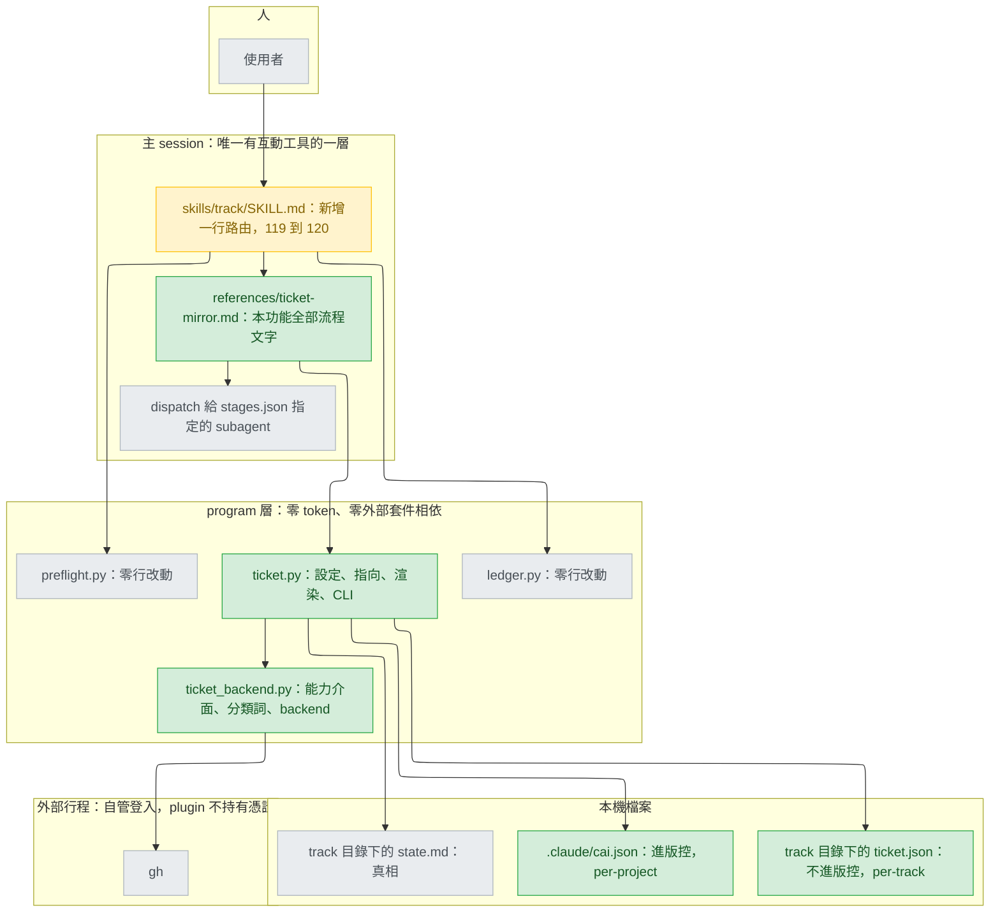
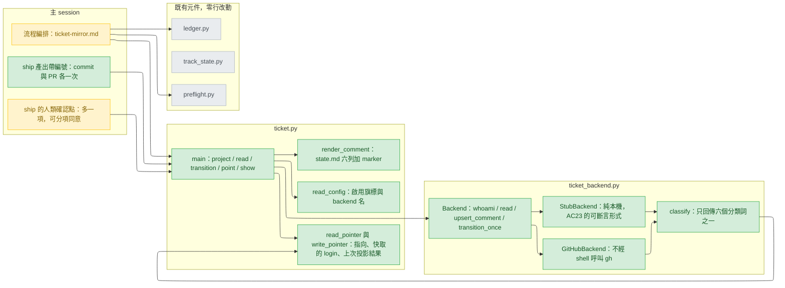
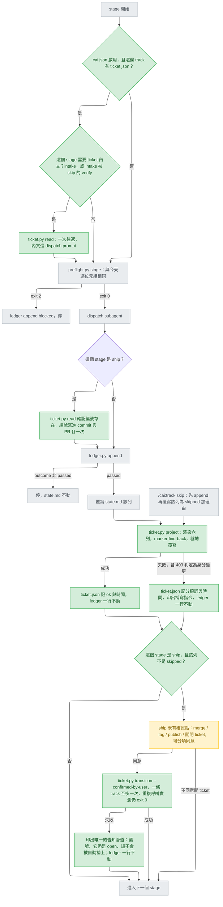
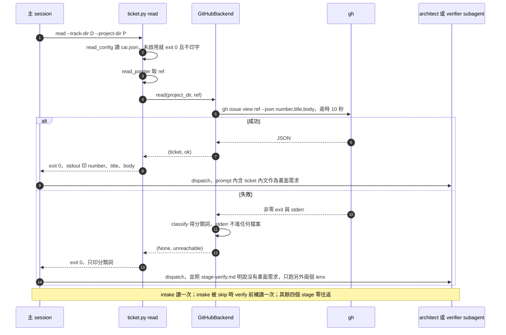
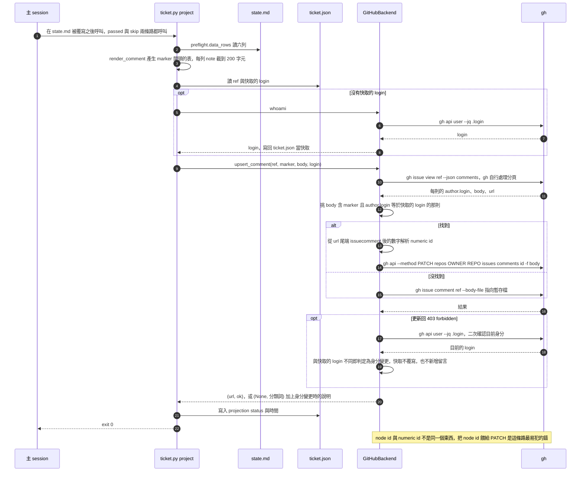
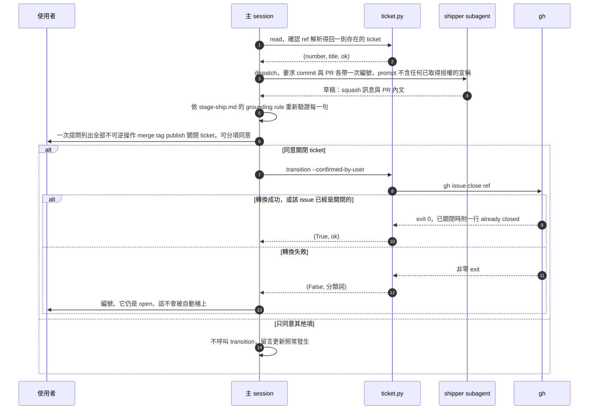
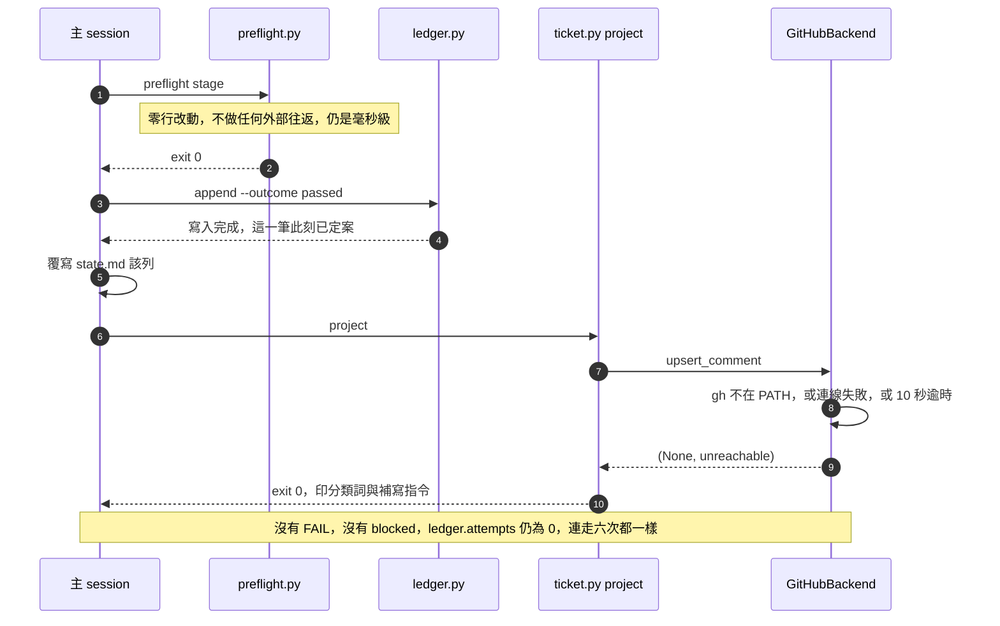
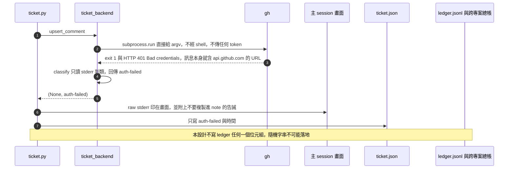
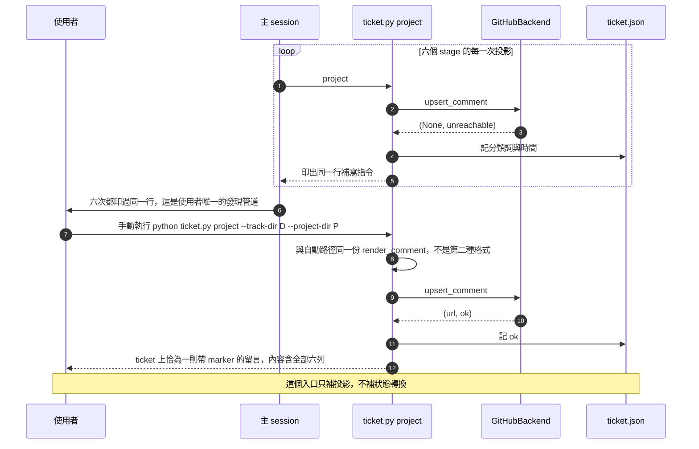

# ticket-integration — detail design

## 維護說明（2026-10-27）

本檔是歷史設計紀錄，保留決策、驗收依據與實作偏差；不是待執行計畫。原簽核狀態、版本、行號及未驗證標記描述撰寫當時，整併不代表重新簽核或重做實測。

名詞：設計立場（stance）說明取捨；決策紀錄（decisions）保存選擇理由；細部設計（detail）記錄建造規格；需求盤點（intake）保存驗收條件。下方英文標題與識別碼沿用原文，便於對照歷史。

原 DD8 在發布階段關閉工單的規格已被 [工單狀態同步設計](2026-09-26-track-issue-status-sync-detail.md) 取代。現行關閉程序在 [`plugins/cai/skills/track/references/ticket-mirror.md:142`](../../plugins/cai/skills/track/references/ticket-mirror.md#L142)；本次一併保留實作時發現的編碼、權限分類與行數預算修正。原規格的 119 行與「剩 1 行」量錯；當時實際為 120 行，使用者裁決把上限從 120 改為 122，並以 TRACK_SKILL_MAX 統一計算依據；詳見末尾行數修正紀錄。這是當時修正，不是現行上限。原排程的單元 1／2、3／4 共享檔案，實際不可並行；末尾一併保留該更正，不能只照原 Alongside 欄安排。

已併入並移除的同主題文件：`2026-08-30-ticket-integration-high-level.md`、`2026-08-30-ticket-integration-intake.md`、`2026-08-31-ticket-integration-implementation-notes.md`。

補充段落保留原文與原決策編號，避免把不同時點同號的決策當成一項；重複的概覽圖、施工排程與階段交接文字不再複製。

## Reference

High Level Design doc: docs/design/2026-08-31-ticket-integration-detail.md
Status: approved 2026-08-31

本文件把該 HLD 的十項裁決轉成可實作的規格，十項裁決不重開。撰寫期間發現一處 HLD 照字面
做不到（投影失敗的紀錄要落在 ledger 上），已回報並由使用者授權修正 HLD 本身：現在兩份
文件對這一點一致，見 DD2。**本文件與 HLD 之間沒有未解的衝突，實作層也沒有未裁決項**；
唯一取代上游的是 AC24 的措辭，理由與新措辭寫在 `## Verification`。

### Traceability

| From the high-level design | Satisfied by | Status |
|---|---|---|
| R1 | `ticket.py read` 在 intake 讀一次，內文進 intake 產物；intake 被 skip 時 verify 前補讀一次（DD5） | covered |
| R2 | `ticket.py project` 在每次 `state.md` 被覆寫後，把六列表覆寫到帶 marker 的那則留言（DD3） | covered |
| R3 | ship 前以 `ticket.py read` 確認編號存在，主 session 要求 commit message 與 PR 內文各帶一次（DD7） | covered |
| UC1 | `preflight.py`、`ledger.py`、`agents/*.md`、`stages.json` 零行改動；無設定檔時 `ticket.py` 不做事也不印字（DD1） | covered |
| UC2 | `ticket.py read` 兩條路徑；讀不到就照 `stage-verify.md:49-50` 明說沒有書面需求 | covered |
| UC3 | `render_comment()` 全表覆寫加 marker；`upsert_comment()` 的 marker find-back 三步 | covered |
| UC4 | ship 既有確認點多一個可分項同意的項目，同意才呼叫 `transition --confirmed-by-user` | covered |
| UC5 | `ticket.py` 永遠 exit 0；preflight 零行改動，ticket 不可能造出 `blocked`（DD4） | covered |
| UC6 | `subprocess.run(argv)` 不經 shell、不傳 token；`classify()` 只回六個封閉集合詞；本設計不寫 ledger 一個位元組（DD6） | covered |
| UC7 | 手動補寫就是使用者具名執行同一支 `ticket.py project`；每次失敗都印出可貼上的那行指令 | covered |
| UC8 | `.claude/cai.json` per-project 進版控；`BACKENDS` 註冊表選類別，加 `StubBackend` 對 preflight 與 `skills/track/` 零行改動 | covered |

## Requirement

在既有六個 stage 之外加一層**單向投影**：`state.md` 是真相，ticket 上的一則留言是它對外
的鏡像。鏡像壞掉不影響真相。給個人（GitHub Issues）與團隊（共享 ticket）同一條路徑。
成功的判準是 intake 產物第 4 節的 24 條 AC 全綠（AC24 依 `## Verification` 的新措辭），
且未啟用時六個 stage 的 preflight stdout 與改動前逐位元組相同。

失敗的定義同樣寫死：**這個功能不得成為使用者進不了自己 track 的原因。** 讀不到、寫不進
去、外部 CLI 不在 PATH 上，三者都不改變任何 stage 的成敗，也不消耗任何重試額度。

**第一版不支援跨 repo 的 ticket。** `ticket.json` 的 `ref` 只存 issue 編號，repo 由 `gh`
自己從專案的 git remote 推得——這與 HLD C2 實際量測過的呼叫形狀
（`gh issue view <n> --json number,title`）完全一致，不多猜一個未量測的參數形式。指向另
一個 repo 的 ticket 需要多帶一個 `--repo`，那是第二版的事；本版遇到這種需求時，使用者看
到的是 `ticket-not-found`，不是一個看起來成功卻寫錯地方的投影。

## Glossary

最後一欄是 `file:line` 者，都是本次親自開啟過的行。

| Term | Definition | Where it lives |
|---|---|---|
| projection（投影） | 把 `state.md` 六列渲染成一張表、覆寫 ticket 上那則留言的動作，每次都是整張表覆寫 | new — plugins/cai/scripts/ticket.py |
| mirror comment | ticket 上被投影覆寫的那一則留言，body 第一行是 marker | concept |
| marker | 鏡像留言第一行的可見標記，含 feature 名稱並以中括號界定 | new — plugins/cai/scripts/ticket.py |
| marker find-back | 列留言、挑 body 含 marker 且作者為登入身分的那則、依數字 id 就地更新，三步 | new — plugins/cai/scripts/ticket_backend.py |
| cached login | `ticket.json` 裡記下的登入帳號，是 find-back 的作者過濾條件，也是 403 之後判定身分是否變更的比較基準 | new — .claude/track/ticket-integration/ticket.json |
| node id | `--json comments` 回傳的 GraphQL 識別碼（`IC_...`），不能餵給更新端點 | concept |
| numeric comment id | 留言 `url` 尾端 `#issuecomment-<n>` 的數字，是 PATCH 端點唯一接受的 id | concept |
| capability interface | 只定義四個語意能力（whoami、read、upsert_comment、transition_once）的抽象基底 | new — plugins/cai/scripts/ticket_backend.py |
| backend | 能力介面的具體實作，由設定檔的 `backend` 值選出 | new — plugins/cai/scripts/ticket_backend.py |
| category word（分類詞） | 六個封閉集合字串之一，是外部 CLI 結果唯一被允許離開 backend 的表示 | new — plugins/cai/scripts/ticket_backend.py |
| per-project config | 進版控的 `.claude/cai.json`，只放「有沒有開」與「用哪個 backend」 | new — .claude/cai.json |
| per-track pointer | track 目錄下與 `state.md` 同層的 `ticket.json`，放指向與上次投影結果 | new — .claude/track/ticket-integration/ticket.json |
| state.md | 一條 track 每 stage 一列的表，只有 passing path 與 skip 會覆寫它 | `plugins/cai/skills/track/SKILL.md:68` |
| ledger | 每次 stage 嘗試一列 JSON 的紀錄，appended, never edited | `plugins/cai/scripts/ledger.py:6` |
| COUNTS_AS_RETRY | 計入重試上限的兩個 outcome（`failed`、`blocked`），五次鎖死該 stage | `plugins/cai/scripts/ledger.py:50` |
| central ledger | 跨專案集中總帳，`ledger.append()` 每次同時寫入的第二個檔 | `plugins/cai/scripts/usage_collector.py:52` |
| preflight probe | preflight 印出的一行 PASS/FAIL；本設計一行都不新增 | `plugins/cai/scripts/preflight.py:476` |
| 主 session | 唯一持有互動工具、能取得授權的那一層；subagent 的回報只是草稿 | `plugins/cai/skills/track/references/stage-ship.md:31` |
| 第二個人類 gate | ship 之前對不可逆操作的確認；本設計只在其列表多加一項 | `plugins/cai/skills/track/SKILL.md:89` |
| conformance lens | verify 三個 lens 之一，沒有書面需求時會被整個放棄 | `plugins/cai/skills/track/references/stage-verify.md:44` |
| grounding rule | ship 寫出的每個事實主張都得指得回 diff、commit 或開過的檔 | `plugins/cai/skills/track/references/stage-ship.md:11` |
| always-on budget | agents 與 skills frontmatter description 的總字元上限，本設計消耗 0 | `scripts/validate.py:215` |
| track 目錄不進版控 | `.claude/track/` 整個被 git 忽略，註解已定性為個人工作狀態 | `./.gitignore:11` |
| stages.json | 六個 stage 的 id/agent/reference/auto_invoke，本設計零行改動 | `plugins/cai/skills/track/stages.json:2` |
| 環境變數接縫 | 以環境變數換掉外部相依的既有慣例，子行程也看得到 | `tests/conftest.py:56` |
| synced / sync_error | 對外寫入失敗而流程照常完成的**形狀**前例；本設計引用其形狀，不引用其落點 | `plugins/cai/scripts/ledger.py:265` |

## Budgets

| What | Number | Where it comes from |
|---|---|---|
| 一次 `gh issue view <n> --json number,title` 往返，三次實測最慢 | 584 ms | 主 session 實測 494 / 551 / 584 ms（HLD C12） |
| `preflight.py design` 在這條 track 上 | 79 ms | 主 session 實測（HLD C12） |
| 外部 CLI 單次呼叫的逾時 | 10 s | 使用者裁決 2026-08-31：實測正常 0.5 秒，取 20 倍餘裕 |
| 一次投影的外部往返次數，首次含取登入身分 | 3 first, then 2 | 本設計：`gh api user` 一次（快取）＋列留言＋更新留言。身分變更是罕見情況，只在更新回 403 時才多一次 `whoami`，不對每次投影收稅 |
| 一次投影的延遲，正常路徑的資訊性量測（**不是 gate**） | 1168 ms | 2 × 584 ms。stub 測不出網路延遲，所以它只在 e2e 記錄，不當門檻，見 `## Verification` |
| 一次投影的最壞耗時（兩次都逾時） | 20 s | 2 × 10 s；使用者可感知的上界 |
| 一條 track 啟用後的往返總數上界 | 16 | 6 × 2 投影＋intake 讀 1＋ship 確認 1＋轉換 1＋取身分 1 |
| 未啟用時本設計新增的外部往返 | 0 | 讀不到 `.claude/cai.json` 就直接返回 |
| 鏡像表每列 note 的字元上限，超過即截斷 | 200 chars | 使用者裁決 2026-08-31 |
| 六列鏡像表的 note 總量上界 | 1200 chars | 6 × 200 |
| ticket 留言 body 的平台上限 | 65536 chars | 文件證據、未實測：錯誤訊息為 `body is too long (maximum is 65536 characters)`。以 1200 計仍有約 50 倍餘裕 |
| marker find-back 需要的翻頁邏輯 | 0 | 實測 `gh issue view --json comments` 對 142 則的 issue 回 142 則、107 則的回 107 則，`gh` 自行處理分頁 |
| always-on description 目前用量 | 5451 chars | `scripts/validate.py:222-225` 實測 |
| always-on description 上限 | 5468 chars | `scripts/validate.py:215` |
| 本設計允許消耗的 always-on 頭寸 | 0 chars | 不新增任何 agent／skill 的 frontmatter description |
| `skills/track/SKILL.md` body，加一行之後 | 120 lines | 上限 120，判定式 `track_lines <= 120`，`scripts/validate.py:1346` |
| 同時最多 active track 數 | 5 | `plugins/cai/scripts/preflight.py:276-277` |
| 一個 stage 鎖死前的重試次數 | 5 | `plugins/cai/scripts/preflight.py:147-173`；本設計必須讓它維持 0 |
| ledger `note` 截斷前位元組 | 3840 bytes | `plugins/cai/scripts/ledger.py:56` |
| ledger 單筆硬上限 | 4096 bytes | `plugins/cai/scripts/ledger.py:55` |
| 鏡像留言列數 | 6 | `plugins/cai/skills/track/stages.json:2-15` |
| GitHub Issues 狀態數 | 2 | HLD C7 |
| 一條 track 的狀態轉換次數 | 1 | HLD C7、Decision 6。實測重複呼叫 `gh issue close` 仍 exit 0，故重試安全 |
| 本設計寫進 ledger 的位元組 | 0 bytes | DD2：`ledger.py` 零行改動 |

note 上限 200 字元的理由要與數字一起留著，否則下一個人只會看到一個礙事的截斷：**完整
理由本來就在 `state.md` 與 ledger 裡，鏡像的用途是讓團隊知道進度，不是取代那兩個檔。**
本專案 `state.md` 實際的 note 單列可達一千五百字以上，六列直接串接會把一則留言變成沒有
人會讀的東西。

## Design decisions

- **DD1 — 未啟用的成本是零，靠「不改既有檔案」而不是「改了但走不到」。** `preflight.py`、
  `ledger.py`、`agents/*.md`、`stages.json` 全部零行改動，AC1 因此不必只靠 golden file，
  `git diff --stat plugins/cai/scripts/preflight.py` 為空是更強也更便宜的證據。
- **DD2 — 投影與轉換的失敗紀錄落在 per-track pointer，`ledger.py` 一行不改。已與 HLD
  同步，不是待決事項。** 依據是 append-only 與寫入時機的組合：`plugins/cai/scripts/
  ledger.py:270` 的 `_write_line()` 在 `append()` 的 `return per_track`
  （`plugins/cai/scripts/ledger.py:271`）之前就把該行落盤，而流程順序是 append → 覆寫
  `state.md` → 投影，投影發生時那一筆已經定案，`plugins/cai/scripts/ledger.py:6` 又寫死
  appended, never edited。唯一能讓欄位落在同一筆上的辦法是把投影移到 `append()` 之前，
  那會違反「投影不得早於 ledger」（依據 `plugins/cai/scripts/ledger.py:230-231` 的拒寫不
  產生孤兒）。兩者不能同時成立。HLD 已於 2026-08-31 依此修正：
  `docs/design/2026-08-31-ticket-integration-detail.md:919`（`REC`）、
  `:134`（`RECT`，轉換失敗同樣在 append 之後，毛病相同）、`:149-156`（不能落在 ledger 的
  理由）、`:405-407`（Decision 8 的落點，並把 C15 降為**形狀**的前例而非落點依據）。因此
  失敗以 `{"status": "<分類詞>", "at": "<UTC>"}` 寫進 `ticket.json`。
- **DD3 — 投影只有一個進入點，自動與手動共用。** `ticket.py project` 就是 HLD 元件圖的
  `FIX`，與正常路徑共用同一份 `render_comment()`，不可能長出第二種留言格式。不新增任何
  skill 或 command，always-on 消耗 0 chars。
- **DD4 — `ticket.py` 所有子指令永遠 exit 0，usage error 才 1，永不回傳 2。** 這是「不得
  產生 FAIL」的具體形狀。本設計不進 preflight，`COUNTS_AS_RETRY`
  （`plugins/cai/scripts/ledger.py:50`）在任何 ticket 失敗下都不可能被觸發。
- **DD5 — ticket 內文由主 session 讀，不由 subagent 讀。** `agents/*.md` 的 `tools:` 行零
  行改動，always-on 零消耗，AC18 對 `plugins/cai/agents/shipper.md:7` 的 `git diff` 為空
  順帶成立。內文以 dispatch prompt 傳給 subagent。
- **DD6 — 分類在來源端做，raw stderr 一個位元組都不進任何檔案。** `classify()` 讀 stderr
  只為判類，回傳永遠是六個詞之一；raw stderr 只印在畫面上（HLD Decision 8 A），並附一行
  「不要把這段複製進 `--note`」的告誡，同一條規則寫進 `references/ticket-mirror.md`。這
  不是理論上的擔憂：`gh` 的認證失敗訊息本身就含 URL（`HTTP 401: Bad credentials
  (https://api.github.com/graphql)`，主 session 2026-08-31 實測）。
- **DD7 — ship 的編號引用先解析、後書寫。** 主 session 先跑 `ticket.py read` 拿到
  `number` 與 `title`，確認編號解析得回一則存在的 ticket，才把「commit message 與 PR 內文
  各帶一次」寫進 dispatch prompt。這是 `plugins/cai/skills/track/references/stage-ship.md:11`
  grounding rule 對一個湊出來的號碼的直接應用。
- **DD8 — 唯一的授權路徑是既有 ship 確認點，且必須可分項同意。** `transition` 缺
  `--confirmed-by-user` 就拒絕並印出原因。旗標不證明使用者同意過；它的作用是讓「授權在
  哪裡取得」在程式碼與紀錄上只有一個位置可指。
- **DD9 — 外部執行檔可由環境變數替換，這是測試唯一的接縫，而且在 Windows 上是唯一可行的
  接縫。** `CAI_TICKET_CLI` 沿用 `CAI_USAGE_LEDGER`
  （`plugins/cai/scripts/usage_collector.py:44`）的既有作法：以環境變數而非 monkeypatch，
  因為子行程只看得到環境（`tests/conftest.py:56-62` 明說這個理由）。值以 `[` 開頭視為
  JSON argv 陣列，否則視為單一執行檔路徑。三件已實測的事，直接決定這個變數的規格：
  1. **路徑必須含副檔名。** 同一支 stub，完整路徑帶 `.cmd` → exit 0；同一路徑去掉副檔名
     → `FileNotFoundError: [WinError 2]`。Windows `CreateProcess` 只替沒有副檔名的名稱補
     `.exe`，所以 `CAI_TICKET_CLI` 收到裸名字會直接失敗。規格要求使用者傳完整路徑，
     `ticket.py` 在值明顯沒有副檔名時多印一行提醒。
  2. **改 PATH 換不掉一支被直接呼叫的 CLI。** Windows 上 `subprocess` 的 `env=` 不影響被
     直接啟動那個行程的執行檔搜尋（搜尋用父行程的 PATH）。這正是本接縫必要而非方便的
     理由。
  3. **AC7 的測法仍然成立**：清空的 PATH 是傳給 `ticket.py` 的，`gh` 是它的孫行程，用的
     是 `ticket.py` 自己已被清空的 `os.environ`。
- **DD10 — 登入身分中途變更以「事後解釋」處理，不做事前檢查（使用者裁決 2026-08-31）。**
  投影一律以 pointer 裡快取的 `login` 過濾與寫入；只有在更新留言回 403 時，backend 才多
  發一次 `whoami` 二次確認，判定是不是換了帳號。理由是成本分布：換帳號是罕見情況，而事前
  檢查要對**每一次**投影加一次 `whoami` 往返（2 → 3），等於為罕見情況對常態收稅；而且新
  身分本來就有權編輯時（例如 repo maintainer），事後解釋讓投影繼續成功，事前檢查會把那種
  情況一併擋掉。三件事無論如何都成立：不新增第二則帶 marker 的留言、投影流程不自動覆寫
  快取的 `login`（覆寫會讓「身分變了」在檔案上消失，偵測就失去依據）、訊息必須明說身分
  不同而不是只丟一個分類詞。

## Diagrams

八個 use case 只畫六張 sequence。**跳過 UC1 與 UC8**，理由都是呼叫順序在 flow 圖上已看得
出來：UC1 就是 flow 圖最左那條「否」分支，外部呼叫為零，畫成 sequence 是一條沒有訊息的
線，而它的驗收是逐位元組比對不是順序；UC8 沒有呼叫順序可畫，它是「哪個檔在哪個作用域」
與「註冊表選出哪個類別」的靜態性質，由 architecture 圖、component 圖與 `## Naming` 承載。

### Architecture



跨越邊界的東西：`SK` 到 `RM` 是一行指示（明說由主 session 自己讀）；`RM` 到 `TK` 是
argv；`TK` 到 `TB` 是 `(project_dir, ref, marker, body, login)`；`TB` 到 `GH` 是 argv，回
來的只有 `(值, 分類詞)`——raw stderr 停在 `TB` 的邊界，只往畫面走，不往任何檔案走。

### Component



`SAN --> PTR` 這條邊是本圖唯一值得停下來看的地方：分類詞流進 per-track 的指向檔，不流進
ledger。HLD 元件圖初版畫的是流進 ledger，2026-08-31 已依 DD2 一併修正
（`docs/design/2026-08-31-ticket-integration-detail.md:919-919`），兩份文件現在一致。
`SAN` 夾在 `CAP` 與 `PTR` 之間而不是掛在寫檔那一端，是為了讓外部字串的判斷責任留在認識
那個來源的地方。

### Flow



`PRJ` 與 `TR` 的失敗邊都往下走、沒有回頭箭頭——那是 UC5。兩者被接住的方式不同（`FW` 會
被下一次投影自癒，`MSG` 不會），所以是兩個節點。三個節點都寫著「ledger 一行不動」，是為
了讓 DD2 在圖上就看得見，而不是要讀者翻到下一節才知道。

### Sequence — UC2（讀進書面需求，含 intake 被 skip 的 fallback）



### Sequence — UC3（投影：marker find-back 與就地覆寫）



### Sequence — UC4（ship：引用編號、可分項同意、只轉換一次）



### Sequence — UC5（不可達：不擋人、不吃重試額度）



### Sequence — UC6（不持憑證，外部輸出不落地）



### Sequence — UC7（全數失敗後的手動補寫）



## Implementation spec

型別以 `typing` 標註書寫，實作可用註解形式；`ticket.py` 與 `ticket_backend.py` 只 import
標準函式庫，加上 `ticket.py` 對同目錄 `preflight` 的 import（單向：`ticket` → `preflight`
→ `ledger` → `usage_collector`，不成環，符合 `plugins/cai/scripts/ledger.py:15-23` 的規則）。

### read_config — per-project 設定

- **Responsibility**：回答「這個專案有沒有開整合、用哪個 backend」，且永遠不丟例外。
- **Interface**：`def read_config(project_dir: str) -> dict`
- **Data**：in `project_dir`；out `{"enabled": bool, "backend": str, "problem": str | None}`。
  檔不存在 → `{"enabled": False, "backend": "", "problem": None}`。JSON 壞掉或型別不對 →
  `enabled=False` 且 `problem` 是一句我方寫的說明（不含檔案內容）。
- **Errors**：`OSError`、`ValueError` 全部就地吃掉轉成 `problem`。沒有任何路徑會 raise。
- **Concurrency**：純讀，可重入。設定檔被同時編輯只會讀到舊或新的一份，兩者都合法。
- **Observability**：成功不印字；`problem` 非 None 時由呼叫端印一行。**未啟用時一個字都
  不印**——這是 AC1 的一部分。
- **Where it lives**：`plugins/cai/scripts/ticket.py`（新檔）。
- **What it reuses**：路徑解析沿用 `plugins/cai/scripts/preflight.py:38-46` 的 `resolve()`
  慣例；`project_dir` 為第一 base 的既有呼叫見 `plugins/cai/scripts/preflight.py:200`。

### read_pointer / write_pointer — per-track 指向

- **Responsibility**：保存與讀取「這條 track 指向哪一則 ticket、以誰的身分投影過、上一次
  投影的結果」。
- **Interface**：
  `def read_pointer(track_dir: str) -> dict | None`；
  `def write_pointer(track_dir: str, pointer: dict) -> None`
- **Data**：out `{"backend": str, "ref": str, "login": str | None,
  "projection": {"status": str, "at": str} | None}`。`ref` 只存 issue 編號（第一版不支援
  跨 repo，見 `## Requirement`）。`login` 是**首次成功取得身分時寫入的快取**，之後只被
  `ticket.py point` 覆寫，**投影流程永遠不自動覆寫它**——DD10 的偵測完全建立在這一點上：
  自動覆寫會讓「身分變了」在檔案上消失，403 之後的二次確認就沒有比較基準。`status` 是六個
  分類詞之一，`at` 是 `YYYY-MM-DDTHH:MM:SSZ`。檔不存在 → `None`（整合對這條 track 靜默
  失效）。
- **Errors**：讀失敗 → `None`。寫失敗 → 吃掉 `OSError` 並印一行；投影本身的成敗不受影響。
- **Concurrency**：read-modify-write，非原子。兩個 session 同跑一條 track 時可能覆蓋彼此
  的 `projection`，代價僅是少一筆狀態；`state.md` 在同一情境下早已會壞，本設計不新增防護。
  不採用 `plugins/cai/scripts/ledger.py:306-336` 的 Windows 鎖：那是為 append-only 檔設計
  的，此處是整檔覆寫。
- **Observability**：`ticket.py show` 印出目前 ref、快取的 login 與上次投影結果——這是
  DD2 之後「投影失敗留在哪裡」唯一的查詢入口，也是使用者確認身分快取的地方。
- **Where it lives**：`plugins/cai/scripts/ticket.py`；資料檔在
  `.claude/track/<feature>/ticket.json`，與 `state.md` 同層、同樣被 `./.gitignore:11` 忽略。
- **What it reuses**：`./.gitignore:8-11` 對該目錄的定性（HLD Decision 10 的依據）。

### render_comment — 狀態表渲染

- **Responsibility**：把 `state.md` 的六列渲染成一段帶 marker 的留言 body。
- **Interface**：
  `def marker_for(feature: str) -> str`；
  `def render_comment(track_dir: str, feature: str, now: str) -> str | None`
- **Data**：in track 目錄與 feature 名；out 純文字。首行是 marker，接一行「此留言由 cai
  就地覆寫，請勿手動編輯」，再接一張 `| stage | status | note |` 三欄六列表，末行是
  `updated <UTC>`。每列 note 超過 200 字元即截斷並補省略記號。**`artifact` 欄不投影**：
  那是 `docs/` 底下的本機路徑，而 `docs/` 被 `./.gitignore:15` 忽略，對團隊沒有意義。
- **Errors**：`state.md` 不存在或列數不是六 → 回傳 `None`，投影跳過並印一行。不 raise。
- **Concurrency**：純函式，無共享狀態。同一輸入永遠同一輸出（`now` 除外）。
- **Observability**：`ticket.py show --dry-run` 直接把 body 印在畫面上，不做任何外部呼叫。
- **Where it lives**：`plugins/cai/scripts/ticket.py`。
- **What it reuses**：`plugins/cai/scripts/preflight.py:49-65` 的 `data_rows()` 與
  `plugins/cai/scripts/preflight.py:68-81` 的 `state_row()`——表格解析只有一份實作，
  `plugins/cai/scripts/track_state.py:66-73` 已經以同一理由這麼做過。

### Backend — 能力介面與兩個實作

- **Responsibility**：把「讀一則 ticket、就地覆寫一則留言、轉換一次狀態」三件語意能力，
  與「用哪支 CLI、哪些子指令」隔開。
- **Interface**：

  ```python
  CATEGORIES = ("ok", "auth-failed", "ticket-not-found",
                "forbidden", "unreachable", "unclassified")
  TIMEOUT_SECONDS = 10

  class Backend:
      name: str
      def whoami(self, project_dir: str) -> tuple[str | None, str]: ...
      def read(self, project_dir: str, ref: str) -> tuple[dict | None, str]: ...
      def upsert_comment(self, project_dir: str, ref: str, marker: str,
                         body: str, login: str) -> tuple[str | None, str]: ...
      def transition_once(self, project_dir: str, ref: str) -> tuple[bool, str]: ...

  class GitHubBackend(Backend): name = "github"
  class StubBackend(Backend):   name = "local-stub"

  BACKENDS = {"github": GitHubBackend, "local-stub": StubBackend}
  def get(name: str) -> Backend | None: ...
  ```

- **Data**：每個方法回傳 `(值, 分類詞)`，分類詞必在 `CATEGORIES` 內。`read` 的值是
  `{"number": str, "title": str, "body": str}`；`upsert_comment` 的值是留言 url。
  `GitHubBackend` 的四條實際呼叫：`gh api user --jq .login`、
  `gh issue view <ref> --json number,title,body`、`gh issue view <ref> --json comments`、
  更新走 `gh api --method PATCH repos/OWNER/REPO/issues/comments/<numeric id> -f body=...`，
  新增走 **`gh issue comment <ref> --body-file <暫存檔>`**（已實測可新增留言，不需要額外
  旗標；body 走檔案而非 argv，避免六列表格的換行與引號經過命令列）。
- **Errors**：不 raise。`FileNotFoundError`（CLI 不在 PATH）與 `TimeoutExpired`（10 秒）都
  成為 `unreachable`；其餘由 `classify()` 決定。失敗後外部狀態不變（PATCH 是單一請求，沒
  有中途狀態）。
- **身分變更：403 觸發二次確認（DD10）。** `upsert_comment` 的作者過濾一律用 pointer 裡
  快取的 `login`，不做任何事前的身分檢查，所以快取命中時的往返數維持 2。使用者中途
  `gh auth switch` 時有兩種結果，兩種都正確：新身分若有權編輯該留言（例如 repo
  maintainer），更新成功、投影照常；若無權，更新回 403，此時 backend **才**多發一次
  `whoami`，把目前身分與快取的 `login` 比對，不同即判定為身分變更，回
  `(None, "forbidden")` 並附上身分變更的說明。三件事在任何路徑上都成立：不新增第二則帶
  marker 的留言、不覆寫快取的 `login`、訊息明說身分不同而不是只丟一個分類詞。
- **Concurrency**：無實例狀態，可安全重入。`upsert_comment` 是 read-then-write：兩個
  session 同時對同一條 track 首次投影時，可能各建一則留言，AC10 會抓到；此窗口與
  `state.md` 已有的同名窗口相同，本設計記錄而不新增防護（見 `## Failure modes`）。
  `transition_once` **是冪等的**：對已關閉的 issue 再次 `gh issue close` 實測 exit 0，
  訊息為 `! Issue ... is already closed`，因此任何重試都不會產生錯誤狀態。
- **Observability**：每次外部呼叫在畫面上印一行 `backend argv 摘要 → 分類詞`；argv 中不
  含任何憑證，因為憑證由 `gh` 自管（HLD C1）。
- **Where it lives**：`plugins/cai/scripts/ticket_backend.py`（新檔）。
- **What it reuses**：呼叫外部行程的形狀抄 `plugins/cai/scripts/preflight.py:212-220` 的
  `subprocess.run(["git", *args], capture_output=True, text=True, timeout=...)`——**不經
  shell**，因為 Git Bash 會把 `gh api` 開頭是斜線的 endpoint 當路徑改寫（HLD C31）。

### classify — 輸出淨化

- **Responsibility**：把一次外部呼叫的結果壓成六個封閉集合詞之一，讓 raw stderr 沒有任何
  出口進入被保存的檔案。
- **Interface**：`def classify(exc: Exception | None, returncode: int, stderr: str) -> str`
- **Data**：in 例外、exit code、stderr 原文；out `CATEGORIES` 之一。判定順序：
  1. 例外優先：`FileNotFoundError` / `TimeoutExpired` / `OSError` → `unreachable`。
  2. `returncode == 0` → `ok`。
  3. 其後對 stderr 做**不分大小寫的子字串比對**，字樣為主 session 於 2026-08-31 實測所得
     （HLD `docs/design/2026-08-31-ticket-integration-detail.md:919-919`）：
     `HTTP 401`、`Bad credentials` → `auth-failed`；
     `Could not resolve to an issue or pull request`、`Could not resolve to a Repository`
     → `ticket-not-found`；
     `error connecting to` → `unreachable`；
     `body is too long` → `unclassified`（留言過長，見 `## Failure modes`）；
     其餘 → `unclassified`。
- **`forbidden` 只可能出現在寫入路徑，而且它是身分變更的偵測訊號本身。** GitHub 對無權限
  的 repo 回的是 `Could not resolve` 而非 403，刻意不洩漏存在性（實測，同上引），所以讀取
  路徑上永遠不會出現 403，實作者不要去找那個字樣。該分類詞保留給 PATCH／close 失敗，判定
  依據是 `403` 或 `forbidden` 出現在寫入呼叫的 stderr。**在 DD10 之下，寫入路徑上的 403
  就是觸發 `whoami` 二次確認的訊號**——`upsert_comment` 收到它時第一件事是比對身分，不是
  去查 repo 的權限設定。
- **Errors**：純函式，不失敗。輸入是 `None` 或空字串時回 `unclassified`。
- **Concurrency**：純函式。
- **Observability**：它是唯一決定「什麼被記下來」的地方；raw stderr 由呼叫端印在畫面，
  且必須帶「不要複製進 `--note`」的告誡。認證失敗的訊息本身就含 URL，這條告誡不是形式。
- **Where it lives**：`plugins/cai/scripts/ticket_backend.py`。
- **What it reuses**：形狀上對應 `plugins/cai/scripts/ledger.py:265-267` 的 `sync_error`
  ——差別是那裡存 `OSError` 原文，這裡只存分類詞，落點也不同（DD2）。

### ticket.py main — CLI 與手動補寫入口

- **Responsibility**：把上面四件事接成五個子指令，並保證任何失敗都不改變任何 stage 的成敗。
- **Interface**：

  ```
  ticket.py project    --track-dir DIR [--project-dir DIR]
  ticket.py read       --track-dir DIR [--project-dir DIR]
  ticket.py transition --track-dir DIR [--project-dir DIR] --confirmed-by-user
  ticket.py point      --track-dir DIR --ref REF [--backend NAME]
  ticket.py show       --track-dir DIR [--project-dir DIR] [--dry-run]
  Exit: 0 一律，1 usage error。永遠不回傳 2。
  ```

- **Data**：`project`／`transition` 的 stdout 是一行 `<子指令>: <分類詞>` 加上失敗時的補
  寫指令；`read` 的 stdout 是 ticket 的 number、title、body。`point` 會清掉舊的 `login`
  快取並在下一次投影重新取得——這是使用者換帳號後回到正軌的既定路徑（DD10）。
- **Errors**：`transition` 缺 `--confirmed-by-user` → 印出原因並 exit 0，不呼叫任何外部
  行程。未啟用、無 pointer、`render_comment` 回 `None` → 各印一行（未啟用時不印）並 exit 0。
- **Concurrency**：`project` 完全冪等，重跑任意次數的結果相同（整表覆寫）。`transition`
  對已關閉的 issue 再呼叫實測 exit 0，因此也是冪等、重試安全的。
- **Observability**：投影失敗時印出的那行**就是**手動補寫入口，內容是可直接貼上的完整
  指令（DD3、HLD Decision 7 A 的 `Fails when`）。
- **Where it lives**：`plugins/cai/scripts/ticket.py`。
- **What it reuses**：`ArgParser` 覆寫 `error()` 使 usage 錯誤 exit 1 的作法，抄
  `plugins/cai/scripts/ledger.py:515-521`；Windows 管線 UTF-8 的
  `sys.stdout.reconfigure(encoding="utf-8")` 抄 `plugins/cai/scripts/ledger.py:531-532`。

### preflight.py — 觸點：零行改動

- **Responsibility**（不變）：只回答 `state.md` 與磁碟上的產物已經決定的事。
- **Interface**：不變。
- **Data**：不變。
- **Errors**：不變。
- **Concurrency**：不變。
- **Observability**：不新增任何一行 probe。這是 AC1 最強的保證形式，也讓 AC23 對
  `preflight.py` 的零行改動要求自動成立。
- **Where it lives**：`plugins/cai/scripts/preflight.py`（既有）。
- **What it reuses**：HLD Decision 3 A 已裁決讀取不進 preflight；`plugins/cai/scripts/
  preflight.py:2-8` 的自述（zero-token、只答檔案已決定的事）是不加 probe 的理由，另一個
  理由是 `ticket.py` 需要 `preflight.data_rows()`，反向 import 會成環。

### ledger.py — 觸點：零行改動

- **Responsibility**（不變）：append-only 的嘗試紀錄。
- **Interface**：不變；不新增任何 `--ticket-*` 旗標。
- **Data**：不變。ticket 相關的狀態一律改存 `ticket.json`（DD2，HLD 已同步）。
- **Errors**：不變。
- **Concurrency**：不變。
- **Observability**：本設計寫進 ledger 的位元組數是 0，因此 AC9 在結構上恆真。
- **Where it lives**：`plugins/cai/scripts/ledger.py`（既有）。
- **What it reuses**：`plugins/cai/scripts/ledger.py:6` 的 appended, never edited、
  `plugins/cai/scripts/ledger.py:270` 的 `_write_line()` 與 `:271` 的 `return per_track`，
  共同構成 DD2 的依據。

### 主 session 流程 — SKILL.md 一行加 ticket-mirror.md

- **Responsibility**：在既有六個 stage 的執行序列上，插入讀、投影、引用、轉換四個動作。
- **Interface**：`plugins/cai/skills/track/SKILL.md` 的「Running a stage」步驟 3 之後加
  **恰一行**：大意為「當 `.claude/cai.json` 啟用 ticket 鏡像時，由你——主 session，不是
  subagent——依 `${CLAUDE_PLUGIN_ROOT}/skills/track/references/ticket-mirror.md` 處理這個
  stage：dispatch 之前，以及 `state.md` 被寫入之後（含 `/cai:track skip`）。」
- **Data**：`ticket-mirror.md` 逐 stage 列出：intake 讀一次；intake 被 skip 時 verify 前
  補讀一次；每次 `state.md` 被覆寫後投影；ship 先確認編號再引用；ship 的確認點多列一項且
  可分項同意；以及「畫面上的 stderr 不得複製進 `--note`」。
- **Errors**：`ticket.py` 永遠 exit 0，所以 `plugins/cai/skills/track/SKILL.md:85` 的
  「非零 exit 停止該步驟」永遠不會因為 ticket 觸發。
- **Concurrency**：不變（同一條 track 同時被兩個 session 跑本來就未定義）。
- **Observability**：`references/ticket-mirror.md` 沒有 frontmatter description，因此
  always-on 預算消耗 0 chars（計入範圍見 `scripts/validate.py:216-221`）。
- **Where it lives**：`plugins/cai/skills/track/SKILL.md`（既有，+1 行）與
  `plugins/cai/skills/track/references/ticket-mirror.md`（新檔）。
- **What it reuses**：`plugins/cai/skills/track/SKILL.md:89-99` 的兩個人類 gate 一字不改；
  `plugins/cai/skills/track/references/stage-ship.md:7` 的不可逆操作清單加入「關閉 ticket」。

## Naming

| Name | What it is | Chosen by |
|---|---|---|
| `.claude/cai.json` | per-project、進版控的設定檔 | the user, 2026-08-31；落點依 `./.gitignore:2-4` 所示 `.claude/settings.json` 進版控 |
| `ticket` | `.claude/cai.json` 內承載本功能設定的頂層鍵 | the user, 2026-08-31 |
| `enabled` | 布林，預設不存在即 false | the user, 2026-08-31 |
| `backend` | 字串，backend 註冊名 | the user, 2026-08-31 |
| `github` | 第一版 backend 的註冊名 | the user, 2026-08-31 |
| `local-stub` | 純本機假實作的註冊名，AC23 的可斷言形式 | the user, 2026-08-31 |
| `ticket.json` | per-track 指向檔，與 `state.md` 同層 | the user, 2026-08-31；位置依 `./.gitignore:8-11` |
| `ref` / `login` / `projection` / `status` / `at` | `ticket.json` 的鍵 | the user, 2026-08-31 |
| `[cai track: <feature>]` | 鏡像留言首行的 marker。中括號界定是必要的：沒有界定字元時 `cai track: ticket` 會是 `cai track: ticket-integration` 的子字串，兩條 track 會互相命中 | the user, 2026-08-31；含 feature 名是 HLD Decision 9 的必要條件 |
| `plugins/cai/scripts/ticket.py` | 設定、指向、渲染與 CLI | the user, 2026-08-31；follows `plugins/cai/scripts/preflight.py:1` 的 scripts 慣例 |
| `plugins/cai/scripts/ticket_backend.py` | 能力介面、分類詞、兩個 backend | the user, 2026-08-31 |
| `plugins/cai/skills/track/references/ticket-mirror.md` | 主 session 的流程文字 | the user, 2026-08-31；目錄依 `plugins/cai/skills/track/stages.json:4` 的 references 慣例 |
| `project` / `read` / `transition` / `point` / `show` | 五個子指令 | the user, 2026-08-31 |
| `--confirmed-by-user` | `transition` 的必要旗標 | the user, 2026-08-31 |
| `--dry-run` | `show` 的旗標，只渲染不外呼 | the user, 2026-08-31 |
| `CAI_TICKET_CLI` | 覆蓋外部執行檔的環境變數，測試接縫 | the user, 2026-08-31；形狀 follows `plugins/cai/scripts/usage_collector.py:44` |
| `ok` / `auth-failed` / `ticket-not-found` / `forbidden` / `unreachable` / `unclassified` | 六個分類詞 | the user, 2026-08-31；五類語意由 HLD Decision 8 裁決 |
| `TIMEOUT_SECONDS` | `ticket_backend.py` 的模組常數，值為 10 | the user, 2026-08-31 |
| `tests/test_ticket_config.py` / `test_ticket_render.py` / `test_ticket_backend.py` / `test_ticket_project.py` | 測試模組 | the user, 2026-08-31；follows `tests/test_preflight_ledger.py:1` 的命名 |
| `tests/fake_gh.py` | 可設定成永遠失敗的假 CLI，由 `CAI_TICKET_CLI` 指向 | the user, 2026-08-31 |

## Change points

新增相依：**無**。`gh` 不是新相依，見 `plugins/cai/skills/git/SKILL.md:17` 與
`plugins/cai/agents/shipper.md:7` 的 `Bash(gh:*)`；Python 側只用標準函式庫（AC22）。

| Path | Change | Exists today |
|---|---|---|
| `plugins/cai/scripts/ticket.py` | 新增：設定、指向、渲染、五個子指令 | no |
| `plugins/cai/scripts/ticket_backend.py` | 新增：能力介面、`classify`、`GitHubBackend`、`StubBackend` | no |
| `plugins/cai/skills/track/references/ticket-mirror.md` | 新增：本功能全部流程文字 | no |
| `plugins/cai/skills/track/SKILL.md` | +1 行（119→120），位置在步驟 3 之後 | yes |
| `plugins/cai/skills/track/references/stage-ship.md` | 第 7 行的不可逆操作清單加入「關閉 ticket」 | yes |
| `.claude/cai.json` | 新增（本 repo 自用；沒有這個檔功能就是關的） | no |
| `tests/test_ticket_*.py`、`tests/fake_gh.py` | 新增 | no |
| `plugins/cai/scripts/preflight.py` | **零行改動**（DD1） | yes |
| `plugins/cai/scripts/ledger.py` | **零行改動**（DD2） | yes |
| `plugins/cai/scripts/track_state.py` | 零行改動 | yes |
| `plugins/cai/agents/*.md` | 零行改動，保住 5451 的 always-on 用量 | yes |
| `plugins/cai/skills/track/stages.json` | 零行改動，維持六個 stage | yes |
| `scripts/validate.py` | 零行改動即可通過；`SKILL.md` 的 120 行檢查已存在於 `scripts/validate.py:1346` | yes |

## Failure modes

| Situation | What happens | What the caller sees |
|---|---|---|
| 沒有 `.claude/cai.json` | `ticket.py` 立即返回，零外部呼叫、零輸出 | 與今天逐位元組相同（AC1） |
| `.claude/cai.json` JSON 壞掉 | 視為未啟用 | 一行「設定檔讀不出來，整合維持關閉」，stage 照常 |
| 啟用了但這條 track 沒有 `ticket.json` | 投影跳過 | 一行「這條 track 尚未指定 ticket，執行 `ticket.py point --ref <n>`」 |
| **登入身分中途變更（`gh auth switch`），pointer 有舊帳號的 `login` 快取** | 投影照常以快取的 `login` 過濾與寫入，往返仍是 2 次。新身分若有權編輯該留言（例如 repo maintainer），更新成功、投影不受影響；若無權，更新回 403，backend 才多發一次 `whoami` 二次確認並判定為身分變更。快取不被覆寫，也絕不新增第二則帶 marker 的留言（DD10） | 有權時使用者什麼都不必做；無權時一行「登入身分與這條 track 建立時不同（快取 `<舊>`，目前 `<新>`），投影未寫入；確認要用新身分後重跑 `ticket.py point --ref <n>`」 |
| 換帳號之後才第一次 `ticket.py point`（沒有快取可比對） | 作者過濾用新身分，找不到舊帳號建的那則，於是新增一則。**這是 intake §3.3「marker ＋ 作者」兩條件規則的固有結果，本版已知並接受，不補救** | issue 上出現第二則帶 marker 留言；使用者自行刪掉舊的那則即可，流程不再提起 |
| `gh` 不在 PATH | `FileNotFoundError` → `unreachable` | exit 0，畫面一行分類詞加補寫指令；`attempts()` 仍 0（AC7） |
| 網路不通，或單次呼叫超過 10 秒 | `TimeoutExpired` → `unreachable` | 同上；下一次投影會補齊整張表（AC6）。最壞一次投影耗 20 秒 |
| 認證過期 | `HTTP 401: Bad credentials` → `auth-failed` | 畫面提示重新登入。**該訊息本身含 `https://api.github.com/graphql`**——這正是 stderr 不得原封落地的實證，落檔的只有分類詞（AC9） |
| ticket 編號不存在，或指向的 repo 不存在 | 兩者 GitHub 都回 `Could not resolve` → `ticket-not-found` | 畫面提示改指向。第一版不支援跨 repo（見 `## Requirement`），指錯 repo 也走這條 |
| 對無權限的 repo 讀取 | GitHub 回 `Could not resolve` 而非 403，刻意不洩漏存在性 → `ticket-not-found` | 使用者看到的是「找不到」。`forbidden` 只會出現在寫入路徑 |
| 別人貼了含相同 marker 的留言 | 作者不符，find-back 略過該則 | 我方那則被更新，別人那則 id 與 body 不變（AC14） |
| 兩條 track 指同一 issue | marker 含各自 feature 名，互不命中 | issue 上兩則帶 marker 的留言，內容互不污染（AC15） |
| 同一條 track 被兩個 session 同時首次投影 | 兩者都沒找到 marker，各建一則 | issue 上出現兩則帶 marker 留言，AC10 會抓到。**本設計不防護**：同一窗口對 `state.md` 已經是未定義行為 |
| 刪掉整個 track 目錄後再跑 | 沒有 pointer，投影跳過；`ticket.py point` 重新指定後，find-back 靠 marker 找回原留言 | 不出現第二則（AC13），前提是登入身分未變 |
| `render_comment` 讀到的列數不是六 | 投影跳過 | 一行說明；`state.md` 與 ledger 都不受影響 |
| 留言 body 超過平台上限 | 200 字元的每列截斷讓六列約 1200 字元，離 65536 有約 50 倍餘裕，正常不會發生；真的發生時 `body is too long` → `unclassified` | 畫面分類詞加補寫指令。**若未來取消截斷，65536 就是會撞到的那面牆** |
| ship 時該 issue 已經是關閉的 | `gh issue close` 實測 exit 0，訊息 `! Issue ... is already closed` | 視為成功。**轉換因此是冪等的、重試安全**——重跑 ship、或使用者已先手動關閉，都不會產生錯誤狀態 |
| 狀態轉換失敗 | 不重試、不補救，ledger 一行不動 | 印出編號、它仍是 open、這不會被自動補上（HLD 第四條約束） |
| 使用者把畫面上的 stderr 貼進 `--note` | ledger 會留下外部原文 | 由 `ticket-mirror.md` 的明文規則防守；這是 DD6 唯一的殘餘風險 |

## Rollout

**能不能分批出？能，而且第一塊完全不碰網路。** 最小可用的第一塊是 Unit 1＋Unit 2：能力
介面、`classify`、`StubBackend`、設定、指向、渲染，以及 `ticket.py project` 走 `local-stub`
——此時整條鏡像路徑可以在完全離線的機器上跑通並被測試覆蓋，AC22 與 AC23 在這一步就綠。
`GitHubBackend` 是第二塊，`read`／`transition`／ship 引用是第三、四塊。

**既有資料怎麼辦？沒有 migration，也沒有 backfill。** 本設計不新增、不改寫任何既有檔案
格式：`state.md` 欄數不動（避開 HLD C32 的錯位風險）、`ledger.jsonl` 欄位不動（DD2）、
`stages.json` 六列不動，因此 `.claude/track/done/` 底下兩條已歸檔 track 的
`track_state.py status` 仍 exit 0（AC2）。既有 track 沒有 `ticket.json`，整合對它們靜默
失效直到使用者執行一次 `ticket.py point`。

**進行中的 track 會壞什麼？不會。** 功能預設關閉，關閉時六個 stage 逐字相同（AC1）。一條
track 跑到一半才打開設定，從下一個 passed 的 stage 起開始投影；因為每次都是整張表覆寫，
第一次投影就把先前所有 stage 一併補上（AC6 的自癒是這個性質的同一件事）。反過來，跑到一
半關掉設定，下一次投影不發生，ticket 上停留在最後一次成功的內容——**不會自動清理**，這是
刻意的：刪掉別人看得到的紀錄比留下一份過期的更糟。

**怎麼回退？** 三層，由輕到重。(1) 把 `.claude/cai.json` 的 `enabled` 改成 false，或刪掉
該檔——下一個 stage 起行為與今天完全相同，不需要重啟任何東西。(2) 刪掉一條 track 的
`ticket.json`——只停掉那一條。(3) 完整回退：revert 兩個被改的既有檔（`SKILL.md` 的一行、
`stage-ship.md` 的一行），刪掉兩支新 script 與新 reference。因為 `preflight.py`、
`ledger.py`、`stages.json`、`agents/*.md` 一行都沒改，這個 revert 不可能影響既有 track。
ticket 上已經寫下的留言與已經關閉的 issue 都不會被復原——外部世界不在 revert 的範圍內，
這一點必須在 release note 裡寫出來。

## Verification

Level 一律指：unit＝`python -m pytest` 內以 stub 執行、不碰網路；integration＝以
`CAI_TICKET_CLI` 指向 `tests/fake_gh.py` 跑完整 `ticket.py` 行程，**同樣不碰網路**；
e2e＝對真實 GitHub issue 手動跑一次。凡是門檻牽涉真實網路延遲的，只能放在 e2e，而且是
資訊性量測不是 gate——這是 stub 測不出來的東西。三列的措辭取代 intake 產物第 4 節的原文，
取代理由寫在該列內：AC5b（DD2）、AC11（`artifact` 欄不投影）、AC24（HLD Decision 1 晚於
intake 且由使用者當面拍板）。

`CAI_TICKET_CLI` 要傳**含副檔名的完整路徑**（實測：去掉副檔名即 `WinError 2`）；AC7 清空
PATH 的測法仍然成立，因為清空的是 `ticket.py` 自己的環境，`gh` 是它的孫行程。

| Criterion | Level | What it needs | Green before |
|---|---|---|---|
| AC1 未啟用時 preflight 輸出逐字不變 | integration | 先確認 `git diff --stat plugins/cai/scripts/preflight.py` 為空；再以 `tests/test_preflight_ledger.py:21-28` 那種**凍結 fixture track**（不是活的 track，否則 ledger 會變動）存六份 golden stdout，在無 `.claude/cai.json` 的環境重跑，`git diff --no-index` 六次無輸出 | Unit 4 merges |
| AC2 既有 track 不被破壞 | integration | `.claude/track/done/` 兩條 track 的 `track_state.py status` 仍 exit 0；`git diff` on `stages.json` 為空 | Unit 4 |
| AC3 always-on 預算完全不動 | unit | `python scripts/validate.py` 印出的用量仍是 5451 | Unit 4 |
| AC4 全綠 | integration | `python scripts/validate.py` exit 0 且 0 FAIL；`python -m pytest` 全綠 | Unit 6 |
| AC5a 讀不到不吃重試上限 | integration | `CAI_TICKET_CLI` 指向永遠 exit 1 的 `tests/fake_gh.py`，同一 stage 連走 6 次：`ledger.attempts()` 為 0、ledger 內無 `blocked`/`failed`、六個 preflight 全 exit 0 | Unit 3 |
| AC5b 寫不進去不吃重試上限，且不製造矛盾（**取代原文**：原文要求該筆 ledger 記錄帶回寫失敗欄位，DD2 證明 append-only 加寫入時機使其不可能，HLD 已同步修正） | integration | 讀成功、寫入 stub 永遠失敗，跑完一個 passed 的 stage：`state.md` 該列 done、ledger 該筆 `passed`、`attempts()` 為 0、**ledger 那一筆不含任何 ticket 欄位**，且 `ticket.json` 的 `projection.status` 為該分類詞、`at` 為該次時間 | Unit 3 |
| AC6 自癒可觀測 | e2e | stub 失敗跑 intake/discover/design 三個 stage，恢復成功後跑 build：留言恰一則、含四列當下狀態、無第二則帶 marker 留言 | Unit 3 |
| AC7 CLI 缺席等同不可達 | integration | 子行程環境的 `PATH` 清空且不設 `CAI_TICKET_CLI`：AC5a 與 AC5b 的斷言全部仍成立 | Unit 3 |
| AC8 plugin 不持有憑證 | integration | 跑完一條 track 後，對 `ledger.jsonl`、`usage_collector.central_ledger_path()`、`.claude/cai.json`、`ticket.json`、`state.md` grep `token`/`password`/`Authorization`/`Bearer`/`api_key` 不分大小寫皆無；設定檔另對 `git show HEAD:.claude/cai.json` 跑同一組 | Unit 6 |
| AC9 外部 stderr 不原封落地 | integration | stub 在 stderr 印 `Bearer sk-test-<亂數>`：該亂數不出現在 ledger 或總帳任何一行（本設計不寫 ledger，故為結構性保證）；並斷言 `ticket.json` 的 `projection.status` 在 `CATEGORIES` 內。另加一個真實字樣測試：`HTTP 401: Bad credentials (https://api.github.com/graphql)` 進去，落檔只有 `auth-failed`，URL 不出現在任何檔 | Unit 1 |
| AC10 恆一則，就地覆寫 | e2e | 跑完六個 stage 後，該 issue 上帶 marker 且作者為登入身分的留言恰 1 則 | Unit 3 |
| AC11 內容等於 state.md（**取代原文**：原文說「對應欄位逐列相同」，本設計不投影 `artifact` 欄，理由是 `docs/` 被 `./.gitignore:15` 忽略、本機路徑對團隊無意義） | unit | 以固定六列 `state.md` fixture 比對 `render_comment()` 的 stage／status／note 三欄逐列相同、且不含任何 artifact 路徑；其中一列須為 `skipped` 且斷言 `--reason` 的理由出現在留言中；另一列 note 超過 200 字元，斷言被截斷且帶省略記號 | Unit 2 |
| AC12 非 passed 不觸發外部寫入 | integration | 讓一個 stage 走 `failed` 與 `blocked` 各一次：`state.md` 不變，stub 記錄到的寫入呼叫次數為 0 | Unit 3 |
| AC13 標記不依賴本機狀態 | e2e | 跑三個 stage 後刪掉整個 track 目錄並重建、重新 `ticket.py point`，跑第四個 stage：仍編輯到原本那則，不出現第二則。登入身分須與前三次相同，否則落入 `## Failure modes` 已接受的那條限制 | Unit 3 |
| AC14 不覆寫別人的留言 | e2e | 另一帳號在同一 issue 貼一則含相同 marker 的留言，再跑一個 stage：該則 id 與 body 均未變 | Unit 3 |
| AC15 兩條 track 指同一 issue | e2e | 兩條 active track 指同一 issue，各跑一個 stage：2 則帶 marker 留言，各含自己的 feature 名，內容互不污染 | Unit 3 |
| AC16 轉換前必問，未答不動 | integration | ship 確認點回答「否」：stub 的轉換呼叫次數 0，而留言更新仍發生；回答「是」後恰 1 次。另斷言 `transition` 缺 `--confirmed-by-user` 時外部呼叫次數為 0 | Unit 5 |
| AC17 沒有第三個 gate | integration | `git diff plugins/cai/skills/track/SKILL.md` 恰 1 行新增、0 行刪除，且抽出的「## Human gates」整段前後逐位元組相同；跑完一條 track 的人類停等點恰 2 個 | Unit 5 |
| AC18 確認由主 session 發起 | integration | dispatch 給 shipper 的 prompt 與 shipper 回報中均不含已取得授權的宣稱；`git diff` on `plugins/cai/agents/shipper.md` 為空 | Unit 5 |
| AC19 conformance lens 真的收到需求 | integration | 啟用且可達時，對 verify 的 dispatch prompt 斷言含 ticket 內文；關閉且無書面需求時，斷言 prompt 明說沒有書面需求且只跑另外兩個 lens | Unit 4 |
| AC20 ship 的引用指得回去 | e2e | 啟用時 squash 後的 commit message 與 PR 內文各含一次編號，且 `ticket.py read` 對該編號回傳 `ok` | Unit 5 |
| AC21 per-project 且進版控 | integration | `.claude/cai.json` 出現在 `git ls-files`；A 專案開啟、B 專案關閉，同一 shell 下兩邊 `preflight.py` 輸出互不影響，且對 B 的外部呼叫次數為 0 | Unit 2 |
| AC22 zero deps | unit | 對兩支新 script 的 `import` 斷言只有標準函式庫加同目錄 `preflight`；全套測試在無 `gh` 的機器上可執行 | Unit 2 |
| AC23 抽象在能力層 | unit | 加入 `StubBackend` 的那一筆 commit，`git diff --stat` 對 `plugins/cai/scripts/preflight.py` 與 `plugins/cai/skills/track/` 皆 0 行；並斷言 `Backend` 只暴露四個方法 | Unit 2 |
| AC24 新規則文字不進 SKILL.md（**取代原文**：原文要求「行數未增加」，與已核准的 HLD Decision 1「用掉最後 1 行」相反；Decision 1 由使用者當面拍板且晚於 intake，判定其勝出） | unit | 新增規則文字位於 `references/` 底下；`SKILL.md` body 至多增加 1 行（Decision 1 的指向句），行數不超過 120，且 `scripts/validate.py:1346` 的 `track_lines <= 120` 仍通過 | Unit 4 |
| 投影的呼叫成本不退化（**這一列才是 gate**） | integration | 以 stub 斷言兩件 stub 測得到的事：單次呼叫傳入的 timeout 參數為 10；一次投影的外部往返次數為 2（快取命中、無 403 的常態路徑） | Unit 3 |
| 投影延遲的資訊性量測（**不是 gate**） | e2e | 對真實 issue 跑一次投影並記錄耗時，與 1168 ms（2 × 584 ms 實測）比對後寫進報告。慢機器或慢網路不使測試失敗 | Unit 3 |
| 身分變更以 403 觸發二次確認（DD10） | integration | 兩個案例。無權：pointer 的 `login` 設為另一帳號、stub 對更新回 403 → 斷言 backend 多發一次 `whoami`、分類詞為 `forbidden`、輸出含「登入身分與這條 track 建立時不同」、`ticket.json` 的 `login` 未被覆寫、帶 marker 的留言數量沒有增加。有權：stub 對更新回成功 → 斷言投影成功、往返仍為 2、不發 `whoami` | Unit 3 |
| 六個分類詞封閉 | unit | 對 `classify()` 的每一條分支各一個測試（含四個實測字樣、`body is too long`、以及 `unclassified` 兜底），斷言回傳值恆在 `CATEGORIES` 內；`forbidden` 的測試建在寫入路徑，不在讀取路徑 | Unit 1 |

## Work breakdown

單元切在 `## Implementation spec` 的介面上：`Backend` 的四個方法簽名一旦定下，Unit 1 與
Unit 2 就能同時開工。實作發現本文件錯了，照
`plugins/cai/skills/track/references/stage-build.md:183-196` 的 Deviations 格式記錄，不要
靜默改範圍。

| Unit | Depends on | Can run alongside | Done when |
|---|---|---|---|
| 1 `ticket_backend.py`：`Backend`、`classify`、`run`（timeout 10 秒）、`GitHubBackend`（最高風險：兩個 id、不經 shell、作者過濾） | nothing（介面已在本文件定死） | 2 | 對拋棄式 issue 連跑兩次只留一則留言且 body 已更新；`classify` 每分支各一測試；AC9 綠 |
| 2 `ticket.py` 本機半邊：`read_config`、`read_pointer`/`write_pointer`、`render_comment`（200 字元截斷）、`marker_for`、`StubBackend` | nothing | 1 | AC11、AC21、AC22、AC23 綠；全程不碰網路 |
| 3 `ticket.py project` 接線、失敗訊息、pointer 狀態寫入、403 觸發的身分二次確認（DD10） | 1, 2 | 4 | AC5a、AC5b、AC6、AC7、AC10、AC12、AC13、AC14、AC15 綠，加上「投影的呼叫成本不退化」與「身分變更以 403 觸發二次確認」兩列 | 
| 4 `ticket.py read`、`ticket-mirror.md` 的 intake/verify 段、`SKILL.md` 的那一行 | 2 | 3 | AC1、AC2、AC3、AC19、AC24 綠 |
| 5 `ticket.py transition`、`--confirmed-by-user`、ship 引用文字、`stage-ship.md` 一行 | 1, 4 | nothing | AC16、AC17、AC18、AC20 綠 |
| 6 收尾：`.claude/cai.json` 範例與說明、測試補齊 | 1, 2, 3, 4, 5 | nothing | AC4、AC8 綠；`validate.py` 與 `pytest` 全綠 |

### Upstream blockers

| What | Owned by | Needed before |
|---|---|---|
| 一個可寫的拋棄式 GitHub issue。**驗證用的 #47 已於 2026-08-30 關閉**，unit 1 開始時要重開它或另建一個，並確認本機 `gh` 已登入 | 使用者 | unit 1 |
| Jira 的 C8–C11 四項能力全部未實測 | 使用者，真的要做 Jira 時 | 不阻擋 unit 1–6；HLD Decision 4 已裁決第一版不讓它們承重 |


## 整併補充：ticket-integration-high-level

來源為原 `2026-08-30-ticket-integration-high-level.md`；以下僅保留上游背景或實作補充，現況以本檔維護說明為準。

#### Use cases / Issues

三個需求（`R1`–`R3`）沿用 intake 產物第 1 節的編號，不重新定義；`UC1`–`UC8`
是本設計要交付的使用情境，每一條都指得回 intake 第 4 節的 AC。

- R1 — 需求要有書面來源：`stage-verify.md:44` 的 conformance lens 明文要拿 the plan, spec, issue 比對，而 `stage-verify.md:47-50` 說沒有書面需求就 say so and review the other two，等於直接放棄這個 lens。成功的判準是 AC19。
- R2 — 團隊看得到進度：`state.md` 與 `ledger.jsonl` 都被 `./.gitignore:11` 排除，是本機私有檔，團隊裡沒有第二個人看得到。成功的判準是 AC10、AC11。
- R3 — 交付物指得回需求：ship 產出的 commit 與 PR 今天不帶 ticket 編號。成功的判準是 AC20。
- UC1 — 未啟用時，六個 stage 的行為與今天逐字相同：無設定檔的環境下，六份 preflight stdout 與改動前逐位元組相同，`validate.py` 與 `pytest` 全綠。判準 AC1–AC4。
- UC2 — 啟用且可達時，ticket 內文成為 intake 的書面需求來源，並在 verify 抵達 conformance lens 的 dispatch prompt。判準 AC19。
- UC3 — 每個 passed 的 stage 與每次 skip 之後，ticket 上「同一則」留言被就地覆寫成六列狀態表（含 skipped 與理由）。判準 AC6、AC10–AC15。
- UC4 — ship 時，由主 session 取得使用者確認後，才對 ticket 發起一次狀態轉換；使用者說不，留言照常更新、轉換不發生。判準 AC16–AC18。
- UC5 — ticket 讀不到、寫不進去、或外部 CLI 根本不在 PATH 上時，track 照常走完，且不消耗任何重試額度。判準 AC5a、AC5b、AC7、AC12。
- UC6 — plugin 全程不持有憑證，外部 CLI 的輸出不會原封落進 append-only 的紀錄。判準 AC8、AC9。
- UC7 — 一條 track 從頭到尾每次回寫都失敗時，使用者有一個明確的手動補寫入口，且該入口不是任何純讀指令。判準：補寫成功後 ticket 上仍恰為一則帶 marker 的留言（AC10 的延伸）。
- UC8 — 設定 per-project 且進版控，A 專案開啟、B 專案關閉互不影響；換第二個 backend 的假實作時，preflight 與 track 流程零行改動。判準 AC21、AC23。

#### Feasibility

除註明「主 session 實測」者外，每一列的 Evidence 都是本次撰稿時親自開啟過的
`file:line`。GitHub 這一側的往返能力（C3、C5、C30、C31）在 2026-08-30 於一個拋棄式
issue（`https://github.com/millerlai/claude-all-in-one/issues/47`，測完已關閉）上跑
過完整讀寫往返，草稿當時的兩個 UNVERIFIED 因此關閉。Jira 那四列仍只有 Atlassian 官
方文件、沒有任何一次本機執行，維持 `UNVERIFIED`，第一版不讓任何結論壓在上面。

| Id | Capability | Verdict | Evidence |
|---|---|---|---|
| C1 | 本機有可用且已登入的 `gh`，憑證由 `gh` 自己保管（keyring），plugin 不持有 | verified | 主 session 實測 `gh auth status`：gh 2.91.0、帳號 `millerlai`、token 存於 keyring；`gh` 早已是既有假設而非新相依，見 `plugins/cai/skills/git/SKILL.md:17` |
| C2 | 讀一則 GitHub issue 的欄位（`gh issue view <n> --json <fields>`），因此一個編號能被解析回一則存在的 ticket | verified | 主 session 讀 `gh issue view --help` 並於 https://github.com/millerlai/claude-all-in-one/issues/47 實測；`gh` 已在既有工具面內，`plugins/cai/agents/shipper.md:7` 的 tools 行含 `Bash(gh:*)` |
| C3 | 列出一則 issue 既有留言，並拿到每則的 id、作者與 body | verified | 主 session 於 https://github.com/millerlai/claude-all-in-one/issues/47 實測 `gh issue view <n> --json comments`：每則回傳 `id`、`author.login`、`body`、`url` 四個欄位，實測輸出含 `{"author":"millerlai","id":"IC_kwDOSxA3Cc8AAAABRjw0GQ","marker":true}` |
| C4 | 「編輯登入身分的最後一則留言」與「編輯帶 marker 的那則」是兩件不同的事，`--edit-last` 只做得到前者 | verified | 主 session 讀 `gh issue comment --help`，並在 https://github.com/millerlai/claude-all-in-one/issues/47 貼第二則不帶 marker 的留言後實測：marker find-back 選到 `#issuecomment-5473317913`（我方那則），而 `.comments[-1]` 是 `#issuecomment-5473321675`（後來那則）——兩者不同；同一 issue 可被兩條 track 指到，見 `plugins/cai/scripts/preflight.py:276-277` |
| C5 | 在 GitHub 上依 comment id 就地更新指定的那一則留言 | verified | 主 session 實測 `gh api --method PATCH repos/OWNER/REPO/issues/comments/<numeric id> -f body=...`：回傳 `updated_at: 2026-08-31T03:27:14Z`，更新後 `comments \| length` 仍為 1 且 body 已變更，證實是就地覆寫而非 append，見 https://github.com/millerlai/claude-all-in-one/issues/47 |
| C6 | 關閉一則 GitHub issue（`gh issue close <n>`，可附 `--comment`） | verified | 主 session 讀 `gh issue close --help`；落點是既有的第二個人類 gate，見 `plugins/cai/skills/track/SKILL.md:93-94` |
| C7 | GitHub Issues 只有 open / closed 兩態，因此一條 track 只需要轉換一次 | verified | 主 session 查證；本設計據此只在 ship 轉換一次，落在 `plugins/cai/skills/track/SKILL.md:89-94` 既有 gate 涵蓋範圍內 |
| C8 | Atlassian 有官方 CLI `acli` | UNVERIFIED | 官方文件 https://developer.atlassian.com/cloud/acli/guides/introduction/ ，本機未安裝、未執行 |
| C9 | `acli jira auth login --web` 以瀏覽器 OAuth 登入（另有 `--token`，本設計不採用） | UNVERIFIED | 官方文件 https://developer.atlassian.com/cloud/acli/reference/commands/jira-auth-login/ ，本機未執行 |
| C10 | Jira 可列出留言（`comment list --key <K> --json`）並依 id 更新（`comment update --key <K> --id <id> --body <text>`） | UNVERIFIED | 官方文件 https://developer.atlassian.com/cloud/acli/reference/commands/jira-workitem-comment/ ，本機未執行 |
| C11 | Jira 可轉換狀態（`acli jira workitem transition --key <K> --status "Done"`） | UNVERIFIED | 官方文件 https://developer.atlassian.com/cloud/acli/reference/commands/jira-workitem/ ，本機未執行 |
| C12 | 一次 GitHub 讀取往返約 0.5 秒，而 preflight 目前是毫秒級 | verified | 主 session 三次實測 `gh issue view 46 --json number,title`：494 / 551 / 584 ms，同一條 track 的 `preflight.py design` 為 79 ms；preflight 自述 zero-token 見 `plugins/cai/scripts/preflight.py:2-8` |
| C13 | preflight 已有「報告但永不擋」的既有 probe 形狀，可以照抄 | verified | `plugins/cai/scripts/preflight.py:176-186`（ledger_intact，註解寫 a corrupt ledger is loud and harmless）與 `plugins/cai/scripts/preflight.py:286-307`（track_ignored，Not a gate） |
| C14 | preflight 的 FAIL 會被記成 `blocked`，而 `blocked` 計入重試上限，五次即鎖死該 stage | verified | `plugins/cai/scripts/ledger.py:50` 的 `COUNTS_AS_RETRY` 含 `blocked`；上限與三條解法見 `plugins/cai/scripts/preflight.py:147-173` |
| C15 | ledger 已有「對外寫入失敗但流程照常完成」的既有欄位前例 | verified | `plugins/cai/scripts/ledger.py:265-267`：`synced: false` 加 `sync_error`，長度再由 `plugins/cai/scripts/ledger.py:274-291` 收斂 |
| C16 | ledger 是 append-only，且同一次 append 也寫進跨專案集中總帳 | verified | `plugins/cai/scripts/ledger.py:6` 寫 appended, never edited；集中總帳路徑見 `plugins/cai/scripts/usage_collector.py:52-56` |
| C17 | 只有 passed 路徑會動 `state.md`；skip 會先 append 再覆寫該列為 skipped 加理由 | verified | `plugins/cai/skills/track/SKILL.md:68` 與 `plugins/cai/skills/track/SKILL.md:107-113` |
| C18 | 「恰兩個人類 gate，never more」是一條寫死的絕對句 | verified | `plugins/cai/skills/track/SKILL.md:87-99` |
| C19 | `track/SKILL.md` body 只剩 1 行餘量，且該檔的設計意圖是路由而非實作 | verified | 上限與量法見 `scripts/validate.py:1341-1346`（判定式為 `track_lines <= 120`，故 120 合法），意圖見 `scripts/validate.py:1338-1339` 的註解 routes rather than implements, so it is read start to finish every time；主 session 實測 body 為 119 行 |
| C20 | always-on description 預算只剩 17 字元頭寸 | verified | `scripts/validate.py:215` 的 ceiling 5468 與 `scripts/validate.py:222-225` 的計算，主 session 實測總量 5451；計入範圍是 agents 與 skills 的 frontmatter description，不含 scripts |
| C21 | `.claude/track/` 不進版控，但 `.claude/settings.json` 進版控 | verified | `./.gitignore:11` 與 `./.gitignore:2-4` |
| C22 | plugin script 讀得到專案內的檔案（既有 `--project-dir` 解析慣例） | verified | `plugins/cai/scripts/preflight.py:38-46` 的 `resolve()` 與 `plugins/cai/scripts/preflight.py:200` 以 project_dir 為第一 base 的既有呼叫 |
| C23 | `.claude/settings.json` 是否容忍 cai 自訂鍵而不被改寫 | UNVERIFIED | 全 repo 沒有任何 plugin script 讀它（本次 Grep 對 `plugins/cai` 搜 `settings.json` 無 match），目前內容只有 hooks，見 `.claude/settings.json:2-14` |
| C24 | 同時最多 5 條 active track，因此兩條 track 指向同一 issue 在程式上可能 | verified | `plugins/cai/scripts/preflight.py:276-277` |
| C25 | `/cai:track status` 是純讀指令，不得因此產生外部副作用 | verified | `plugins/cai/scripts/track_state.py:6` 明說 It never writes state.md |
| C26 | ledger 拒寫時兩個檔案都不動，該路徑不可能產生孤兒 | verified | `plugins/cai/scripts/ledger.py:230-231`，拒寫條件見 `plugins/cai/scripts/ledger.py:236-238` |
| C27 | 沒有書面需求時 conformance lens 會被整個放棄 | verified | `plugins/cai/skills/track/references/stage-verify.md:44` 與 `plugins/cai/skills/track/references/stage-verify.md:47-50` |
| C28 | 被 dispatch 的 subagent 沒有互動工具，取得不了使用者授權 | verified | `plugins/cai/agents/shipper.md:7` 的 tools 行只有 Read 與兩個 Bash 前綴；同類不一致見 `plugins/cai/agents/designer.md:8` 的 tools 不含 AskUserQuestion，而同檔 `plugins/cai/agents/designer.md:6-7` 的 description 卻要求 stops for AskUserQuestion |
| C29 | preflight 的回傳通道只有 exit code 與 stdout，承載不了一次問答 | verified | `plugins/cai/scripts/preflight.py:2` 自述 Zero-token stage gate，`plugins/cai/scripts/preflight.py:10` 的 Exit 只有 0/2/1 三種 |
| C30 | 列留言拿到的 id 與更新留言要用的 id 不是同一個：前者是 GraphQL node id（`IC_...`），後者是數字 id，只能從留言 `url` 的 `#issuecomment-<n>` 尾段解析 | verified | 主 session 於 https://github.com/millerlai/claude-all-in-one/issues/47 實測：`--json comments` 回傳 `id: IC_kwDOSxA3Cc8AAAABRjw0GQ`，而 PATCH 成功用的是同一則 `url` 末端的 `5473317913` |
| C31 | 由 Python subprocess（不經 shell）呼叫 `gh api` 時 endpoint 不受路徑改寫影響；Git Bash 下則必須省略 endpoint 開頭的斜線 | verified | 主 session 實測：Git Bash 下 `/repos/...` 被 MSYS 改寫成 `C:/Program Files/Git/repos/...` 而失敗，省略開頭斜線即正常；既有呼叫外部行程的方式不經 shell，見 `plugins/cai/scripts/preflight.py:212-220` 的 `subprocess.run(["git", *args])` |
| C32 | `state.md` 受檢查的是列數而非欄數，且兩個讀者都以位置索引取欄並對過短的列有防護——因此在**尾端**加一欄相容，在中間插一欄會讓既有欄位錯位 | verified | 只數列見 `plugins/cai/scripts/track_state.py:66-73` 與 `plugins/cai/scripts/track_state.py:121-126`；位置索引與長度防護見 `plugins/cai/scripts/track_state.py:82-83` 的 `row[1]`/`row[3]`、`plugins/cai/scripts/preflight.py:89` 的 `row[2]`、`plugins/cai/scripts/preflight.py:314` 的 `row[1]` |

#### Architecture decisions

十項全部已裁決：Decision 1、2 於 2026-08-30 由使用者當面拍板，Decision 10 與
Decision 7 的涵蓋範圍於 2026-08-31 拍板（訪談跨過午夜），Decision 3 到 9 使用者採納
撰稿者的推薦。Decision 10 是 plan-review 第一輪指出「ticket 指向的作用域
放錯」之後才從 Decision 5 拆出來的。每個 `**Chosen**` 欄記錄裁決結果與理由；被否決
的選項留在表上，是為了讓「為什麼不是那條」不必在 detail design 重新問一次。

##### Decision 1 — 新流程步驟與確認點寫在哪裡

`SKILL.md` 只剩 1 行餘量（C19），而確認點只能落在主 session（C28、C29），主 session
讀的正是 `SKILL.md`。這兩件事直接對撞。

| Option | Rests on | Costs | Fails when |
|---|---|---|---|
| A **(recommended)** 用掉最後 1 行：`SKILL.md` 只加一句指向新的 `references/` 檔（該目錄無行數上限），詳細步驟全部寫在那裡 | C19, C18, C28, C29 | `SKILL.md` 變成 120/120 滿載，下一個要動它的功能沒有餘量；讀者多一次跳轉 | 那一句沒有明確指示由主 session 自己讀那份 reference——若被當成 stage 的 reference 交給 subagent 讀，確認點就又回到沒有互動工具的那一層 |
| B 縮寫既有措辭換出行數，維持 119 行 | C19, C18 | 要動既有規則的措辭 | 壓縮既有句子時損及既有規則的精確度——那是拿一條運作中的規則換一條新規則 |
| C 完全不動 `SKILL.md`，把投影塞進下一個 stage 的 preflight（既有 step 1 已經會呼叫它） | C29, C19, C13 | preflight 從純判定變成有外部副作用；違反它自己的自述 | ship 之後沒有下一個 stage，最後一列永遠投影不出去；且確認無論如何仍需要主 session，這條路根本承載不了 Decision 6 |
| D 調高 `validate.py` 的 120 行上限 | C19, C18 | 推翻一條刻意設下的限制；`SKILL.md` 每次都整份被讀，加長它是對每個 session 課稅 | 上限一旦鬆動就沒有回頭的力道，下一個功能同樣理由再要一次 |

**Chosen:** A，使用者裁決。決定性的理由不是省行數，而是 `scripts/validate.py:1338-1339`
的註解已經寫明這個檔案的設計意圖：`track/SKILL.md routes rather than implements, so
it is read start to finish every time someone reaches for it`。一句指向正是「路由」，
它與這個意圖同向，而 B 的縮寫、D 的放寬都是逆著它走。判定式是 `track_lines <= 120`
（`scripts/validate.py:1346`），因此 119→120 合法。代價已記入 `## Open questions`：
之後任何新增都會撞破。

##### Decision 2 — 留言「就地覆寫」的機制

草稿階段這一項卡在兩個未實測能力上。2026-08-30 在拋棄式 issue 上跑完整往返後，C3
（列得出留言的 id、作者、body）與 C5（依數字 id 就地 PATCH，留言數不變）都關閉了，
`--edit-last` 會編錯對象也從推論變成實測（C4）。

| Option | Rests on | Costs | Fails when |
|---|---|---|---|
| A 直接用 `gh issue comment --edit-last --create-if-none` | C4, C1, C17 | 零額外呼叫；但語意是「我的最後一則」，不是「帶 marker 的那則」 | 已實測會發生：貼一則不帶 marker 的留言之後，`--edit-last` 的目標就與我方那則分岔，AC10、AC14、AC15 三條同時破 |
| B **(recommended)** marker find-back：列出留言，比對 marker 加作者，有就依 id 就地更新、沒有就新增 | C3, C5, C30, C31, C26, C24 | 每次投影多一次讀取往返；實作要多做一次 id 轉換，且呼叫 `gh` 不能經過 shell | ticket 平台不提供「列出留言並依 id 更新」這組能力——GitHub 已證實提供，Jira 依文件也提供 |
| C 混合：先 find-back 確認「帶 marker 的那則正好是登入身分的最後一則」，成立才用 `--edit-last`；不成立就當作回寫失敗，等下一次自癒 | C3, C4, C15, C24, C1 | 共用 issue 或使用者插話之後，投影可能長期停滯在舊狀態 | AC15 要求兩條 track 各自有一則留言，本選項在該情境下兩條都寫不進去 |

**Chosen:** B，使用者裁決。它是 GitHub 與 Jira 唯一都成立的機制（Jira 那側是 C10，
仍只有文件），也是 AC13（刪掉本機 track 目錄後仍找得回同一則）唯一的實現方式。實作
必須知道的兩件事，都是這次實測撞出來的：

- **兩個 id 不是同一個東西（C30）。** 列留言拿到的是 GraphQL node id（`IC_...`），
  就地更新要的是數字 id，只能從該則留言 `url` 尾端的 `#issuecomment-<n>` 解析。把
  node id 直接餵給更新端點是這條路上最容易犯的錯。
- **不要經過 shell（C31）。** Git Bash 會把以斜線開頭的 endpoint 當成路徑改寫掉；
  直接給 argv 的呼叫方式不受影響，而那正是這個 repo 既有的做法。任何寫進文件的
  Bash 範例都要省略 endpoint 開頭的斜線，否則照抄的人一定會踩到。

##### Decision 3 — ticket 的讀取發生在哪裡，要不要快取

讀一次要 0.5 秒，preflight 現在是 79 毫秒（C12）。

| Option | Rests on | Costs | Fails when |
|---|---|---|---|
| A **(recommended)** 只在 intake 讀一次，內容落進 intake 的產物文件；verify 從產物取用，不再往返 | C2, C12, C27, C14 | intake 之後 ticket 內文若被改動，track 看不到；產物文件變大 | intake 被 skip 掉時沒有產物可讀——這條路徑必須另有 fallback，否則 R1 在最需要它的時候失效 |
| B 每個 stage 的 preflight 都讀一次，做成「報告但永不擋」的 probe | C13, C12, C14 | 六個 stage 各多約 0.5 秒，preflight 整體慢約 7 倍；preflight 從此對網路有相依 | 離線或 ticket 不可達時，每個 stage 都要等一次逾時——最痛的正是最需要它安靜的時候 |
| C intake 與 verify 各讀一次，不快取 | C2, C27, C12 | verify 多一次往返；不可達時 verify 手上沒有需求可比 | verify 執行當下 ticket 不可達，conformance lens 因此被放棄——而 intake 明明成功讀到過 |

**Chosen:** A，使用者採納推薦，**外加一條 fallback**。A 讓 preflight 的延遲預算一個
位元都不動（B 的 7 倍是實測而非估計），而且把「書面需求」變成一份被 ledger 記下
sha256 的產物，比一個隨時可能變動的遠端字串更符合 R1 想要的東西。

fallback 是必要的，因為 `SKILL.md:107-113` 允許 skip 掉任何一個 stage，包含 intake
（需求已在別處談定時很自然就會這麼做），此時沒有產物可讀。兩條路裡選**「verify 自己
讀一次」**而不是「退回今天的行為」：後者等於在 R1 唯一想防的那個情境——沒有書面需求
所以整個 conformance lens 被放棄（C27）——正好把功能關掉。代價是一次 0.5 秒的往返
（C12），而且只發生在「啟用了整合、又 skip 掉 intake」這條路徑上，不影響其他五個
stage，也不進 preflight。這一次仍讀不到時，才退回今天的行為，並照 `stage-verify.md:49-50`
明說沒有書面需求——那是誠實的降級，不是靜默的。

##### Decision 4 — Jira 在第一版佔多少位置

D2 已拍板「能力層抽象、第一版只實作 GitHub」。這裡要決定的是**介面形狀要不要現在就
承接 Jira 的已知差異**——而 Jira 那四項能力全部只有文件、沒有實測。

| Option | Rests on | Costs | Fails when |
|---|---|---|---|
| A 介面只定義三個語意能力（讀 ticket、upsert 留言、轉換一次狀態），第一版只實作 GitHub，Jira 僅以本機假實作檢驗介面形狀 | C8, C9, C10, C11, C1, C6 | 多一層抽象與一份假實作；抽象是照著四項未實測的文件畫的 | 文件與 `acli` 實際行為不符，介面切在錯的地方——但屆時要改的是一層薄殼，不是整條流程 |
| B 第一版同時實作 GitHub 與 Jira | C8, C9, C10, C11 | 工期翻倍；四項未實測能力全部同時承重 | 任何一項文件與現實不符，第一版就交不出來 |
| C 不做介面，直接寫死 `gh` | C1, C6 | 最省；但 AC23 直接不成立，第二個 backend 要重寫流程 | 使用者哪天真的要 Jira——這正是 D2 已經否決的情境 |

**Chosen:** A，使用者確認第一版不讓 C8–C11 承重。這條約束要寫死在驗收上：假實作是
純本機的、不呼叫任何外部程式，因此 A 在第一版的可交付性完全不依賴那四項是否為真。
本節刻意不標任何一列為推薦——A 引用了四項未驗證能力，標了就是讓一個沒查過的假設
安靜地變成架構。

##### Decision 5 — 設定放在哪裡、哪些東西進得去

D5 已拍板 per-project 且進版控。剩下的是落點，以及**哪些東西真的是 per-project**。

| Option | Rests on | Costs | Fails when |
|---|---|---|---|
| A **(recommended)** repo 內一個 cai 專屬的、進版控的設定檔，內容只有兩樣：是否啟用、backend 名稱 | C21, C22 | 多一個檔案要說明與維護；ticket 指向得另外找地方放（Decision 10） | 使用者期待所有設定集中在一處——多一個檔就是多一個要記得的地方 |
| B 塞進既有的 `.claude/settings.json` | C23, C21, C22 | 零新增檔案；但那是 Claude Code 自己的 schema | 未知鍵不被容忍或被改寫時，設定會安靜地消失——C23 未驗證，這條無法被排除 |
| C 設定檔攜帶憑證或 token 路徑 | C1, C9 | 明確否決：登入由外部 CLI 自管，設定檔沒有任何欄位需要它 | 任何時候——AC8 會直接抓到，且設定檔進版控，等於把憑證推進 git 歷史 |
| D 三樣一起放：是否啟用、backend 名稱、**ticket 指向** | C24, C21, C22 | 表面上最省，只有一個檔要讀 | 開第二條 track 的當下——同時最多 5 條 active track（C24），共用同一個編號會讓兩條 track 投影到同一則 ticket；要避開就得每開一條 track 改檔並 commit，把個人的工作狀態推進團隊的 git 歷史 |

**Chosen:** A，使用者採納推薦，不賭 `.claude/settings.json`。B 的唯一好處是少一個
檔，代價卻是壓在一項未驗證的容忍性上（C23），而失敗模式是「安靜地消失」，是最難察
覺的那種。C 留在表上，是為了讓「設定檔不含憑證」成為寫下來的約束。D 是草稿原本的
形狀，被 plan-review 抓出來：作用域錯了——「有沒有開」是專案的性質，「指向哪一則」
是一條 track 的性質，兩者放同一個檔就是拿專案層的檔案去存 track 層的值。ticket 指向
移到 Decision 10。

##### Decision 6 — ship 的狀態轉換要不要與既有確認合併成一次提問

| Option | Rests on | Costs | Fails when |
|---|---|---|---|
| A **(recommended)** 併進既有的 ship 確認，一次提問列出所有將執行的不可逆操作，含關閉 ticket | C6, C7, C18, C28 | 需要讓使用者能分項同意，否則只能全有或全無 | 使用者想 merge 但不想關 ticket，而提問沒有給分項的餘地 |
| B 獨立一次提問 | C18, C28 | 授權粒度最清楚；但實際停等次數變成三次 | AC17 直接不成立——即使文件上仍寫「兩個 gate」，使用者感受到的是第三次打斷 |
| C 第一版不轉換狀態，只更新留言 | C7 | 最省，且完全避開授權問題 | D4 已拍板要主動轉——這個選項等於推翻它 |

**Chosen:** A，使用者採納推薦，且提問必須提供分項同意。C18 是一條寫死的絕對句，B
會讓它在使用者眼中變成假的；A 的唯一代價（粒度）用一個多選的提問就補得回來。

##### Decision 7 — 全數失敗時的手動補寫入口，以及它涵蓋到哪裡

自癒**只涵蓋投影**：每次投影都是整張表覆寫，任何一次成功就補齊先前所有遺漏。它不
涵蓋狀態轉換——轉換一條 track 只發生一次，而且發生在 ship，之後沒有下一個 stage 會
再跑一次（C7）。所以缺口有兩個形狀：投影從頭到尾沒有成功過，以及轉換那一次失敗了。

| Option | Rests on | Costs | Fails when |
|---|---|---|---|
| A **(recommended)** 一支獨立的、由使用者具名執行的 script，只補投影，不新增任何會被自動觸發的 description | C20, C25, C19 | 使用者要知道它存在——得靠投影失敗時的訊息把它印出來 | 訊息沒印好，使用者根本不知道有這個入口，缺口等於沒補 |
| B 新增一個 `/cai:track` 子指令 | C19, C20 | 要在只剩 1 行餘量的 `SKILL.md` 裡再擠一個子指令，並與 Decision 1 爭同一行 | 與 Decision 1 的 A 直接搶同一份預算，兩個都要就一定有一個擠不進去 |
| C 掛在 `/cai:track status` | C25 | 零新增介面 | 任何時候——`track_state.py:6` 明說它永不寫入，讓純讀指令產生外部副作用會破壞這個性質 |
| D 同一個入口同時補投影與狀態轉換 | C6, C7, C18, C28 | 補轉換是不可逆外部操作，仍要照 Decision 6 問人，於是這個入口從純投影變成帶授權 | 這個設計裡授權路徑只有一條是刻意的；多一條就多一個地方要保證「確認真的問了人」，而使用者手上的替代方案只是去 ticket 上按一次按鈕 |

**Chosen:** A，使用者採納推薦；D 由使用者裁決否掉——**狀態轉換失敗是盡力而為，不
提供手動補救**。理由是成本不對稱：手動補救那一邊，使用者要做的是在 ticket 上按一次
按鈕；而「要」那一邊，得為此新增第二條不可逆操作的授權路徑，多一個地方要保證確認
真的問了人。C 被 C25 直接判掉；B 與 Decision 1 搶同一行預算，而 Decision 1 的裁決
已經把那一行用掉了，B 現在連空間都不存在。A 完全不進 always-on description 的計入
範圍（C20 的計算只涵蓋 agents 與 skills 的 frontmatter），因此對那 17 字元的頭寸零
消耗。

這個裁決是**有條件的**，條件已升格成 `## High-level design` 的第四條約束：轉換失敗
時印出的那則訊息必須含 ticket 編號、它仍是 open、以及「這不會被自動補上」。

順帶一個 detail design 必須知道的耦合：選項 A 的 `Fails when`（訊息沒印好，使用者
就不知道有這個入口）現在不只影響那個入口。轉換失敗既然不補救，那則訊息就是使用者
唯一會知道的管道，於是**同一個弱點同時決定兩件事**——手動補寫入口的可發現性，以及
一則沒關掉的 ticket 會不會被發現。這些訊息不是輔助輸出，它們是這兩條路的唯一介面，
設計時要照介面的標準對待。

##### Decision 8 — 外部 CLI 輸出的淨化規則

| Option | Rests on | Costs | Fails when |
|---|---|---|---|
| A **(recommended)** 白名單：只有我方產生的封閉集合分類詞會被記下，外部 CLI 的 stderr 一律不進任何持久紀錄，只印在主 session 畫面上 | C16, C15, C1 | 失敗原因的細節不會被記下，事後查問題要靠當下的畫面 | 某一類失敗沒有任何分類詞表達得了，白名單就連排錯所需的方向都吃掉了 |
| B 黑名單：把 stderr 收進 ledger，但先用樣式遮蔽疑似憑證的片段，再套既有截斷 | C15, C16 | 遮罩是一份列舉，要持續維護 | 出現沒列舉到的樣式——而 ledger 不可回頭修改（C16），寫進去就永遠在那裡，且已同步到跨專案總帳 |

**Chosen:** A，使用者採納推薦。B 的失敗是不可逆的（C16），A 的失敗只是「少了一行事
後資訊」。AC9 用隨機字串測遮罩，B 會通過那個測試卻仍在未列舉的樣式上失守——一個會
通過測試的錯誤答案，比一個明顯的限制更危險。

白名單能不能成立，取決於類別夠不夠用，所以類別本身屬於這個決策而不是 detail：
**認證失敗／找不到該 ticket／權限不足／網路或 CLI 不可達／其他（不可分類）**。前四
類各自對應一個使用者做得出的下一步（重新登入、改指向、換帳號或請人授權、稍後重
試），最後一類是誠實的兜底——它存在，正是為了讓 AC9 測得出「沒有任何 stderr 原文
落地」，同時不假裝每一種失敗都已經被想過。確切字串與各類的判定方式留給 detail。

**分類詞的落點是 per-track 的指向檔，不是 ledger**——理由見主流程圖下方第一條註記，
`ledger.py` 因此一行不改。C15 在這裡仍被引用，但它的角色是**形狀的前例**（對外寫入
失敗而流程照常完成，`ledger.py:265-267` 的 `synced`/`sync_error`）而不是落點的依據。

主 session 於 2026-08-31 實測了 `gh` 四種失敗的 stderr 字樣，供 detail 寫判定表：
`HTTP 401: Bad credentials`（認證失敗）、`Could not resolve to an issue or pull
request`（找不到該 ticket）、`Could not resolve to a Repository`（repo 不存在）、
`error connecting to <host>`（不可達）。**「權限不足」這一類在 GitHub 的讀取路徑上
測不出來**：對無權限的 repo，GitHub 回的是 `Could not resolve` 而非 403，刻意不洩漏
存在性，所以該類只可能出現在寫入路徑。另外，認證失敗的訊息本身就含 URL
（`https://api.github.com/graphql`），這是「stderr 不得原封落地」不只是理論擔憂的實證。

##### Decision 9 — marker 的可見形式

intake 已拍板 marker 在留言 body 內、必須含 feature 名稱，且比對條件是「body 含
marker」**且**「作者是目前登入身分」。剩下的是它長什麼樣。

| Option | Rests on | Costs | Fails when |
|---|---|---|---|
| A **(recommended)** 一行可見的標題行，含 feature 名稱，放在留言最前面 | C24, C21, C4 | 留言頂端多一行可見文字 | 使用者覺得那行醜——但它同時也是人類辨認「這則是誰的」的依據 |
| B 隱藏式標記（依賴 ticket 平台把某種語法渲染成不可見） | C24, C4 | 零可見雜訊 | 平台的渲染行為未經查證，而且兩個 backend 的渲染規則不必然相同；一旦渲染出來就是一段沒人看得懂的雜訊 |

**Chosen:** A，使用者採納推薦。B 需要一項沒人查證過的渲染行為，換來的只是美觀；A 對
兩個 backend 都只需要「body 是我們能控制的純文字」這一個前提。marker 含 feature 名
稱不是選項而是必要條件——兩條 track 指同一 issue 在程式上可能（C24），不含 feature
名就會互相覆寫；實測時 marker 比對也正是靠這一行把我方留言與後來的留言分開（C4）。

##### Decision 10 — per-track 的 ticket 指向存在哪裡

Decision 5 把「指向哪一則 ticket」從 per-project 設定檔移出來之後，它需要一個新的
落點。背景兩句：`.claude/track/` 整個被 git 忽略（C21），所以放在那裡的東西換一台
機器就不存在；而 `state.md` 的列數受檢查、欄數不受檢查，尾端加欄相容、中間插欄會
錯位（C32）。

| Option | Rests on | Costs | Fails when |
|---|---|---|---|
| A **(recommended)** track 目錄下一個本機小檔，與 `state.md` 同層 | C21, C24, C22 | 多一個檔；換機器或 `/cai:track done` 之後就沒了 | 使用者換機器繼續同一條 track——指向要重新給一次。AC13 的情境本來就假設使用者會重新指定，所以這是可承受的，但它是真的會發生 |
| B `state.md` 尾端加一欄放 ticket 指向 | C32, C21, C24 | 不新增檔案；但一個 per-track 的值會在六列裡重複六次，且六列可能不一致 | 有人為了美觀把新欄插在中間——`row[1]`/`row[3]` 是位置索引（C32），既有欄位當場錯位。這個錯不會在寫入時報錯，只會讓 status 印出錯的東西 |
| C per-project 設定檔裡一張以 feature 名為 key 的對照表 | C21, C22, C24 | 換機器仍在，AC13 免費成立；但每開一條 track 就要改檔並 commit | 團隊共用這個 repo——每個人的 track 指向都會出現在別人的 diff 裡，而那是個人的工作狀態，不是專案的設定 |

**Chosen:** A，使用者裁決。決定性的依據不是省事，而是 `./.gitignore:8-11` 的註解本
來就替這個位置定了性：`Local working state for whoever is driving a track, not
something to share`。一條 track 指向哪一則 ticket 正是這種東西，放進去與既有判斷同
向；而 C 等於推翻它——它把個人的工作狀態寫進團隊共用、進版控的檔案。B 被判掉的理由
與偏好無關：它是三者中唯一有**安靜失敗模式**的，把新欄插在中間不會在寫入時報錯，
只會讓 `row[1]`/`row[3]` 錯位、讓 status 印出錯的東西（C32）。A 的代價（換機器要重
給一次編號）已被接受，AC13 的測試情境本來就假設使用者會重新指定。

#### Open questions

十項架構選擇全部已裁決（2026-08-30 至 08-31），結果記在 `## Architecture decisions` 各小節的
`**Chosen**` 欄。這一節留下五項必須被下一個人看見的東西：兩項是裁決本身帶著的條件
與代價，三項是隨裁決一起接受的遺留代價。每一項都帶著它的答案。

- **per-track 的 ticket 指向存在哪裡（Decision 10）→ 答案：track 目錄下的本機檔，與 `state.md` 同層。** 依據是 `./.gitignore:8-11` 的註解已經把那個目錄定性為 `Local working state ... not something to share`。隨之接受的代價：換一台機器或 `/cai:track done` 之後指向就不在了，使用者要重新給一次編號——AC13 的測試情境本來就是這樣假設的。
- **狀態轉換失敗要不要能手動補救 → 答案：不補救，ticket 狀態是盡力而為。** 依據是成本不對稱：使用者那邊只是去 ticket 上按一次按鈕，而「要」得新增第二條不可逆操作的授權路徑。**這個答案帶一個條件，已寫進 `## High-level design` 的第四條約束**：轉換失敗時那則訊息必須含 ticket 編號、它仍是 open、以及「這不會被自動補上」——沒有任何後續流程會再提起這件事，那則訊息是使用者唯一的管道。
- **`SKILL.md` 行數自此滿載（Decision 1 的代價，已接受）。** 裁決把最後 1 行用掉，body 從 119 變成 120，判定式是 `scripts/validate.py:1346` 的 `track_lines <= 120`，所以現在剛好合法、之後任何新增都會撞破。下一個要動 `SKILL.md` 的功能得先自己決定縮寫既有措辭或提高上限——這一項留給那個功能，不阻擋本設計。
- **Jira 的四項能力仍未實測（C8–C11，已接受）。** Decision 4 的裁決是第一版不讓它們承重：假實作純本機、不呼叫外部程式。真的要做 Jira 時，這四項必須先各跑一次，才輪得到介面形狀的討論。
- **`.claude/settings.json` 是否容忍自訂鍵（C23，已繞開）。** Decision 5 選了獨立設定檔，所以本設計不再需要這個答案；留在這裡是因為它仍未被關閉，未來若有人想把設定併回去，得先補這一次驗證。

#### Out of scope

- **Jira 的實作。** 第一版只有 GitHub Issues。C8–C11 全部未實測，任何以它們為前提的工期或介面承諾都不在本設計的保證範圍內。
- **第三個人類 gate，以及把 `SKILL.md:87-99` 改寫成「任何對外部系統的不可逆操作」的措辭（intake §3.1 的選項 iii）。** GitHub 只有兩態（C7），第一版的轉換只發生在 ship，落在既有 gate 內；現在改一條絕對規則卻無人受益是純成本，且 `SKILL.md` 在 Decision 1 之後已無餘量（C19）。推遲到真的要做 Jira 時。
- **第七個 stage。** D6 已拍板維持六個；加一列會讓 `done/` 底下既有 track 的 status 直接失敗。
- **自動對帳。** D7 已拍板：ticket 與 `state.md` 不一致時只顯示，不自動改任何一邊。
- **強制使用者走 SSO。** 架構上能保證的是 plugin 不持有憑證（C1），不是使用者用了哪種登入方式；後者不可斷言，因此刻意不寫成驗收標準（intake §3.5-1）。
- **一條 track 對多則 ticket、或一則 ticket 對多條 track 的合併視圖。** 兩條 track 指同一 issue 只保證彼此不覆寫（各自一則帶自己 feature 名的留言），不提供彙整。
- **把 ticket 編號回填進已經合併的 commit 或已經開好的 PR。** 第三個互動點只在 ship 產出那一次寫入；漏了就是漏了，改寫已推送的歷史不在本設計範圍內。
- **狀態轉換失敗後的自動或手動補救（Decision 7 的 D）。** 裁決是盡力而為；使用者自己去 ticket 上關閉，流程不再提起。
- **實作層的細節**——設定檔名與鍵名、marker 的確切字串、狀態表的欄位順序、ledger 新欄位的名稱、淨化分類詞的確切字串與判定方式、node id 到數字 id 的解析寫在哪個函式、模組切分與函式簽名，全部留給 detail design 的 `## Naming` 與 `## Implementation spec`。


## 整併補充：ticket-integration-intake

來源為原 `2026-08-30-ticket-integration-intake.md`；以下僅保留上游背景或實作補充，現況以本檔維護說明為準。

#### 1. 問題陳述

在 six stages 之外新增一個 per-project、進版控、預設關閉的開關；開啟後，track 以「委派給一支自管登入的外部 CLI」的方式，把一則 ticket 當成需求來源讀進 `intake` 與 `verify`，並在每次 `state.md` 被覆寫後，就地更新 ticket 上的**同一則**留言為六個 stage 的當下狀態表（含 skipped 與理由）；ticket 的狀態轉換由 plugin 主動發起，但每次執行前必須取得使用者確認。關閉時，six stages 的行為與今天逐字相同。

##### 「整合」其實是三個成本不同的需求

| # | 需求 | 今天缺什麼 | 由哪個決策承接 |
|---|---|---|---|
| R1 | 需求要有書面來源 | `stage-verify.md:44,47-50` 的 conformance lens 明文要拿 the plan, spec, issue 比對；沒有書面需求時**直接放棄這個 lens** | 決策 1（讀） |
| R2 | 團隊看得到進度 | `state.md` 與 `ledger.jsonl` 都在 `.gitignore:11`，是本機私有檔，團隊裡沒有第二個人看得到 | 決策 1+3（回寫） |
| R3 | 交付物指得回需求 | ship 的 commit / PR 不帶 ticket 編號 | 決策 1+4 |

一個反直覺的事實：在團隊情境下，**ticket 是唯一共享的紀錄，`state.md` 才是私有的**。這反轉了同步的動機——不是讓 ticket 反映 `state.md`，而是讓 `state.md` 有個對外的投影。

---

#### 2. 已拍板的決策（2026-08-30 訪談）

| # | 決策 | 使用者的選擇 |
|---|---|---|
| D1 | **方向：讀 + 回寫** | 明知代價（1-2 週、可逆性低、ledger append-only）仍選擇。R1+R2+R3 全要 |
| D2 | **backend：能力層抽象，第一版只實作 GitHub Issues** | 附加約束（原話）：「驗證方式都盡可能採用 SSO 的方式為主，其餘方式為輔，盡可能不要自己存 Token 之類的方式」 |
| D3 | **回寫形式：單一留言就地更新** | 固定編輯同一則留言，內容為六個 stage 當下狀態表，含 skipped 及理由 |
| D4 | **狀態轉換：plugin 主動轉，但每次執行前詢問使用者** | 原話：「我要採用 plugin 主動轉狀態, 但是要詢問 User 才做」 |
| D5 | **設定作用域：per-project 並進版控** | 採預設。憑證在 D2 之下本來就不由 plugin 管 |
| D6 | **維持六個 stage** | 採預設。加第七列會讓 `done/` 底下既有 track 的 `status` exit 2（`track_state.py:121-126`） |
| D7 | **不自動對帳** | 採預設。不一致只顯示，不自動改任何一邊 |

##### D2 的關鍵推論：抽象在「能力層」而非「呼叫層」

介面不該抽象成 HTTP client，而該抽象成「**委派給一支自己管登入的外部 CLI**」。成立的理由：

1. zero-deps 保住，且有既有作法背書——`preflight.py:212-220` 呼 git、`preflight.py:123-125` 呼 `design_probe.py`，外部行程不是 Python 套件。
2. 洩漏路徑從根消失：plugin 不持有憑證，`ledger.py:221-234` 就沒有 token 可寫進去。
3. `gh` 已是既有假設而非新增相依：`skills/git/SKILL.md:17`、`agents/shipper.md:7`、`stage-design.md:187` 三處。

介面只該定義三個能力——**讀一則 ticket、覆寫一則留言、轉一次狀態**——不要定義用哪支 CLI、哪些子指令、哪種輸出格式。理由見第 5 節未驗證項 1：若 Jira 沒有滿足 D2 的 CLI，被迫退回 HTTP 時，焊死呼叫形狀的介面會整層重寫。

---

#### 3. 可行性結論

##### 3.1 D4 與「只有兩個人類 gate」的關係——第一版不衝突

`skills/track/SKILL.md:87-99` 寫著 `Exactly two stages stop for a person, never more`。

**第一版（GitHub Issues）不需要動這段文字一個字。** GitHub Issues 只有 open / closed 兩態，因此 D4 的狀態轉換一條 track 只發生一次，就是 ship 時的 close——正好落在既有第二個 gate 涵蓋的 stage 與性質（對外部系統的不可逆操作）之內。只需在 `stage-ship.md` 的不可逆操作清單把「close ticket」加成第四項。

**衝突只在 Jira 才真的出現**（多態，轉換散落多個 stage）。屆時三條路，破壞性由小到大：

- (i) 限制轉換只在 ship 發生 → 零破壞，但 D4 的價值被閹割（intake 做完 Jira 上仍是 To Do）。
- (ii) 新增第三個 gate → 推翻一條絕對句。破壞是認知上的：一條有條件成立的絕對規則比沒有規則更糟。
- (iii) 把第二個 gate 從「列舉 ship 的三個操作」改寫成「任何對外部系統的不可逆操作，目前是 merging / tagging / publishing / ticket 狀態轉換」→ 對未開啟者外延完全相同，規則數目仍是二；對開啟者功能不被閹割。

**建議 (iii)，但推遲到真的要做 Jira 時再付。** 現在改一條絕對規則卻無人受益是純成本；且 `SKILL.md` body 實測 **119 行、上限 120（`validate.py:1341-1346`），只剩 1 行餘量**，而 (iii) 的措辭比原文長。第一版所有新規則寫進 `references/stage-*.md`（無行數上限）。

(iii) 的代價要誠實記下：它讓 gate 判定從「查表」變成「判斷類別」。緩解方式是保留列舉當**非窮舉清單**並把 ticket 狀態轉換明確加進去——類別負責語意，清單負責判定，判斷不落給模型。

##### 3.2 確認點只能落在主 session 的 orchestrator 層

- **`preflight.py` 不可能**：它被 `SKILL.md:48-51` 以 subprocess 呼叫，只印 PASS/FAIL 並 exit 0/2（`preflight.py:10,476-480`），自述為 "Zero-token stage gate"（`preflight.py:2`）。回傳通道只有 exit code 與 stdout，承載不了一次問答。
- **subagent 不該**：`agents/shipper.md:7` 的 tools 無互動工具，但 `agents/shipper.md:20-21` 與 `stage-ship.md:7-9` 都要求確認。唯一解法是那個確認本來就由主 session 執行——`stage-ship.md:31-34` 明文：a subagent's report is a draft。
  - 佐證既有不一致：`agents/designer.md:8` 的 `tools: Read, Write, Grep, Glob` 不含 `AskUserQuestion`，但同檔 description 明文要求 "stops for AskUserQuestion"（實測 grep 確認全 repo 只有此處提及）。即使 subagent 能問，由「草稿層」自行取得的授權，主 session 無法依 `stage-ship.md:31-34` 重新驗證——這正是不可逆外部寫入最不該放的位置。
- `validate.py:1253-1258` 的 `STAGE_TOOL_NEEDS` 只檢查 design→Write、verify→測試指令、ship→git，對互動工具沒有意見，不會替你擋錯層。

**結論：確認位於 `SKILL.md` 的 Running a stage 流程中、主 session 手上——ledger 寫入之後、狀態轉換執行之前。**

##### 3.3 回寫的觸發點與冪等鍵

**觸發點：接在既有寫入序列第三位——`ledger.append()` → 覆寫 `state.md` → 更新 ticket 留言。**

- 不能更早：留言內容來源是 `state.md`，必須等它先被覆寫。
- 不能早於 ledger：`ledger.py:230-231` 明說 a refusal here leaves both files untouched; no orphan is possible on this path，而 `_fit` 確實可能拒絕寫入（`ledger.py:236-238`）。在 ledger 成功前對外寫入，就是製造「ticket 有、ledger 沒有」的孤兒。
- **`failed` / `blocked` / `unavailable` 不觸發回寫**：`SKILL.md:68` 明說 Only the passing path touches `state.md`，表的內容沒變。這把外部寫入自動壓到每個 stage 至多一次。
- **例外：`skip` 要觸發**。`SKILL.md:107-113` 的 skip 會覆寫該列（status=skipped、note=理由），正是 D3 要求出現在留言裡的內容。

**冪等鍵：留言 body 內的隱藏標記，不是本機存的 comment id。**

- 不能存本機：`.gitignore:11` 註解明說 `.claude/track/` 是 local working state；存本機則換機器、或 `/cai:track done` 搬進 `done/`（`SKILL.md:120-125`）後就找不回那則留言。
- 標記必須含 feature 名稱：`preflight.py:276-277` 允許同時最多 5 條 active track，兩條指向同一 issue 在程式上可能，標記不含 feature 名會互相覆寫。
- 找回方式：列出留言，取「body 含此標記」**且**「作者是目前登入身分」的那一則；找到就編輯，找不到就新增。第二個條件不能省，否則任何人手動貼一則含標記的留言都會被覆寫。

##### 3.4 讀不到 vs 寫不進去：處置不同，但都不擋

**讀不到**：在 `preflight.py` 層照抄既有的「報告但永不擋」形狀——現成先例兩個：`ledger_intact`（`preflight.py:176-186`，註解寫 a corrupt ledger is loud and harmless: every stage says so, none refuses）與 `track_ignored`（`preflight.py:286-307`，Not a gate）。

**絕不能 FAIL**：preflight exit 2 → `SKILL.md:71-73` 記 `blocked` → `ledger.py:50` 的 `COUNTS_AS_RETRY` 含 `blocked` → 五次網路抖動就把該 stage 鎖死（`preflight.py:147-173`）。一個可選的方便功能變成把人鎖在自己 track 外面的原因，是這個設計最容易犯、最難察覺的錯。

**寫不進去：更不能擋**。寫入發生在 `state.md` 已被覆寫之後，此時該 stage 在本機意義上已經成功。若讓寫入失敗記成 `failed`，就造出「`state.md` 說 passed、`ledger.jsonl` 說 failed」的自我矛盾，而 ledger 不可回頭修改（`ledger.py:6`）。

**寫入失敗記在哪**：沿用既有同構前例——集中總帳寫失敗時 per-track 那筆記 `synced: false` 加 `sync_error`，流程照常完成（`ledger.py:265-267`）。ticket 回寫失敗應用**另一組獨立欄位名**（不重用 `synced`），並套用 stderr 過濾與 `_cut` 式截斷（`ledger.py:163-167,274-291`）。

**自癒由 D3 免費取得**：每次回寫都是整張六列表的覆寫而非增量 append，任何一次成功就把先前所有漏掉的更新一併補上。

**尚未關閉的缺口**：若整條 track 每次都寫失敗，就沒有任何一次成功可補齊，需要手動重試入口。**不該掛在 `/cai:track status`**——`track_state.py:6` 明說 It never writes state.md，讓純讀指令產生外部副作用會破壞這個性質。具體形式留給 design。

##### 3.5 D2 的三個裂縫（必須做進設計約束）

1. **「委派給 CLI」≠「一定走 SSO」**。`gh auth login` 同時支援瀏覽器 OAuth 與貼上 PAT，抽象層無法強制前者。架構上能保證的是「**plugin 不持有憑證**」，不是「使用者用了 SSO」。兩者必須分開，否則 AC 會寫成不可測的東西。
2. **不持有憑證 ≠ 沒有洩漏面**。外部 CLI 的 stderr 可能含 URL、帳號、org 名稱；原封放進 `--note` 仍會進 append-only 的 `ledger.jsonl` 與跨專案集中總帳（`usage_collector.py:52-56`），而 `_fit` 只截斷不回頭修改（`ledger.py:339-390`）。既有已有同類路徑：`sync_error` 會把 OSError 訊息寫進紀錄（`ledger.py:266-267`）。需要一條「外部 CLI 的 stderr 不得原封進 ledger」的規則。
3. **不要把「怎麼呼叫」抽象進介面**——見第 2 節末。

---

#### 4. 驗收標準

##### 關閉時（回歸保證）

| # | 標準 | 怎麼測 |
|---|---|---|
| AC1 | 未開啟時 preflight 輸出逐字不變 | 改動前把六個 stage 的 `preflight.py <stage> --track-dir ... --project-dir ...` stdout 存成 golden file；改動後在**無設定檔**環境重跑，六份逐字節相同（含 probe 行數、順序、括號內文字）。`git diff --no-index` 對六份全部無輸出 |
| AC2 | 既有 track 不被破壞 | `.claude/track/done/` 底下兩條既有 track 的 `track_state.py status` 仍 exit 0；`stages.json` 的 `git diff` 為空 |
| AC3 | always-on 預算完全不動 | `scripts/validate.py` 印出的 always-on description budget 仍是 **5451**（實測值，ceiling 5468，`validate.py:215,222-225`）。只剩 17 字元頭寸，任何新增可自動觸發的 description 都會撞破 |
| AC4 | 全綠 | `python scripts/validate.py` exit 0 且 0 FAIL；`python -m pytest` 全綠；`SKILL.md` 仍通過 120 行上限（實測目前 119） |

##### 不可達時（不擋人保證）

| # | 標準 | 怎麼測 |
|---|---|---|
| AC5a | 讀不到不吃重試上限 | 把 PATH 上的外部 CLI 換成永遠 exit 1 的 stub，同一 stage 連續走 6 次：`ledger.attempts()` 仍為 **0**，ledger 內無 `blocked`/`failed`，六個 stage 的 preflight 全 exit 0 且各印一行說明原因 |
| AC5b | 寫不進去不吃重試上限，且不製造矛盾 | 讀成功、寫入 stub 永遠失敗，跑完一個 passed 的 stage：`state.md` 該列為 done、ledger 該筆 outcome 為 `passed`（**不得**為 failed/blocked/unavailable）、`attempts()` 仍為 0，且該筆帶有回寫失敗的獨立欄位與原因 |
| AC6 | 自癒可觀測 | 在 AC5b 環境下連跑 intake→discover→design 三個 stage 皆寫入失敗，恢復 stub 為成功後跑 build：ticket 上留言為**一則**，內容含全部四列當下狀態（前三列不得遺漏），且無第二則帶標記留言 |
| AC7 | CLI 缺席等同不可達 | 從 PATH 完全移除該 CLI（command not found）：AC5a 與 AC5b 的斷言全部仍成立 |

##### 憑證與洩漏

| # | 標準 | 怎麼測 |
|---|---|---|
| AC8 | plugin 不持有憑證 | 跑完一條完整 track 後，對 `ledger.jsonl`、集中總帳（`usage_collector.central_ledger_path()`）、per-project 設定檔、`state.md` grep：不含 `token`/`password`/`Authorization`/`Bearer`/`api_key`（不分大小寫）。設定檔進版控，同一組 grep 也對 `git show HEAD:<設定檔>` 執行 |
| AC9 | 外部 CLI 的 stderr 不原封落地 | 讓 stub 在 stderr 印出含 `Bearer sk-test-<亂數>` 的假錯誤：該亂數不得出現在 ledger 或集中總帳任何一行。（測的是 3.5-2 的過濾規則，不是 SSO——後者不可斷言，刻意不列） |

##### 回寫的正確性

| # | 標準 | 怎麼測 |
|---|---|---|
| AC10 | 恆一則，就地覆寫 | 跑完六個 stage 後，該 issue 上帶標記且作者為登入身分的留言**恰為 1 則** |
| AC11 | 內容等於 state.md | 留言六列與 `state.md` 對應欄位逐列相同。至少一條測試路徑須含 `/cai:track skip <stage> --reason "<why>"`，並斷言該理由出現在留言中 |
| AC12 | 非 passed 不觸發外部寫入 | 讓一個 stage 走 `failed` 與 `blocked` 各一次（`state.md` 依 `SKILL.md:68` 不變）：stub 記錄到的寫入呼叫次數為 **0** |
| AC13 | 標記不依賴本機狀態 | 跑完三個 stage 後刪除整個 `.claude/track/<feature>/` 並重建（模擬換機器），再跑第四個 stage：仍編輯到**原本那一則**，issue 上不出現第二則 |
| AC14 | 不覆寫別人的留言 | 由另一帳號在同一 issue 貼一則含相同標記的留言，再跑一個 stage：該則**未被修改**（比對 id 與 body） |
| AC15 | 兩條 track 指同一 issue 不互相覆寫 | 建立兩條 active track 指向同一 issue，各跑一個 stage：issue 上有 2 則帶標記留言，標記各含自己的 feature 名稱，內容互不污染 |

##### 狀態轉換與人類 gate

| # | 標準 | 怎麼測 |
|---|---|---|
| AC16 | 轉換前必問，未答不動 | 在 ship 的確認點回答「否」：stub 記錄到的**狀態轉換**呼叫次數為 0，而留言更新仍照常發生（留言是資訊、轉換才需要授權）；回答「是」後轉換恰發生 1 次 |
| AC17 | 第一版沒有第三個 gate | 跑完一條完整 track，人類停等點恰為 **2 個**：design 之後的簽核、ship 的不可逆操作確認。close ticket 併入後者，`SKILL.md:87-99` 的 `git diff` 為空 |
| AC18 | 確認由主 session 發起 | dispatch 給 shipper 的 prompt 與 shipper 的回報中均**不含**任何已取得使用者授權的宣稱；`agents/shipper.md:7` 的 tools 行未被加入互動工具（`git diff` 該行為空） |

##### 讀入路徑的收益

| # | 標準 | 怎麼測 |
|---|---|---|
| AC19 | conformance lens 真的收到需求 | 開啟且可達時，verify 傳給三個 reviewer 的 requirement 內含 ticket 內文（對 dispatch prompt 斷言）。關閉且無書面需求時，仍照 `stage-verify.md:49-50` 明說「沒有書面需求」並只跑另外兩個 lens，**不得**自行編造 |
| AC20 | ship 的引用指得回去 | 開啟時 squash 後的 commit message 與 PR 內文各含一次 ticket 編號，且該編號可經外部 CLI 解析為存在的 ticket（`stage-ship.md:11-29` 的 grounding rule 適用） |

##### 設定與相依

| # | 標準 | 怎麼測 |
|---|---|---|
| AC21 | per-project 且進版控 | 設定檔在 `git ls-files` 中出現；A 專案開啟、B 專案關閉時，兩邊 `preflight.py` 行為互不影響（同一台機器、同一 shell 環境） |
| AC22 | zero deps | 新增 script 的 import 僅限標準函式庫；`tests/` 有對應測試，且在**無該 CLI** 的機器上仍可執行（全程 stub） |
| AC23 | 抽象在能力層而非呼叫層 | 介面只暴露三個能力。可斷言形式：新增第二個 backend 的假實作（純本機 stub，不呼叫任何外部程式）時，`preflight.py` 與 track 流程的程式碼**零行改動** |
| AC24 | 新文字不進 SKILL.md | 新增規則文字位於 `references/stage-*.md` 或新設定檔說明，`skills/track/SKILL.md` 行數未增加（實測 119/120，只剩 1 行） |

---

#### 5. 未驗證項（design 階段必須關掉）

1. **Atlassian 是否存在一支滿足 D2 的官方 CLI 且支援 SSO 登入。** 未查證。若不存在，第 2 節的抽象邊界就是唯一能防止整層重寫的保險。
2. **回寫在 preflight 之外增加的外部往返對延遲的影響。** 未量測。依 3.3，回寫不在 preflight 裡（它在主 session），所以 preflight 只承擔「讀」。讀的延遲仍需在 design 決定是否快取，或只在 intake 讀一次。
3. **寫入序列與 gate 位置的流程圖**留給 design 階段繪製並驗證渲染（`documentation.md` 要求每張圖交付前確認渲染通過，本次為唯讀分析未繪製）。


## 整併補充：ticket-integration-implementation-notes

來源為原 `2026-08-31-ticket-integration-implementation-notes.md`；以下僅保留上游背景或實作補充，現況以本檔維護說明為準。

#### 這一輪的三個決定（使用者 2026-08-31）

1. **每個 unit 一個 commit**。六個 commit，ship 階段會 squash 成一個。
2. **順序執行，不開 worktree 平行 lane**。
3. **unit 1 的 e2e 另建一個拋棄式 issue**（#47 已關閉，保留其驗證紀錄）。

#### 追溯表（`stage-build.md` Step 6.1）

每一列指得出實際落點才算實作了。`R1`–`R3` 與 `UC1`–`UC8` 的編號沿用 HLD 的
`## Use cases / Issues`。

| Id | 需求 | 實際落點 |
|---|---|---|
| R1 | 需求要有書面來源 | `plugins/cai/scripts/ticket.py:285`（`read`）＋ `plugins/cai/skills/track/references/ticket-mirror.md:15`（Before dispatch: read once） |
| R2 | 團隊看得到進度 | `plugins/cai/scripts/ticket.py:182`（`project`）＋ `:126`（`render_comment`）＋ `ticket-mirror.md:35`（After every state.md write） |
| R3 | 交付物指得回需求 | `ticket-mirror.md:45`（ship: resolve before quoting）＋ `plugins/cai/skills/track/references/stage-ship.md:8` |
| UC1 | 未啟用時逐字相同 | `ticket.py:44`（`read_config`，檔不存在即靜默返回）；斷言在 `tests/test_ticket_config.py`、`tests/test_ticket_read.py` |
| UC2 | ticket 內文成為書面需求 | `ticket.py:285`＋`ticket-mirror.md:15`（含 intake 被 skip 時由 verify 補讀） |
| UC3 | 同一則留言就地覆寫 | `ticket_backend.py:196` 的 `GitHubBackend.upsert_comment`（marker＋作者兩條件 find-back）＋ `ticket.py:112`（`marker_for`） |
| UC4 | ship 確認後才轉換一次 | `ticket.py:323`（`transition`，缺旗標即拒絕）＋ `stage-ship.md:8`＋`ticket-mirror.md:45` |
| UC5 | 不可達不擋人、不吃重試額度 | `ticket_backend.py:105`（`run`，例外全轉分類詞）＋ `ticket.py:392`（`main` 一律 exit 0）；斷言在 `tests/test_ticket_project.py` |
| UC6 | 不持憑證、輸出不落地 | `ticket_backend.py:46`（`classify`，封閉集合）＋ `:88`（`_argv_summary`）；斷言在 `tests/test_ticket_close_out.py` |
| UC7 | 手動補寫入口 | `ticket.py:175`（`_resend_hint`）＋ `:182` 失敗路徑印出可貼上的指令 |
| UC8 | 設定 per-project、換 backend 零改動 | `.claude/cai.json`＋`ticket.py:44`＋`ticket_backend.py:306`（`StubBackend`）、`:331`（`get`）；零改動斷言在 `tests/test_zero_change_promises.py` |

`SKILL.md:87` 是把以上接進 track 流程的那一行；它明寫由主 session 而非 subagent 執行。

#### e2e 抓到、單元測試抓不到的兩個 bug（2026-08-31，commit `5c0d4ec`）

這兩個都是在 **186 個單元測試全綠**的狀態下存在的，值得單獨記一節，因為它們說明了這個
功能的哪一類風險靠 stub 測不出來。

1. **編碼。** `run()` 抄了 `preflight.py:212-220` 的 `subprocess.run(text=True)` 形狀，
   那會用主控台 locale 解碼。對 `git` 沒問題（輸出基本上是 ASCII），對 `gh` 必然出事——它
   回吐的是留言 body、issue title 與本專案自己的中文 `state.md` note。**第一次投影成功、
   第二次死在讀回自己剛寫的中文留言上**（cp950 `UnicodeDecodeError`）。而且它是在 subprocess
   自己的 reader thread 裡拋的，`run()` 的 `except` 根本看不到，只留下 `stdout is None`，
   於是三個 frame 之後才由 `json.loads(None)` 現形，行程 exit 1、失敗也沒記進 pointer——
   同時違反「不 raise」與「失敗記在 `ticket.json`」兩條。修法：明確 `encoding="utf-8"`，
   並讓每個 JSON 解析都走守衛、回分類詞而非拋例外。
2. **可觀測性。** 設計要的是 `backend <argv 摘要> -> <分類詞>`，而「摘要」是承重的：
   `-f body=...` 帶的是整張六列表，逐字印 argv 等於每次投影都把整則鏡像留言洗在畫面上。

**第二個修正第一次還修錯了，這點更值得記**：`run()` 有兩處 print，只改到其中一處；而為它
寫的測試驗的是摘要 helper 而不是 `run()`，於是測試全綠、真實輸出卻沒變。補的測試改為直接
驅動 `run()` 並斷言它印出來的那一行，突變驗證確認任一處 print 改回舊寫法都會讓它紅。
**教訓：測 helper 不等於測整合。**

#### Deviations

實作發現設計錯了就記在這裡，格式依 `stage-build.md` Step 5。

- **Unit 1 — 設計對「403 但身分未變」沒有給答案，第一版實作因此回錯分類。**
  設計在 `### classify` 的判定順序裡沒有任何 403 規則，卻在同一節的散文寫「該分類詞保留給
  PATCH／close 失敗，判定依據是 `403` 或 `forbidden` 出現在寫入呼叫的 stderr」。implementer
  保守地只在「403 且目前身分與快取 `login` 不同」時回 `forbidden`，身分相同時落回
  `classify()` 的結果，也就是 `unclassified`。
  Why: 兩段文字有張力，而 DD10 通篇談的是換帳號，讀起來像是 `forbidden` 專屬於那個情境。
  實際上 DD10 的二次確認只決定印哪一則訊息，不決定分類——被移除協作者、或 token scope 改
  變，同樣是 403，使用者卻會看到「無法分類」而找錯方向。
  改法: 403 一律回 `forbidden`；身分比對只選訊息（換帳號 vs 同一帳號權限不足）。
  Cost: none。介面與回傳型別未變，unit 2–6 不受影響。

- **Unit 1 — `tests/fake_gh.py` 未建立，改用 inline fake。**
  設計的 `## Naming` 列了它，但 ownership map 把它分給 unit 2。implementer 因此把每個假
  `gh` 腳本寫在 `tests/test_ticket_backend.py` 內、每個測試各自寫進 `tmp_path`。
  Why: 遵守 ownership 邊界，不是設計錯誤。
  Cost: unit 2 建 `tests/fake_gh.py` 時，可考慮把 unit 1 的 inline fake 收斂過去；不做也
  不會壞任何東西。

- **Unit 2 — 主 session 的 brief 造成一個結構性衝突，由主 session 自己修。**
  brief 把 `tests/test_ticket_backend.py` 列進「不可動」清單，但 unit 1 在該檔留了
  `test_stub_backend_is_registered_and_left_for_unit_2`，斷言 `StubBackend.whoami()` 會
  raise `NotImplementedError`——那正是 unit 2 要取代的行為。implementer 標記而未偷改，是
  對的處置；主 session 改寫該測試，改為斷言 AC23 真正依賴的事：第二個 backend 能回答同樣
  四個方法且完全不呼叫外部行程。
  Why: 寫 brief 時沒有察覺 unit 1 的佔位測試會與 unit 2 的實作直接對撞。
  Cost: none。

- **Unit 2 — implementer 未逐測試跑 red-green，主 session 以突變測試補驗。**
  它自陳實作與測試一起寫，只對截斷那一個測試做過突變檢查。主 session 在 commit `1eeba93`
  之後（先 commit 才動手，才有安全的還原點）跑了四個突變，全部被既有測試抓到：marker 去掉
  中括號（3 failed）、截斷停用（1 failed）、`artifact` 欄洩漏進表（1 failed，AC11 的核心）、
  `problem` 回傳含檔案內容（2 failed）。還原後 `git status` 乾淨、167 測試全綠。
  Why: implementer 判斷「同一次讀規格後一起寫」較有效率，但那正是無法證明測試非空的做法。
  Cost: none，但這個補驗是必要的——沒有它，那四條斷言的有效性只是宣稱。

- **Unit 2 — 鏡像留言第二行採用設計原文的中文字串。**
  設計以「」引號寫「此留言由 cai 就地覆寫，請勿手動編輯」，implementer 讀成字面內容而非
  設計註解，照用。這與本 repo 的 `state.md` note 同樣是中文，前後一致。
  Why: 設計文件沒有明說該行是內容還是敘述。
  Cost: 若團隊的 ticket 以英文為主，這一行需要改；改動範圍是 `ticket.py` 的一個字串常數與
  一條測試斷言。**留給使用者裁決，未自行決定。**


#### 主 session 測錯了一個數字，整份設計都建立在它上面（2026-08-31，commit `cfca96f`）

**`SKILL.md` 的 body 一直是 120 行，不是 119。** 主 session 用 `wc -l` 減 frontmatter 行數
得到 119；`validate.py:1344-1345` 用 `find("\n---", 3)` 定位 frontmatter 結尾再
`splitlines()`，得到 120。**同一個數字、兩套公式，無聲地不一致。**

這個 119 被寫進了 HLD 的 C19、Decision 1 的三個選項與裁決依據、detail 的 `## Budgets`
與 AC24。**使用者是看著「還剩 1 行」才選了「用掉最後 1 行指向 reference」**，而那條路在
算術上不可能（120 + 1 = 121 > 120）。

unit 4 的 implementer 沒有採信 brief 裡的數字：它 `git stash` 後實跑 `validate.py`，加上
那行看它 `FAIL (121)`，再還原確認。錯誤因此在 build 階段浮出，而不是在 ship 時整條路走不通。

**處置（使用者 2026-08-31 裁決）**：`scripts/validate.py` 的上限從 120 調到 122，改為具名
常數 `TRACK_SKILL_MAX`。理由寫在該處註解：一個檔案剛好卡在上限的「上限」已經不再測量任何
東西——下一行不論值不值得加都會失敗。刻意加 2 而非 1，讓它重新是預算而不是絆線。

**已加防再犯的測試**：`tests/test_track_skill_ticket_pointer.py` 的
`test_validate_reports_the_same_body_line_count_as_computed_here` 交叉比對兩套算法，任何
一邊漂移都會紅。其餘斷言一律讀 `validate.py` 自己的 stdout 或 `git diff`／`git show`
輸出，**不把任何數字複製一份到測試裡**——那次複製正是這個錯誤的來源。

**未改的文件**：HLD 與 detail 都已簽核且被 `artifact_unchanged` 以 sha256 盯著，因此
C19、Decision 1、`## Budgets`、AC24 裡的 119 與「剩 1 行」維持原文，以本節為準。


#### 建表時發現：`Alongside` 欄與檔案擁有權衝突

設計的 `## Work breakdown` 標 unit 1 與 2 可並行、3 與 4 可並行。做 ownership map 時發現兩對都不成立：

- **1 與 2**：unit 2 的 `StubBackend` 住在 `ticket_backend.py`，那是 unit 1 的檔案。
- **3 與 4**：兩者都在 `ticket.py` 加子指令。

`stage-build.md` Step 1 說「一個路徑落在兩個 unit 底下不是對映問題，而是這兩個 unit 不能並行」。使用者已選順序執行，所以這次不造成任何影響；記錄下來是因為若未來有人照設計的 `Alongside` 欄開平行 lane，會在同一個檔案上撞車。**設計文件未改**（它已簽核且被 sha256 盯著），此表的「實際上不可」註記是唯一的更正。
