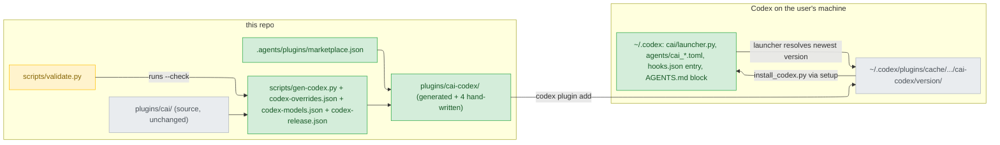
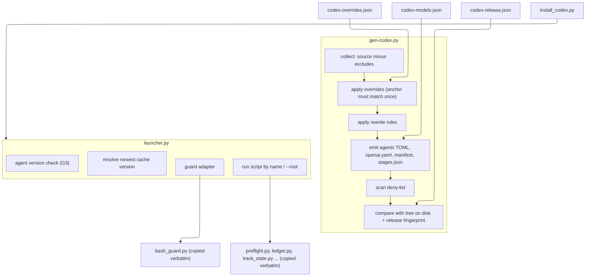
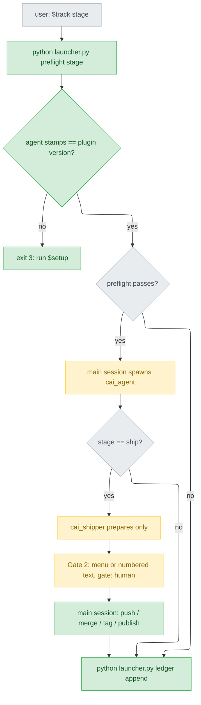
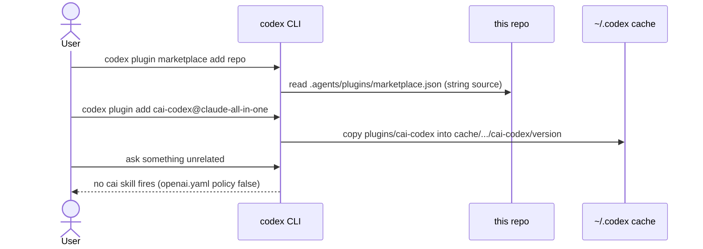
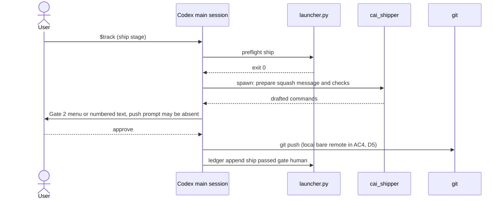
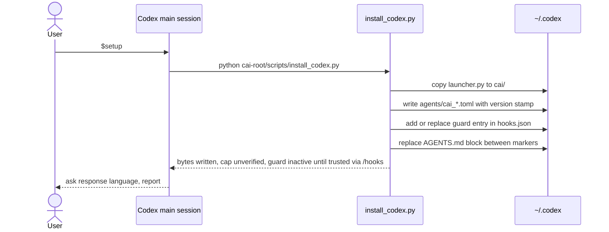
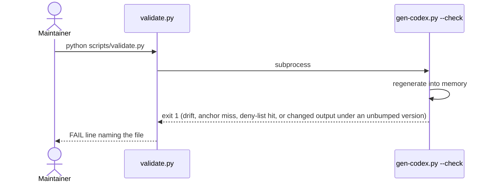
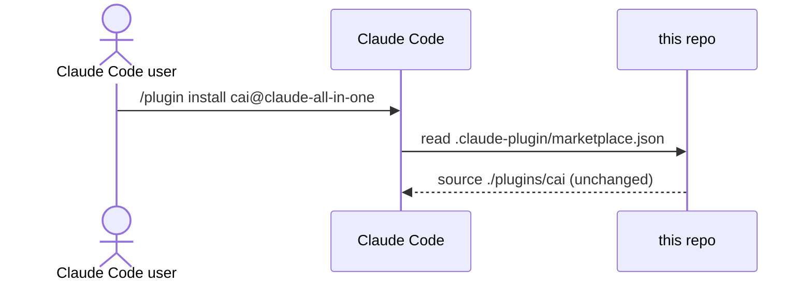

# codex-support — detail design

## 維護說明（2026-10-27）

本檔是歷史設計紀錄，保留決策、驗收依據與實作偏差；不是待執行計畫。原簽核狀態、版本、行號及未驗證標記描述撰寫當時，整併不代表重新簽核或重做實測。

名詞：設計立場（stance）說明取捨；決策紀錄（decisions）保存選擇理由；細部設計（detail）記錄建造規格；需求盤點（intake）保存驗收條件。下方英文標題與識別碼沿用原文，便於對照歷史。

原先兩套 plugin 各自升版及 gen-codex --release 的程序已由 [統一發版設計](2026-09-26-release-versioning-detail.md) 取代。現行產生器與手寫檔案邊界以 [`scripts/gen-codex.py:83`](../../scripts/gen-codex.py#L83) 為準。單元提交訊息的後續限制也併入本檔；當時對平台權限的未驗證推測仍是歷史限制，不能視為現行保證。

已併入並移除的同主題文件：`2026-09-18-codex-support-decisions.md`、`2026-09-18-codex-support-stance.md`、`2026-09-23-codex-commit-message-prompts-stance.md`。

補充段落保留原文與原決策編號，避免把不同時點同號的決策當成一項；重複的概覽圖、施工排程與階段交接文字不再複製。

## Reference

Stance doc: docs/design/2026-09-18-codex-support-detail.md
Decisions doc: docs/design/2026-09-18-codex-support-detail.md
Status: approved 2026-09-18. On 2026-09-18 the stance's Sacrifices bullet 3 was reworded after D5; it gets re-signed at Gate 1.

These inputs are fixed:
- stance invariants I1–I9;
- decisions D1–D20, including the Tier 1 answers D1=C, D2=A, D3=A, D4=B and D5=A;
- requirement gaps G1–G3.

This document implements them and re-opens none of them.

Some choices are defaults that still need the user's answer. Each of those carries a `[Qn default]` marker, `n` being its entry under `## Pending questions` in the stage report. An answer replaces exactly the text inside that marker and nothing else.

Evidence paths:
- `E<n>` means row n of `.claude/track/codex-support/discover/experiments.md` (E1 = line 11 … E8 = line 18).
- `raw/` means `.claude/track/codex-support/discover/raw/`.

### Traceability

| From the high-level design | Satisfied by | Status |
|---|---|---|
| UC1 install | U3 (manifest, D6 marketplace, D8 `openai.yaml` ×81) and U6 (marketplace file added last); AC3 run in verify | covered |
| UC2 six stages end to end in the TUI | U1–U5; AC4 in verify with a local bare remote (D5=A) | covered. C12 is not exercised (D5) |
| UC3 Codex setup | U5 (`install_codex.py`, AGENTS.md block, agents, hooks.json) | covered |
| UC4 maintainer drift | U1 (`--check`: drift, anchor miss, deny-list), U3 (release fingerprint), `validate.py` wiring | covered |
| UC5 Claude users see no change | Every unit writes outside `plugins/cai/`. `test_gen_codex.py` asserts `git diff main -- plugins/cai/` is empty | covered |
| R1 `${CLAUDE_PLUGIN_ROOT}` stays literal | U1 rewrite rules plus the launcher (D1=C); deny-list count must be 0 (I6) | covered |
| R2 bash-only syntax in PowerShell 5.1 | U2 overrides for 8 lines in 4 files (D16); a fenced-block deny-list | covered |
| R3 Claude-only claims copied over | U2 overrides; a `--check` deny-list of Claude-only tokens (I4) | covered |
| R4 ship's irreversible steps unguarded | U2 overrides move them to the main session (I9); U4 guard adapter plus U5 hooks.json (D4) | covered. Guard firing is UNVERIFIED (C9) |
| R5 no network in a subagent | Same override as R4: pushes run in the main session (I9) | covered |

## Requirement

A Codex CLI user installs `cai-codex` from this repo, runs `$setup` once, and can then run `$track` through all six stages in the interactive TUI. That includes the two human gates and the `preflight.py`/`ledger.py` program gates. `plugins/cai/` and Claude Code's behaviour stay byte-identical (I1).

We know it worked when:
- AC1, AC2, AC5, AC7 and AC8 pass under `validate.py` and `pytest`;
- AC3 and AC4 pass in verify's manual TUI run;
- the Codex README's mapping table (AC6) marks every row "verified", "documented, not tested" or "degraded", and the push-approval row reads "documented, not tested" (D5).

## Glossary

| Term | Definition | Where it lives |
|---|---|---|
| source tree | The Claude plugin that every Codex file is derived from. | .claude-plugin/marketplace.json:11 |
| generator | The maintainer script that turns the source tree into the Codex tree and checks it. | new — scripts/gen-codex.py |
| Codex tree | The Codex plugin: generated files plus the listed hand-written files. | new — plugins/cai-codex/ |
| override | One entry that replaces an exact source sentence or paragraph (the anchor) in one file with Codex text. | new — scripts/codex-overrides.json |
| anchor | The exact source text an override must find, once, in its target file; if it is not found, `--check` fails. | concept |
| rewrite rule | A mechanical token substitution applied to every generated text file after the overrides, e.g. `/cai:x` becomes `$x`. | new — scripts/gen-codex.py |
| deny-list | Tokens that must not appear in generated output, e.g. `${CLAUDE_PLUGIN_ROOT}` or `AskUserQuestion`; a hit fails `--check`. | new — scripts/gen-codex.py |
| hand-written list | Paths inside the Codex tree that the generator never writes, only checks for existence. | new — scripts/gen-codex.py |
| tier table | The Codex model and reasoning effort for each role (D3). | new — scripts/codex-models.json |
| role | A component's tier name (chore/build/think), read from the source's assignments. | plugins/cai/models.json:1 |
| release record | The cai-codex version plus a fingerprint of the generated output (D13). | new — scripts/codex-release.json |
| fingerprint | The SHA-256 over the sorted (relative path, bytes) pairs of every generated file, the manifest excluded. | concept |
| launcher | The fixed-path script that every generated command goes through (D1=C). It resolves the newest cached Codex tree, runs a named script there, checks agent versions (G3) and adapts guard payloads. | new — plugins/cai-codex/scripts/launcher.py |
| installer | The script `$setup` runs. It installs the launcher, the agents, the hook entry and the AGENTS.md block. | new — plugins/cai-codex/scripts/install_codex.py |
| cai root | The absolute directory of the newest cached Codex tree, printed by `launcher.py --root`. | concept |
| agent TOML | The Codex agent definition generated from a source agent `.md`, named `cai_<name>` (D2=A). | new — plugins/cai-codex/agents/ |
| version stamp | The first-line comment `# cai-codex-version: <v>` in every agent TOML. | concept |
| guard | The existing pre-tool-use command checker. | plugins/cai/scripts/bash_guard.py:171 |
| guard adapter | The launcher mode that normalizes a Codex hook payload into the shape the guard reads (`tool_input.command` as a string, `tool_name`). | new — plugins/cai-codex/scripts/launcher.py |
| stages table | Which agent runs each stage; the Codex copy carries the prefixed names. | plugins/cai/skills/track/stages.json:13 |
| AGENTS.md block | The marked region of `~/.codex/AGENTS.md` holding the Codex rules (D11). | concept |
| Codex README | The user-facing install guide and mapping table (AC6). | new — plugins/cai-codex/README.md |
| Codex marketplace | The native marketplace file naming `./plugins/cai-codex` with a string `source` (D6). | new — .agents/plugins/marketplace.json |

## Budgets

| What | Number | Where it comes from |
|---|---|---|
| Files in the source tree | 195 | `find plugins/cai -type f \| wc -l`, 2026-09-18 |
| Lines carrying `${CLAUDE_PLUGIN_ROOT}` (files) | 209 (97) | grep, 2026-09-18; blindspot.md:16 |
| …of which are `python ${CLAUDE_PLUGIN_ROOT}/scripts/*.py` invocations | 17 | grep, 2026-09-18 |
| Lines naming `AskUserQuestion` (files), each needing an override or a rewrite | 33 (13) | grep, 2026-09-18 |
| Lines naming `/cai:` (files) | 55 (28) | grep, 2026-09-18 |
| Bash-only command lines (files) needing D16 overrides | 8 (4) | grep: `skills/quiz/SKILL.md:21-22`, `refactor/references/selection.md:22,25,28`, `procedure-scan.md:19`, `stage-ship.md:69,112` |
| Agent TOMLs generated | 10 | `ls plugins/cai/agents` |
| `agents/openai.yaml` files with the implicit-invocation policy off | 81 | 72 catalog + 9 skills declaring `disable-model-invocation: true` (grep, 2026-09-18) |
| Rules bytes placed in the AGENTS.md block | 15392 | `wc -c plugins/cai/rules/*.md` |
| Model tiers in the tier table | 3 | D3 |
| New subprocess calls added to `validate.py` | 1 | mirrors `scripts/validate.py:1414` |
| Deny-list hits allowed in generated output | 0 | I4, I6 |

## Design decisions

Every row is a consequence of a decision already made. None is a new trade.

- **Generation order.**
  - Order: collect, then anchored overrides, then rewrite rules, then emit (agent TOMLs, `openai.yaml`, manifest, `stages.json`), then the deny-list scan over everything emitted, then the comparison with disk and with the release fingerprint.
  - Overrides run first because their anchors are source text (I3). Rewrites run second so that an override's replacement text is also rewritten.
  - Serves: I2, I3, I4.
- **Everything is generated except four listed files.** The four hand-written files are the Codex setup skill, `launcher.py`, `install_codex.py` and `README.md` (D18). Serves: I2.
- **Excluded from the Codex tree.**
  - Out of scope in the stance:
    - `skills/usage/`, `skills/setup/` (replaced by the hand-written one), `evals/` and `prices.json`;
    - `scripts/{statusline,install_statusline,usage_report,context_peak}.py`.
  - Maintainer-only generators: `scripts/gen-{models,commands}.py`.
  - `hooks/`, because D4=B means setup writes the hook.
  - Serves: stance Out of scope.
- **`${CLAUDE_PLUGIN_ROOT}` rewrites (D1=C).**
  - `python ${CLAUDE_PLUGIN_ROOT}/scripts/<x>.py` becomes `python "$HOME/.codex/cai/launcher.py" <x>` [Q1 approved 2026-09-18].
  - Any other `${CLAUDE_PLUGIN_ROOT}/<path>` becomes `<cai-root>/<path>`, and each affected file gets one preamble line saying `<cai-root>` is what `python "$HOME/.codex/cai/launcher.py" --root` prints.
  - `$HOME` expands inside double quotes in both PowerShell and POSIX shells.
  - Python is on PATH as `python` in Codex's PowerShell on this machine (E7, experiments.md:17). On other machines this is UNVERIFIED; if it is wrong, every program gate fails loudly with "not found".
  - Serves: I6, R1.
- **Agents (D2=A, D3=A, D17).**
  - Each `agents/<n>.md` becomes `agents/cai_<n>.toml` with:
    - `name`, `description`;
    - `model` and `model_reasoning_effort` from the tier table, by the source's role;
    - `sandbox_mode` from the source's declared intent, commented as unenforced;
    - `developer_instructions` = the rewritten body, prefixed by a line listing the source `tools:` as "allowed, not enforced by Codex".
  - The fields `name`, `description`, `model`, `sandbox_mode` and `developer_instructions` are what the E5 probe agent used and Codex accepted (E5, experiments.md:15).
  - `model_reasoning_effort` as an agent-TOML key is UNVERIFIED (the doc fetch found no field list). If it is wrong, the effort is ignored or the agent fails to load; AC4 catches either.
  - The version stamp is a comment, so no unknown key is introduced.
  - In `stages.json` and in every dispatch sentence, agent names get the `cai_` prefix. The deny-list rejects unprefixed agent names in dispatch position.
  - Serves: D2, D3, I5.
- **Implicit invocation.** Every skill whose source frontmatter says `disable-model-invocation: true` gets `agents/openai.yaml` with `policy.allow_implicit_invocation: false`. That is 72 catalog skills (D8) plus 9 skills; the source flag means the same thing C3 tests. The generated `SKILL.md` frontmatter keeps only `name` and `description`, the subset the E3/E4 probes used. Serves: D8, AC3.
- **Ship (I9, G1).**
  - Overrides in `stage-ship.md`, `shipper.md` and `track/SKILL.md` make the shipper prepare only.
  - The main session runs push, merge, tag, publish and ticket-close after Gate 2 (`plugins/cai/skills/track/references/stage-ship.md:7-8`).
  - Before Gate 2, the main session states that Codex's push-approval prompt may be absent.
  - Serves: I9, G1, R4, R5.
- **Verify and build dispatch (D9).** Overrides make the main session dispatch the four reviewers, and any helpers of `build`. `cai_verifier` reconciles; it does not spawn. Serves: D9, D20.
- **Gates (D10, I7).** Overrides replace every "`AskUserQuestion` …" instruction with: use `request_user_input` if the tool is present, otherwise numbered options answered in text; either way the main session writes `gate: human`. Serves: I7, I8.
- **Rules (D11, I4).** Rule sentences that are true only on Claude get overrides. Their text goes into the AGENTS.md block.
  - Known sites: `model-selection.md:26,30-32`, `workflow.md:27`, `option-explainer.md:54` (blindspot.md:24).
  - The deny-list finds the rest.
- **Version (D13).**
  - `plugins/cai-codex/.codex-plugin/plugin.json` carries the version from the release record [Q1 approved 2026-09-18: start at `0.1.0`]. `.codex-plugin/plugin.json` with `version` is the manifest shape Codex installed under a version directory in E3 (`raw/e3-exec-dollar-form.jsonl:5`).
  - `plugins/cai/` is never bumped by this work (I1).
- **Test isolation (D14).** Verify uses the real `~/.codex` with backup, restore and `changes.log`.
- **`CODEX_HOME` and the launcher's fixed path.**
  - The launcher and the installer read `CODEX_HOME` (default `~/.codex`) to find the plugin cache, the agents directory, `hooks.json` and `AGENTS.md`.
  - The launcher itself is always installed at `$HOME/.codex/cai/launcher.py`, even when `CODEX_HOME` points elsewhere. Generated text must name one path that expands in both PowerShell and POSIX shells, and it cannot rely on an optional variable being set (D1=C rests on the path being fixed).
  - The `hooks.json` entry stays consistent because the installer writes the launcher's absolute path into it.

## Diagrams

### Architecture

Look at the two arrows between the cache and `~/.codex`. Setup copies from the cache into fixed paths once. After that, every command goes the other way, from the fixed launcher back into whatever version is newest in the cache. That round trip is what makes plugin updates work without re-running setup for the launcher itself.

### Component

What to look at: the source scripts, shown grey, are copied byte for byte. Everything Codex-specific at run time sits in two new files, the launcher and the installer. At build time it sits in the generator's six steps.

### Flow

Two branches are new:
- the version check that runs before preflight (G3);
- the ship branch, where the irreversible steps leave the subagent and run in the main session after Gate 2 (I9).

### Sequence — UC1

The native marketplace file wins over `.claude-plugin/` (E2), so Codex never sees the untranslated Claude tree (E1).

### Sequence — UC2

The push arrow comes from the main session, not from the subagent. In AC4 the remote is a local path, so no network prompt is expected there (D5).

### Sequence — UC3

Each write replaces cai's own region or files, so a second run leaves the same state (AC8).

### Sequence — UC4

There are four distinct reasons for exit 1, and each prints its own `DRIFT` / `ANCHOR` / `DENY` / `UNRELEASED` prefix.

### Sequence — UC5

Nothing Codex-related is on this path. `.agents/` and `plugins/cai-codex/` are never read by Claude Code, whose marketplace names only `./plugins/cai` (.claude-plugin/marketplace.json:11).

## Implementation spec

### gen-codex.py

- **Responsibility:** produce the Codex tree from the source tree, or check that it is current.
- **Interface:**
  - `python scripts/gen-codex.py [--check] [--source DIR] [--out DIR] [--release X.Y.Z]`.
  - The defaults are `--source plugins/cai --out plugins/cai-codex`.
  - Exit codes: 0 means ok; 1 means drift, anchor miss, deny-list hit or unreleased change; 2 means bad arguments or an unreadable input file.
  - Internal pure functions, for tests:
    - `collect(source: Path) -> dict[str, bytes]`
    - `apply_overrides(files: dict[str, str], overrides: list[Override]) -> dict[str, str]`, which raises `AnchorError`
    - `rewrite(files: dict[str, str]) -> dict[str, str]`
    - `emit(files, tiers: dict, version: str) -> dict[str, bytes]`
    - `deny_hits(files) -> list[tuple[str, int, str]]`
    - `fingerprint(files) -> str`
- **Data:**
  - `codex-overrides.json`: `{"overrides": [{"target": "skills/track/references/approval-gates.md", "anchor": ["line", "..."], "replacement": ["line", "..."], "why": "I4: ..."}]}`. The target is relative to the source root. The anchor and replacement are lists of lines, joined with `\n`. The anchor must occur exactly once in the target.
  - `codex-models.json`: `{"roles": {"chore": {"model": "gpt-5.6-luna", "effort": "low"}, "build": {"model": "gpt-5.6-terra", "effort": "medium"}, "think": {"model": "gpt-5.6-terra", "effort": "high"}}}`. Roles are read from the source's `models.json` assignments; the tier table only maps role to Codex values.
  - `codex-release.json`: `{"version": "0.1.0", "fingerprint": "sha256:<hex>"}`.
- **Errors:**
  - An anchor found 0 or more than once prints `ANCHOR <target>: found N` and exits 1.
  - A `target` that does not exist in the source prints `ANCHOR <target>: missing file` and exits 1. It is treated as drift, because a renamed source file is the likely cause.
  - A deny-list hit prints `DENY <path>:<line>: <token>` and exits 1.
  - `--check` with an on-disk mismatch prints `DRIFT <path>` and exits 1.
  - If the fingerprint differs from the release record, it prints `UNRELEASED: output changed, run --release <greater version>` and exits 1.
  - `--release` with a version not greater than the recorded one exits 2.
  - Write mode writes every file and then deletes generated files that are no longer produced. Hand-written paths are never touched. A crash mid-write leaves a tree that `--check` reports as drift, and re-running write mode repairs it.
- **Deny-list:**
  - Anywhere in the file: `${CLAUDE_PLUGIN_ROOT}`, `AskUserQuestion`, `/cai:`, `subagent_type`, `CLAUDE_CODE_`, `~/.claude/`, `CLAUDE.md`. The `CLAUDE.md` token applies only to rules and agents; a skill may still mention the user's project file.
  - Inside fenced code blocks only: `&&`, `$(date`, `2>/dev/null`, `${VAR:-`.
  - Unprefixed agent names in dispatch position.
  - The exact list is a constant with one comment per entry citing the invariant it enforces.
- **Concurrency:** single writer. Two concurrent write runs could interleave; this is a maintainer tool and nothing runs it concurrently. It is not safe to run while pytest runs, because tests call it on temp dirs only; `--out` defaults to the real tree.
- **Observability:** one line per finding with a fixed prefix, then a summary line `N file(s) generated, M finding(s)`. This mirrors gen-models.py's output shape (plugins/cai/scripts/gen-models.py:114-121).
- **Where it lives:** `scripts/gen-codex.py`, new. It is Ours, because it assumes this repo's layout (CLAUDE.md, "Who a file is for").
- **What it reuses:**
  - The shape of the argparse `--check` flow in gen-models.py (plugins/cai/scripts/gen-models.py:85-125).
  - The frontmatter split in gen-models.py (plugins/cai/scripts/gen-models.py:46-53), reimplemented rather than imported, because that file sits under `plugins/cai/` and importing it is harmless but couples the two.

### launcher.py

- **Responsibility:** from a fixed path, run the right version of a cai-codex script.
- **Interface:**
  - `python "$HOME/.codex/cai/launcher.py" <script-name> [args...]` runs `<cai-root>/scripts/<script-name>.py` with the args, passes the exit code through, and is run from the user's cwd.
  - `python ... --root` prints the cai root.
  - `python ... guard` reads a Codex hook payload on stdin and pipes an adapted payload to `bash_guard.py`, returning its exit code.
  - Before any `<script-name>` run, `preflight` included, it checks agent version stamps.
  - Exit codes: 3 means agent version mismatch; 4 means no cached cai-codex found; otherwise the child's code.
- **Data:**
  - The cache root is `$CODEX_HOME` or `~/.codex`, then `/plugins/cache/*/cai-codex/<version>/`. The version is picked as the highest by numeric (major, minor, patch). The layout `cache/<marketplace>/<plugin>/<version>` was observed in E1 (`raw/e1-plugin-add.txt:2`).
  - Stamps are read from `$CODEX_HOME/agents/cai_*.toml`, first line only.
  - Adapter input is the Codex payload, UNVERIFIED (C9):
    - `tool_input.command` may be a string or an argv list. For a list whose first element is a shell executable followed by `-Command` or `-c`, the adapter takes the next element; otherwise it joins the list with spaces.
    - `tool_name` is set to `Bash` on POSIX and `PowerShell` on Windows, so `bash_guard.py:184` picks the right rule set.
    - Other fields pass through.
- **Errors:**
  - An unparsable payload makes the guard mode exit 0, matching bash_guard's fail-open (plugins/cai/scripts/bash_guard.py:174-175).
  - A mismatch prints `cai-codex agents are version A, plugin is version B: run $setup` to stderr and exits 3.
  - A missing cache prints `cai-codex is not installed` and exits 4.
- **Concurrency:** stateless. It reads the cache and the agents directory only, so it is safe to run twice or in parallel.
- **Observability:** silent on success; one stderr line per failure; `--root` output is the path only.
- **Where it lives:** `plugins/cai-codex/scripts/launcher.py`, new and hand-written. The installed copy is `$HOME/.codex/cai/launcher.py` [Q1 approved 2026-09-18].
- **What it reuses:**
  - The highest-version rule `/cai:setup` already uses (plugins/cai/skills/setup/SKILL.md:16-17).
  - bash_guard.py, unmodified, as a child process.

### install_codex.py

- **Responsibility:** make a user's `~/.codex` match the installed cai-codex version.
- **Interface:** `python <cai-root>/scripts/install_codex.py` with no arguments. The setup skill resolves `<cai-root>` once from its own `SKILL.md` path (C8), because the launcher does not exist yet. Exit codes: 0 means ok; 1 means a write failed, with the failing path printed.
- **Data (writes, in order):**
  1. `$HOME/.codex/cai/launcher.py`, copied from its own tree.
  2. `$CODEX_HOME/agents/cai_*.toml`, copied from `<cai-root>/agents/`; `cai_*.toml` files no longer shipped are removed.
  3. `$CODEX_HOME/hooks.json`. The installer adds, or replaces, the one PreToolUse entry whose command contains `.codex/cai/launcher.py`. That entry's command is `"<sys.executable>" "<abs home>/.codex/cai/launcher.py" guard`, with absolute paths computed at install time, so no variable expansion happens at hook time. Other entries are preserved byte for byte. The hooks.json schema is UNVERIFIED (C9); it copies the shape of the E6 probe, and verify captures the real one.
  4. `$CODEX_HOME/AGENTS.md`. The installer replaces the region between `<!-- cai-codex:begin -->` and `<!-- cai-codex:end -->` [Q1 approved 2026-09-18], or appends it if absent, with the generated rules. Text outside the markers is untouched.
  - Output: `rules: <n> bytes (Codex's AGENTS.md cap is unverified)` (D19), `guard: installed, inactive until you trust it with /hooks` (G2), and one line per file written.
- **Errors:**
  - Each step writes to a temp file and then does `os.replace`, so a failure leaves the previous file intact.
  - An invalid JSON `hooks.json` makes the installer stop before step 3 and print the parse error; it never overwrites a file it cannot read.
  - A begin marker without an end marker stops before step 4.
- **Concurrency:** idempotent. Two runs give the same end state. Two simultaneous runs could interleave step 3; this is not guarded, because setup is interactive and single.
- **Observability:** one line per write, plus the three status lines above.
- **Where it lives:** `plugins/cai-codex/scripts/install_codex.py`, new and hand-written.
- **What it reuses:**
  - The naming and single-purpose shape of `install_statusline.py` (plugins/cai/scripts/install_statusline.py:1).
  - The "copy wholesale, updates propagate" behaviour of `/cai:setup` step 2 (plugins/cai/skills/setup/SKILL.md:25-31).

### Codex setup skill

- **Responsibility:** tell the Codex agent how to run the installer and finish setup.
- **Interface:**
  - `$setup`, with `openai.yaml` policy false.
  - Step 1: resolve `<cai-root>` as two directories up from this `SKILL.md`.
  - Step 2: run the installer.
  - Step 3: ask the response language with a menu or numbered text, and edit the language line inside the AGENTS.md block. This mirrors plugins/cai/skills/setup/SKILL.md:38-50.
  - Step 4: tell the user to run `/hooks` and trust the cai guard.
  - Step 5: report.
- **Data:** none of its own.
- **Errors:** a non-zero installer exit means stop and quote its output.
- **Concurrency:** n/a.
- **Observability:** the installer's lines, quoted.
- **Where it lives:** `plugins/cai-codex/skills/setup/SKILL.md`, new and hand-written.
- **What it reuses:** the step structure of `/cai:setup` (step headings at plugins/cai/skills/setup/SKILL.md:11,25,38,206). Its steps 4–7 have no Codex counterpart: CLAUDE.md bootstrap, the guard self-test, which is replaced by the trust notice (G2), and the status line, which is out of scope.

### Codex README and marketplace

- **Responsibility:** tell Codex users what they get, and list the mapping.
- **Interface:** a Markdown mapping table with columns `Claude Code behaviour | Codex counterpart | Status | Evidence`, where Status is one of `verified`, `documented, not tested`, `degraded`. It must contain these rows:
  - the push-approval row, as `documented, not tested` (D5);
  - the guard row, as `documented, not tested`, "inactive until trusted" (G2);
  - the `tools:`/sandbox row, as `degraded` (E5);
  - the usage row, as `degraded` (D12).
- **Data:** `.agents/plugins/marketplace.json` = `{"name": "claude-all-in-one", "plugins": [{"name": "cai-codex", "source": "./plugins/cai-codex", ...}]}`. The name follows `.claude-plugin/marketplace.json:2`.
- **Errors:** `validate.py` fails if `source` is not a string (D6).
- **Concurrency:** n/a.
- **Observability:** n/a.
- **Where it lives:** `plugins/cai-codex/README.md` (hand-written) and `.agents/plugins/marketplace.json`, both new.
- **What it reuses:** the table in intake.md:26-34 as the row list.

### validate.py wiring

- **Responsibility:** run the generator's check, and cover the Codex payload in the guard cases.
- **Interface:**
  - `check("plugins/cai-codex matches gen-codex.py", rc == 0)` after `subprocess.run([sys.executable, "scripts/gen-codex.py", "--check"])`, placed beside the gen-models block (scripts/validate.py:1405-1418).
  - `check(".agents/plugins/marketplace.json sources are strings", ...)`.
  - New `CASES` entries: `git push --force origin main` in a Codex-shaped payload, run through `launcher.py guard`, expecting 2 (AC5). The payload shape follows the documented form and is marked UNVERIFIED in a comment.
- **Errors:** as the existing checks.
- **Concurrency:** n/a.
- **Observability:** PASS/FAIL lines.
- **Where it lives:** `scripts/validate.py`, which exists.
- **What it reuses:** `check()` (scripts/validate.py:18) and `run_hook()` (scripts/validate.py:2185).

## Naming

| Name | What it is | Chosen by |
|---|---|---|
| `scripts/gen-codex.py` | generator | the user, 2026-09-18 (intake approach B′) |
| `plugins/cai-codex/` | Codex tree | the user, 2026-09-18 (intake approach B′) |
| `.agents/plugins/marketplace.json` | Codex marketplace | the user, 2026-09-18 (intake approach B′); path required by Codex (E2) |
| `cai-codex` | plugin name in the Codex marketplace and manifest | follows the directory name, as `cai` follows `plugins/cai` at .claude-plugin/marketplace.json:9,11 |
| `claude-all-in-one` | Codex marketplace name | follows .claude-plugin/marketplace.json:2 |
| `scripts/codex-overrides.json` | override list | follows the JSON data-file convention of plugins/cai/models.json:1 and the hyphenated `scripts/` names (`scripts/run-validate-hook.cmd`) |
| `scripts/codex-models.json` | tier table | same convention as above |
| `scripts/codex-release.json` | release record | same convention as above |
| `cai_<agent>` (e.g. `cai_shipper`) | agent names and TOML files | the user, 2026-09-18 (D2=A) |
| `$setup`, `$track`, … | skill invocations | D7 (Tier 2, 2026-09-18) |
| `plugins/cai-codex/scripts/install_codex.py` | installer | follows `install_statusline.py` at plugins/cai/scripts/install_statusline.py:1 |
| `$HOME/.codex/cai/` | install directory for the launcher | follows the `<config dir>/cai/` convention at plugins/cai/scripts/usage_collector.py:56 |
| `launcher.py` (in `plugins/cai-codex/scripts/` and `$HOME/.codex/cai/`) | launcher file name | [Q1 approved 2026-09-18] |
| `<!-- cai-codex:begin -->` / `<!-- cai-codex:end -->` | AGENTS.md markers | [Q1 approved 2026-09-18] |
| `# cai-codex-version: <v>` | version stamp line | [Q1 approved 2026-09-18] |
| `0.1.0` | first cai-codex version | [Q1 approved 2026-09-18] |
| `<cai-root>` | placeholder used in generated prose for the cai root | [Q1 approved 2026-09-18] |
| `DRIFT` / `ANCHOR` / `DENY` / `UNRELEASED` | `--check` finding prefixes | follows `DRIFT` at plugins/cai/scripts/gen-models.py:116 |
| exit 3 / exit 4 | launcher: version mismatch / not installed | [Q1 approved 2026-09-18] |

## Change points

| Path | Change | Exists today |
|---|---|---|
| scripts/gen-codex.py | new generator | no |
| scripts/codex-overrides.json | new override list | no |
| scripts/codex-models.json | new tier table | no |
| scripts/codex-release.json | new release record | no |
| plugins/cai-codex/** | new generated tree plus 4 hand-written files | no |
| .agents/plugins/marketplace.json | new; added in the last unit | no |
| scripts/validate.py | one `--check` call, a string-source check, Codex guard `CASES` | yes |
| tests/test_gen_codex.py | new | no |
| tests/test_codex_launcher.py | new | no |
| tests/test_codex_install.py | new | no |
| CLAUDE.md | "Who a file is for" names `plugins/cai-codex/` as a second shipped tree [Q2 approved 2026-09-18: edit] | yes |
| plugins/cai/** | none (I1) | yes |

No new dependency: the standard library only, the same as every existing script.

## Failure modes

| Situation | What happens | What the caller sees |
|---|---|---|
| A source sentence under an override is edited | Anchor found 0 times | `validate.py` FAIL; `ANCHOR <target>: found 0` |
| A new Claude-only token appears in the source | Deny-list hit | FAIL; `DENY <path>:<line>: <token>` |
| The generator output changed but the version did not | Fingerprint mismatch | FAIL; `UNRELEASED ...` |
| The plugin was updated and setup was not re-run | Version stamps differ | Every stage refuses with exit 3: "run $setup" (G3) |
| `python` is not on PATH in the user's Codex shell | Every generated command fails | "python not found" at the first preflight. UNVERIFIED off this machine (E7 verified here) |
| The Codex hook payload is not the documented shape | The adapter passes an empty command; the guard allows it | Nothing. The guard is silently inactive, and the README row already says "documented, not tested"; verify captures the real payload (C9) |
| The user never trusts the hook | The guard never runs | The setup report says so (G2) |
| The cap on the global `AGENTS.md` truncates the block | The last rules are unseen | Verify's quote-the-last-sentence check fails (D11) |
| `model_reasoning_effort` is not a valid agent key | The agent fails to load, or the effort is ignored | A dispatch error in AC4; fix in the generator |
| A slug is unavailable for an account | Dispatch error | An error naming the model (D3 accepted) |
| A push from the main session raises no prompt | Force push held only by Gate 2 and the guard | Nothing before release; README row "documented, not tested" (D5) |
| `hooks.json` is corrupt | The installer stops before touching it | The parse error and path |

## Rollout

- **Pieces.** It ships as one PR built in units U1–U6. Nothing is installable until U6 adds `.agents/plugins/marketplace.json`, so a partial merge exposes no half-working plugin to Codex users. The smallest useful piece is U1–U3: a generated tree that `validate.py` checks.
- **Existing data.** Nothing is migrated. Claude users' installs, `~/.claude/` and ledgers are untouched (I1). Existing `.claude/track/` directories are read by the Codex copy of the same scripts unchanged (plugins/cai/scripts/track_state.py:21).
- **In-flight callers.** Claude Code sessions see no change. Before this lands, Codex users who added this repo got the untranslated tree (E1). After it lands, a re-add picks the native file (E2).
- **Rollback.** Revert the PR; nothing in the repo was migrated. A Codex user who installed rolls back with `codex plugin remove cai-codex@claude-all-in-one` and by deleting the files the installer wrote:
  - `~/.codex/cai/`
  - `~/.codex/agents/cai_*.toml`
  - the cai entry in `hooks.json`
  - the marked `AGENTS.md` block

  The README lists these. No uninstall code is added (nothing asked for it).
- **Versioning.**
  - cai-codex follows its own version in `scripts/codex-release.json` (D13), starting at [Q1 approved 2026-09-18: `0.1.0`], and is bumped whenever the generated output changes.
  - `plugins/cai/`'s version is not bumped by this PR, because nothing under it changes (I1).

## Verification

| Criterion | Level | What it needs | Green before |
|---|---|---|---|
| UC4/AC1: clean tree `--check` exits 0 | unit | real repo tree; pytest `tests/test_gen_codex.py` | U1 merges |
| UC4/AC1: edited anchor makes `--check` exit 1 | unit | temp copy of the source with one anchor sentence altered, `--source/--out` temp dirs | U1 merges |
| R1/I6: zero `${CLAUDE_PLUGIN_ROOT}` in output | unit | generated temp tree | U1 merges |
| R3/I4: zero deny-list hits | unit | generated temp tree | U2 merges |
| R2/D16: the 8 bash-only lines rewritten, none left in fenced blocks | unit | generated temp tree | U2 merges |
| I9/G1: ship override text present, and shipper text says prepare only | unit | string asserts on the generated `stage-ship.md` and `shipper.md` | U2 merges |
| D2/D3/D17: 10 `cai_*.toml`, tier table applied, stamp on line 1; `stages.json` agents prefixed | unit | generated temp tree | U3 merges |
| D8: 81 `openai.yaml` with policy false | unit | generated temp tree | U3 merges |
| D13: changed output with an unchanged version exits 1; `--release` refuses a lower version | unit | temp release record | U3 merges |
| UC5/AC2: `git diff main -- plugins/cai/` empty | integration | git in CI | every unit |
| Launcher resolves the highest version; `--root`; exit 3 on stamp mismatch; exit 4 with no cache | unit | fake `CODEX_HOME` with `0.1.0` and `0.2.0` dirs; `tests/test_codex_launcher.py` | U4 merges |
| AC5: guard adapter, string / argv-list / missing command; Windows payload uses PowerShell rules | unit + `validate.py` CASES | synthetic payloads (documented shape, UNVERIFIED) | U4 merges |
| UC3/AC8: installer twice gives one AGENTS.md block, agents copied, other hooks.json entries preserved, output prints bytes and "inactive until trusted" | unit | fake home dir; `tests/test_codex_install.py` | U5 merges |
| D6: marketplace `source` is a string | `validate.py` | repo file | U6 merges |
| AC6: every README row carries a Status. Assert each mandated row's exact Status: push approval = `documented, not tested`; guard = `documented, not tested` with "inactive until trusted"; `tools:`/sandbox = `degraded`; usage = `degraded` | unit | string asserts on `README.md` | U6 merges |
| AC7: `validate.py` and `pytest` green (the known Windows failure excepted) | integration | full suite | every unit |
| UC1/AC3: install, skills visible, no implicit firing | end-to-end, manual | real `~/.codex` with backup, restore, `changes.log` (D14) | verify stage |
| UC2/AC4: six stages `done`, six `passed`, design and ship `gate: human`, bare remote receives the push | end-to-end, manual in the TUI | fixture repo plus a local bare remote inside the writable root (D5=A); setup run; guard trusted | verify stage |
| C9/C11/C13/C14 observations: payload captured, menu seen, AGENTS.md last sentence quoted | end-to-end, manual | same run | verify stage; if any is wrong, return to design |

## Work breakdown

Each unit leaves `validate.py` and `pytest` green (workflow.md, checkpointed units). Deviations are logged in the format `stage-build.md` defines. Run pytest with nothing else editing the tree: pytest mutates real files.

| Unit | Depends on | Can run alongside | Done when |
|---|---|---|---|
| U1 Generator core: collect/exclude, override engine with the anchor rule, the deny-list step shipped with only the two tokens U1's rewrites clear (`${CLAUDE_PLUGIN_ROOT}`, `/cai:`) so `validate.py` stays green, `${CLAUDE_PLUGIN_ROOT}` and `/cai:` rewrites, `--check` (DRIFT/ANCHOR), `--source/--out`, the first override (`approval-gates.md:21`), `validate.py` wiring, first generated tree | nothing | — | the U1 rows in Verification are green |
| U2 Every override: `AskUserQuestion` sites, ship main-session (I9, G1), verify/build flattening (D9, D20), gates (D10), rules sentences (D11), bash-only lines (D16); the rest of the deny-list tokens added in the same unit as the overrides that clear them | U1 | U3 | the U2 rows are green, with 0 deny hits |
| U3 Emitters: agent TOMLs from `codex-models.json`, `stages.json` prefix, `openai.yaml` ×81, `.codex-plugin/plugin.json`, release record plus UNRELEASED check | U1 | U2 | the U3 rows are green |
| U4 Launcher: resolution, run, `--root`, stamp check, guard adapter; `validate.py` Codex CASES | U1 (hand-written list) | U2, U3 | the U4 rows are green |
| U5 Installer and Codex setup skill | U3, U4 | — | the U5 rows are green |
| U6 README mapping table, `.agents/plugins/marketplace.json`, CLAUDE.md edit [Q2] | U2–U5 | — | the U6 rows are green; the Codex tree is installable |

U1 comes first because the override format and the anchor rule are the parts most likely to change once real overrides are written. A wrong format found in U2 costs a rewrite of U1 only.

### Upstream blockers

| What | Owned by | Needed before |
|---|---|---|
| codex-cli installed and logged in on the verify machine | the user | the verify stage (AC3, AC4) |
| `python` on PATH inside Codex's shell (verified on this machine, E7) | the user | the verify stage |
| A person present at the TUI to answer both gates | the user | AC4 |

## 整併補充：codex-support-decisions

來源為原 `2026-09-18-codex-support-decisions.md`；以下僅保留上游背景或實作補充，現況以本檔維護說明為準。

#### Feasibility

"Doc" means it is documented but was not observed in a Codex run.

| Id | Capability | Verdict | Evidence |
|---|---|---|---|
| C1 | `.agents/plugins/marketplace.json` lists a plugin whose `source` is a string. It takes precedence over `.claude-plugin/`, and the object form of `source` is silently dropped. | verified | experiments.md:12; `raw/e2-diag-codex-strsource-list.txt`, `raw/e2-diag-codex-list.txt` |
| C2 | Bare `$name` invokes a plugin skill. | verified | experiments.md:13; `raw/e3-exec-dollar-form.jsonl` |
| C3 | `agents/openai.yaml` `policy.allow_implicit_invocation: false` suppresses implicit firing. Tested on one skill only. | verified | experiments.md:14; `raw/e4-exec-implicit.jsonl`, `raw/e4-exec-implicit-true.jsonl` |
| C4 | A user-level `~/.codex/agents/*.toml` can be dispatched by name, and its `model` override is applied (`gpt-5.5`). | verified | experiments.md:15; `raw/e5-subagent-rollout.jsonl` |
| C5 | A plugin-shipped `agents/*.toml` can be dispatched. | infeasible | experiments.md:15; `raw/e5-plugin-agent-parent-rollout.jsonl` |
| C6 | A subagent's `sandbox_mode` / `tools:` is enforced. It inherits `workspace-write` with no network. | infeasible | experiments.md:15; https://learn.chatgpt.com/docs/agent-configuration/subagents "Codex respects inherited sandbox policies and approval requirements from the parent agent." |
| C7 | `${CLAUDE_PLUGIN_ROOT}` (or `${PLUGIN_ROOT}`) is substituted in a skill body. | infeasible | experiments.md:13; `raw/e3-exec-dollar-form.jsonl:7` |
| C8 | The model reads a skill's `SKILL.md` by its absolute cache path, which includes the version directory. | verified | `raw/e3-exec-dollar-form.jsonl:5`; `raw/e1-plugin-add.txt:2` |
| C9 | A trusted hook fires, and exit 2 blocks. The payload shape is unknown. `plugin_hooks` shows `removed` in `codex features list`. | UNVERIFIED | experiments.md:16; https://learn.chatgpt.com/docs/hooks "Use `/hooks` in the CLI to inspect, review, and trust hook definitions."; the same page says a plugin's hook paths "are resolved relative to the plugin root" and documents `PLUGIN_ROOT`. The user deferred this to verify. |
| C10 | `request_user_input` works in `codex exec`. | infeasible | experiments.md:18; `raw/e8-exec-enabled.jsonl` |
| C11 | `request_user_input` renders as a menu in the TUI with `--enable default_mode_request_user_input`, and has a free-text slot. | UNVERIFIED | experiments.md:18. The user deferred this to verify. |
| C12 | The main session's `git push` raises a Codex approval prompt when network is off. | UNVERIFIED | https://learn.chatgpt.com/docs/agent-approvals-security "By default, network access remains disabled"; no run observed it. **It will not be verified before ship (D5=A):** a local-path push needs no network. The stance's fallback can therefore fire only after release. |
| C13 | A subagent can spawn its own subagent. | UNVERIFIED | Not found at https://learn.chatgpt.com/docs/agent-configuration/subagents (doc fetch 2026-09-18); E5 tested one level only |
| C14 | `project_doc_max_bytes` also caps the global `~/.codex/AGENTS.md`, and what happens past the cap. | UNVERIFIED | https://learn.chatgpt.com/docs/config-file/config-reference "the maximum bytes read from `AGENTS.md` when building project instructions". The default and the global-file behaviour were not found. |
| C15 | `CODEX_HOME` relocates all state, auth included. | verified | https://learn.chatgpt.com/docs/config-file/environment-variables "sets the root for Codex state, including config, auth, logs, sessions, skills, and standalone package metadata" |
| C16 | The ledger still writes a record when there is no Claude session id; usage is left empty and the reason recorded. | verified | `plugins/cai/scripts/ledger.py:236-240` |
| C17 | The plugin cache is keyed by version directory. | verified | `raw/e1-plugin-add.txt:2` |
| C18 | Windows PowerShell 5.1 has no `&&`. | verified | https://learn.microsoft.com/en-us/powershell/module/microsoft.powershell.core/about/about_pipeline_chain_operators "Beginning in PowerShell 7, PowerShell implements the `&&` and `||` operators"; the Codex shell is `WindowsPowerShell\v1.0` (`raw/e3-exec-dollar-form.jsonl:5`) |
| C19 | Model slugs visible to this account: `gpt-5.6-luna` ("Fast and affordable"), `gpt-5.6-terra` ("Balanced"), `gpt-5.5` ("previous-generation"). Whether other accounts see the same list is unknown. | UNVERIFIED | `~/.codex/models_cache.json:178` (`gpt-5.6-luna`). The file was fetched 2026-09-18 and carries a per-account `identity` field. |
| C20 | codex-cli updates itself between runs. | verified | blindspot.md:4 (0.149.1 to 0.155.0 on 2026-09-18) |

#### Ruled out

| Option | Invariant it violates | Evidence |
|---|---|---|
| Add Codex tier or model columns to `plugins/cai/models.json` | I1 | `plugins/cai/models.json` sits under `plugins/cai/` |
| Leave `${CLAUDE_PLUGIN_ROOT}` in the output and hope Codex substitutes it | I6 | C7 |
| Enable network for subagents so the shipper pushes itself | I9 | stance I9; C6 |
| Gates that work only with a menu | I7 (a typed answer must also count) | C10, C11 |
| Copy `approval-gates.md:21` ("`AskUserQuestion` adds that entry itself") unchanged | I4 | `plugins/cai/skills/track/references/approval-gates.md:21` |
| Make the push prompt the only protection, without Gate 2 | I9 | C12 |
| Tie cai-codex's version to cai's version (lockstep) | I1: a Codex-only fix would need an edit to `plugins/cai/.claude-plugin/plugin.json` | `plugins/cai/.claude-plugin/plugin.json:3` |

#### Requirement gaps

| # | The behavioural assumption | Veto condition, or verification path | Deletes |
|---|---|---|---|
| G1 | The user keeps Codex's sandbox and approval prompts on (stance, Sacrifices). | Veto: before Gate 2, the Codex ship stage says the push prompt may be absent. C12 itself stays untested through ship (D5=A), so this statement is the only warning a user gets. Verification path: a user's first real network push, after release. | Any ship text that presents the prompt as guaranteed |
| G2 | The user trusts the guard with `/hooks` after setup (C9). | Veto: setup ends by listing the guard as "inactive until trusted", and the Codex README's mapping row says the same. | Any setup or README that calls the guard active once installed |
| G3 | The user re-runs setup after every plugin update, so the installed agents match (C17). | Veto: a program detects the mismatch between the agents' version and the plugin's version before a stage dispatches. | Any D2 variant that only documents "re-run setup" |

#### Tier 1

##### D1 — How does generated text find the plugin's scripts, now that `${CLAUDE_PLUGIN_ROOT}` is not substituted?

| Option | Rests on | What it costs | Fails when |
|---|---|---|---|
| A — The generator rewrites each root to a path relative to the skill's own `SKILL.md`, and adds one sentence: resolve it from the path you read. | C7, C8 | Generator rules only; nothing is installed. | The model resolves the path against the repo's working directory. That happens silently, on one of 209 sites. |
| B — Setup writes the installed plugin root into the AGENTS.md block, and skills refer to it by name. | C8, C17 | Setup writes one line. | A plugin update moves the root to a new version directory (C17) and setup is not re-run, so the path goes stale. |
| C — Setup installs a small launcher at a fixed user path. The launcher picks the newest cached cai-codex version and runs the named script. | C17 | A hand-written script outside the generator. It must parse the cache layout. | Codex changes its cache layout. |

- **Blast radius:** 97 generated files and every program gate (`plugins/cai/skills/track/SKILL.md:49,63`).
- **Found out when:** AC4's end-to-end run in the TUI. A silent misresolution may only appear in real use, after release.
- **Undo cost:** regenerate. B and C also leave files in users' home directories.
- **Decided:** C, a launcher at a fixed path — chosen by the user via menu ("C 啟動器 (Recommended)"), 2026-09-18. The D2 version check and the D4 hook command both use this launcher's fixed path.

##### D2 — Where are the Codex agents installed, and what are they called?

| Option | Rests on | What it costs | Fails when |
|---|---|---|---|
| A — Personal `~/.codex/agents/`, with names prefixed `cai_`. The generator rewrites the `stages.json` `agent` column and every dispatch sentence. | C4, C5 | One more rewrite rule. The names differ from Claude's. | A dispatch sentence the generator misses. `--check` can assert that zero unprefixed names remain. |
| B — Personal `~/.codex/agents/`, keeping Claude's names. | C4, C5 | No rewrite. | The user already has a personal agent of the same name. Which one wins is UNVERIFIED; verify can install a same-named agent and see. |
| C — Project-scoped `.codex/agents/` in each repo, keeping Claude's names. | C5; the doc at https://learn.chatgpt.com/docs/agent-configuration/subagents says: "`~/.codex/agents/` (personal) or `.codex/agents/` (project-scoped)" | Setup runs once per repo and writes into the user's repo, so the files show up in `git status`. | Dispatch from a project-scoped agent was never observed (E5 tested personal only). |

- **Blast radius:** the user's `~/.codex/agents/` or every repo they use, plus every stage's dispatch.
- **Found out when:** a name clash surfaces only on a user's machine, after release.
- **Undo cost:** renaming or relocating published agents means users must re-install and re-learn the names.
- **Decided:** A, personal `~/.codex/agents/` with a `cai_` prefix — chosen by the user via menu ("A 加 cai_ 前綴 (Recommended)"), 2026-09-18. The prefix applies to agents only; skill names stay as they are (D7).

##### D3 — Which Codex model and reasoning effort does each tier (chore, build, think) run on?

| Option | Rests on | What it costs | Fails when |
|---|---|---|---|
| A — Pin a slug and an effort per tier: chore `gpt-5.6-luna`/low, build `gpt-5.6-terra`/medium, think `gpt-5.6-terra`/high. No listed model is described as stronger than terra (C19). | C4, C19, C20 | A mapping table under `scripts/` (Ours), and re-tiering as models change. | A slug is retired or hidden for this account (C19 is per-account; C20 means the client moves on). Dispatch then breaks for users. |
| B — Set only `model_reasoning_effort` per tier and leave `model` out. | C4 | Nothing to maintain. | Leaving `model` out does not inherit it (UNVERIFIED). Or the user's default is expensive, so cheap tiers are no cheaper. |

- **Blast radius:** every agent TOML, and the cost of every dispatch.
- **Found out when:** A's failure shows only for users whose model list differs, after release. B's cost failure shows on a bill.
- **Undo cost:** regenerate and re-run setup.
- **Decided:** A, pinned slugs — chosen by the user via menu ("A 寫死模型 (Recommended)"), 2026-09-18. The mapping is chore `gpt-5.6-luna`/low, build `gpt-5.6-terra`/medium, think `gpt-5.6-terra`/high. The table lives under `scripts/`, because `models.json` is ruled out by I1.

##### D4 — Where is the bash guard hook declared on Codex?

| Option | Rests on | What it costs | Fails when |
|---|---|---|---|
| A — In the plugin's manifest, using `PLUGIN_ROOT`. | C9 | Generated; nothing is written to the user's home. | `plugin_hooks` really is removed in this build (experiments.md:16), so the guard never runs. |
| B — Setup writes an entry into the user-level `~/.codex/hooks.json`. | C9, plus D1's path | A hand-written write into the user's config. It needs an absolute script path (see D1). | The path goes stale after an update. |
| C — Both. | C9 | Both costs, and the guard may fire twice. | Neither declaration can be trusted. |

- **Blast radius:** who is allowed to force-push or `rm -rf`, which is high by default. It also touches the user's config.
- **Link to D1:** B uses the same path mechanism D1 picks. A uses `PLUGIN_ROOT`, which applies only to hooks.
- **Found out when:** verify's TUI run (deferred there by the user).
- **Undo cost:** B and C leave config in users' homes.
- **Decided:** B, setup writes the hook into `~/.codex/hooks.json`, and its command runs the guard through the D1 launcher — chosen by the user via menu ("B setup 寫入 (Recommended)"), 2026-09-18. It was asked after D1. The main session judged that D1=C did not change D4's options or tier.

##### D5 — Which remote does AC4's end-to-end run push to?

| Option | Rests on | What it costs | Fails when |
|---|---|---|---|
| A — A local bare remote inside the session's writable root. | C6 | No credentials, and nothing leaves the machine. | It never tests C12: a push to a local path needs no network, so no prompt is expected. The stance's key assumption stays untested after verify. |
| B — A local bare remote outside the workspace. | C6, C12 | No credentials. | Whether a write outside the workspace raises a prompt is an inference (blindspot.md:26, :57). Even if it does, it is a different prompt from the network one I9 relies on. |
| C — A throwaway network remote, such as a private repo created for the run and deleted afterwards. | C12 | Needs the user's `gh` or git credentials in the run, a real remote-side effect, and clean-up afterwards. | The credential setup fails inside the sandbox. |

- **Blast radius:** AC4, the primary acceptance criterion (intake.md:20), and whether the stance's C12 assumption is ever checked.
- **Found out when:** verify. With A, C12 is never found out before release.
- **Undo cost:** low for the test itself. Credentials are high by default.
- **Decided:** A, a local bare remote inside the writable root — chosen by the user via menu ("A 工作區內本機"), 2026-09-18. **This was not the recommended option (C was).** The consequences are carried as follows:
  - C12 will not be verified before ship.
  - The stance's fallback ("if verify shows push goes through without a prompt, return to stance, option 2") cannot fire during verify. It can only fire after release, on a Codex user's first real network push.
  - The Codex README's mapping table must list the push-approval row as "documented, not tested".
  - Verify has to check that this row is present.

#### Tier 2

##### D6 — Which marketplace form?

Use `.agents/plugins/marketplace.json` with a string `source`, and have `validate.py` check that the source is a string. The object form is dropped silently (C1, experiments.md:12). **Found out when:** the next `validate.py` run.

##### D7 — What are the skills invoked as?

Keep Claude's skill names, so skills are invoked as `$track`. AC3's rewrite names `$track` (blindspot.md:34), and the bare form works (C2, experiments.md:13). **Found out when:** AC3's install check.

##### D8 — How are the 72 catalog skills kept from firing implicitly?

The generator adds `agents/openai.yaml` with `allow_implicit_invocation: false` to each of the 72. None has one today (stance UC1), and C3 shows the flag works (experiments.md:14). **Found out when:** `--check` counts 72 files, and AC3 runs.

##### D9 — How do `build` and `verify` dispatch reviewers and helpers?

The main session dispatches them, and `verifier` only reconciles the results; the same goes for `build`. One-level dispatch is the only kind observed (C4, experiments.md:15). Nesting (`plugins/cai/agents/verifier.md:7`, `implementer.md:6`) is not documented anywhere fetched and is untested (see the Feasibility row on nested spawn). Being wrong here costs extra main-session context and one override to delete. **Found out when:** AC4, or when verify proves nesting works.

##### D10 — How do gates ask on Codex?

Ask with the menu tool when it is present; otherwise ask with numbered options answered in text. Either way, the main session writes `gate: human` (`approval-gates.md:53-55`, stance I7). `raw/e8-exec-enabled.jsonl` shows menus are impossible in exec mode. **Found out when:** AC4 in the TUI.

##### D11 — What goes into `~/.codex/AGENTS.md`, and how is a size cap caught?

All 8 rules go into one marked block, with their Claude-only sentences overridden (I4; intake.md:24, AC8). Together they are 15,392 bytes (`wc -c plugins/cai/rules/*.md`). Nothing is cut in advance, because the cap is unknown. Verify has the model quote the last rule's final sentence from the installed block, so silent truncation is caught before release. **Found out when:** verify's AC8 check.

##### D12 — What happens to usage accounting in the Codex ledger?

It is accepted as degraded: usage stays empty and the reason is recorded, while the record is still written (C16, `plugins/cai/scripts/ledger.py:236-240`). A Codex usage collector is out of scope (stance, Out of scope). **Found out when:** AC4's `ledger.jsonl`.

##### D13 — What is cai-codex's version policy?

cai-codex has its own version. `--check` fails if the generated output changes while the version stays the same, because the cache is keyed by version (C17, `raw/e1-plugin-add.txt:2`), so an unbumped change never reaches an install. Lockstep with cai is under Ruled out. **Found out when:** the next `validate.py` run.

##### D14 — How are verify's Codex runs isolated?

Use the real `~/.codex` with backup, restore and `changes.log`, the same method discover used (experiments.md:20-31). `CODEX_HOME` would relocate auth too (C15), which means copying credentials. **Found out when:** the restore diff after verify.

#### Tier 3

| Decision | Chose | Instead of | Found out when |
|---|---|---|---|
| D15 Override list format | A data file of (target, exact anchor sentence, replacement) entries, read by `gen-codex.py` | Overrides hard-coded in Python | The next `--check` run |
| D16 Bash-only commands (C18) | Rewrite each into a form that parses in both PowerShell 5.1 and bash, plus a `--check` rule that fails on `&&` in generated skills | Separate text per shell | The next `--check` run |
| D17 `sandbox_mode` in agent TOMLs (C6) | Keep the declared value, noted in the TOML as unenforced | Omit it | The next `--check` run |
| D18 Hand-written Codex files: the setup skill and the D1 launcher. Setup writes the D2 agents, the D4 `hooks.json` entry, and the D11 block. | Listed by path in `gen-codex.py`; `--check` requires they exist and does not regenerate them | A separate hand-written directory | The next `--check` run |
| D19 What setup prints about rule size (C14) | The total bytes, plus a note that the cap is unverified | Printing nothing | The next setup test |
| D20 What the generated build and verify text says about nesting (C13) | One line: nested dispatch is untested on Codex, so this procedure does not use it (D9) | Saying nothing | The next `--check` run |

## 整併補充：codex-support-stance

來源為原 `2026-09-18-codex-support-stance.md`；以下僅保留上游背景或實作補充，現況以本檔維護說明為準。

#### Optimises for

Procedure parity at the lowest hand-written cost. On Codex, the track's six stages run the same procedure from one generated source. The one guarantee kept beyond prose is that ship's irreversible git/gh steps sit behind the platform's own approval prompt: they run in the main session after Gate 2, where network is off by default (https://learn.chatgpt.com/docs/agent-approvals-security: "By default, network access remains disabled"). That this raises a prompt on push is documented, not tested; see Sacrifices. The user chose this on 2026-09-18 ("主對話執行 (Recommended)").

#### Sacrifices

- **Dispatch by agent field, for ship.** Ship's irreversible steps (push, merge, tag, publish, ticket close) are not run by the `stages.json` `agent` (`shipper`). This departs from intake.md:11, which says work is dispatched by the `agent` field. The shipper only prepares.
- **Enforced per-agent limits.** On Codex, `tools:` allowlists and `sandbox_mode` are degradations that are written down, not enforced (E5). Read-only agents are read-only by instruction only.
- **Assumption, not tested before release: a push raises an approval prompt.** Verify pushes to a local remote inside the workspace (decisions D5=A), which needs no network, so this is not tested before ship, and the Codex README marks it "documented, not tested". If the first real network push after release goes through without a prompt, the only thing left blocking a force push is Gate 2 plus a guard hook that has not been tested. The stance then returns here, and rejected option 2 is the fallback.
- **Assumption, not yet tested: the user keeps Codex's sandbox and approval prompts on.** A session with either turned off loses the platform prompt, and ship's steps are held back only by Gate 2 and instructions. Which modes and flags turn them off was not checked (UNVERIFIED).
- **Main-session context.** The main session spends its own context running ship's final commands, instead of handing them to a subagent.

#### Invariants

**This system's** (from decisions already made: in-repo, full parity, B′):

- I1 — `plugins/cai/` is not changed by this work: `git diff main -- plugins/cai/` is empty (intake.md:18, AC2). Any exception is recorded and approved separately.
- I2 — One source. Every file under `plugins/cai-codex/` is either produced from `plugins/cai/` by `scripts/gen-codex.py`, or is on an explicit list of hand-written files that `--check` knows about. `--check` exits 0 on a clean tree and 1 on drift (intake.md:17, AC1), and is wired into `validate.py` like `gen-models.py --check` (`scripts/validate.py:1414`).
- I3 — Every override is anchored to the exact source sentence it replaces. If that sentence changes in `plugins/cai/`, `--check` fails; it is never silently re-applied (intake.md:38).
- I4 — No generated sentence claims a Codex behaviour that is neither verified nor marked "documented, not tested" or "degraded". A Claude-only claim may not be carried over word for word, e.g. "`AskUserQuestion` adds that entry itself" (`plugins/cai/skills/track/references/approval-gates.md:21`), or "the Task tool" (`plugins/cai/rules/model-selection.md:26`). Pure word-swapping was rejected for this reason (intake.md:37).
- I5 — Every Claude Code behaviour in the mapping table gets either a Codex counterpart that was tested, or a degradation that is written down and accepted. Both cite a discover artefact (intake.md:11, AC6).
- I6 — The generated output contains zero literal `${CLAUDE_PLUGIN_ROOT}`. Codex does not substitute it (E3, `raw/e3-exec-dollar-form.jsonl`), and without the substitution `preflight.py` and `ledger.py` cannot be found (`plugins/cai/skills/track/SKILL.md:49,63`).
- I7 — There are still exactly two human gates, design and ship. Each is recorded in the ledger as `gate: human` whether the answer came from a menu or from typed text. `preflight.py build` refuses to start without that record (`approval-gates.md:53-55`).
- I8 — Subagents never ask the person anything. They hand their questions up to the main session (`plugins/cai/skills/track/references/pending-questions.md:8-16,22-26`). This holds whether or not Codex menus work (blindspot.md, landmine 6).
- I9 — On Codex, no subagent runs an irreversible git/gh operation. That means push, and ship's own irreversible list: merging, tagging, publishing and closing the linked ticket (`plugins/cai/skills/track/references/stage-ship.md:7-8`; the push is its own confirmed step, `:104-107,126`). The main session runs these, and only after Gate 2 records `gate: human`.

**Cross-project** (referenced, not restated):

- The Theirs/Ours split in the repo `CLAUDE.md` ("Who a file is for"). The generator and the override list are Ours. `plugins/cai-codex/` is Theirs, so it may not assume this repo's layout.
- The user's rule files, `plugins/cai/rules/*.md` as imported by `CLAUDE.md`. That includes "never commit or push unless I explicitly ask" (`workflow.md`).
- Platform limits observed on codex-cli 0.155.0:
  - E2: a native marketplace file takes precedence, and only a string `source` is read.
  - E5: a plugin cannot ship an agent that can be dispatched. A spawned subagent ignores its `sandbox_mode` and runs with `workspace-write` and no network. This matches https://learn.chatgpt.com/docs/agent-configuration/subagents: "Codex respects inherited sandbox policies and approval requirements from the parent agent."
  - E8: `request_user_input` is never available in `codex exec`.
- What the test environment can observe:
  - Gate menus can only be seen in the interactive Codex TUI (E8).
  - CI runs only `validate.py` and `pytest`, on Linux (`CLAUDE.md`, "Platform coverage").
- The file hygiene rules in `CLAUDE.md` also apply to generated output: no UTF-8 BOM, and `.cmd` files pure ASCII.

#### Rejected stances

- **Option 1: faithful translation, gaps recorded.** The Codex version would hold only generated files plus the setup skill. If the hook does not fire, only written instructions would stand between the agent and a force push. It also leaves R5 (no network in a subagent) unsolved. The user chose option 3 over it (2026-09-18), and it breaks I9.
- **Option 2: hand-written Codex-only enforcement.** Setup would install a `~/.codex/rules/` file derived from `bash_guard.py`, plus a sync check. That means more hand-written code, more ways for the two sides to drift, and writes to the user's home directory. It would also rest on an unverified claim: https://learn.chatgpt.com/docs/agent-configuration/rules does not say these rules apply to commands the agent runs. It goes against "lowest hand-written cost", and it is kept as the fallback if the prompt assumption fails.
- **Pure word-swap generator (B).** It would move Claude-only platform claims into Codex text unchecked (intake.md:37). That breaks I4.
- **Make `plugins/cai/` platform-neutral (A).** It means editing roughly 50–60 files, the provenance ledger and the eval graders, and it is hard to reverse (intake.md:39). It breaks I1, and the user approved B′ over it.
- **Point Codex at today's Claude tree.** Codex accepts the legacy marketplace file and copies the tree as-is (E1). But agents, hooks and `${CLAUDE_PLUGIN_ROOT}` stay untranslated (E1, E3), so no program gate can run. That breaks I6.
- **A hand-maintained Codex fork.** Nothing would catch drift from `plugins/cai/`. That breaks I2, and it goes against the user's in-repo, generator-based choice.

#### Out of scope

- The statusline, the usage report, `context_peak` and the evals. `skills/track/` refers to none of the four, and each reads Claude-only data or needs `claude plugin eval` (intake.md:11).
- Left to Decisions, not to this stance:
  - which OpenAI model each tier maps to
  - the format of the override list
  - agent naming and how names map to `stages.json`
  - how the cai-codex version number is set and bumped
  - how each shell-specific command gets rewritten
  - how `usage` and `sync` are handled in the ledger
  - Whether `build` and `verify` depend on nested dispatch. `implementer` and `verifier` spawn agents themselves (`plugins/cai/agents/implementer.md:6`, `verifier.md:7`), and a subagent spawning a subagent is not tested on Codex (blindspot.md, landmine 2). Decisions either marks it "documented, not tested" or designs around it.
  - How the rules fit in `AGENTS.md`. The rules are 15,392 bytes, and whether a size cap applies to the global file is UNVERIFIED (blindspot.md, landmine 7). If a cap does apply, AC8 fails until the rules are cut or split.
  - How to isolate a test run: `CODEX_HOME`, or backup, restore and `changes.log`. This is UNVERIFIED (intake.md:19, blindspot.md AC3).
- `docs/` is git-ignored. This file needs `git add -f` at ship.

## 整併補充：codex-commit-message-prompts-stance

來源為原 `2026-09-23-codex-commit-message-prompts-stance.md`；以下僅保留上游背景或實作補充，現況以本檔維護說明為準。

#### Optimises for

在 Codex 上跑 `$track` 的 build 並選 commit per unit 時，提交一個 unit 不必在 workspace 外寫任何檔，所以訊息檔引起的 approval prompt 為 0 次；改動只有一句程序文字加一個測試。成功的判準：生成的 `plugins/cai-codex/skills/track/references/stage-build.md` Step 3 第 5 項寫出這個做法，且有測試斷言（AC1）。

#### Sacrifices

- **per-unit commit 只剩標題，沒有內文。** ship Step 4 起草最終訊息時讀的是 `git log <BASE>..HEAD --pretty=format:'%h %s%n%b'`（`plugins/cai/skills/track/references/stage-ship.md:98`），之後只剩標題、diff stat 與設計文件可用；main 上的歷史不變，因為 ship 會 `git reset --soft <BASE>` 壓成一個（`stage-ship.md:113`）。
- **per-unit 標題不能含撇號。** bash 與 PowerShell 跳脫撇號的方式不同；ship 的 PR 標題已有同一限制（`scripts/codex-overrides.json:206`）。
- **ship 的兩個暫存檔照舊會問。** `cai-commit-msg.txt`、`cai-pr-body.md` 仍寫在系統暫存資料夾（`scripts/codex-overrides.json:186,203`），每條 track 約 2 次 prompt。
- **假設，未測：`git commit` 本身（寫 workspace 內的 `.git`）在 macOS Codex 上不另跳 prompt**（`intake.md:44`）。若不成立，本改動只解一半；只有 AC4 的手動回報驗得到。UNVERIFIED。
- **假設，未測：model 會照 stage 程序的這一句，而不是 git skill 的一般建議。** git skill 說多行訊息寫檔、單行用單引號 `-m`（`plugins/cai-codex/skills/git/SKILL.md:13`）；這句把 per-unit 訊息限定為單行，兩者不衝突，但 model 是否照做只有 AC4 驗得到。UNVERIFIED。

#### Invariants

**This system's:**

- N1 — 提交一個 unit 不寫訊息檔：只用一個單引號包住的單行 `git commit -m '<type(scope): summary>'`，標題不含撇號（使用者在 intake 的選擇），也不含反引號與 `$`（允許它們的寫法違反下方使用者全域規則，依 conflict test 刪除，不另權衡）。
- N2 — ship 的 Codex override（`scripts/codex-overrides.json:176-210`）一字不動（intake 決定，範圍外）。
- N3 — `plugins/cai/` 不變（Q1 於 2026-09-23 答 (b)）：`git diff main -- plugins/cai/` 為空，Claude Code 的 build/ship 行為逐字不變（AC2），不 bump `plugins/cai/.claude-plugin/plugin.json:3`（`1.28.2`）。這句以新 override 進 `scripts/codex-overrides.json`，anchor 為 `plugins/cai/skills/track/references/stage-build.md:155-156` 整句；該處目前無任何 override（現有三條在 `:3-5`、`:8-9`、`:127`，`scripts/codex-overrides.json:20-34,420-439`），也不被 `docs/rule-provenance.md` 引用（該檔只引 Step 1、Step 4、Step 6，`:25,77,84`）。
- N4 — 生成的句子只講做法，不宣稱 Codex 的 sandbox 行為；理由寫在 override 的 `why` 欄（Ours）。這是 codex-support stance I4 的直接套用。
- N5 — 解法是程序文字，不是叫使用者關 approval 或改 Codex 設定；codex-support stance 假設使用者保持 sandbox 與 approval 開著（`docs/design/2026-09-18-codex-support-detail.md:798`）。
- N6 — cai-codex 輸出一變就 `python scripts/gen-codex.py --release 0.2.4`（現為 `0.2.3`，`scripts/codex-release.json:2`），否則 `validate.py` 報 DRIFT/UNRELEASED（`scripts/gen-codex.py:681,684`）。

**Cross-project:**

- 專案 `CLAUDE.md` 的「Who a file is for」（cai-codex 由產生器生成、不手改）與「Before pushing」（`validate.py`、`pytest` 全綠、無 BOM）。
- codex-support stance 的 I2、I3、I4（`docs/design/2026-09-18-codex-support-detail.md:806-808`）：單一來源、override 錨定原句、不宣稱未驗證的 Codex 行為。
- 使用者全域 `CLAUDE.md` 的 Environment：Bash 不用 heredoc，`-m` 不帶反引號或 `$`。

#### Rejected stances

- **B — build 與 ship 的訊息檔都改放專案內、被 git 忽略的固定位置。** 能把 ship 的 prompt 也消掉，但無 track 時放哪要另做決定，專案沒忽略該處時留下的檔會卡住 ship 的乾淨工作樹檢查；使用者在 intake 選 A 而非 B（`options-intake.md`）。
- **C — 只在 cai-codex README 教使用者改設定。** 沒改設定的使用者照樣每個 unit 被問，與 issue 的預期相反；相關設定鍵也查無文件。
- **(a) 把這句寫進 `plugins/cai/skills/track/references/stage-build.md` 本身，兩個平台都拿到。** 單一來源、不多一條 override，也可能讓在 Claude Code 上寫暫存檔的使用者少一次 prompt；代價是 Claude Code 的 per-unit 內文一併消失（`stage-ship.md:98` 讀不到）、要 bump plugin 版本，而 Claude Code 側沒有任何回報。使用者於 2026-09-23 在 Q1 選 (b)，否決此項。

#### Out of scope

- ship 的兩個暫存檔（intake 決定）；git skill 第 13 行與 bash guard 的 `REWRITE` 提示（`plugins/cai-codex/scripts/bash_guard.py:23-28`）照舊，`$git` 單獨提交多行訊息時仍可能寫檔。
- 否決條件：若 AC4 顯示 `git commit` 本身在 Codex 上也跳 prompt，問題在 commit 指令而非訊息檔，這份取捨重開，不在措辭上補。
- 留給 build（單一 unit，先寫會 fail 的測試）：在 `tests/test_gen_codex.py` 仿 `:498-524` 用 `--source` 真樹生成到 `tmp_path`，斷言生成的 `stage-build.md` 在 `5. **Commit**` 到 `**Never leave the tree` 之間含 `git commit -m '` 與 `no message file`、且不含 `-F`；再加 override、`python scripts/gen-codex.py`、`--release 0.2.4`。Verify with：`python -m pytest tests/test_gen_codex.py -q`，接著 `python scripts/validate.py`；收尾跑完整 `python -m pytest`。句子措辭與測試函式名稱屬 build。新句子不得含 `DENY_LIST` 字樣（`scripts/gen-codex.py:120-128`）。
- `docs/` 被 git 忽略；本檔要進 repo 需在 ship 時 `git add -f`。
