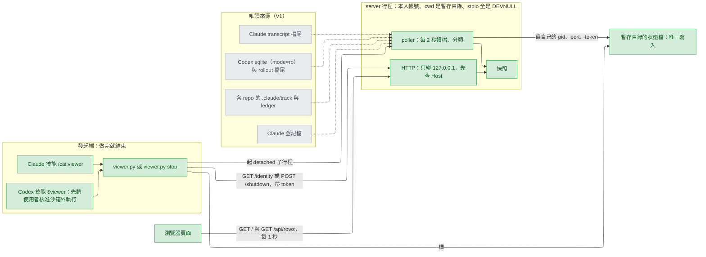
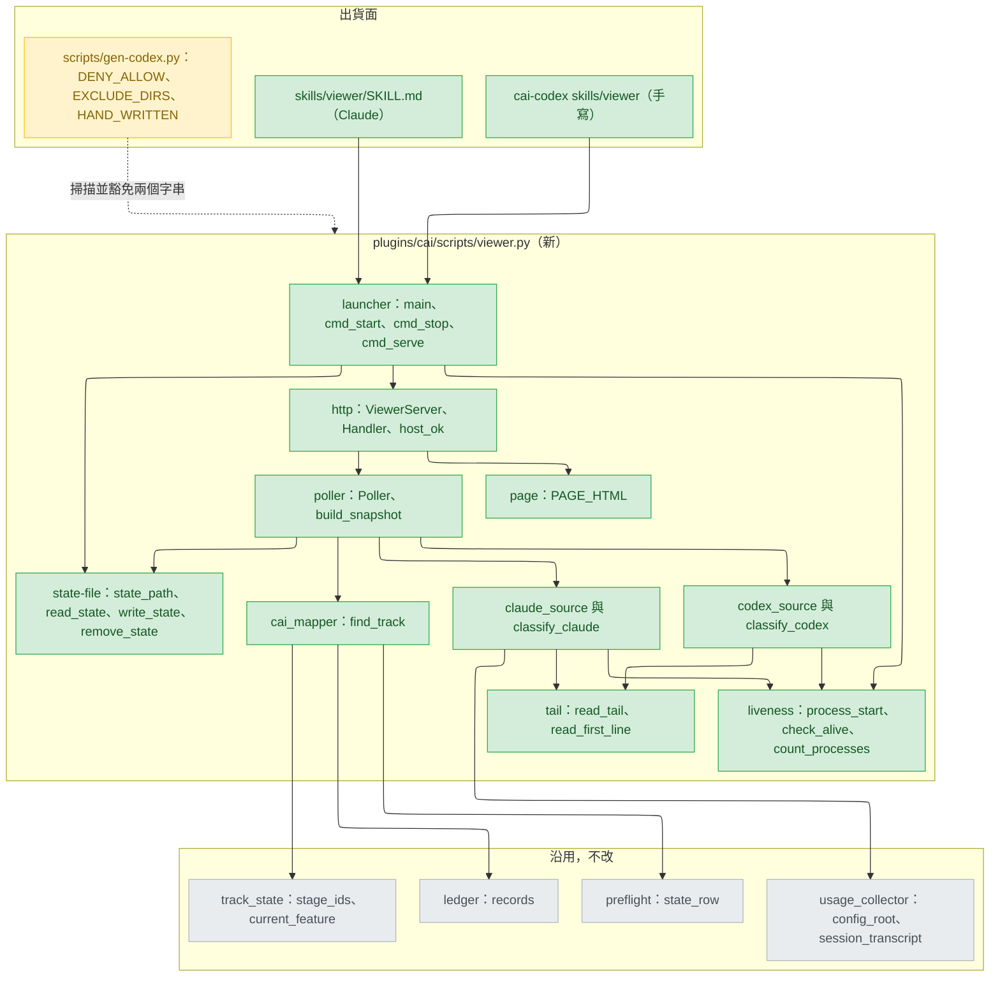
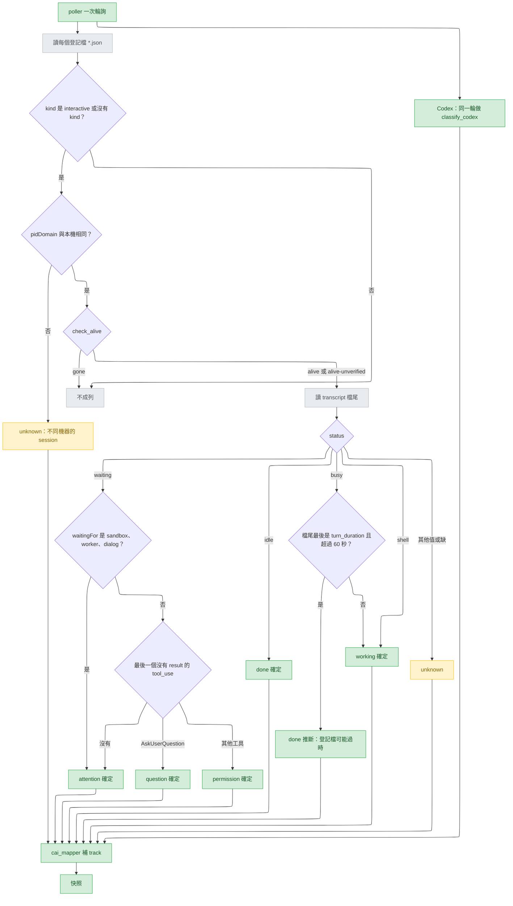
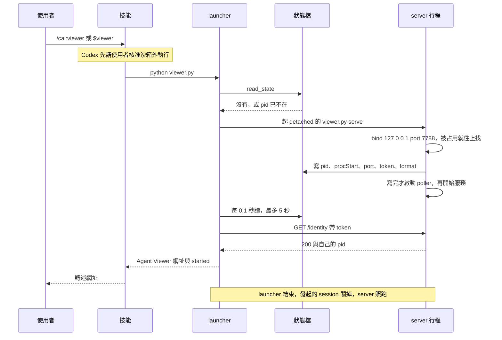
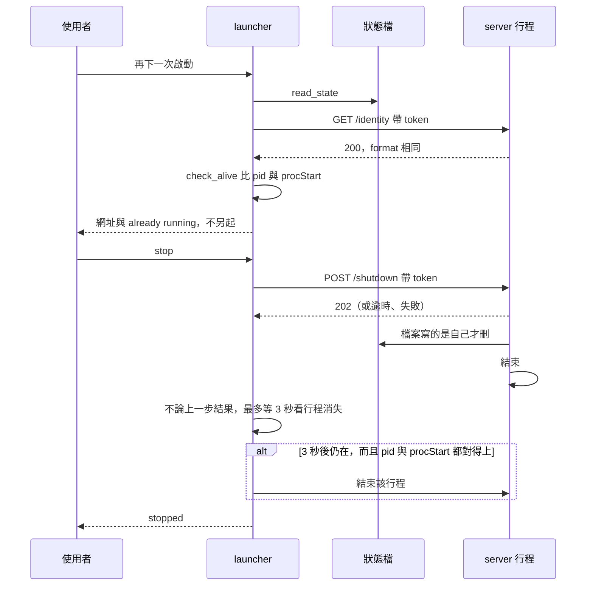
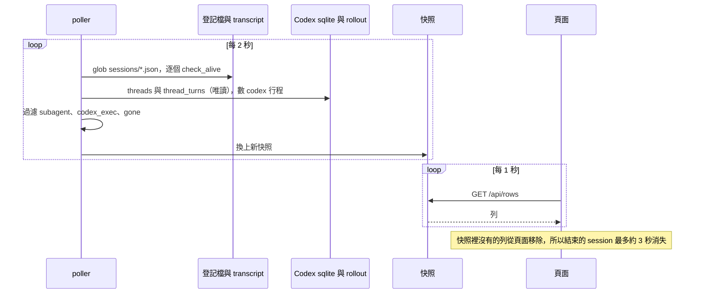
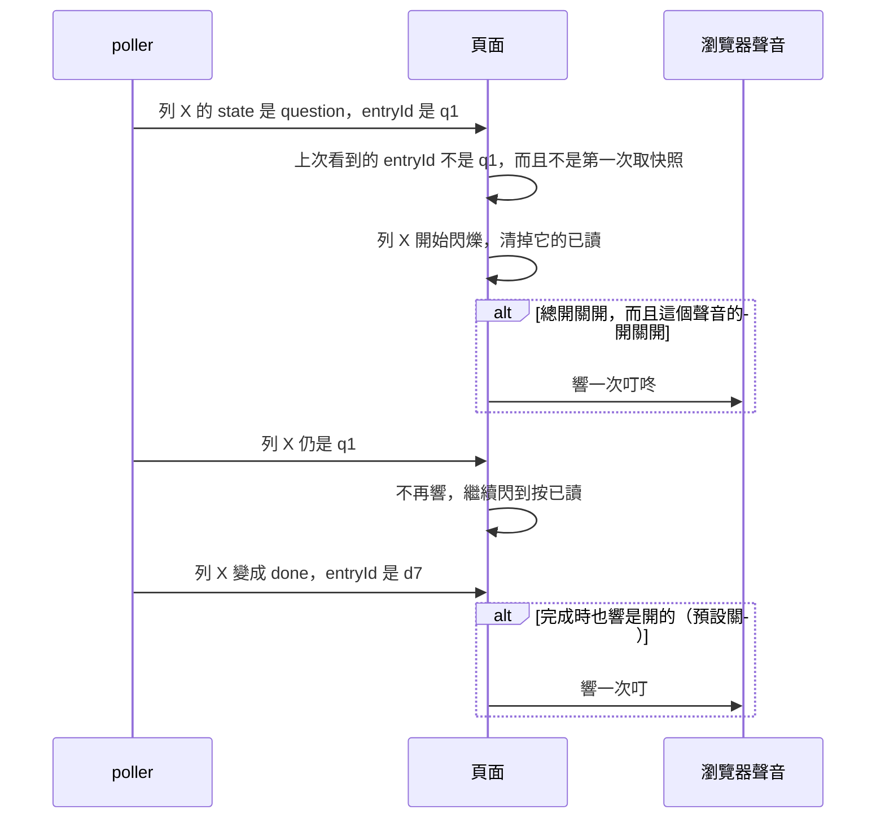
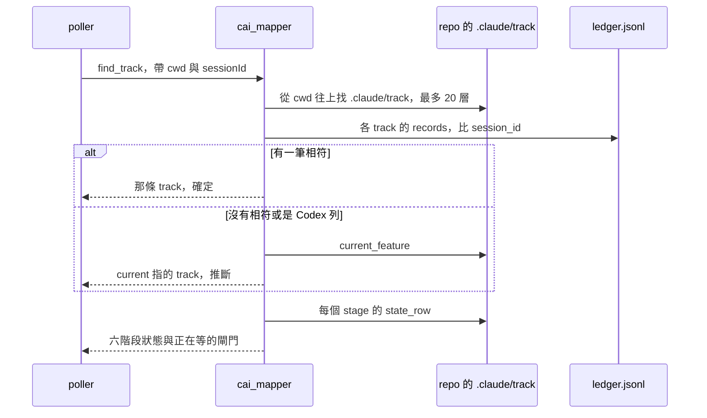
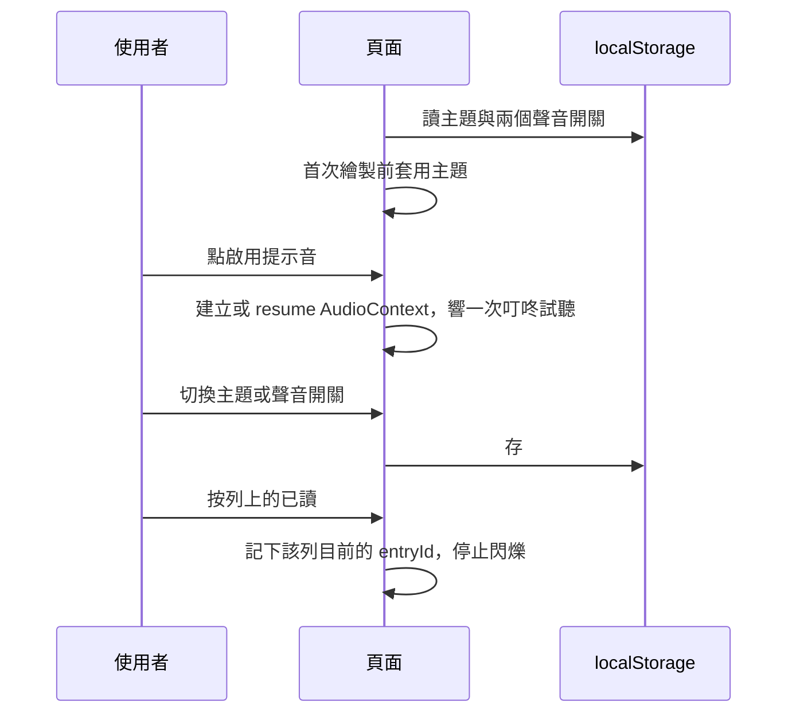

# agent-viewer-web-portal — detail design

## 維護說明（2026-10-27）

本檔是歷史設計紀錄，保留決策、驗收依據與實作偏差；不是待執行計畫。原簽核狀態、版本、行號及未驗證標記描述撰寫當時，整併不代表重新簽核或重做實測。

名詞：設計立場（stance）說明取捨；決策紀錄（decisions）保存選擇理由；細部設計（detail）記錄建造規格；需求盤點（intake）保存驗收條件。下方英文標題與識別碼沿用原文，便於對照歷史。

保留入口頁與資料來源設計。原以行程數推算 Codex 對話清單的 D6 已被 [存活狀態修正](2026-09-26-viewer-live-status-detail.md) 取代；[語言切換](2026-09-26-agent-viewer-language-switch-detail.md) 是另外一項功能。現行入口見 [`plugins/cai/scripts/viewer.py:2628`](../../plugins/cai/scripts/viewer.py#L2628)。

已併入並移除的同主題文件：`2026-09-25-agent-viewer-web-portal-decisions.md`、`2026-09-25-agent-viewer-web-portal-stance.md`。

補充段落保留原文與原決策編號，避免把不同時點同號的決策當成一項；重複的概覽圖、施工排程與階段交接文字不再複製。

## Reference

Stance doc: docs/design/2026-09-25-agent-viewer-web-portal-detail.md
Decisions doc: docs/design/2026-09-25-agent-viewer-web-portal-detail.md
Status: approved 2026-09-25（stance）；decisions 的 Tier 1 三項皆有 `Decided:`（使用者 2026-09-25），decisions 本身仍是 draft，Gate 1 與 stance 一起簽。

其他輸入：`.claude/track/agent-viewer-web-portal/` 的 `intake.md`（AC1–AC7）、`discover.md`（地雷 1–8）、`discover-evidence.md`、`mockup.html`（已核准的畫面）、`options-D1.md`…`options-G3.md`（使用者答案的原文）。本文件不做新的架構決定；這一層新出現的小決定都列在 `## Design decisions`，並標明哪幾項要在 Gate 1 讓使用者看到。

用詞（第一次出現的英文詞）：登記檔（registry，Claude Code 每個執行中 session 一個的小 JSON 檔）；對話紀錄（transcript，Claude 的 `.jsonl`）；Codex 紀錄檔（rollout，Codex 的 `.jsonl`）；狀態檔（state file，viewer 記錄自己在哪個 port 的暫存檔）；權杖（token，每次啟動隨機產生的一串字）；輪詢（poll，定時重讀檔案）；快照（snapshot，一次輪詢的結果）；檔尾（tail，檔案最後固定位元組數）；閘門（gate，cai track 的人工簽核點）；分類器（classifier，把檔尾換成狀態的純函式）；沙箱（sandbox，Codex 的受限帳號）；同源政策（same-origin policy）；內容安全政策（CSP，瀏覽器限制頁面能載入什麼的標頭）；跨站腳本（XSS，別人的文字被當成程式在頁面上執行）。

### Traceability

| From the high-level design | Satisfied by | Status |
|---|---|---|
| UC1 | `launcher.cmd_start` 起 detached `serve`（`### launcher`）；兩個技能（`### skill-claude`、`### skill-codex`）；Verification 的 lifecycle 測試加 verify 實機 | covered（Codex TUI 實機、TUI 會不會收掉子行程、Linux 終端機關閉留給 verify） |
| UC2 | `cmd_start` 的「已在跑」判斷、`cmd_stop`、殘留狀態檔處理（`### launcher`、`### state-file`） | covered |
| UC3 | `claude_source`、`codex_source` 產生列；`gone` 的列下一次輪詢就不在快照裡；`codex_exec` 與 subagent 過濾 | covered |
| UC4 | `classify_claude`、`classify_codex` 的狀態表；頁面的 `entryId` 聲音規則（`### page`） | covered（V7 依 decisions 的讀法：一輪做完預設不響） |
| UC5 | `cai_mapper` 與頁面 stepper（兩道閘門） | covered |
| UC6 | 頁面：主題三段切換存 localStorage、「啟用提示音」、「已讀」 | covered（verify 手動對照 mockup） |
| R1 | 頁尾文字改寫：Claude 的等權限是確定的，推斷只用在 Codex（`### page`） | covered |
| AC5 | V1 寫入邊界：只寫狀態檔；讀檔只讀檔尾；sqlite 唯讀；不開 `auth.json`（Verification 的 write-boundary 測試） | covered |
| AC6 | gen-codex 允許清單、EXCLUDE_DIRS、HAND_WRITTEN、CLAUDE.md、版本（`### gen-codex`） | covered |
| AC7 | Verification 表的 fixture 與生命週期測試 | covered |

## Requirement

同時開著好幾個 Claude Code 與 Codex 主 session 的人，打開一個只在本機的網頁，約 3 秒內看出哪一個在等他（提問、等權限、一輪做完），不必切回每個終端機；cai track 的 session 另外看得到六階段進度與兩道閘門。被看的 agent 那一側什麼都不改。做到的判準：AC4 每個狀態一個 fixture 測試、AC7 的生命週期測試全綠，加上 verify 在 Windows 實機從 Claude Code 與 Codex 各啟動一次。

## Glossary

| Term | Definition | Where it lives |
|---|---|---|
| viewer.py | 唯一的腳本：launcher、背景 server、分類器與內嵌頁面都在這一檔 | new — plugins/cai/scripts/viewer.py |
| 登記檔（registry） | Claude Code 每個執行中 session 一個的 JSON 檔 `<config_root>/sessions/<pid>.json` | .claude/track/agent-viewer-web-portal/discover-evidence.md:6 |
| 對話紀錄（transcript） | Claude session 的 `.jsonl`，路徑由 cwd 與 sessionId 算出 | plugins/cai/scripts/usage_collector.py:81 |
| Codex 紀錄檔（rollout） | Codex thread 的 `.jsonl`，第 1 行是 `session_meta` | .claude/track/agent-viewer-web-portal/discover-evidence.md:51 |
| 主 session | 使用者在終端機對話的那個行程；subagent 與 `codex exec` 不算 | concept |
| 列（row） | 快照裡一個主 session 的 JSON 物件，欄位見 `### poller` | new — plugins/cai/scripts/viewer.py |
| 列鍵（row key） | Claude：`claude:<pid>:<procStart>`；Codex：`codex:<threadId>` | new — plugins/cai/scripts/viewer.py |
| 狀態（state） | 列的六個值之一：`question`、`permission`、`attention`、`done`、`working`、`unknown` | new — plugins/cai/scripts/viewer.py |
| 確定度（certainty） | `confirmed` 或 `inferred`；畫面上寫「確定」「推斷」（V4） | docs/design/2026-09-25-agent-viewer-web-portal-detail.md:994 |
| 需要你（needs-you） | 狀態是 `question`、`permission`、`attention`、`done` 其中之一 | concept |
| 進入編號（entryId） | 列每進入一次「需要你」就換一個的字串；頁面以它判斷「這次響過沒」 | new — plugins/cai/scripts/viewer.py |
| 存活結果（liveness） | `alive`、`alive-unverified`、`gone` 三值之一 | new — plugins/cai/scripts/viewer.py |
| 狀態檔（state file） | 暫存目錄裡記 pid、procStart、port、token 的 JSON；viewer 唯一寫的檔 | new — <tempfile.gettempdir()>/cai-viewer.json |
| 關閉權杖（token） | 64 個十六進位字元，只守 `/identity` 與 `/shutdown`，不守讀取（D1=B） | new — plugins/cai/scripts/viewer.py |
| launcher | 前景執行的 `viewer.py` 或 `viewer.py stop`；做完就結束 | new — plugins/cai/scripts/viewer.py |
| server 行程 | `viewer.py serve` 起的背景行程，開 port、輪詢、回頁面 | new — plugins/cai/scripts/viewer.py |
| poller | server 裡每 2 秒輪詢一次的執行緒，產生快照 | new — plugins/cai/scripts/viewer.py |
| 快照（snapshot） | poller 最近一次的結果，HTTP 只回它 | new — plugins/cai/scripts/viewer.py |
| 頁面（page） | 內嵌在 viewer.py 的 HTML/CSS/JS，版面照 mockup | .claude/track/agent-viewer-web-portal/mockup.html:1 |
| 安全插值清單（SAFE_INTERPOLATIONS） | 頁面模板裡允許不經 `esc()` 的插值運算式，只放數字、布林與固定的 class 名稱 | new — plugins/cai/scripts/viewer.py |
| stepper | cai track 的六階段進度條，兩道閘門畫在 build 與 ship 前 | .claude/track/agent-viewer-web-portal/mockup.html:402 |
| 閘門（gate） | cai 的人工簽核點：Gate 1 在 build 前、Gate 2 在 ship 內 | .claude/track/agent-viewer-web-portal/mockup.html:269 |
| config_root | Claude 設定目錄，尊重 `CLAUDE_CONFIG_DIR` | plugins/cai/scripts/usage_collector.py:48 |
| session_transcript | 由 projects 目錄、cwd、sessionId 回傳 transcript 路徑或 None | plugins/cai/scripts/usage_collector.py:81 |
| stage_ids | 六個 stage 的 id，依 stages.json 順序 | plugins/cai/scripts/track_state.py:33 |
| current_feature | 讀 `<track_root>/current` 回傳 track 名或 None | plugins/cai/scripts/track_state.py:38 |
| state_row | 讀 track 目錄的 state.md，回傳某 stage 那一列的儲存格 | plugins/cai/scripts/preflight.py:73 |
| ledger.records | 讀 track 的 `ledger.jsonl`，壞行變成 malformed 佔位 | plugins/cai/scripts/ledger.py:418 |
| Codex home | `CODEX_HOME` 或 `~/.codex` | plugins/cai-codex/scripts/launcher.py:34 |
| DENY_LIST | gen-codex 對每個產出檔掃的禁用字串 | scripts/gen-codex.py:126 |
| DENY_ALLOW | 新增的（路徑, 字串）允許清單，只放 viewer.py 的兩項 | new — scripts/gen-codex.py |
| HAND_WRITTEN | gen-codex 不寫也不刪的 Codex 手寫檔清單 | scripts/gen-codex.py:81 |
| EXCLUDE_DIRS | gen-codex 不複製到 Codex 樹的目錄 | scripts/gen-codex.py:47 |
| 叮咚、叮 | 頁面合成的兩種提示音 | .claude/track/agent-viewer-web-portal/mockup.html:529 |
| 嗒 | 新的第三種提示音，只給 Codex 推斷的等權限（G1） | new — plugins/cai/scripts/viewer.py |
| 已讀（ack） | 列上的按鈕，停止該列閃爍直到下一個 entryId | .claude/track/agent-viewer-web-portal/mockup.html:462 |
| 啟用提示音 | 頁面頂端要使用者先點一次的橫幅（C23） | .claude/track/agent-viewer-web-portal/mockup.html:235 |

## Budgets

| What | Number | Where it comes from |
|---|---|---|
| server 輪詢間隔 | 2 秒 | `intake.md:17`（約每 2 秒） |
| 頁面向 server 取快照的間隔 | 1 秒 | 2 + 1 ＝ 最壞 3 秒，湊 AC4（`intake.md:33`） |
| 狀態改變到畫面反映的上限 | 3 秒 | AC4 |
| transcript 檔尾 | 262144 位元組 | designer 決定（Tier 3）；要容得下最後一個提問、最後 8 個 tool_use 與最後一則文字，夠不夠由 verify 在實機看 |
| rollout 檔尾 | 262144 位元組 | 同上 |
| 登記檔單檔讀取上限 | 65536 位元組 | 實際約 700 位元組（`C:\Users\millerlai\.claude\sessions\45224.json` 一行） |
| rollout 第 1 行讀取上限 | 65536 位元組 | 只要 `session_meta` |
| 最近動作筆數 | 8 | D2 的答案（`options-D2.md` 欄位 1）；`mockup.html:448` 的 `slice(-8)` |
| 列上「剛剛」顯示筆數 | 3 | `mockup.html:311` 顯示 3 筆 |
| Codex 等權限推斷門檻 | 30 秒 | designer 決定（decisions Tier 3）；Gate 1 列為可推翻 |
| Claude `busy` 過時門檻 | 60 秒 | designer 決定（decisions Tier 3） |
| sqlite 取最近 thread 數 | 50 | 上限；K 個 codex 行程只會用到前 K 個 |
| 退回路徑：只看最近修改的 rollout | 24 小時 | 退回路徑（D9）不掃整棵 `sessions/` |
| 退回路徑：rollout 檔數上限 | 200 | 同上 |
| 預設 port | 7788 | `mockup.html:220` |
| port 嘗試個數 | 10 | 7788 到 7797（decisions Tier 3） |
| launcher 等 server 就緒 | 5 秒 | 每 0.1 秒看一次狀態檔 |
| `/identity` 請求逾時 | 1 秒 | |
| `/shutdown` 請求逾時 | 2 秒 | |
| `stop` 送出關閉後等行程結束 | 3 秒 | 不論 `/shutdown` 回 202 或失敗都等；之後才退而結束行程 |
| 關閉權杖長度 | 32 位元組 | `secrets.token_hex(32)`，64 個十六進位字元 |
| 往上層找 `.claude/track` 的層數 | 20 | cwd 可能在 repo 的子目錄 |
| 提問原文截斷 | 1000 字元 | 每個選項 200 字元，最多 10 個選項 |
| 權限指令截斷 | 500 字元 | |
| 摘要截斷 | 400 字元 | |
| 最近動作的參數截斷 | 120 字元 | |
| 頁面判定「離線」 | 3 次 | 連續取快照失敗 3 次 |
| 狀態檔讀到半截 JSON 時重試 | 1 次 | 隔 100 毫秒；再失敗視為沒有狀態檔 |

## Design decisions

照 decisions 文件執行 D1–D11、G1–G3 與 Tier 3 全部條目，不再重述。這一層新出現、decisions 沒有的決定：

- **狀態檔直接寫，不經暫存再改名。** V1 說唯一寫的是狀態檔（`stance.md:26`），另寫一個 `.tmp` 再 `os.replace` 等於多寫一個檔。讀到半截 JSON 的機率由「重試 1 次、再失敗當作沒有」處理（Budgets），兩個實例同時啟動由 server 的自我檢查收斂（`### poller`）。服務 V1、V6。
- **兩個實例同時起來時，由 server 自己退讓。** 每次輪詢讀狀態檔：檔案不見了，或寫的是另一個還活著的 pid，就自行關閉；寫的是已經死掉的 pid，就寫回自己。不另開鎖檔（decisions Ruled out）。server 一定先寫狀態檔、再啟動 poller，所以第一輪不會把自己誤判成被取代。服務 V6。
- **不同協定版本的 viewer 在跑時，不起第二個。** launcher 的判斷有固定順序（`### launcher`）：身分端點答得上來、但 `format` 不同，就只印一行請使用者先 `stop`，不自動重啟、也不另起一個（另起會綁到下一個 port，變成兩個實例，違反 V6）。
- **launcher 印英文、只用 ASCII。** 技能透過 Claude 的 Bash 工具（Windows 上是 Git Bash）或 Codex 的 PowerShell 讀輸出，非 ASCII 會被主控台字碼頁弄壞（`probe/monitor.py:31-32` 的探針就得明設 `encoding="utf-8"`）；模型轉述時再翻成使用者的語言。頁面是 UTF-8 的 HTML，照 mockup 用中文。服務 UC1。
- **使用者訊息不上頁面。** D2 答案的範圍是選項原文列出的四種（`options-D2.md`），mockup「經過」裡的「你：…」不在其中（`mockup.html:297`）。**Gate 1 要讓使用者看到這一條。**
- **不顯示已結束的列。** UC3「已結束的幾秒內消失」（`stance.md:52`）勝過 mockup 的「已結束」列（`mockup.html:339-342`），頂端計數拿掉「已結束」。服務 UC3。
- **保留 mockup 的 resume 複製鈕與 subagent 標籤。** 兩者都在核准的 mockup 裡（`mockup.html:463`、`:418`）。`codex resume <id>` 的語法沒查文件（UNVERIFIED，verify 實按一次）；subagent 名稱讀 Claude 的 `Agent`／`Task` tool_use 的 `subagent_type`，所以 gen-codex 允許清單多一項。服務 UC6。
- **對話原文一律跳脫，並有測試守住。** D1=B 讓同機其他帳號也打得開頁面，D2=A 讓工具參數與提問原文上頁面；原文裡的 HTML 若被當成標記，就會在頁面上執行（CSP 允許內嵌 script）。所以頁面模板裡每一個 `${...}` 插值都必須是 `esc(...)`，或列在 `SAFE_INTERPOLATIONS`；有一個靜態測試逐一檢查，另有一個帶 `` 的 fixture 列留給 verify 在瀏覽器實看。頁面同時帶 CSP 與 `X-Content-Type-Options: nosniff`；token 不在頁面上，所以就算被注入也送不出關閉請求。服務 V3、D2。
- **檔尾快取。** 以（路徑、大小、修改時間）為鍵，沒變就不重新解析；10 個 Claude 加 10 個 Codex session 每 2 秒最多讀 5 MiB，大多數輪詢是零。服務 AC4 的 3 秒。
- **協定版本不看腳本內容。** 狀態檔與 `/identity` 帶 `format: 1`。gen-codex 產生的 Codex 副本不必與 Claude 那份逐位相同也能互認。服務 V6。
- **聲音開關記憶。** 「完成時也響」（預設關，G2）、「推斷的等權限也響」（預設開，G1）存 localStorage；「聲音」總開關照 mockup 不記（`mockup.html:380`）。第一次取到快照只建立基準、不響，重新整理頁面不會把所有等待中的列再響一遍。
- **`--port` 只給測試用。** 測試不能碰使用者正在用的 7788，也不能碰真的暫存目錄；`--port` 加上子行程環境裡的 `TMPDIR`（`tempfile.gettempdir()` 第一個看的變數，https://docs.python.org/3/library/tempfile.html ：「The directory named by the TMPDIR environment variable」）就隔離。技能不傳它。比照 `CAI_USAGE_LEDGER` 為測試隔離而設（`tests/conftest.py:55-62`）。

## Diagrams

### Architecture



看哪裡：瀏覽器只碰 HTTP，HTTP 只回快照，不會因為一個請求去讀檔；token 只在 launcher 與 HTTP 之間走，從不經過瀏覽器（D1=B 之後它只守關閉與身分）。

### Component



看哪裡：兩個分類器（`classify_claude`、`classify_codex`）不讀檔、不看時鐘以外的東西，是測試的主力；灰色的四個模組只被呼叫，一行都不改；唯一被修改的既有檔是黃色的 gen-codex。

### Flow



看哪裡：`waiting` 底下的判斷不看 `waitingFor` 是 `permission prompt` 還是 `input needed`，只看 transcript 檔尾，所以登記檔對權限寫哪一個值都判得對（C2 未驗證也成立）；推斷只出現在過時的 `busy` 一格，Claude 的等權限是確定的（R1）。

### Sequence — UC1



看哪裡：launcher 不信任「子行程起來了」，要讀到子行程自己寫的狀態檔、並且 `/identity` 回的 pid 對得上才印網址。

### Sequence — UC2



看哪裡：退而結束行程只看「3 秒後還在、而且 pid 與建立時間都對得上」，不看 `/shutdown` 有沒有回 202；殘留的狀態檔（pid 已不在）在啟動與 stop 兩條路上都被當成「沒有在跑」。

### Sequence — UC3



看哪裡：列的消失不是頁面自己判斷的，是快照裡少了它；頁面只做比對。

### Sequence — UC4



看哪裡：「不重複」靠的是 server 給的 `entryId`，不是頁面記得的狀態名稱；同一個提問答完又問一次，`entryId` 換了就會再響。

### Sequence — UC5



看哪裡：Codex 列一定走下面那條（ledger 沒有 Codex 的 session id，C17），所以 Codex 的 cai 列永遠標「推斷」。

### Sequence — UC6



看哪裡：聲音在使用者點擊之前不可能響（C23），所以橫幅在點過之前一直顯示；「已讀」記的是 `entryId`，下一次進入會重新亮起。

## Implementation spec

所有 `### launcher` 到 `### page` 都在同一檔 `plugins/cai/scripts/viewer.py`（新），只用 stdlib；開頭 `sys.path.insert(0, HERE)` 後 import `usage_collector`、`track_state`、`preflight`、`ledger`，比照 `plugins/cai/scripts/track_state.py:28-30`。檔案內不得出現 `${CLAUDE_PLUGIN_ROOT}`、`/cai:`、`~/.claude/`、`CLAUDE_CODE_`、反引號包住的 agent 名稱，也不得有以三個反引號開頭的行（C18；gen-codex 會改寫或拒絕）。所有檔案開啟都指定 `encoding="utf-8"` 或二進位。

### launcher

- **Responsibility:** 解析指令列，啟動、找到或關閉唯一的 server 行程，印出結果。
- **Interface:**
  - `main(argv: list[str]) -> int`：`[]` 或 `["start"]` 走 `cmd_start`；`["stop"]` 走 `cmd_stop`；`["serve", "--port", N]` 走 `cmd_serve`；`--port N` 也可接在 `start` 後；其他印用法、回 1。
  - `cmd_start(port: int = 7788) -> int`
  - `cmd_stop() -> int`
  - `cmd_serve(port: int) -> int`
  - `spawn_server(port: int) -> subprocess.Popen`
- **Data:** stdout 只印 ASCII 行，技能照抄：`Agent Viewer: http://127.0.0.1:<port>`；接著一行 `started (pid <n>)`、`already running (pid <n>)`、`stopped (pid <n>)`、`not running`、`not running (removed a stale state file)`，或 `a different viewer version is running (pid <n>); run stop, then start again`。錯誤一行 `error: <原因>`。
- **`cmd_start` 的判斷，依序，第一個成立的算：**
  1. `read_state()` 是 None → 起新的 server。
  2. 帶狀態檔的 token 送 `GET /identity` 到狀態檔的 port：連不上、逾時、非 200、或 body 的 `pid` 不等於狀態檔的 pid → 起新的 server（server 起來後會覆寫狀態檔）。
  3. body 的 `format` 不是 1 → 印網址與「different version」那行，回 0，**不起新的 server**。
  4. `check_alive(pid, procStart, exact=True) == "gone"` → 起新的 server。
  5. 其餘 → 印網址與 `already running`，回 0。
- **`cmd_stop` 的判斷：** `read_state()` 是 None → `not running`，回 0；`check_alive(..., exact=True) == "gone"` → 刪狀態檔，`not running (removed a stale state file)`，回 0；否則送 `POST /shutdown`（不論回 202、非 202 或逾時，下一步都一樣），然後最多等 3 秒看 `check_alive` 變成 `gone`；3 秒後仍是 `alive` → `os.kill(pid, signal.SIGTERM)`（這是結束自己的 server，不是存活探測，V2 不適用），再等 1 秒；仍在 → `error: could not stop pid <n>`，回 1。3 秒後是 `alive-unverified` → 不結束任何行程，印 `error: could not stop pid <n>`，回 1。行程消失後若狀態檔仍寫著該 pid 就刪掉，印 `stopped (pid <n>)`，回 0。
- **`cmd_serve` 的順序：** 產生 token → 依序試 port 7788 到 7797 綁 `ViewerServer`（全失敗回 3）→ `write_state`（`OSError` 回 2）→ 啟動 `Poller` 執行緒 → `serve_forever()`；結束時若狀態檔寫的是自己就刪。狀態檔一定在 poller 第一輪之前寫好，否則 poller 會把「檔案不在」當成被取代而自行關閉。
- **Errors:**
  - `cmd_start`：子行程以 3 結束 → `error: ports 7788-7797 are all in use`，回 1；5 秒內沒就緒 → `error: the viewer did not come up within 5 seconds`，回 1，不刪任何檔。
  - `cmd_serve`：其他未預期例外回 2（stdio 是 DEVNULL，看不到訊息；launcher 以結束碼判斷）。
- **Concurrency:** 兩個 `cmd_start` 同時跑會各起一個 server；收斂由 `### poller` 的自我檢查負責。`cmd_stop` 可以重跑，第二次印 `not running`。
- **Observability:** 只有 stdout 那幾行與結束碼（0 成功、1 失敗）；server 行程沒有日誌（stdio 全 DEVNULL，`discover.md:24`）。
- **Where it lives:** plugins/cai/scripts/viewer.py（新）。
- **What it reuses:** detached 旗標與存活證據 `.claude/track/agent-viewer-web-portal/probe/spawn_probe.py`（探針，只作參考，不 import）；`sys.stdout.reconfigure(errors="replace")` 比照 `plugins/cai/scripts/design_probe.py`（`main()` 開頭）。
- `spawn_server`：`[sys.executable, os.path.abspath(__file__), "serve", "--port", str(port)]`，`stdin/stdout/stderr=subprocess.DEVNULL`，`cwd=tempfile.gettempdir()`，`close_fds=True`。Windows：`creationflags=DETACHED_PROCESS | CREATE_NEW_PROCESS_GROUP | CREATE_BREAKAWAY_FROM_JOB`，`OSError` 時拿掉 `CREATE_BREAKAWAY_FROM_JOB` 重試一次（D8）。POSIX：`start_new_session=True`。

### state-file

- **Responsibility:** 讀、寫、刪暫存目錄裡的那一個狀態檔。
- **Interface:** `state_path() -> str`；`read_state(path: str) -> dict | None`；`write_state(path: str, state: dict) -> None`；`remove_state(path: str, pid: int) -> None`。
- **Data:** Windows 路徑 `<tempfile.gettempdir()>/cai-viewer.json`；POSIX `<tempfile.gettempdir()>/cai-viewer-<os.getuid()>.json`（D11）。內容一行 JSON：`{"format": 1, "pid": int, "procStart": str, "port": int, "token": str, "startedAt": int}`，`startedAt` 是 epoch 毫秒。
- **Errors:** `read_state`：檔案不在 → None；JSON 壞 → 隔 100 毫秒重讀一次，仍壞 → None；`pid`、`port` 不是整數或 `token` 不是字串 → None；`format` 可以是任何整數（版本不同的判斷交給 launcher 第 3 步），`procStart` 缺則為 None。`write_state`：`os.open(path, O_WRONLY | O_CREAT | O_TRUNC, 0o600)` 後寫入（POSIX 權限只保證不寬於 0o600，C16），`OSError` 往上拋，`cmd_serve` 回 2。`remove_state`：只有檔案內的 pid 等於參數才刪；不在就算了。
- **Concurrency:** 多個寫者時後寫的贏；讀者可能讀到寫一半的內容，由重試與 poller 自我檢查兜住。
- **Observability:** 無。
- **Where it lives:** plugins/cai/scripts/viewer.py（新）。
- **What it reuses:** 無。

### liveness

- **Responsibility:** 不送任何 signal 地回答「這個 pid 還是當初那個行程嗎」，以及「現在有幾個 codex 行程」。
- **Interface:** `process_start(pid: int) -> str | None`；`check_alive(pid: int, expected_start: str | None, exact: bool) -> str`（回 `"alive"`、`"alive-unverified"`、`"gone"`）；`count_processes(name: str) -> int`。
- **Data:** Windows 的建立時間是 FILETIME 組成的整數，轉成十進位字串（與登記檔 `procStart` 同格式，C1）；Linux 是 `/proc/<pid>/stat` 最後一個 `)` 之後第 20 個欄位（整份的第 22 欄，C4）的原字串。
- **Errors / 規則:**
  - Windows：`kernel32 = ctypes.WinDLL("kernel32", use_last_error=True)`；`OpenProcess(0x1000, False, pid)`；NULL 且 `get_last_error() == 5` → `alive-unverified`，其他 NULL → `gone`；`GetExitCodeProcess` 不是 259 → `gone`（只要 handle 還被別人握著，結束的行程也開得起來；UNVERIFIED 文件，由「起子行程、結束它、仍握著 Popen」的測試證明）；`GetProcessTimes` 的建立時間等於 `expected_start` → `alive`，不等 → `gone`；`expected_start` 是 None → `alive-unverified`；一定 `CloseHandle`。
  - Linux：`/proc/<pid>/stat` 讀不到 → `gone`；狀態欄是 `Z` → `gone`；第 22 欄等於 `expected_start` → `alive`；不等時 `exact=True`（自己寫的狀態檔）→ `gone`，`exact=False`（Claude 的 `procStart`，格式未知，C5）→ `alive-unverified`（D10）。
  - `count_processes`：Windows 用 `CreateToolhelp32Snapshot(TH32CS_SNAPPROCESS)` 加 `Process32FirstW/NextW`，`szExeFile` 不分大小寫等於 `codex.exe`（C6，`discover-evidence.md:42`）；Linux 掃 `/proc/*/comm` 等於 `codex`（C7）；任何錯誤 → 0。加 `skip_app_server=True` 時不數 app-server（VS Code 擴充套件的常駐 daemon，執行檔在 `packages/app-server-daemon/` 下；或 `codex app-server`）：Windows 以 `QueryFullProcessImageNameW` 取執行檔路徑、Linux 讀 `/proc/<pid>/cmdline`，含 `app-server` 就跳過；取不到路徑就照數（2026-09-26 修正）。
- **Concurrency:** 無共享狀態，可並行。
- **Observability:** 無；誤判以列的「存活：推斷」標籤呈現。
- **Where it lives:** plugins/cai/scripts/viewer.py（新）。
- **What it reuses:** 無；repo 內沒有可沿用的存活 helper（`discover.md:22`）。本元件任何路徑都不得呼叫 `os.kill`（V2）。

### tail

- **Responsibility:** 只讀檔尾固定位元組數，回傳解析得了的 JSON 物件。
- **Interface:** `read_tail(path: str, max_bytes: int) -> list[dict]`；`read_first_line(path: str, max_bytes: int = 65536) -> dict | None`。
- **Data:** 以二進位開啟，`seek(max(0, size - max_bytes))`；offset 大於 0 時丟掉第一個換行之前的半行；`decode("utf-8", "replace")`；逐行 `json.loads`，失敗或不是 dict 就略過。快取鍵（路徑、`st_size`、`st_mtime_ns`），沒變就回上次的結果。
- **Errors:** 檔案不在或 `OSError` → `[]` 或 None。
- **Concurrency:** 快取只由 poller 執行緒存取。
- **Observability:** 無。
- **Where it lives:** plugins/cai/scripts/viewer.py（新）。
- **What it reuses:** 壞行容忍與 UTF-8 `replace` 的作法比照 `plugins/cai/scripts/ledger.py:423-438`。

### claude_source 與 classify_claude

- **Responsibility:** 把每個登記檔變成零或一個 Claude 列；分類是純函式。
- **Interface:** `claude_rows(config_root: str, now_ms: int) -> tuple[list[dict], list[str]]`（列、problems）；`classify_claude(reg: dict, tail: list[dict], now_ms: int) -> dict`。
- **Data（輸入）：** 登記檔欄位見 C1；transcript 形狀：`type` 為 `assistant` 的項目 `message.content[]` 內有 `{"type": "tool_use", "id", "name", "input"}` 與 `{"type": "text", "text"}`，`message.model`；`type` 為 `user` 的項目內有 `{"type": "tool_result", "tool_use_id"}`；`{"type": "system", "subtype": "turn_duration"}`（`intake.md:57`）。tool_use／tool_result 的欄位路徑沒有文件（transcript 格式是內部的，`stance.md:15`），**unit 2 第一步**對照 `intake.md:58` 那兩行本機樣本只核對鍵名，fixture 照實際形狀造。
- **分類規則（依序，第一個成立的算）：**
  1. `status` 不在 `busy`、`idle`、`waiting`、`shell` → `unknown`。
  2. `waiting`：`waitingFor` 是 `sandbox request`、`worker request`、`dialog open` → `attention`（確定，標籤附原值）；否則看最後一個沒有對應 tool_result 的 tool_use：`name == "AskUserQuestion"` → `question`（確定，`input.questions[*].question` 與 `options[*].label`）；其他工具 → `permission`（確定，工具名與參數摘要）；沒有 → `attention`（確定，附 `waitingFor` 原值或「原因未知」）。
  3. `idle` → `done`（確定）；`shell` → `working`（確定），`entryId` 用 `working:<statusUpdatedAt>`，notes 保留「背景 shell 執行中」；`current` 是最新一個還在跑的背景 Bash：`name == "Bash"` 且 `input.run_in_background` 為 true 的 tool_use，它的 tool_result 列帶 `toolUseResult.backgroundTaskId`，而檔尾沒有含這個 `<task-id>` 的 `<task-notification>`（`queue-operation` 列，形狀同下面背景 subagent 那條）。`current` 是 `{"tool": "Bash", "input": 參數摘要, "since": statusUpdatedAt}`（`since` 同規則 4），參數摘要取 `input.description`，沒有才取 `command`，依 Budgets 截斷；幾個同時在跑，取檔尾中 tool_use 最後出現的那個；一個都找不到（例如呼叫已捲出檔尾）`current` 為空，仍是 `working`。`shell` 是 Claude 在一輪結束、但還有背景 Bash 沒結束時寫的；那個 shell 結束後 Claude 排入 `<task-notification>`，模型自己接續，不需要人（2026-09-26 修正；Claude Code 2.1.283 的寫法是 `idle` 且有未結束的 `local_bash` task 就寫 `shell`，本機 transcript 核對）。代價：永不結束的背景 shell（例如 dev server）讓列一直是 `working`，登記檔分不出來，靠顯示的 description 讓人判斷（decisions Tier 3）。
  4. `busy`：檔尾最後一項是 `turn_duration`、它沒有任何大於 0 的 `pending*Count`（目前見到 `pendingBackgroundAgentCount`、`pendingWorkflowCount`）、且 `now_ms - statusUpdatedAt > 60000` → `done`（推斷），notes 加「登記檔可能過時」；否則 `working`（確定），`current` 是最後一個沒有 result 的 tool_use，沒有的話是最後一個還在跑的背景 subagent／Workflow 的那個呼叫。`pending*Count > 0` 是一輪在背景 subagent 或 Workflow 還在跑時結束，Claude 刻意讓登記檔停在 `busy`，不是過時（2026-09-26 修正；本機 transcript 核對）。
  - 背景 subagent／Workflow：Claude 對 `Agent`／`Task`／`Workflow` 呼叫立刻回一個 tool_result，該列的 `toolUseResult.status` 是 `async_launched`，id 在 `agentId`（subagent）或 `taskId`（Workflow，另有 `workflowName`）；跑完時檔尾多一列 `type` 為 `queue-operation`、`content` 含 `<task-notification>` 與 `<task-id>` 的項目（`<status>` 是 `completed`、`failed`、`killed` 或 `stopped`，都算不在跑）。「還在跑」= 有 `async_launched` 而尾端沒有它的 `<task-id>`；`subagents` 列的是前景沒 result 的呼叫加上這些，subagent 名稱讀 `subagent_type`，Workflow 顯示成 `Workflow <workflowName>`。
  - 參數摘要：`file_path`、`path`、`pattern`、`command`、`url`、`description` 依序取第一個存在的，否則 `json.dumps(input)`；依 Budgets 截斷。`description` 排最後，只有 `Agent` 這類沒有前面幾個鍵的呼叫會用到。例外：規則 3 `shell` 的 `current`（背景 Bash）先取 `description`、沒有才取 `command`，要讓人看出那個背景 shell 在做什麼（2026-09-26 修正）。
  - `entryId`：`question`／`permission` 用那個 tool_use 的 `id`；其他用 `<state>:<statusUpdatedAt>`。`since` 用 `statusUpdatedAt`。
- **claude_rows 規則：** glob `<config_root>/sessions/*.json`（不開 `*.key`）；`kind` 存在且不是 `interactive` → 略過；`pidDomain` 平台不符（或 Windows 上主機名不分大小寫不符）→ `unknown` 列、不做存活檢查；`check_alive(pid, procStart, exact=False)`：`gone` → 略過，`alive-unverified` → notes 加「存活：推斷」；transcript 用 `usage_collector.session_transcript(os.path.join(config_root, "projects"), cwd, sessionId)`，None 時檔尾是 `[]`（所以 `waiting` 會落在 `attention`）。
- **Errors:** 單一登記檔讀不了或 JSON 壞 → 略過並在 problems 加一行；絕不讓一個檔的錯誤中斷整輪。
- **Concurrency:** 只在 poller 執行緒跑。
- **Observability:** problems 進快照，頁尾顯示「有 N 個來源讀不了」。
- **Where it lives:** plugins/cai/scripts/viewer.py（新）。
- **What it reuses:** `plugins/cai/scripts/usage_collector.py:48-49`（`config_root`）、`:81-83`（`session_transcript`）。

### codex_source 與 classify_codex

- **Responsibility:** 列出活著的互動式 Codex thread 並分類。
- **Interface:** `codex_rows(codex_home: str, now_ms: int, process_count: int, session_count: int | None = None) -> tuple[list[dict], list[str]]`（`session_count` 省略時等於 `process_count`，也就是修正前「每個 codex 行程都算一個 session」的讀法；`build_snapshot` 一定兩個都傳）；`classify_codex(turn_status: str | None, tail: list[dict], now_ms: int, tail_mtime_ms: int) -> dict`。
- **Data（輸入）：** `state_*.sqlite` 取編號最大的一個，`thread_history_*.sqlite` 亦同，皆 `sqlite3.connect("file:<posix 路徑>?mode=ro", uri=True)`（C8、D9）。`threads`：`rollout_path`、`cwd`、`updated_at_ms`、`thread_source`、`originator`、`archived`、`name`（`discover-evidence.md:44`），條件 `archived = 0 AND originator = 'codex-tui' AND thread_source = 'user'`，依 `updated_at_ms` 由新到舊取 50 筆。`thread_turns`：`thread_id`、`status`、`started_at`（`probe/monitor.py:39`），每個 thread 取 `started_at` 最大的一筆的 `status`。threads 對 thread_turns 的鍵：thread id 取 rollout 檔名最後 36 個字元（UNVERIFIED；**unit 3 第一步**以唯讀查詢比對本機 `thread_turns.thread_id` 與 rollout 檔名，不符就改用 `threads` 的 id 欄，記進 implementation-notes）。rollout 每行 `{"type", "payload": {"type", "name", "call_id", "arguments"}}`（C9，`probe/monitor.py:58-59`）；`request_user_input` 的 `arguments` 鍵名、助理訊息文字的位置、每行有沒有 `timestamp`，都在 unit 3 第一步只核對鍵名。
- **存活：** K 是 `count_processes("codex.exe" 或 "codex")`（所有 codex 行程，含 app-server），S 是同一函式加 `skip_app_server=True`（互動 session 數）；K 為 0 → 沒有 Codex 列；否則先放所有最新 turn 是 `inProgress` 的 thread（存活：確定；不以 K 封頂，因為一個 app-server 行程就能同時跑好幾輪 VS Code 的 turn，K 只說得出「有沒有 Codex 在跑」），再依 `updated_at_ms` 把 `source` 不是 `vscode` 的 thread 補到 S 個（存活：推斷；已確定的 thread 中 `source` 不是 `vscode` 的先佔掉名額）。`source = vscode` 的 thread 由 app-server 服務、沒有自己的行程，看不出面板還開著沒，所以只在 `inProgress` 時列、不佔名額；`threads` 沒有 `source` 欄（舊版）就全當不是 vscode。rollout 首行 `session_meta` 也有 `source`，fallback 路徑同規則（D6，2026-09-26 修正）。
- **分類規則：**
  1. 本輪進行中＝`turn_status == "inProgress"`（確定）；sqlite 不可用時改看 rollout：最後一個 `task_started` 在最後一個 `task_complete` 之後（推斷）。
  2. 進行中：最後一個沒有 `function_call_output` 的 `function_call` 名稱是 `request_user_input` → `question`（確定）；是其他名稱且已超過 30 秒 → `permission`（推斷，`entryId` 用 `call_id`，響嗒）；否則 `working`。
  3. 不在進行中：最後一輪（最後一個 `task_started` 之後）有 `request_user_input_async` → `question`（確定）；否則 `done`（確定），`turn_status` 是 `failed` 或 `interrupted` 時 notes 加「上一輪 failed／interrupted」。
  4. 檔尾是空的或沒有任何可辨識的事件 → `unknown`。
  - 時間：事件有時間欄就用，沒有就用 rollout 的修改時間（`tail_mtime_ms`）。
- **退回路徑（sqlite 開不起來、表或欄位不符）：** 掃 `<codex_home>/sessions/**/rollout-*.jsonl` 中 24 小時內修改過的最多 200 個，`read_first_line` 取 `session_meta` 的 `originator`、`thread_source`、`cwd` 過濾，所有 Codex 列的確定度一律 `inferred`，problems 加「Codex 資料庫讀不了，改看紀錄檔」。
- **Errors:** 任何 `sqlite3.Error` → 退回路徑；單一 rollout 讀不了 → 略過並記 problems。連線用完即關，不長開。
- **Concurrency:** 唯讀連線不擋 Codex 寫入（C8）。
- **Observability:** problems。
- **Where it lives:** plugins/cai/scripts/viewer.py（新）。
- **What it reuses:** Codex home 的解析照 `plugins/cai-codex/scripts/launcher.py:34-36`（`CODEX_HOME` 或 `~/.codex`）；不開 `auth.json`（V1）。

### cai_mapper

- **Responsibility:** 給一個 cwd 與可有可無的 sessionId，回傳該列對應的 cai track 與六階段狀態。
- **Interface:** `find_track(cwd: str, session_id: str | None) -> dict | None`。
- **Data（輸出）：** `{"name": str, "certainty": "confirmed" | "inferred", "stages": [{"id": str, "status": str}], "current": str | None, "gateWaiting": "build" | "ship" | None}`；`status` 是 state.md 的原值（空字串代表未開始）。
- **規則:** 從 cwd 往上最多 20 層找含有 `.claude/track` 目錄的那一層；每個不叫 `done` 的子目錄用 `ledger.records(track_dir)` 找 `session_id == session_id` 的紀錄 → 確定；否則 `track_state.current_feature(track_root)` → 推斷；都沒有 → None。`stages` 用 `track_state.stage_ids()` 與 `preflight.state_row(<絕對 track 目錄>, sid)`，絕不呼叫 `format_status`（它以 `"."` 找專案，`plugins/cai/scripts/track_state.py:135`）。`current` 是第一個狀態不是 `done`／`skipped` 的 stage。`gateWaiting`（只在列的狀態是 `question` 時計算）：design 是 `done` 且 build 是空 → `build`；current 是 `ship` → `ship`；頁面此時把標籤換成「等你簽核」。
- **Errors:** 任何 `OSError` 或 state.md 缺列 → 該 stage 狀態為空字串；整體失敗 → None。
- **Concurrency:** 每輪以 track_root 為鍵快取一次。
- **Observability:** 無。
- **Where it lives:** plugins/cai/scripts/viewer.py（新）。
- **What it reuses:** `plugins/cai/scripts/track_state.py:33-43`、`plugins/cai/scripts/preflight.py:73-86`、`plugins/cai/scripts/ledger.py:418-445`。

### poller

- **Responsibility:** 每 2 秒產生一份快照並做實例自我檢查。
- **Interface:** `class Poller(threading.Thread)`：`__init__(self, config_root: str, codex_home: str, state_path: str, own_pid: int, on_superseded: Callable[[], None])`；`snapshot(self) -> bytes`（已編碼的 JSON）；`build_snapshot(config_root: str, codex_home: str, now_ms: int) -> dict`（純組裝，可單獨測）。
- **Data（快照）：** `{"format": 1, "generatedAt": int, "rows": [Row], "problems": [str]}`。Row：`{"key": str, "platform": "claude" | "codex", "state": str, "certainty": "confirmed" | "inferred", "entryId": str, "since": int, "project": str, "cwd": str, "branch": str | null, "name": str | null, "sessionId": str | null, "model": str | null, "aliveCertainty": "confirmed" | "inferred", "notes": [str], "question": {"text": str, "options": [str]} | null, "permission": {"tool": str, "input": str} | null, "current": {"tool": str, "input": str, "since": int} | null, "summary": str | null, "recent": [{"at": int | null, "tool": str, "input": str}], "subagents": [str], "track": Track | null}`。`project` 是 cwd 的最後一段；`branch` 讀 `<repo>/.git/HEAD` 的 `ref: refs/heads/<x>`（`.git` 是檔案時跟 `gitdir:`），讀不到為 null。
- **自我檢查：** 每輪 `read_state`：檔案不在，或寫的是另一個 pid 且 `check_alive(..., exact=True) != "gone"` → 呼叫 `on_superseded()`（server 關閉、不刪檔）；寫的是已經 `gone` 的 pid → `write_state` 寫回自己。只在 `cmd_serve` 寫完狀態檔之後才啟動（`### launcher`）。
- **Errors:** 一輪中任何未預期例外 → 保留上一份快照，problems 加一行，下一輪照跑。
- **Concurrency:** 快照以 `threading.Lock` 保護換上；HTTP 執行緒只讀。
- **Observability:** `problems`、`generatedAt`（頁面若 10 秒沒更新就顯示「資料停在 hh:mm:ss」）。
- **Where it lives:** plugins/cai/scripts/viewer.py（新）。
- **What it reuses:** 上面各元件。

### http

- **Responsibility:** 在 127.0.0.1 上回頁面與快照，並提供帶 token 的身分與關閉。
- **Interface:** `class ViewerServer(http.server.ThreadingHTTPServer)`，`allow_reuse_address = False`（C22）、`daemon_threads = True`；`class Handler(http.server.BaseHTTPRequestHandler)`：`do_GET`、`do_POST`、`log_message` 改成什麼都不做；`host_ok(host_header: str | None, port: int) -> bool`。
- **Data:**
  - `GET /` → 200 `text/html; charset=utf-8`，`PAGE_HTML` 內的 `__PORT__` 換成實際 port。
  - `GET /api/rows` → 200 `application/json; charset=utf-8`，快照。
  - `GET /identity`，標頭 `X-Cai-Viewer-Token` → 相符（`hmac.compare_digest`）回 200 `{"app": "cai-viewer", "format": 1, "pid": int, "port": int}`，否則 403。
  - `POST /shutdown`，同一標頭 → 202 後另起執行緒呼叫 `server.shutdown()`；否則 403。
  - 其他路徑 404；其他方法（含 `OPTIONS`）走 `BaseHTTPRequestHandler` 預設的 501。
  - 每個回應都帶 `Cache-Control: no-store`、`X-Content-Type-Options: nosniff`、`Referrer-Policy: no-referrer`；HTML 另帶 `Content-Security-Policy: default-src 'none'; script-src 'unsafe-inline'; style-src 'unsafe-inline'; connect-src 'self'; base-uri 'none'; form-action 'none'; frame-ancestors 'none'`；任何回應都不帶 `Access-Control-Allow-*`。
- **Errors:** Host 不是 `127.0.0.1:<port>` 或 `localhost:<port>`（不分大小寫）或缺 → 403，body 是 `forbidden host`，且在檢查 token 之前（V3）。
- **Concurrency:** 每請求一執行緒；只讀快照與不變的 token。
- **Observability:** 無日誌（stdio 是 DEVNULL）。
- **Where it lives:** plugins/cai/scripts/viewer.py（新）。
- **What it reuses:** stdlib `http.server`（「not recommended for production. It only implements basic security checks」，https://docs.python.org/3/library/http.server.html ；所以只綁回送位址並自己查 Host）。

### page

- **Responsibility:** 照核准的 mockup 畫出列，並負責閃爍、聲音、已讀與主題。
- **Interface:** `PAGE_HTML: str`；`SAFE_INTERPOLATIONS: frozenset[str]`；前端每 1 秒 `fetch("/api/rows", {cache: "no-store"})`。
- **Data / 規則:**
  - 照抄 `mockup.html:7-212` 的首繪前主題腳本與整段 CSS（深色／淺色兩組色票、科技感背景），`mockup.html:215-265` 的版面，去掉「MOCKUP 模擬台」（`:240-247`）與假資料（`:280-354`）、`SIMS`、`churn`。
  - 主題：三段 系統／深色／淺色，鍵 `agent-viewer-theme`（`mockup.html:357`）。
  - 標籤對照（`META`，改自 `mockup.html:271-278`）：`question`→等你回答（有 `track.gateWaiting` 時是「等你簽核」）；`permission` 確定→等你核准權限；`permission` 推斷→可能在等權限；`attention`→等你處理；`done`→完成，等指示；`working`→執行中；`unknown`→未知（灰）。每個標籤旁顯示「確定」或「推斷」（V4）；`aliveCertainty` 是推斷時 meta 行加「存活：推斷」；平台徽章 CLAUDE／CODEX（`mockup.html:455`）；有 track 時徽章 CAI TRACK 與 stepper（`mockup.html:402-414`，兩道閘門在 build 與 ship 前，正在等的那道閃）。
  - 內容框（D2=A）：提問原文與選項；權限的工具與指令（推斷時加 `mockup.html:434` 那行提示，確定時提示「要核准請回終端機」）；做完的摘要；執行中的當前工具、「剛剛」3 筆、subagent；「經過」展開顯示 `recent` 8 筆。使用者訊息不顯示。
  - 跳脫：模板裡每一個 `${...}` 插值，運算式要嘛以 `esc(` 開頭，要嘛原樣列在 `SAFE_INTERPOLATIONS`（只准數字、布林與 viewer 自己產生的 class 名稱，例如 `m.cls`）；`esc()` 沿用 `mockup.html:387`，另加跳脫單引號。不得用 `innerHTML` 以外的方式插入未經模板的字串。
  - 排序與篩選照 `mockup.html:470-471`、`:249-254`：需要你（等最久優先）→ 執行中 → 未知。頂端計數只有「需要你（未讀）」與「執行中」。
  - 聲音：「啟用提示音」橫幅與總開關照 `mockup.html:230`、`:235-238`、`:633-645`；勾選框「完成時也響」（鍵 `agent-viewer-done-chime`，預設關）與「推斷的等權限也響」（鍵 `agent-viewer-inferred-chime`，預設開）。叮咚、叮用 `mockup.html:529-545` 的 `chime`；嗒是單一 440 Hz、振幅 0.12、0.25 秒的音。響的條件：不是第一次取快照、該列 `entryId` 與上次看到的不同、狀態屬需要你、總開關開、該聲音的開關開（V7 讀法）。
  - 已讀：記 `key → entryId`，`entryId` 變了就重新閃（`mockup.html:450-462`）。
  - resume 鈕照 `mockup.html:619-623`：`claude --resume <sessionId>` 或 `codex resume <sessionId>`。
  - 離線：連續 3 次取不到 → LIVE 改「離線」並顯示「viewer 沒有回應（可能已經 stop）」。
  - 頁尾（R1）：「回答問題、核准權限、簽核仍然在終端機做；這一頁只負責讓你看見誰在等你。『可能在等權限』只出現在 Codex 列：某個工具呼叫超過 30 秒沒有結果時推斷，工具只是跑得久也會這樣顯示。Claude 列的等權限讀自登記檔，是確定的。」頁面任何地方都不寫啟動指令（`/cai:` 會被 gen-codex 改寫，C18）。
- **Errors:** `fetch` 失敗計數；JSON 壞當成一次失敗。
- **Concurrency:** 單一頁面；多個分頁各自獨立，各自會響（已知，見 Failure modes）。
- **Observability:** `document.title` 顯示未讀數（`mockup.html:509`）。
- **Where it lives:** plugins/cai/scripts/viewer.py 內的字串常數（新）。
- **What it reuses:** `.claude/track/agent-viewer-web-portal/mockup.html:1-661` 的 CSS、版面與函式。

### skill-claude

- **Responsibility:** 讓 Claude Code 使用者打 `/cai:viewer` 或 `/cai:viewer stop`。
- **Interface:** `plugins/cai/skills/viewer/SKILL.md`，frontmatter：`name: viewer`、`description:`（說明開啟本機 Agent Viewer 網頁、用法 `/cai:viewer [stop]`）、`model: haiku`、`disable-model-invocation: true`（AC1；比照 `plugins/cai/skills/git-sweep/SKILL.md:1-6`）。本文：參數只接受空或 `stop`，其他就說用法並停；執行 `python "${CLAUDE_PLUGIN_ROOT}/scripts/viewer.py" [stop]`；原樣轉述 stdout 的網址那行，其他行用使用者的語言轉述；結束碼非 0 時引用 `error:` 行並停，不重試、不自行殺行程。
- **Data:** 無。
- **Errors:** 見上。
- **Concurrency / Observability:** 無。
- **Where it lives:** plugins/cai/skills/viewer/SKILL.md（新）；`plugins/cai/models.json` 加 `"skills/viewer/SKILL.md": "chore"`（比照 `plugins/cai/models.json:50`）。
- **What it reuses:** `plugins/cai/skills/git-sweep/SKILL.md:8` 的「執行腳本、轉述輸出」寫法。

### skill-codex

- **Responsibility:** 讓 Codex 使用者打 `$viewer` 或 `$viewer stop`，並在沙箱外以本人帳號執行（D3=A）。
- **Interface:** `plugins/cai-codex/skills/viewer/SKILL.md`（手寫），frontmatter `name: viewer`、`description:`；`plugins/cai-codex/skills/viewer/agents/openai.yaml` 內容與 `plugins/cai-codex/skills/models/agents/openai.yaml` 相同（`allow_implicit_invocation: false`）。本文照 `plugins/cai-codex/skills/models/SKILL.md:11-14`（解析 `<cai-root>`）、`:27-44`（直譯器順序與 Windows 管線）、`:69-70`（先請使用者核准在沙箱外執行，再執行 `"<cai-root>/scripts/viewer.py"` 加可選的 `stop`）；轉述規則同 Claude 技能。
- **Data / Errors:** 直譯器全失敗 → 引用最後一個錯誤並停。
- **Where it lives:** plugins/cai-codex/skills/viewer/（新，手寫）。
- **What it reuses:** `plugins/cai-codex/skills/models/SKILL.md`。

### gen-codex

- **Responsibility:** 讓 viewer.py 照常產生到 Codex 樹，只豁免它需要的兩個字串。
- **Interface:** `scripts/gen-codex.py`：新增 `DENY_ALLOW = {("scripts/viewer.py", "AskUserQuestion"), ("scripts/viewer.py", "subagent_type")}`；`deny_hits` 的 DENY_LIST 迴圈改成 `if token in line and (path, token) not in DENY_ALLOW`（`scripts/gen-codex.py:297-299`），其餘檢查不動；`EXCLUDE_DIRS` 加 `"skills/viewer"`；`HAND_WRITTEN` 加 `"skills/viewer/SKILL.md"`、`"skills/viewer/agents/openai.yaml"`。
- **Data:** 無。
- **Errors:** 允許清單以外的任何命中照舊 `DENY` 並回 1。
- **Where it lives:** scripts/gen-codex.py（改）；`tests/test_gen_codex.py` 加三個案例：允許的配對通過、同一字串出現在別的檔仍擋、viewer.py 出現別的禁用字串仍擋。
- **What it reuses:** `scripts/gen-codex.py:285-313`。

## Naming

| Name | What it is | Chosen by |
|---|---|---|
| `/cai:viewer`、`$viewer` | 兩平台的指令 | intake 的假設，隨 stance 的 UC1 於 2026-09-25 核准（`stance.md:50`） |
| `stop` | 關閉用的參數 | the user, 2026-09-25（intake Q3，`intake.md:19`） |
| `plugins/cai/scripts/viewer.py` | 腳本 | follows the scripts convention at `intake.md:35`（AC6） |
| `plugins/cai/skills/viewer/`、`plugins/cai-codex/skills/viewer/` | 技能目錄 | follows `plugins/cai-codex/skills/models/SKILL.md:2` 的「目錄名＝指令名」 |
| `serve` | server 行程的內部子指令 | designer 提案 2026-09-25，Gate 1 待確認（不對使用者公開） |
| `--port` | 測試用的 port 參數 | designer 提案 2026-09-25，Gate 1 待確認 |
| `cai-viewer.json`、`cai-viewer-<uid>.json` | 狀態檔名 | designer 提案 2026-09-25，Gate 1 待確認 |
| `format`、`pid`、`procStart`、`port`、`token`、`startedAt` | 狀態檔欄位 | `procStart` follows 登記檔欄位（`C:\Users\millerlai\.claude\sessions\45224.json:1`）；其餘 designer 提案，Gate 1 待確認 |
| `/identity`、`/shutdown` | 帶 token 的端點 | follows `discover.md:23`、`:50`（身分端點、shutdown 端點） |
| `/api/rows` | 快照端點 | designer 提案 2026-09-25，Gate 1 待確認 |
| `X-Cai-Viewer-Token` | token 標頭 | designer 提案 2026-09-25，Gate 1 待確認 |
| `cai-viewer` | `/identity` 回的 `app` 值 | designer 提案 2026-09-25，Gate 1 待確認 |
| `question`、`permission`、`attention`、`done`、`working`、`unknown` | 狀態值 | designer 提案 2026-09-25，Gate 1 待確認（內部；畫面顯示中文標籤） |
| `confirmed`、`inferred` | 確定度值 | follows V4 的「確定」「推斷」（`stance.md:29`） |
| `alive`、`alive-unverified`、`gone` | 存活結果 | follows `discover.md:22` 的「活著但未驗證」 |
| 快照欄位 `key`、`entryId`、`since`、`notes`、`recent`、`track`、`gateWaiting` 等 | JSON 欄位 | designer 提案 2026-09-25，Gate 1 待確認 |
| `SAFE_INTERPOLATIONS` | 頁面允許不跳脫的插值清單 | designer 提案 2026-09-25（內部常數） |
| `agent-viewer-theme` | 主題的 localStorage 鍵 | follows `mockup.html:357` |
| `agent-viewer-done-chime`、`agent-viewer-inferred-chime` | 兩個聲音開關的 localStorage 鍵 | follows `mockup.html:357` 的前綴；designer 提案 |
| 等你回答、等你簽核、可能在等權限、完成，等指示、執行中、完成時也響、啟用提示音、已讀 | 畫面文字 | follows `mockup.html:231`、`:237`、`:272-277`、`:462` |
| 等你核准權限、等你處理、未知、推斷的等權限也響、確定、推斷 | 新的畫面文字 | 未知、確定、推斷 follow `stance.md:29`；其餘 designer 提案，Gate 1 待確認 |
| `DENY_ALLOW` | gen-codex 的允許清單常數 | follows `scripts/gen-codex.py:126` 的 `DENY_LIST` 命名 |
| `tests/test_viewer_liveness.py`、`test_viewer_lifecycle.py`、`test_viewer_claude.py`、`test_viewer_codex.py`、`test_viewer_cai.py`、`test_viewer_http.py`、`test_viewer_page.py` | 測試檔 | follows `tests/test_<script>.py`（例：`tests/test_gen_codex.py`） |

## Change points

| Path | Change | Exists today |
|---|---|---|
| plugins/cai/scripts/viewer.py | 新增整支腳本 | no |
| plugins/cai/skills/viewer/SKILL.md | 新增 Claude 技能 | no |
| plugins/cai/models.json | 加 `skills/viewer/SKILL.md: chore` | yes |
| plugins/cai/.claude-plugin/plugin.json | version 1.30.0 → 1.31.0（新指令；`:3`） | yes |
| plugins/cai-codex/skills/viewer/SKILL.md | 新增手寫 Codex 技能 | no |
| plugins/cai-codex/skills/viewer/agents/openai.yaml | 新增，`allow_implicit_invocation: false` | no |
| plugins/cai-codex/scripts/viewer.py 與其餘產出 | 由 `python scripts/gen-codex.py` 產生，再 `--release <大於 0.2.12 的版本>`（`plugins/cai-codex/.codex-plugin/plugin.json:3`） | no |
| plugins/cai-codex/README.md | 手寫，補 `$viewer` 一段（比照 `:66-70` 的 `$models`） | yes |
| scripts/gen-codex.py | DENY_ALLOW、EXCLUDE_DIRS、HAND_WRITTEN | yes |
| tests/test_gen_codex.py | 三個允許清單案例 | yes |
| tests/test_viewer_*.py（7 檔） | 新測試，fixture 在測試內以 `tmp_path` 產生，不含真實對話（AC7） | no |
| CLAUDE.md | `:30` 的「seven」改「nine」，`:31-33` 的清單補兩個 viewer 檔 | yes |
| README.md | `:130-142` 的「The other tools」表加 `/cai:viewer` 一列 | yes |
| MANUAL.md | `:16-32` 的表加一列 | yes |
| 新相依 | 無；只用 stdlib（`plugins/cai/scripts/track_state.py:2` 的 Zero deps） | — |

## Failure modes

| Situation | What happens | What the caller sees |
|---|---|---|
| 沒有任何 session 在跑 | 快照 `rows` 為空 | 頁面「目前沒有 agent」（`mockup.html:495` 的空狀態） |
| 第一次啟動、暫存目錄沒有狀態檔 | 起 server | `started` |
| 殘留狀態檔，pid 已不在 | `/identity` 連不上 → 起新的，server 覆寫 | `started`（UC2） |
| 殘留狀態檔，pid 被別的行程重用 | `/identity` 連不上或 pid 不符 → 起新的 | `started` |
| 7788 被別的程式占用 | 往上試到 7797 | 網址顯示實際 port；主題、開關設定因 port 不同而是預設值（C24） |
| 7788–7797 全被占用 | server 以 3 結束 | `error: ports 7788-7797 are all in use` |
| 另一版（`format` 不同）的 viewer 在跑 | 不起新的 | 網址加「different version」那行，請使用者先 `stop` |
| 兩個 session 同時啟動 | 可能起兩個 server；各自每 2 秒自我檢查，後寫狀態檔者留下 | 兩個 launcher 可能印不同 port；其中一個網址在 2 秒內失效，重下一次指令拿到留下的那個 |
| `/shutdown` 回 202 但 server 超過 3 秒才結束 | 3 秒後 pid 與建立時間都對得上 → 結束該行程 | `stopped` |
| 使用者手動刪掉狀態檔 | server 在下一輪自我關閉 | 頁面顯示離線 |
| Windows 上 job 不准脫離 | 拿掉 `CREATE_BREAKAWAY_FROM_JOB` 重試；若所在 job 在發起端結束時收掉子行程，viewer 會跟著結束（UNVERIFIED） | verify 看得到；頁面離線 |
| Codex TUI 結束時收掉子行程 | viewer 結束（UNVERIFIED，`discover-evidence.md:38`） | verify 看得到 |
| 登記檔 `waitingFor` 是沒見過的值 | 仍是 `attention`，標籤附原值 | 「等你處理（<值>）」 |
| 登記檔 `status` 是沒見過的值 | `unknown` | 灰色「未知」列，不響 |
| transcript 找不到（resume 後路徑換了、`CLAUDE_CONFIG_DIR` 只在 Claude 的環境裡設） | 檔尾是空的；`waiting` 落在 `attention`、`busy` 落在 `working` | 列還在，但沒有原文 |
| 檔尾 256 KiB 裡找不到提問的 tool_use（最後一個工具結果很大） | `waiting` 落在 `attention` | 「等你處理」而不是提問原文；verify 若看到就調大 Budgets |
| 對話原文或工具參數裡有 HTML 或 script | 經 `esc()` 後當成文字顯示 | 原樣看到那段文字，不會被執行 |
| 登記檔的 `pidDomain` 是別台機器 | 不做存活檢查 | 「未知」列 |
| Linux 上 Claude `procStart` 格式不同 | `alive-unverified` | meta「存活：推斷」 |
| Codex 資料庫被鎖或 schema 換了 | 退回掃 rollout，Codex 列全標推斷 | 頁尾 problems 一行 |
| 同時開多個 Codex，或 `codex exec` 也在跑（行程數 K 被灌大） | 多出來的 K 會把最近的互動 thread 標成活著（推斷） | 殘影列，標「存活：推斷」（stance 已接受，`stance.md:16`）。VS Code 擴充套件的 app-server daemon 曾讓這件事變成永久（沒開任何 TUI 也永遠有兩列），2026-09-26 起推斷名額不數 app-server；擴充套件若不走 managed daemon 而自己起 `codex app-server`，Windows 上只看得到執行檔路徑、看不到參數，仍會被數成一個 session |
| Codex 崩潰留下 `inProgress` | 只要還有任何 codex 行程，它可能佔一個名額 | 殘影列（存活：確定——已知的誤判） |
| 工具只是跑很久（Codex） | 30 秒後成為推斷的等權限，響嗒（開關預設開） | 「可能在等權限」，頁面提示可能只是跑得久 |
| 同一台機器的其他帳號連進來（D1=B） | 照樣回資料 | 他們看得到原文（使用者已接受，decisions D1） |
| 惡意網頁用 DNS rebinding 連 127.0.0.1 | Host 不符 → 403 | 無 |
| 惡意網頁跨站送 `POST /shutdown` | 沒有 token 標頭 → 403 | 無 |
| 開了兩個分頁 | 兩個分頁各自響 | 同一事件響兩次（已知，不處理） |
| 使用者沒點「啟用提示音」 | 不出聲（C23） | 橫幅一直在 |
| `/plugin update` 後舊 server 還在跑 | 照跑舊版；新版 launcher 看到 `format` 相同就沿用 | 要換新版得先 `stop`；`format` 不同時 launcher 明說 |
| Windows 主控台字碼頁 | launcher 只印 ASCII | 模型轉述時翻成中文 |

## Rollout

- **分段出貨：** 一個 PR 出完。最小可用的一片是 unit 1 到 unit 5 加上 Claude 技能；Codex 技能與 gen-codex 的變更必須同一個 PR，否則 `gen-codex.py --check` 會對 viewer.py 報 DENY，validate.py 與 CI 會紅。
- **既有資料：** 無 migration、無 backfill。viewer 不寫任何既有檔案。
- **進行中的呼叫者：** 無；新增的指令與腳本。gen-codex 的 DENY_LIST 對其他檔案照舊生效，CLAUDE.md 的手寫檔清單同步改。
- **版本：** `plugins/cai/.claude-plugin/plugin.json` bump 到 1.31.0；Codex 樹重產後 `python scripts/gen-codex.py --release <大於 0.2.12>`（CLAUDE.md「Who a file is for」）。確切的 Codex 版號由 ship 決定。
- **Rollback：** revert 那個 commit。唯一留在機器上的是可能還在跑的 server 行程與暫存目錄的狀態檔：revert 之前先 `stop`；忘了的話，重開機或結束該 python 行程即可，狀態檔下次不會有人讀。

## Verification

| Criterion | Level | What it needs | Green before |
|---|---|---|---|
| V2：存活檢查與行程計數不送任何 signal | unit | monkeypatch `os.kill` 為會 raise 的函式，跑 `check_alive`、`count_processes` | unit 1 合併 |
| D5：活著、已結束（Popen 仍握 handle）、pid 重用（建立時間不符）三種結果 | integration | 真的起一個 python 子行程 | unit 1 合併 |
| UC1、UC2：啟動印網址、再啟動只印網址、`stop` 關閉並刪檔、殘留狀態檔被覆寫 | integration | 子行程環境設 `TMPDIR=tmp_path`，`--port` 用測試先找到的空 port；每個測試結束時一定 `stop` | unit 1 合併 |
| `cmd_start` 的五步順序：`format` 不同時不起第二個 server | unit | 假的狀態檔加一個回 `format: 2` 的測試 HTTP server | unit 1 合併 |
| `cmd_stop`：`/shutdown` 回 202 但行程不結束時，3 秒後結束它；`alive-unverified` 時不結束 | unit | monkeypatch `check_alive` 與 HTTP 呼叫，記錄 `os.kill` 的呼叫 | unit 1 合併 |
| `cmd_serve` 先寫狀態檔再啟動 poller | unit | monkeypatch `Poller.start`，斷言呼叫當下狀態檔已存在 | unit 5 合併 |
| UC1（Linux）：launcher 結束後 server 仍活著 | integration | 同上，CI 的 Linux | unit 1 合併（CI） |
| 兩個實例同時啟動會收斂成一個 | integration | 兩個 `serve` 指向同一 TMPDIR、不同 port，等 3 次輪詢 | unit 5 合併 |
| V3：Host 不符 403、token 缺或錯 403、沒有 CORS 標頭、HTML 帶 CSP | unit | 以 `http.client` 對測試 port 送請求 | unit 5 合併 |
| XSS：`PAGE_HTML` 的每一個 `${...}` 插值都以 `esc(` 開頭或在 `SAFE_INTERPOLATIONS` 裡；`SAFE_INTERPOLATIONS` 不含任何快照裡的字串欄位名 | unit | 以正規式掃 `PAGE_HTML`（`tests/test_viewer_page.py`） | unit 5 合併 |
| AC4 Claude：執行中、提問未答、等權限（`waitingFor` 分別是 `permission prompt` 與 `input needed` 兩種讀法都判成權限）、`idle`、`shell`（執行中；`current` 取有 description 的背景 Bash、只有 command 的取 command、已收到 task-notification 的不算、找不到為空）、過時 `busy`、`attention`、resume 換 sessionId、未知 `status` | unit | 合成的登記檔與 transcript fixture（形狀依 unit 2 第一步核對的鍵名） | unit 2 合併 |
| AC2：`kind` 非 interactive 不列、已結束不列、`pidDomain` 不符為未知 | unit | 同上加假的 `check_alive` | unit 2 合併 |
| AC4 Codex：執行中、同步提問、非同步提問、一輪做完、`failed`、推斷的等權限（29 秒不是、31 秒是）、subagent 排除、`codex_exec` 排除（G3） | unit | 合成的 sqlite（以 `sqlite3` 在 tmp_path 建）與 rollout fixture | unit 3 合併 |
| D6：K 為 0 時沒有 Codex 列；K 個名額先給 `inProgress` | unit | 同上，`process_count` 直接傳 | unit 3 合併 |
| D9：sqlite 壞掉退回掃 rollout，全部標推斷 | unit | 寫一個不是 sqlite 的檔案當資料庫 | unit 3 合併 |
| Linux 行程列舉找得到自己的 python 行程 | integration | CI 的 Linux | unit 3 合併（CI） |
| UC5、AC3：ledger 相符為確定、退回 current 為推斷、兩道閘門的 `gateWaiting`、不呼叫 `format_status` | unit | tmp_path 下造 `.claude/track/<name>/state.md` 與 `ledger.jsonl`；monkeypatch `track_state.format_status` 為會 raise | unit 4 合併 |
| AC5：唯一寫的檔是狀態檔 | integration | 跑一次完整啟動與兩輪輪詢，前後比對 fixture 目錄的檔案清單與修改時間；sqlite 以 `mode=ro` 開 | unit 5 合併 |
| 快照 JSON 形狀與 `entryId` 規則 | unit | `build_snapshot` 加 fixture | unit 5 合併 |
| AC6：`gen-codex.py --check` 無 DENY、允許清單三案例、validate.py 全 PASS | unit | 既有測試架構 | unit 7 合併 |
| R1、UC6：頁面與 mockup 對照（配色、主題三段存 localStorage、啟用提示音、已讀、平台徽章、stepper 兩道閘門、三種聲音與開關預設值、頁尾文字） | end-to-end（手動） | 瀏覽器；**留給 verify** | verify |
| XSS 實看：一個提問原文是 `` 的 fixture 列，在瀏覽器只顯示成文字 | end-to-end（手動） | 以 `--port` 起一個指向 fixture 目錄的 viewer；**留給 verify** | verify |
| UC1 Windows 實機：從 Claude Code 啟動，關掉該 session 後頁面仍更新 | end-to-end（手動） | **留給 verify** | verify |
| UC1 Codex 實機：`$viewer` 經核准在沙箱外執行，行程擁有者是本人（C12）；Codex TUI 結束後 viewer 是否還活著（`discover-evidence.md:38`） | end-to-end（手動） | 真實 Codex TUI；**留給 verify** | verify |
| UC1 Linux：終端機關掉後仍活著、Claude `procStart` 格式（C5、C11） | end-to-end（手動） | 有 Linux 的人；**留給 verify**，找不到人就在 ship 的說明寫明未驗 | verify |
| 256 KiB 檔尾是否夠、30 秒門檻是否太吵、`codex resume` 語法 | end-to-end（手動） | 實際使用；**留給 verify** | verify |

## Work breakdown

所有 viewer 的 unit 都改同一檔 viewer.py，所以彼此依序、每個 unit 自己的測試綠了就 commit（`workflow.md` 的分段）；unit 6 動的是別的檔，可以並行。偏離照 `stage-build.md` 定的格式記進 implementation-notes。

| Unit | Depends on | Can run alongside | Done when |
|---|---|---|---|
| 1 liveness、state-file、launcher、http 骨架（`/identity`、`/shutdown`、Host 檢查、`/api/rows` 先回空列） | nothing | 6 | V2、D5、UC1、UC2、`cmd_start` 五步、`cmd_stop` 的測試在 Windows 本機綠，CI 的 Linux 綠 |
| 2 tail、claude_source、classify_claude；第一步核對 transcript 鍵名 | 1 | 6 | AC4 Claude 與 AC2 的 fixture 測試綠 |
| 3 codex_source、classify_codex、行程計數；第一步核對 thread id 與 rollout 鍵名 | 2 | 6 | AC4 Codex、D6、D9 的測試綠 |
| 4 cai_mapper | 3 | 6 | UC5、AC3 的測試綠 |
| 5 poller、快照、自我檢查、page（照 mockup） | 4 | 6 | V3、XSS 靜態檢查、`cmd_serve` 順序、AC5、快照形狀、雙實例收斂的測試綠；本機瀏覽器打開能看到自己這個 session 的列 |
| 6 gen-codex 的 DENY_ALLOW、EXCLUDE_DIRS、HAND_WRITTEN 與三個測試 | nothing | 1–5 | `tests/test_gen_codex.py` 綠 |
| 7 兩個技能、models.json、README、MANUAL、cai-codex README、CLAUDE.md、版本 bump、重產 Codex 樹與 `--release` | 5、6 | nothing | `python scripts/gen-codex.py --check` 無 DENY／DRIFT／UNRELEASED；`python scripts/validate.py` 全 PASS；`python -m pytest` 全綠 |

### Upstream blockers

| What | Owned by | Needed before |
|---|---|---|
| 真實 Codex TUI 可由使用者操作，核准一次沙箱外執行 | 使用者 | verify |
| 一台 Linux 機器跑一次 UC1 | 使用者或其找的人；找不到就在 PR 寫明未驗 | verify |
| 無 repo 以外的相依 | — | — |


## 整併補充：agent-viewer-web-portal-decisions

來源為原 `2026-09-25-agent-viewer-web-portal-decisions.md`；以下僅保留上游背景或實作補充，現況以本檔維護說明為準。

#### Feasibility

| Id | Capability | Verdict | Evidence |
|---|---|---|---|
| C1 | 讀 Claude 登記檔，欄位有 `pid`、`procStart`、`sessionId`、`cwd`、`status`、`statusUpdatedAt`、`kind`、`name`、`pidDomain`；同目錄另有 `*.key` 檔 | verified | `discover-evidence.md:6-20`；`C:\Users\millerlai\.claude\sessions\45224.json:1`（2026-09-25 讀取：`procStart` 是字串 `"134348104489533736"`、`pidDomain` 是 `"win32:desktop-1c4jlj0"`）；目錄列表見到 `45224.<hex>.key` 等 6 個 `.key` 檔 |
| C2 | 登記檔的 `waitingFor` 與 `claude agents --json` 用同一組值 | UNVERIFIED | 文件只描述 `--json`：「`permission prompt` for an approval, `input needed` for a question from Claude or an MCP server's input request, `sandbox request`, `worker request`, or `dialog open`」（https://code.claude.com/docs/en/agent-view.md ，經子代理擷取）；登記檔只觀察到 `input needed`（`stance.md:17`） |
| C3 | Windows 不送 signal 判斷存活：`OpenProcess(PROCESS_QUERY_LIMITED_INFORMATION)` 加 `GetProcessTimes` 取建立時間，比對 `procStart` | verified | GetProcessTimes：「receives the creation time of the process」「The handle must have the PROCESS_QUERY_INFORMATION or PROCESS_QUERY_LIMITED_INFORMATION access right」（https://learn.microsoft.com/en-us/windows/win32/api/processthreadsapi/nf-processthreadsapi-getprocesstimes ）；OpenProcess：「If the function fails, the return value is NULL.」（https://learn.microsoft.com/en-us/windows/win32/api/processthreadsapi/nf-processthreadsapi-openprocess ）；`procStart` 與行程建立時間逐位相符（`discover-evidence.md:18`） |
| C4 | Linux 讀 `/proc/<pid>/stat` 第 22 欄取開機後的啟動時間 | verified | 「The time the process started after system boot. ... Since Linux 2.6, the value is expressed in clock ticks (divide by sysconf(_SC_CLK_TCK)).」（https://man7.org/linux/man-pages/man5/proc_pid_stat.5.html ） |
| C5 | Claude 在 Linux 上 `procStart` 的格式 | UNVERIFIED | 本機測不了（`discover.md:41`） |
| C6 | Windows 以 stdlib 的 ctypes 依執行檔名列舉行程 | verified | TH32CS_SNAPPROCESS「Includes all processes in the system in the snapshot.」（https://learn.microsoft.com/en-us/windows/win32/api/tlhelp32/nf-tlhelp32-createtoolhelp32snapshot ）；`szExeFile`「The name of the executable file for the process.」（https://learn.microsoft.com/en-us/windows/win32/api/tlhelp32/ns-tlhelp32-processentry32w ） |
| C7 | Linux 掃 `/proc` 依名稱列舉行程 | UNVERIFIED | 沒有取文件；規則出自 `discover.md:22` |
| C8 | 以唯讀開啟 Codex 的 sqlite，且不擋 Codex 寫入 | verified | `mode=ro`「determines if the new database is opened read-only」（https://www.sqlite.org/uri.html ）；「readers do not block writers and a writer does not block readers」，唯讀讀 WAL 自 3.22.0 起可行（https://www.sqlite.org/wal.html ）；`~/.codex/state_5.sqlite-wal`、`thread_history_1.sqlite-wal` 存在（2026-09-25 列目錄）；沙箱帳號唯讀開啟成功（`discover-evidence.md:34`） |
| C9 | Codex 的 `thread_turns.status`、`threads` 欄位、rollout 的提問與一輪結束形狀 | verified | `discover-evidence.md:43-51`；rollout 每行是 `type` 加 `payload.type`（與 `payload.name`）：`probe/monitor.py:58-59`，實際值 `response_item/function_call:request_user_input_async`、`response_item/function_call_output`、`event_msg/task_started`、`event_msg/task_complete`（`probe/monitor-log.jsonl:4-33`） |
| C10 | Windows 上切斷關係的背景行程在發起端結束後存活 | verified | 四種啟動方式都存活（`discover-evidence.md:24-31`）；旗標語意：DETACHED_PROCESS「will not inherit its parent's console」、CREATE_BREAKAWAY_FROM_JOB「is not associated with the job」（https://docs.python.org/3/library/subprocess.html ） |
| C11 | Linux 上 `start_new_session=True` 起的行程在發起端結束後存活 | UNVERIFIED | 文件只保證「the setsid() system call will be made in the child process」（https://docs.python.org/3/library/subprocess.html ）；存活本機測不了（`discover.md:41`） |
| C12 | Codex 經使用者核准在沙箱外執行的指令，以本人帳號執行 | UNVERIFIED | 核准的做法有先例（`plugins/cai-codex/skills/models/SKILL.md:69-70`）；帳號是本人屬假設（`discover.md:39`）；Codex 文件查無相關句子（2026-09-25，子代理查 learn.chatgpt.com 的 security、windows-sandbox 頁） |
| C13 | 沙箱帳號能開 127.0.0.1 port、讀 `~/.claude` 與 `~/.codex`，與本人看到同一個暫存目錄 | verified | `discover-evidence.md:31-35` |
| C14 | 同機另一個帳號連得到某帳號開的 127.0.0.1 port | verified | 主 session 2026-09-25 實測（方向：沙箱帳號開、本人連）：`codex sandbox -c windows.sandbox="elevated" -c sandbox_mode="workspace-write" python probe/probe_serve.py` 在 127.0.0.1:7799 開 port，擁有者 CodexSandboxOffline（pid 45344），以 millerlai 執行 `urllib.request.urlopen` 取回頁面；同時關閉 `discover.md:40` 列的「瀏覽器連沙箱帳號的 port」 |
| C15 | 同機其他一般帳號讀不到本人的 `~/.claude` | verified | 本機 `icacls C:\Users\millerlai\.claude`（主 session 2026-09-25，結果也寫在使用者看到的 `.claude/track/agent-viewer-web-portal/options-D1.md:3`）：只有 CodexSandboxUsers:(OI)(CI)(RX)、SYSTEM (F)、Administrators (F)、millerlai (F)；本機啟用中的其他一般帳號 DevToolsUser、defaultuser0 不在清單上。只證本機，不證其他使用者的機器 |
| C16 | state file 只有擁有者讀得到 | UNVERIFIED | Windows 暫存目錄在使用者目錄下，但沙箱帳號看到同一路徑且可寫（`discover-evidence.md:35`）；POSIX：`os.open` 的 mode「the current umask value is first masked out」（https://docs.python.org/3/library/os.html#os.open ），只保證不比 mode 寬；Windows：`os.chmod`「you can only set the file's read-only flag」（同頁） |
| C17 | cai 對應的輸入：ledger 的 `session_id` 來自 `CLAUDE_CODE_SESSION_ID`，Codex 永遠是空；`format_status` 以 `"."` 找專案 | verified | `plugins/cai/scripts/ledger.py:236-251`、`usage_collector.py:65-68`、`scripts/codex-overrides.json:645-651`、`plugins/cai/scripts/track_state.py:135` |
| C18 | gen-codex 對每個產出檔（含 `.py`）掃 DENY_LIST，並改寫 `${CLAUDE_PLUGIN_ROOT}`、`/cai:` 與反引號裡的 agent 名稱 | verified | `scripts/gen-codex.py:126-134`、`:267-282`、`:285-313`、`:659` |
| C19 | 由 `cwd` 與 `sessionId` 算出 transcript 路徑，config 目錄尊重 `CLAUDE_CONFIG_DIR`；Codex 產出的同一檔照樣保留這兩個函式 | verified | `plugins/cai/scripts/usage_collector.py:48-49`、`:71-83`；`plugins/cai-codex/scripts/usage_collector.py:48-49`、`:72` |
| C20 | stdlib 開 127.0.0.1 的 HTTP port | verified | 探針開了 127.0.0.1 port（`discover-evidence.md:24`、`:28-31`）；ThreadingHTTPServer「uses threads to handle requests」「useful to handle web browsers pre-opening sockets」（https://docs.python.org/3/library/http.server.html ） |
| C21 | `codex exec` 不會停下來等人 | verified | `codex exec --help` 第 1 行「Run Codex non-interactively」（主 session 2026-09-25 執行，引用於 `.claude/track/agent-viewer-web-portal/options-G3.md:3`） |
| C22 | 同一 port 不會被第二個行程靜默共用 | verified | `allow_reuse_address`「This defaults to False, and can be set in subclasses to change the policy」（https://docs.python.org/3/library/socketserver.html ）；SO_REUSEADDR「allows a socket to forcibly bind to a port in use by another socket」（https://learn.microsoft.com/en-us/windows/win32/winsock/using-so-reuseaddr-and-so-exclusiveaddruse ） |
| C23 | 瀏覽器要使用者先操作過頁面才能出聲 | verified | 「If an `AudioContext` is created before the document receives a user gesture, it will be created in the 'suspended' state, and you will need to call `resume()` after the user gesture.」（https://developer.chrome.com/blog/autoplay ） |
| C24 | 瀏覽器的 localStorage 以主機加 port 為範圍 | verified | localStorage 屬於「the Document's origin」（https://developer.mozilla.org/en-US/docs/Web/API/Window/localStorage ）；origin 由「protocol, port (if specified), and host」決定（https://developer.mozilla.org/en-US/docs/Web/Security/Same-origin_policy ） |
| C25 | 別的網站讀不到 127.0.0.1 頁面的回應（沒有 CORS 標頭時） | verified | 「Cross-origin reads are typically disallowed」（https://developer.mozilla.org/en-US/docs/Web/Security/Same-origin_policy ）；DNS rebinding 繞過這一條，由 V3 的 Host 檢查擋（`stance.md:28`） |

#### Ruled out

| Option | Invariant it violates | Evidence |
|---|---|---|
| 以 `os.kill(pid, 0)` 判斷存活 | V2：Windows 上等於對行程群組送 Ctrl+C | `stance.md:27`；`discover.md:22` |
| 用 psutil 判斷存活或列舉行程 | Cross-project：出貨腳本零相依，不替使用者裝套件 | `plugins/cai/scripts/track_state.py:2`；`plugins/cai/rules/workflow.md:21` |
| Codex 版 `viewer.py` 手寫一份 | V5：一支腳本服務兩平台，由 gen-codex 產生 | `stance.md:30` |
| 放寬 DENY_LIST，或讓 viewer 以外的檔案豁免 | Cross-project：DENY_LIST 對 viewer 以外每個產出檔照舊生效 | `stance.md:37`；C18 |
| 用 hook 取得 Codex 的權限等待 | V1：兩平台 hook 設定不改 | `stance.md:26` |
| 把 Codex 的 sqlite 複製一份再讀 | V1：唯一會寫的是 state file | `stance.md:26`；C8 |
| Linux 上照猜的格式比對 `procStart`，不符就判為已結束 | V4：讀不懂的不得歸入確定狀態；格式未知（C5） | `stance.md:29`；`discover.md:41` |
| 綁 0.0.0.0 或任何非回送位址 | V3 | `stance.md:28` |
| 另開一個鎖檔防止兩個實例同時啟動 | V1：唯一會寫的是 state file | `stance.md:26` |

#### Requirement gaps

| # | The behavioural assumption | Veto condition, or verification path | Deletes |
|---|---|---|---|
| G1 | Codex 推斷的等權限（黃燈）響不響（`intake.md:42` 對 `mockup.html:553`；`stance.md:53` 對 `:108`）。賭的是使用者對「可能是假警報的聲音」的容忍度 | **已解**（使用者 2026-09-25 選「換一種音色響」，`options-G1.md`）。否決條件：「推斷的等權限用一種與確定狀態分得出來、較輕的聲音；頁面上有它自己的開關」。開關預設開：選項原文寫「多一個開關讓你關掉它」「改回不響只要關掉開關」（`options-G1.md` 第二個選項的欄位 3、5） | 刪「只亮不響」與「跟確定的一樣響」 |
| G2 | 「一輪做完」響不響（`mockup.html:231`、`:553`；`stance.md:108`）。賭的是做完的提醒是有用還是吵 | **已解**（使用者 2026-09-25 選「響，開關預設關」，`options-G2.md`）。否決條件：「一輪做完只在『完成時也響』開著時響單音『叮』；開關預設關，選擇記在這個瀏覽器」 | 刪「預設就響」與「不響也沒有開關」 |
| G3 | 不列 `codex exec`（`intake.md:31`、`:41`；`stance.md:52`）。賭的是使用者不想在表上看到非互動的批次執行 | **已解**（使用者 2026-09-25 選「不列」，`options-G3.md`）。否決條件：「表上只列可能停下來等人的主 session」；驗證路徑已走完：C21 | 刪「exec 也列成執行中的列」 |

**V7 在 G1、G2 之後的讀法（stance 未改；Gate 1 與 stance 一起簽）。** V7 寫「進入『需要你』時閃爍並響一次，不重複」（`stance.md:32`），G1、G2 讓它變窄，本文件把它讀成四句。（1）閃爍不變：每一個進入「需要你」的列都閃，直到按「已讀」或狀態再變。（2）聲音：每一次進入（一個新的「進入編號」，見 detail 的 `entryId`）最多響一次、不重複；只在「聲音」總開關與該聲音自己的開關都開著時才響。（3）每一種會響的聲音都關得掉：叮咚（提問、確定的等權限、等你處理、簽核）由總開關管；叮（一輪做完）由「完成時也響」管，預設關；嗒（Codex 推斷的等權限）由「推斷的等權限也響」管，預設開。（4）所以「進入需要你一定響一次」不再成立：一輪做完預設不響，這是使用者在 G2 的選擇，不是本文件的決定。

#### Tier 1

##### D1 — 同一台機器上，誰可以讀這個網頁？


看哪裡：兩邊只差左下那條箭頭——沒有 token 的其他帳號在 A 被擋、在 B 拿得到資料。

| Option | Rests on | What it costs | Fails when |
|---|---|---|---|
| A — 每次啟動產生隨機 token，印出的網址帶著它；頁面每次向 server 取資料都附上，缺了就拒絕；state file 存 token，只給擁有者讀 | C14、C16、C20 | 網址變長（`http://127.0.0.1:7788/#t=...`）；viewer 重啟後舊網址失效，要再下一次 `/cai:viewer` 取新網址；state file 權限要處理（C16 未驗證） | state file 被別人讀到（Windows 上沙箱帳號看得到同一個暫存目錄，C13，但它本來就讀得到 `~/.claude`） |
| B — 不設讀取 token，只靠綁 127.0.0.1 與 Host 檢查（V3）；token 只用在關閉，防惡意網頁跨站送關閉請求 | C14、C15、C20、C25 | 零額外成本 | 機器上有其他一般帳號，而它們原本讀不到你的 `~/.claude`：網頁成了它們讀你對話內容的新管道。本機屬實（C14、C15 皆已驗證：DevToolsUser、defaultuser0 原本讀不到，現在連得到網頁） |

- **Blast radius:** server 的每個端點、頁面取資料的方式、state file 的內容與權限、啟動時印出的網址；D2 的選項跟著變。
- **Found out when:** 有人在共用機器上讀到別人的畫面時；測試抓不到（屬「誰能做什麼」，`stage-design.md` 預設高）。
- **Undo cost:** B 改 A 要改網址格式，使用者存的書籤失效；A 改 B 只是拿掉檢查。
- **Decided:** B — 「讀取不設權杖」（使用者，2026-09-25，選單；與推薦的 A 相反）。使用者看到的適用條件是「你確定 cai 的使用者幾乎都是一人一台電腦，而且你很在意網址能固定、能存書籤」（`options-D1.md` 第二個選項欄位 6），代價「同一台電腦的其他帳號打開同一個網址，就看得到你的提問原文與指令」寫在同一選項欄位 3。

##### D2 — 頁面顯示多少對話原文？

D1 選了 B，所以此項需要回答。


看哪裡：同一個來源，A 把原文送上頁面，B 只送標籤。

| Option | Rests on | What it costs | Fails when |
|---|---|---|---|
| A — 照 `mockup.html:289-342`：提問原文與選項、權限提示的指令（例如 `rm -rf dist/ && npm run build`）、做完的摘要、最近動作 | C19、C9 | 檔尾要讀得比較深（位元組上限見 detail 的預算表） | D1 選 B 且機器上有其他帳號：他們讀得到你的提問與指令原文 |
| B — 只有狀態、工具名稱、檔名（不含路徑以外的參數）、時間 | C19、C9 | 看不出「它在問什麼」，要回終端機才知道；與已看過的 mockup 不同 | 你要靠頁面判斷先處理哪一個時資訊不夠 |

同一個提問列，兩種選項在頁面上的樣子：

```
A： ❓ 資料庫 migration 要用哪個工具？  [Alembic (recommended)] [手寫 SQL 檔] [這次先不做 migration]
B： ❓ 等你回答（AskUserQuestion，3 個選項）
```

- **Blast radius:** 分類器輸出的欄位、頁面的每種列、檔尾讀取深度。
- **Found out when:** 對話內容被不該看的人看到時；測試抓不到。
- **Undo cost:** 改顯示只動一支腳本；但已經被看到的內容收不回來。
- **Decided:** A — 「照 mockup 顯示原文 (Recommended)」（使用者，2026-09-25，選單；主 session 的推薦，與本文件上一輪推薦的 B 不同）。範圍照選項原文欄位 1 的清單：「提問原文和選項、權限提示要跑的指令、做完時的最後一則摘要、最近 8 筆動作」（`options-D2.md`）。mockup 的「經過」裡還有使用者訊息（`mockup.html:297`「你：修 invoice…」），不在這張清單上，所以不顯示；Gate 1 時一併確認。

##### D3 — Codex 版在沙箱外還是沙箱內執行？


看哪裡：A 多一個你要按的核准；B 少一步，但行程與 state file 屬於另一個帳號。

| Option | Rests on | What it costs | Fails when |
|---|---|---|---|
| A — 技能指令請使用者核准在沙箱外執行，比照 `$models`（`plugins/cai-codex/skills/models/SKILL.md:69-70`） | C12 | 每次從 Codex 啟動或 `stop` 都要按一次核准；「沙箱外＝本人帳號」要到 verify 才確認 | 核准後仍不是本人帳號（C12 未驗證）；或 Codex TUI 結束時收掉子行程（`discover-evidence.md:38`，兩案同樣未知） |
| B — 直接在沙箱裡執行 | C13、C14 | 不用核准；但行程屬於沙箱帳號 | 沙箱帳號寫暫存目錄只在 `workspace-write` 下驗證過（`discover-evidence.md:35`）；本人連得到沙箱開的 port 已驗證（C14） |

- **Blast radius:** Codex 技能指令的內容、單一實例判斷（D7）、`stop` 能不能跨平台互關。
- **Found out when:** verify 在真實 Codex TUI 跑一次時（`discover.md:39`）；Linux 上的 Codex 要到發版後。
- **Undo cost:** 改技能指令一段文字。
- **Decided:** A — 「在沙箱外執行 (Recommended)」（使用者，2026-09-25，選單）。從兩個平台啟動的是同一個帳號、同一個實例（`options-D3.md` 第一個選項欄位 3）。

#### Tier 2

##### D4 — Claude 列的資料來源：登記檔，還是 `claude agents --json`？

選登記檔 `~/.claude/sessions/*.json`（C1），因為使用者在 intake 的 Q1 選的就是它（`intake.md:17`），且已實測可讀。`claude agents --json` 雖有文件（「Use `--json` to print active sessions as a JSON array for scripting」，https://code.claude.com/docs/en/cli-reference.md ），但它是否列出終端機裡的一般 session 文件只寫「every live session」、會不會起常駐行程或寫檔文件沒說（https://code.claude.com/docs/en/agent-view.md ），且每 2 秒要起一個行程。**Found out when:** 解析錯誤在 fixture 測試隔天就抓到；平台改格式要到使用者看到（stance 已接受，`stance.md:15`）。

##### D5 — Windows 上怎麼判斷 Claude 的行程還活著？

選 `OpenProcess(PROCESS_QUERY_LIMITED_INFORMATION)` 加 `GetProcessTimes`（C3）：開得起來且建立時間等於 `procStart` 才算活著；時間不符算已結束（pid 被重用）；開啟失敗且錯誤是 `ERROR_ACCESS_DENIED` 標「活著（推斷）」（`discover.md:22`）；其他失敗算已結束，殘留的登記檔因此不會成列（`stance.md:106`）。`os.kill` 與 psutil 見 Ruled out；每 2 秒起 PowerShell 太重（`discover.md:26`）。**Found out when:** 下一次測試——測試起一個子行程、結束它，檢查兩種結果；「其他失敗＝不存在」這一條由同一個測試證明。

##### D6 — Codex 列的「還活著」怎麼推斷？

選：`thread_turns.status = inProgress` 的 thread 確定在跑（C9，唯讀讀 sqlite，C8）；其餘以 Windows 的 ctypes 依執行檔名數出 `codex` 行程數 K（C6），把最近更新（`threads.updated_at_ms`）、非封存、`codex-tui` 且 `thread_source=user` 的前 K 個 thread 標「活著（推斷）」。只看 rollout 修改時間會把等人的 session 判死（`intake.md:48`），sqlite 沒有 pid（`discover-evidence.md:44`），每 2 秒起 PowerShell 太重（`discover.md:26`），所以只剩這一個。**Found out when:** 多個 Codex 同開時出現殘影或漏列，要等使用者看到；stance 已接受（`stance.md:16`）。2026-09-26 看到了：Codex 0.157 的 VS Code 擴充套件用常駐的 app-server daemon（執行檔在 `packages/app-server-daemon/` 下），它的 `codex.exe` 永遠在，K 永遠 ≥ 2，兩個早已關掉的 VS Code thread 永遠列成「完成，等指示（存活：推斷）」。修正：推斷名額只數非 app-server 的行程（`count_processes(..., skip_app_server=True)`），`source = vscode` 的 thread 只在 `inProgress` 時列且不佔名額。

##### D7 — 單一實例與 `stop` 怎麼做？

選：state file 記 pid、行程建立時間、port、關閉用 token、協定版本；「已在跑」要 pid 活著且建立時間相符（C3）並且 `GET /identity` 帶 token 回應正確；`stop` 送帶 token 的 `POST /shutdown`（C20）；只有 pid 與建立時間都對得上才退而結束該行程，絕不只憑 pid（pid 會重用，`discover-evidence.md:18`）。D1 選 B 之後 token 只守關閉與身分，不守讀取；token 放在自訂標頭，別的網站的頁面讀不到回應（C25）。**Found out when:** AC7 的生命週期測試，下一次測試；但含 token，依 `stage-design.md` 列為高成本。

##### D8 — 背景行程怎麼切斷與發起端的關係？

Windows 選 `DETACHED_PROCESS | CREATE_NEW_PROCESS_GROUP | CREATE_BREAKAWAY_FROM_JOB`、stdio 一律 DEVNULL、cwd 設系統暫存目錄，四種啟動方式實測存活（C10，`discover-evidence.md:24-31`）。所在的 job 不准脫離時建立會失敗（UNVERIFIED），失敗就不帶該旗標重試一次。Linux 用 `start_new_session=True`（https://docs.python.org/3/library/subprocess.html ：「the setsid() system call will be made in the child process」），存活沒實測（stance 已接受，`stance.md:20`）。**Found out when:** verify 在 Windows 實機跑 UC1；Linux 上「發起的 launcher 結束後仍活著」由 CI 的生命週期測試抓，「終端機關掉後仍活著」要到發版後。

##### D9 — Codex 的 sqlite 怎麼讀？

選 `sqlite3.connect("file:<path>?mode=ro", uri=True)`（C8），檔名以前綴 glob（`state_*.sqlite`、`thread_history_*.sqlite`），因為兩個資料庫都是 WAL（`-wal` 檔存在），讀者不擋寫者，不會拖慢 Codex；開不起來或欄位不符就退回只掃 rollout，所有 Codex 列標「推斷」（V4，`stance.md:29`）。複製資料庫見 Ruled out。**Found out when:** Codex 升版換 schema 時，由退回路徑兜住；fixture 測試涵蓋退回。

##### D10 — Linux 上怎麼判斷 Claude 的行程還活著？

選：`/proc/<pid>` 不在就算已結束；在的話，若 `procStart` 能換算成 `/proc/<pid>/stat` 第 22 欄（C4）就比對，換算不了就標「活著（推斷）」。照猜的格式判死見 Ruled out（V4，`stance.md:29`）。**Found out when:** 發版後由 Linux 使用者回報；stance 已接受 Linux 本機測不了（`stance.md:20`）。

##### D11 — 多人共用 `/tmp` 的 Linux 上，state file 叫什麼名字？

選：POSIX 上檔名帶帳號的數字 id，一個帳號一個實例；共用目錄裡同一個檔名只能屬於一個帳號，不帶 id 的話第二個帳號永遠啟動不了，而且會讀到別人檔裡關閉用的 token（檔案權限擋不擋得住沒驗證，所以不靠它）。Windows 不帶：暫存目錄在使用者自己的目錄下（`discover-evidence.md:35`），D3 選 A 之後兩個平台都以本人帳號啟動，要找到同一個實例（C13）。這把 V6 的「一個暫存目錄最多一個實例」讀成「每個帳號一個」（`stance.md:31`）。**Found out when:** 多人共用的 Linux 上，發版後才會有人碰到。

#### Tier 3

| Decision | Chose | Instead of | Found out when |
|---|---|---|---|
| Claude `waiting` 的細分（C2 兩種讀法都要成立） | 「需要你」只看 `status=waiting`（確定）；提問或權限由 transcript 檔尾決定：最後一個沒有 result 的 tool_use 是 AskUserQuestion→提問，是其他工具→等你核准權限；兩者皆無→「等你處理」並附 `waitingFor` 原值。`waitingFor` 只在值是 `sandbox request`、`worker request`、`dialog open` 時改標籤；`permission prompt`、`input needed` 不覆蓋檔尾的判斷，所以不論登記檔對權限寫哪一個值都判得對（C2） | 照文件的值直接分（上一輪草稿）：登記檔若對權限也寫 `input needed`，權限會被標成提問 | fixture 測試，下一次測試 |
| `idle`、`shell`、過時的 `busy` | `idle`→一輪做完；`shell`→執行中（確定），正在做的事是最新一個還在跑的背景 Bash 的 `description`，沒有才用 `command`，找不到就留空，仍標「背景 shell 執行中」（2026-09-26 修正）；`busy` 但檔尾是 `turn_duration`、其 `pendingBackgroundAgentCount` 是 0 或沒有、且 `statusUpdatedAt` 超過 60 秒→一輪做完（推斷）並標「登記檔可能過時」（`discover.md:20`）；任一 `pending*Count > 0` 是在等背景 subagent 或 Workflow，仍是執行中並列出它們（2026-09-26 修正） | 照 `status` 原樣顯示；或不看 `pending*Count`（修正前：等 subagent 的列全被標成「完成，等指示」）；或 `shell`→一輪做完並標「背景 shell 執行中」（修正前：等背景 shell 的列被標成「完成，等指示」並響鈴） | fixture 測試；修正前的 `shell` 讀法測試抓不到，因為測試斷言的就是它（`tests/test_viewer_claude.py:206-210`）。2026-09-26 觀察：Claude Code 2.1.283 寫 `shell` 的條件是一輪已結束（`idle`）且有 `local_bash` task 未結束（`claude.exe` 內 `nn=bo==="idle"&&$o?"shell":bo`，`$o` 來自 `eEr(tasks)`＝有 `type==="local_bash"` 且狀態未終結的 task）；shell 結束後 Claude 排入一則 `<task-notification>`，模型不經人就接續（本機 transcript 核對）。代價：永不結束的背景 shell（例如 dev server）讓列一直停在執行中，登記檔沒有訊號分得出來，靠畫面上的 description 讓人自己判斷；要等使用者看到才知道 |
| 登記檔目錄只讀哪些檔 | 只 glob `*.json`，不開 `*.key`（C1） | 讀整個目錄 | 單元測試 |
| 哪些登記檔成列 | `kind` 不是 `interactive` 就不列；沒有 `kind` 欄位照列（C1） | 不看 `kind` | fixture 測試 |
| `pidDomain` 與本機不符 | 冒號前的平台與本機不同，或 Windows 上冒號後的主機名（不分大小寫）與本機不同，就不做存活檢查、標「未知」（C1、V4）；Linux 主機名格式沒看過，只比平台 | 照常檢查 pid | fixture 測試 |
| cai 對應 | 先比 ledger 的 `session_id`；對不到退回 `cwd` 加 `.claude/track/current` 並標「推斷」；只用 `stage_ids()`、`current_feature()` 與 `preflight.state_row(<絕對 track 目錄>, ...)`，不呼叫 `format_status`（C17） | 只用 `cwd` | fixture 測試（AC3） |
| transcript 路徑 | 重用 `usage_collector.config_root()` 與 `session_transcript()`（C19），每次輪詢重讀 `sessionId` | 自己組 `~/.claude/` 路徑（也會觸發 DENY_LIST） | 單元測試 |
| gen-codex 豁免 | 以（路徑, token）為單位的允許清單，只含 `scripts/viewer.py` 的 `AskUserQuestion` 與 `subagent_type` 兩項，附測試；腳本不含 `${CLAUDE_PLUGIN_ROOT}`、`/cai:`、`~/.claude/`、`CLAUDE_CODE_`，也沒有以三個反引號開頭的行（C18） | 整檔豁免 viewer.py；或把字串拆開躲過掃描 | `gen-codex.py --check` 與 pytest |
| Linux 列舉 `codex` 行程 | 掃 `/proc/*/comm`（C7），CI 的 Linux 測試以找到自己的 python 行程驗證 | 不在 Linux 數行程，Codex 列一律只靠 `inProgress` | CI 的 Linux pytest |
| Linux 背景行程存活 | CI 驗 launcher 結束後仍活著；verify 請有 Linux 的人跑一次 UC1（C11） | 不驗 | verify |
| 預設 port | 7788（`mockup.html:220`），被占用才往上找到 7797，找到的寫進 state file；主題與開關存在 localStorage，以主機加 port 為範圍（C24），所以固定 port；server 明設 `allow_reuse_address = False`，避免 Windows 上兩個行程搶同一 port（C22） | 每次由作業系統指派 | 生命週期測試 |
| state file 格式 | JSON，含 `format` 版本號 | 純文字一行一欄 | 生命週期測試 |
| 頁面怎麼更新 | 頁面每 1 秒向 JSON 端點取資料；背景執行緒每 2 秒輪詢檔案、快取結果，HTTP 處理只回快取；最壞約 3 秒反映（AC4） | server-sent events（伺服器推送）長連線 | 單元測試 |
| HTML 放哪 | 內嵌在 `viewer.py`（`discover.md:24`） | 另放一個檔案 | 單元測試 |
| Codex 等權限的推斷 | `inProgress` 且某個不是 `request_user_input` 的 `function_call` 超過 30 秒沒有 output → 等權限（推斷，`discover.md:26`）；響「嗒」（G1） | 不推斷，Codex 權限等待看不見（stance 已否決，`stance.md:46`） | fixture 測試 |
| 聲音與開關（V7 讀法見 Requirement gaps） | 三種合成音：叮咚、叮沿用 `mockup.html:529-545`；嗒是單一短音、音量較低；「完成時也響」預設關、「推斷的等權限也響」預設開，兩者記在 localStorage；「聲音」總開關照 mockup 不記；第一次取資料只建立基準、不響；需要先點「啟用提示音」（C23） | 三個開關都不記，或都記 | verify 對照 mockup 手動核對 |
| 不送 CORS 標頭 | 任何回應都不帶 `Access-Control-Allow-*`；不處理 `OPTIONS`；讀取靠同源政策加 Host 檢查（C25、V3） | 送 `Access-Control-Allow-Origin: *` | HTTP 單元測試 |
| `codex exec` 篩選 | `threads.originator` 或 rollout 第 1 行 `session_meta` 的 `originator` 是 `codex_exec` 就不列（G3、C21） | 列成永不亮燈的執行中 | fixture 測試 |
| 已結束的列 | 不顯示：存活檢查判為已結束的下一次輪詢就消失（UC3「已結束的幾秒內消失」），拿掉 mockup 的「已結束」列與計數 | 照 mockup 顯示已結束列（`mockup.html:339-342`） | fixture 測試 |


## 整併補充：agent-viewer-web-portal-stance

來源為原 `2026-09-25-agent-viewer-web-portal-stance.md`；以下僅保留上游背景或實作補充，現況以本檔維護說明為準。

#### Optimises for

同時開著好幾個 Claude Code 與 Codex 主工作階段（main session，終端機裡對話的那個行程）的人，約 3 秒內在一個本機網頁上看出哪一個在等他；被看的 agent 那一側什麼都不必改：不掛任何掛鉤（hook，平台在特定事件自動執行的指令），除了一個暫存狀態檔（state file）什麼都不寫。判準：AC4 的每個狀態各有一個合成測試資料（fixture）的測試（AC7），AC5 的寫入邊界有測試。

#### Sacrifices

- **狀態讀自平台的內部檔案，不是承諾過的介面。** 對話紀錄（transcript）：「The entry format is internal to Claude Code and changes between versions, so scripts that parse these files directly can break on any release.」（https://code.claude.com/docs/en/sessions.md ）。登記檔（registry）目錄只有用途有文件：「holds one small file per running session, used to detect concurrent sessions and crashes」（https://code.claude.com/docs/en/claude-directory.md ），欄位沒有。Codex 的紀錄檔（rollout）與 sqlite 資料庫查無文件（2026-09-25 查詢）。平台一改格式，列就讀錯或消失，要等使用者看到才知道。
- **Codex 的列比 Claude 的弱，而且會一直弱。** 行程與 thread 沒有連結，同時開多個 Codex 時「還活著」是推斷（`discover-evidence.md` U3）；等權限在 rollout 裡沒有痕跡（U5），只能從「工具呼叫太久沒結果」推成黃燈；cai 對應退回以 cwd 找 `.claude/track/current`，同一 cwd 的多個 Codex 顯示同一條 track（AC3）。
- **Claude 的「需要你」確定，細分只到排除法。** `waiting` 在提問與權限提示各觀察到一次（U1）；「最後不是未答的提問就是權限」是排除法，其他會造成 `waiting` 的情況沒觀察過。登記檔另有 `waitingFor` 欄位，只見過一個值 `input needed`（`~/.claude/sessions/20648.json`，2026-09-25 讀取）。`busy` 會過時（39300 標了 140 分鐘，原因不明）。
- **有延遲，也有一個常駐行程。** 輪詢約 2 秒一次、約 3 秒才反映（AC4）；viewer 在發起的 session 關掉後仍在跑，直到 `stop` 或重開機，期間開著一個 127.0.0.1 的 port（Q3）。
- **只能看，不能答。** 回答提問、核准權限、簽核仍在終端機做（`mockup.html:259`）。
- **macOS 沒有承諾。** 只承諾 Windows 與 Linux（AC1）；Linux 的啟動流程與 `procStart` 格式本機測不了，CI 只驗純邏輯（`discover.md:41`）；macOS 沒有任何涵蓋（`CLAUDE.md:155-157`）。

#### Invariants

**This system's:**

- V1 — 唯讀：唯一會寫的是系統暫存目錄裡的 state file；不寫 `~/.claude`、`~/.codex` 或任何 repo；兩平台的 hook 設定不改；不開 `~/.codex/auth.json`；sqlite 只以唯讀開啟；紀錄檔只讀尾端固定位元組數（AC5）。
- V2 — 不碰被看的行程：判斷存活不送任何 signal 或主控台事件。Windows 上 `signal.CTRL_C_EVENT == 0`（本機 Python 3.13.5 印出 `0`），而 `os.kill` 對它「can only be sent to console processes which share a common console window」、其他值則「unconditionally killed by the TerminateProcess API」（https://docs.python.org/3/library/os.html#os.kill ），所以任何探測都不得呼叫 `os.kill`（地雷 4），並有測試證明。
- V3 — 資料不離開本機回送位址（loopback，127.0.0.1）：只綁 127.0.0.1；Host 標頭不是本機名稱的請求一律拒絕，防 DNS rebinding（惡意網頁把自己的網域解析到 127.0.0.1 來讀資料，地雷 5）。
- V4 — 推斷永遠標成推斷：畫面上每個狀態都標明「確定」或「推斷」；讀不懂的紀錄顯示「未知」，不歸入任何確定狀態。
- V5 — 一支腳本服務兩個平台：兩邊的技能指令（skill）呼叫同一支只用 Python 內建函式庫（stdlib）的腳本，Codex 那份由 gen-codex 照常產生，不另寫一份（AC1、AC6）。
- V6 — 生命週期與發起的 session 無關：發起端結束後仍在；一個暫存目錄最多一個實例；已在跑只印網址；`stop` 會把它關掉（AC1）。
- V7 — 進入「需要你」時閃爍並響一次，不重複；聲音必須先由使用者在頁面上點一次才啟用（AC4、`mockup.html:237`；瀏覽器是否一定要求這一步未查文件，UNVERIFIED，但這一步已隨 mockup 核准，照留）。

**Cross-project:**

- `CLAUDE.md`「Who a file is for」：腳本與兩個 skill 是 Theirs，不得假設這個 repo 的佈局；`plugins/cai-codex/` 只由 `scripts/gen-codex.py` 產生，手寫檔以 `HAND_WRITTEN` 為準（`scripts/gen-codex.py:81-89`）；改到 `plugins/cai/` 要 bump 版本並跑 `--release`。
- gen-codex 的 `DENY_LIST`（`scripts/gen-codex.py:126-134`）與 `rewrite()`（`:267-282`）對 viewer 以外的每一個產出檔照舊生效，一條都不放鬆。
- 出貨的腳本不依賴第三方套件（`plugins/cai/scripts/track_state.py:2`、`usage_collector.py:2-3`「Zero deps」）；使用者規則不准替使用者安裝套件（`plugins/cai/rules/workflow.md:21`）。
- `CLAUDE.md`「Before pushing」：`validate.py`、`pytest` 全綠，無 BOM，`.cmd` 純 ASCII；CI 只看得到 Linux。

#### Rejected stances

- **B：hook 寫狀態檔。** 權限等待也能確定，但每位安裝 cai 的人、每次事件都付一個 Python 行程，不管開不開 viewer；輸在「agent 那一側什麼都不必改」。使用者選 A（`options-intake-approach.md`）。C（A 加選用 hook）保留為黃燈太常出現時的下一步，這一版不做。
- **只看 Claude Code。** Claude 側證據強得多、工作量約一半；輸在「一個畫面看到所有主 session」。使用者選兩邊都看，接受 Codex 的推斷（`options-intake-codex.md`）。
- **綁在 session，或終端機指令。** 前者發起的 session 一關畫面就斷；後者要改使用者的 PATH，複製出去的那份不隨 plugin 更新（`options-intake-launch.md`）。
- **只顯示確定的狀態，推斷的不顯示。** 能守住「不說錯」，但 Codex 的等權限整個看不見，而那正是使用者要看的；使用者看過並接受 mockup 的黃燈（`mockup.html:432-434`）。

#### Out of scope

- 遠端存取、從網頁回答或核准、任何 hook（intake 問題陳述）。
- 留給 Decisions，其中前兩項屬「誰能做什麼」，依 `stage-design.md` 預設為高成本：
  - 誰能讀這個網頁。只綁 127.0.0.1 時，同一台機器的其他帳號也連得到（Codex 沙箱帳號 CodexSandboxOffline 就能開 port、讀 `~/.claude`，U2）；連帶：頁面顯示多少對話內容（mockup 顯示提問原文與使用者訊息，`mockup.html:289-303`）。
  - Codex 版在沙箱外執行（比照 `plugins/cai-codex/skills/models/SKILL.md:69-70` 請使用者核准）或以沙箱帳號執行（U2 顯示可行，但 `stop` 與 state file 跨帳號）。
  - Claude 列的來源：直接讀登記檔，或呼叫有文件的 `claude agents --json`。該頁寫「The `claude agents` command opens agent view, a terminal interface for managing multiple background Claude Code sessions」（https://code.claude.com/docs/en/agent-view.md ）；據文件查詢的轉述，`--json` 輸出含 `status`、`waitingFor`、`pid`、`sessionId`，與登記檔欄位重疊（未逐字核對）。它列不列終端機裡的一般 session、每 2 秒起一次的成本，都 UNVERIFIED。
  - 列的鍵（pid+procStart）與存活檢查：當掉的 session 會留下登記檔，「clears crash leftovers on the next launch」（claude-directory.md），所以存活檢查必須擋得住殘檔；cai 對應規則（地雷 3）；Codex 存活的判斷來源（行程列舉、sqlite、rollout 修改時間）；Claude `waiting` 的細分與 `waitingFor` 能否取代排除法。
  - 單一實例與 `stop` 的機制（地雷 5 提的帶 token 身分與 shutdown 端點）；gen-codex 豁免的形狀；預設 port；state file 格式。
- 需求缺口（對人會怎麼反應的假設，要有人拍板）：推斷的等權限響不響（intake 假設只亮不響）；「一輪做完」響不響（mockup 有開關，`mockup.html:553`）；不列 `codex exec`。
- 留給 verify：真實 Codex TUI 由模型啟動；TUI 結束時會不會收掉子行程（`discover.md:39`）。
- `docs/` 被 git 忽略；本檔要進 PR 需在 ship 時 `git add -f`。
