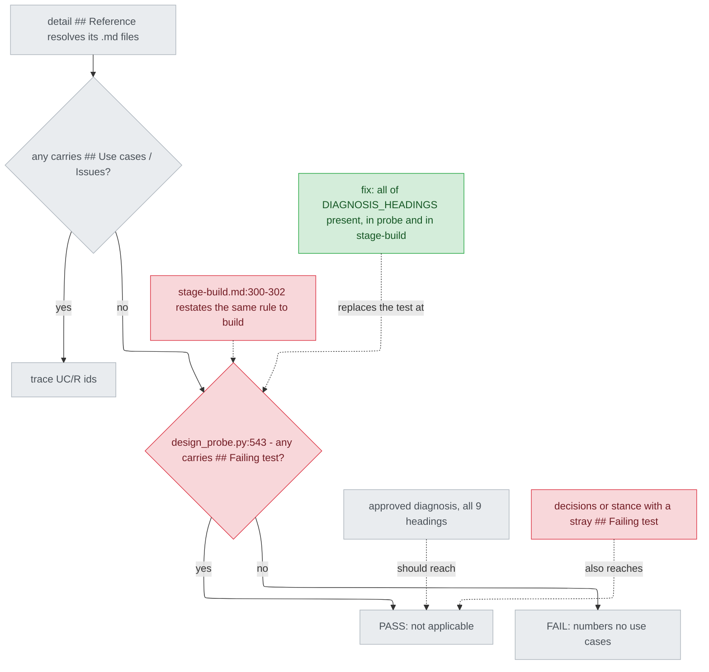

# design_probe.py recognises a diagnosis by one heading — diagnosis

## 維護說明（2026-10-27）

本檔是歷史設計紀錄，保留決策、驗收依據與實作偏差；不是待執行計畫。原簽核狀態、版本、行號及未驗證標記描述撰寫當時，整併不代表重新簽核或重做實測。

名詞：設計立場（stance）說明取捨；決策紀錄（decisions）保存選擇理由；細部設計（detail）記錄建造規格；需求盤點（intake）保存驗收條件。下方英文標題與識別碼沿用原文，便於對照歷史。


已併入並移除的同主題文件：`2026-09-25-diagnosis-detail-traceability-diagnosis.md`、`2026-09-26-decisions-probe-finds-stance-diagnosis.md`。

補充段落保留原文與原決策編號，避免把不同時點同號的決策當成一項；重複的概覽圖、施工排程與階段交接文字不再複製。

## Status

approved 2026-09-26

## Symptom

A detail design whose `## Reference` resolves only to documents with no
`## Use cases / Issues` should FAIL traceability unless one is a diagnosis.
Any document that merely carries `## Failing test` is taken for one, and the
check becomes a "not applicable" PASS (issue #166).

**Reproduction** (2026-09-26, working tree at `567f508`, read-only): a scratch
script wrote one upstream to a temp directory, pointed a detail's
`## Reference` at it alone, and called the test file's `traceability_verdict`
(`tests/test_design_probe_diagnosis.py:162-167`):

```
a decisions + stray Failing test             -> True  | not applicable -- <tmp>\up.md is a diagnosis ...
b stance, no Use cases, + stray Failing test -> True  | not applicable -- <tmp>\up.md is a diagnosis ...
control: full diagnosis fixture              -> True  | not applicable -- <tmp>\up.md is a diagnosis ...
control: decisions without Failing test      -> False | the high-level design numbers no use cases
```

(a) is `DECISIONS_MIN` (`tests/test_design_probe_diagnosis.py:150-159`) plus a
`## Failing test` section; (b) a stance with `## Status` and `## Optimises for`
but no use cases, plus the same section. Both should read like the last row.

## Failing test

Two tests appended after `tests/test_design_probe_diagnosis.py:253`, run red
by build before the probe changes. Each writes one upstream to `tmp_path`,
references only it, and asserts `ok is False` and `"numbers no use cases" in
label` via `traceability_verdict`; red today on `assert True is False`:

- `tests/test_design_probe_diagnosis.py::test_decisions_with_a_stray_failing_test_still_fails`
  — `DECISIONS_MIN` plus a `## Failing test` section (AC1a).
- `tests/test_design_probe_diagnosis.py::test_stance_without_use_cases_with_a_stray_failing_test_still_fails`
  — a new stance fixture as in (b) above (AC1b).

**Promise** (documentation): only an approved diagnosis makes traceability
not applicable (`plugins/cai/skills/track/references/stage-design.md:445-447`);
every other upstream numbers its use cases (`stage-design.md:439-444`). A
diagnosis is written from its template with no heading added or renamed
(`stage-design.md:255-259`) and passes `--kind diagnosis` (`:284-286`), which
fails if any of the nine headings is missing
(`plugins/cai/scripts/design_probe.py:82-84,210-219,357`).

## Root cause

**The not-applicable branch identifies a diagnosis by a heading no kind owns
exclusively: `design_probe.py:543` tests `"Failing test" in s`, and nothing
stops another document from carrying that heading.**

- `sections()` keys every `## ` heading whatever the kind (`:129-142`); only
  the legacy kind rejects extra headings, and only detail ones (`:300-302`).
- The branch runs when no upstream has `## Use cases / Issues` (`:528,539`) —
  true of every decisions document (`:75-76`) and of a stance missing them.
- `stage-build.md:300-302` restates the rule to build: the design row is a
  diagnosis when "it carries a `## Failing test` heading, judged the same way
  `design_probe.py`'s not-applicable branch does".

**Fixing only `:543` would leave** build, following `stage-build.md:300-305`,
taking the same stray document for a diagnosis and writing failing-test rows
instead of UC/R rows. The rule is stated in two places; both change.

## Blast radius

- **`design_probe.py:543`** is the only content-based recognition. `:368`
  runs inside `--kind diagnosis`, which already needs all nine headings
  (`:357`); `preflight.py:42` picks kinds by filename suffix. Neither reached.
- **`stage-build.md:300-305`**: Step 6.1's classification, including the
  detail-path clause ("at least one diagnosis"). The Codex copy
  (`plugins/cai-codex/skills/track/references/stage-build.md:310-311`)
  regenerates; no `scripts/codex-overrides.json` anchor for this file lies in
  Step 6.
- **Label**: a real diagnosis plus a stray document, no use cases — today's
  plural label (`design_probe.py:549-552`) names both; after, only the real
  one. The two-diagnosis test uses full fixtures (`tests/...:183-194`).
- **Coupling**: recognition now follows `DIAGNOSIS_HEADINGS`; adding a heading
  later un-recognises older diagnoses. The list already gates `--kind
  diagnosis` and is tied to the template (`scripts/validate.py:1224-1234`),
  and is unchanged since `fd30d5f` (#105), per `explorer`'s `git log -L`.
- **Local documents**: all three `docs/design/*-diagnosis.md` have the nine
  headings, no other file there has `## Failing test`: no verdict changes.

## Fix

1. **`design_probe.py:543`**: a resolved document is a diagnosis only when
   every heading in `DIAGNOSIS_HEADINGS` (`:82-84`) is a key of its
   `sections()`. Presence, not content — content is `--kind diagnosis`'s check
   (`:210-219`), passed before sign-off. No new constant. The comment at
   `:540-542` says why one heading is not enough and the full shape is.
2. **`stage-build.md:300-302`**, parenthetical only (AC3): a diagnosis carries every
   heading of the diagnosis template (`design_probe.py`'s
   `DIAGNOSIS_HEADINGS`), not only `## Failing test` — the test the probe's
   not-applicable branch applies — and is still not judged by filename.
3. **Tests** as in `## Failing test`, red first.

Mechanical (AC4): `plugins/cai/.claude-plugin/plugin.json` 1.35.3 → 1.35.4;
`python scripts/gen-codex.py`, then `--release <greater version>`; `validate.py` and
`pytest` green. Two shipped files change in substance, so after sign-off this
goes straight to `build` (`stage-design.md:294-296`).

Left to the builder (one component, caught next test run): exact wording and
the fixture's name. No test pins the label side effect; no AC asks for one. No
new `stage-build.md` line may start with `## ` (`build_step` stops at
`\n## `, `scripts/validate.py:1823`).

## Invariants preserved

- `tests/test_design_probe_diagnosis.py:174-253` pass unedited (AC2): the
  `DIAGNOSIS` fixture has all nine headings (`:25-67`); label strings
  (`design_probe.py:533,546-552`) are unchanged.
- `scripts/validate.py:1224-1234` and `:2368-2373` pass: the list is untouched.
- The ledger sentence at `stage-build.md:296-298` and the Step 6 heading stay
  intact (`docs/rule-provenance.md:83-84`); `validate.py:1826-1848` still
  find their phrases in Step 6 (`## Failing test` stays at `:306`).
- Known by: `validate.py` 0 FAIL, no DRIFT/UNRELEASED; `pytest` all green.

## Picture



Look at the two dotted arrows into `NA`: the real diagnosis and the stray
document pass the same red node, and `stage-build.md` repeats that node.

## Out of scope

- `design_probe.py:411` recognises a stance by one heading: separate issue.
- The FAIL label "the high-level design numbers no use cases" (`:533,555`).
- The branch never checks the diagnosis is approved, though
  `stage-design.md:445` gates Detail on it. Found here, not fixed.
- Rejected at intake: excluding other kinds' headings; the filename suffix.


## 整併補充：diagnosis-detail-traceability-diagnosis

來源為原 `2026-09-25-diagnosis-detail-traceability-diagnosis.md`；以下僅保留上游背景或實作補充，現況以本檔維護說明為準。

#### Symptom

`## Reference` 只列一份已核准診斷文件的細部設計，跑 `design_probe.py --kind detail`，不論內容寫什麼，都印 `FAIL traceability (the high-level design numbers no use cases)` 並 exit 2。

**重現**（2026-09-25，已安裝的 1.33.0 探針，與 repo 的 `plugins/cai/scripts/design_probe.py` 逐位元組相同，`filecmp.cmp(..., shallow=False)` → `True`）：在 scratchpad 寫兩份夾具——一份 `--kind diagnosis` 0 FAIL 的診斷（`## Status` 為 `approved 2026-09-25`），一份其餘各項都合格、`## Reference` 只寫 `Diagnosis doc: x-diagnosis.md` 的細部設計——然後執行 `python <plugin>/scripts/design_probe.py --kind detail --project-dir <scratch> <scratch>/x-detail.md`：

```
PASS reference_resolves (...\repro\x-diagnosis.md)
FAIL traceability (the high-level design numbers no use cases)
-- detail: 1 probe(s) failed
```

其餘五項 PASS，exit 2。縮減到只剩兩個必要條件：被引用文件沒有 `## Use cases / Issues` 標題，而且它是 `## Reference` 裡第一個讀得到的 `.md`。

**假設與小測試**（每次只改夾具的一處，不改程式）：

| # | 假設：若 X 是原因，改 Y 症狀就消失 | 改了什麼 | 結果 |
|---|---|---|---|
| H1 | 探針只讀被引用文件的 `## Use cases / Issues` | 診斷副本加上這個標題與 `UC1`，細部設計寫 `UC1` | PASS，成立 |
| H2 | 診斷其他段落的編號也會被讀到 | 把 `R1` 寫進 `## Failing test`，細部設計寫 `R1` | 仍 FAIL，不成立 |
| H3 | 看的是位置，不是文件種類 | 另寫一份有 `UC1` 的 stance，排在診斷前面 | PASS，成立 |
| H4 | 是細部設計自己漏寫編號 | 看 FAIL 走哪個分支 | 走的是 `:510-511` 的「空集合」分支，不是 `:512-514` 的「沒提到」分支，不成立 |

H1、H3 正是今天唯一能過關的兩種做法：改已簽核的診斷，或另加一份文件。這兩種都是 AC1 禁止的。

#### Failing test

`tests/test_design_probe_diagnosis.py::test_a_detail_after_a_diagnosis_passes_traceability`（新增，由 build 先寫、先跑出紅燈）：把本檔 `DIAGNOSIS` 夾具的 `draft` 換成 `approved 2026-09-25`，寫進 `tmp_path/t-diagnosis.md`；細部設計的 `## Reference` 只寫這個檔名；斷言 `traceability` 為 True，而且標籤點名該診斷檔。今天會失敗，標籤是 `traceability (the high-level design numbers no use cases)`，值為 False。同一檔另加三個測試：列兩份診斷（AC3）；有標題但沒編號的 stance 仍 FAIL（AC4）；`[診斷, stance]` 的順序仍對 stance 的編號做追溯，缺一個就 FAIL。修法順帶改變的一種情況也要有測試：decisions 排在 stance 前面時，改為追溯 stance。

**所依承諾（promise）**：文件。`plugins/cai/skills/track/references/stage-design.md:294-301` 寫明診斷簽核後，改動不只幾個檔案時「goes straight to Detail」；同檔 `:485-487` 要求 Detail 的探針「fix and re-run until 0」。這條路徑上，後一句做不到。

#### Root cause

`detail_probes` 用 `## Reference` 裡**第一個讀得到的 `.md`** 當可追溯性的來源，並且假定那份文件一定會為使用情境編號，完全不看文件種類。所以，排第一的上游只要沒有 `## Use cases / Issues`，編號集合就一定是空的，而空集合一律 FAIL。

- 選文件：`plugins/cai/scripts/design_probe.py:496-501`，第一個 `resolve()` 成功就 `break`。
- 只讀一個標題：`design_probe.py:508`。診斷的標題清單裡沒有它（`design_probe.py:82-84`），而且作者不准自己加（`stage-design.md:258-259`「Do not add or rename headings」）。
- 空集合一律 FAIL，訊息仍寫著 HLD 時代的「high-level design」：`design_probe.py:510-511`。
- 文件也是同一個假設：Detail step 0 只寫了 stance、decisions 和舊式 HLD 這三種上游（`stage-design.md:439-444`），範本也一樣（`plugins/cai/templates/design-detail.md.tpl:25-35`、`:45`），`stage-design.md:554-555` 亦然。
- 何時引入（UNVERIFIED，explorer 回報的 `git log`，本階段無法自己執行 git）：`fd30d5f`（#105，2026-09-16）新增了診斷這一種文件和 Diagnosis→Detail 路徑；`detail_probes` 的可追溯性區塊上一次修改是 `09ee5f5`（2026-08-27）。這不影響上面的結論，結論只依據現在的程式碼。

**只修 `:510-511` 會留下什麼**：一是讓空集合改成 PASS 的話，沒編號的 stance/HLD 也會過（違反 AC4）；二是 `## Reference` 把 decisions 排第一時，同一個原因換一條路發作，因為 decisions 也沒有這個標題，`plugins/cai/scripts/preflight.py:474-476` 的註解已經寫到這件事。所以根因是「照位置選文件」，不是空集合那一行。

#### Fix

**方向：路徑是診斷時，直接 PASS 並附說明（issue 的第二個方向）。** 改在「選哪份文件」這一步：

1. 照今天的解析順序，把 `## Reference` 裡所有讀得到的 `.md` 都解析出來。`reference_resolves` 照舊報第一個。
2. 第一個有 `## Use cases / Issues` 標題的文件當來源，之後的行為完全不變：空集合 FAIL、有沒提到的 FAIL、全部提到才 PASS。
3. 如果沒有任何一份有這個標題，但至少一份是診斷，就 PASS，標籤寫明不適用，並列出每一份診斷解析後的路徑，寫法與 `reference_resolves` 印出的相同（AC2、AC3）。例如：`traceability (not applicable -- x-diagnosis.md is a diagnosis and numbers no use cases; build starts from its ## Failing test)`。判斷「是診斷」看的是有沒有 `## Failing test` 標題，這個標題只出現在 `DIAGNOSIS_HEADINGS`（`design_probe.py:52-84`）。不看檔名，因為作者可以自己指定路徑（`stage-design.md:255-256`），這樣 `-diagnosis.md` 字尾就會漏判。
4. 其餘情況照今天的訊息 FAIL。

step 8（`stage-design.md:485-487`）的文字不用改，1-3 做完，這條路徑就能跑到 0（AC6）。第 2 點也會讓 decisions 排第一的 `## Reference` 改成追溯後面的 stance（見 Blast radius 第二點）。intake 把這條記為範圍外，但它是修在根因上的直接結果，不需要多寫程式；build 會為它多加一個測試，把這個行為固定下來。

**為什麼不選第一個方向（改用診斷 `## Failing test` 裡的測試編號）**：探針從這一段能抽出來的，只有第一個帶副檔名的字串（`design_probe.py:49`、`:368`），而範本要求同一段也要寫出所依承諾（例如某份 `.md`），那個字串可能排在測試前面。要可靠地抽出測試，就得收緊診斷文件的格式，等於替一種已簽核的文件訂新的規則，這是 Stance 的工作（`stage-design.md:273-277`）。探針本身也寫明，誤擋一份正確文件的代價高於漏掉一次（`design_probe.py:28-31`）。何況失敗測試已經由 build 的 test-first 把關（`stage-build.md:160-165`），這比「文件裡提到它」更強。

**文件（AC5-AC7）**：
- `stage-design.md:439-444` step 0 加上診斷入口：打開診斷文件，確認 `## Status` 是 `approved` 並帶日期，沒有 Tier 1 要查。
- `:450-451` 的「same `<topic>` as the stance」補上「或診斷」。
- `:552-555` 補上細部設計的 `## Reference` 也可能指向診斷。
- 範本 `design-detail.md.tpl:20-35` 加一行 `Diagnosis doc:`，註解說明這時 traceability 為不適用；`:45` 的表頭改成不指名文件種類的寫法。
- 只改註解、Reference 那幾行和 `### Traceability` 表格，`##` 標題一個都不動（`scripts/validate.py:1224-1235` 會比對）。

**會動到的檔案**：`design_probe.py`、`stage-design.md`、`design-detail.md.tpl`、`tests/test_design_probe_diagnosis.py`，另外重新產生 `plugins/cai-codex/`。

#### Invariants preserved

- 上游是 stance/HLD 時：沒提到的編號 FAIL（`scripts/validate.py:1185`）；有標題但沒編號也 FAIL（`:510-511` 的分支保留）。
- `scripts/validate.py:1177-1202` 的 PROBE_CASES 不改，全數通過；範本的 `##` 標題仍與 `DETAIL_HEADINGS` 相同（`validate.py:1224-1235`）。
- 診斷文件的格式不變，`DIAGNOSIS_HEADINGS` 不動。`preflight.py` 不動。
- 驗證方式：`python scripts/validate.py` 全 PASS，`python -m pytest` 全綠，重新產生 codex 後 `validate.py` 沒有 DRIFT；回報 UNRELEASED 時，照 `CLAUDE.md` 的規則跑 `python scripts/gen-codex.py --release <更大的版本>`（AC8）。


## 整併補充：decisions-probe-finds-stance-diagnosis

來源為原 `2026-09-26-decisions-probe-finds-stance-diagnosis.md`；以下僅保留上游背景或實作補充，現況以本檔維護說明為準。

#### Symptom

決策文件的 `## Reference` 如果先列一份非 stance 的 `.md`、再列 stance，`--kind decisions` 的 `stance_is_approved` 讀到的是排第一那份的 `## Status`，不是 stance 的。兩個方向都會錯：

**重現**（2026-09-26，repo 的 `design_probe.py`，與已安裝的 1.35.0 版逐位元組相同，`filecmp.cmp(..., shallow=False)` 回傳 `True`）：在 scratchpad 用 `tests/test_design_probe_tiers.py` 自己的夾具（`decisions_doc()`、`STANCE`、`replace_section()`）寫出決策文件，`## Reference` 依序列 `intake.md`（沒有 `## Optimises for` 的非 stance）和 `stance.md`，再用 `python plugins/cai/scripts/design_probe.py --kind decisions --project-dir <scratch> <scratch>/x-decisions.md` 跑：

```
== case1（intake approved、stance draft）exit 0
PASS reference_resolves (<scratch>\case1\intake.md)
PASS stance_is_approved (approved)
-- decisions: 0 probe(s) failed
== case2（intake draft、stance approved）exit 2
PASS reference_resolves (<scratch>\case2\intake.md)
FAIL stance_is_approved (the stance it serves is still draft)
-- decisions: 1 probe(s) failed
```

case1 是比較危險的方向：stance 還是 draft，整份決策文件卻 0 FAIL。

本機現有 9 份 `docs/design/*-decisions.md` 都把 stance 排在第一，所以目前沒有一份讀錯（見 Blast radius 的比對）。`2026-09-25-convention-benchmark-case-decisions.md:5-6` 證明非 stance 文件確實會跟 stance 一起列在 `## Reference`，但它仍把 stance 排在前面；「真的有文件把別份排在 stance 前面」這件事，在本機沒有實例，是依 #169 的回報，本階段沒有讀 issue 原文（UNVERIFIED）。這不影響根因：上面的重現不依賴任何既有文件。

#### Failing test

`tests/test_design_probe_tiers.py::test_an_approved_non_stance_listed_first_does_not_pass_a_draft_stance` 與 `tests/test_design_probe_tiers.py::test_a_draft_non_stance_listed_first_does_not_block_an_approved_stance`（新增，放在 `:253` 之後、`# --- the legacy kind` 之前，由 build 先寫、先跑出紅燈）。全文：

```python
NOT_A_STANCE = "# t - intake\n\n## Status\n\n%s\n\n## Problem\n\nSomething is broken.\n"


def stance_listed_second(tmp_path, first_status):
    """## Reference naming a document that is not a stance ahead of the one
    that is -- the order #169 reports the probe reading by position."""
    (tmp_path / "intake.md").write_text(NOT_A_STANCE % first_status,
                                        encoding="utf-8")
    return replace_section(decisions_doc(), "Reference",
                           "- Intake: `intake.md`\n- Stance: `stance.md`")


def test_an_approved_non_stance_listed_first_does_not_pass_a_draft_stance(tmp_path):
    doc, roots = written(tmp_path, stance_listed_second(tmp_path, "approved 2026-09-16"),
                         stance=STANCE)
    assert verdicts("decisions", doc, roots)["stance_is_approved"] is False


def test_a_draft_non_stance_listed_first_does_not_block_an_approved_stance(tmp_path):
    doc, roots = written(tmp_path, stance_listed_second(tmp_path, "draft"))
    assert verdicts("decisions", doc, roots)["stance_is_approved"] is True
```

本 track 的 design 第 1 輪經本人同意，暫時插入上面兩個測試、跑 `python -m pytest tests/test_design_probe_tiers.py -k non_stance_listed_first -v`，兩個都失敗，然後移除。輸出節錄（原文完整保留在第 2 輪的 brief 裡）：

```
tests/test_design_probe_tiers.py::test_an_approved_non_stance_listed_first_does_not_pass_a_draft_stance FAILED [ 50%]
tests/test_design_probe_tiers.py::test_a_draft_non_stance_listed_first_does_not_block_an_approved_stance FAILED [100%]
>       assert verdicts("decisions", doc, roots)["stance_is_approved"] is False
E       assert True is False
>       assert verdicts("decisions", doc, roots)["stance_is_approved"] is True
E       assert False is True
====================== 2 failed, 16 deselected in 0.07s =======================
```

兩個結果都跟程式碼推得出來的一樣：`design_probe.py:392-397` 第一個 `resolve()` 成功就 `break`，`:402-405` 讀那一份的 `## Status`。移除後 `git status --short` 與 `git diff --stat` 都沒有輸出，repo 裡現在沒有這兩個測試。

**所依承諾（promise）**：
- 文件：`plugins/cai/skills/track/references/stage-design.md:569-570`「The probe still catches the case that matters — the stance's `## Status` going back to `draft`」；`plugins/cai/templates/design-decisions.md.tpl:24-27`，`## Reference` 放的是「The stance document this queue serves」，Decisions mode 要那份文件的 `## Status` 是 `approved <date>` 才會開始。
- 探針自己的標籤：`design_probe.py:408-409` 說的是「the stance it serves」。
- 既有測試：`tests/test_design_probe_tiers.py:194-198`（stance 是 draft 時 FAIL），這個測試今天只因為 stance 是唯一一份參照文件才會過。

#### Root cause

`decisions_probes` 把「`## Reference` 裡第一個讀得到的 `.md`」當成 stance，完全不檢查那份文件是不是 stance。所以只要 stance 不是第一份讀得到的，`stance_is_approved` 讀到的就是別份文件的 `## Status`。

- 選文件：`plugins/cai/scripts/design_probe.py:391-397`。regex `[\w./\\-]+\.md` 抓出每一個 `.md`，第一個 `resolve()` 成功就 `break`。這裡不看文件內容。
- 讀狀態：`design_probe.py:401-405` 打開 `ref`，讀 `## Status`，要求 `approved YYYY-MM-DD`。
- 範本沒有說 stance 必須排第一，也沒說只能列 stance：`design-decisions.md.tpl:21-31` 只給了一行 `- Stance:` 的範例。本機現有的文件也會在 stance 後面加列 intake、parent decisions、diagnosis、detail（見 Blast radius）。
- 同一種寫法以前出過事：#165 的 `detail_probes` 也是「第一個讀得到的」，後來改成挑第一份帶 `## Use cases / Issues` 的文件（`design_probe.py:511-515`）。那份診斷記錄了 `decisions_probes` 有同樣的迴圈，當時列為範圍外（`docs/design/2026-09-26-diagnosis-recognition-shape-diagnosis.md:172`、`:121`）。

**只修 stack trace 指到的那一行，還會剩下什麼**：stack trace 指到的是測試的斷言，探針裡直接算出那個布林值的是 `:404-405` 的狀態判斷。那一行沒錯，它只是如實讀了拿到的文件。就算把 `:397` 的 `break` 改成取最後一份，或改成只認帶 `Stance:` 字樣那一行，探針還是在猜「哪一份是 stance」：取最後一份時，排在 stance 後面的其他文件會被當成 stance（本機有 5 份決策文件在 stance 之後還列了讀得到的 `.md`，見 Blast radius）；只認 `Stance:` 字樣，就是替範例文字訂新規則，而範本的 `- Stance:` 本來只是示範（`design-decisions.md.tpl:31`）。所以根因是**用位置認文件種類**，不是狀態判斷那一行。修好之後，`design_probe.py` 裡就沒有別的判定結果還是用位置來決定；`detail_probes:502` 的 `resolved[0]` 只拿來印 `reference_resolves` 的路徑，不影響判定。

#### Fix

只改 `plugins/cai/scripts/design_probe.py` 的 `decisions_probes`（`:391-409`），做法與 #165 相同（`:496-515`）：

1. 照今天的 regex 和解析順序（`:392-395`，同一份文件旁邊的先找），把 `## Reference` 裡**所有**讀得到的 `.md` 依出現順序收集起來。`reference_resolves` 照舊：報第一份讀得到的路徑；一份都沒有就 FAIL，標籤不變（`:398-399`）。
2. 依序打開每一份，用 `sections()` 解析。**第一份 `sections()` 的鍵裡剛好有 `Optimises for` 的**就是 stance。判斷方式是鍵完全相等，跟 `:515` 用 `"Use cases / Issues" in s` 的寫法一樣。找到就停。打開檔案的方式跟今天的 `:402` 相同（`encoding="utf-8"`）。唯一新增的風險：排在 stance 前面、但不是第一份的非 UTF-8 `.md` 現在也會被打開並拋出例外。#165 的 `:509` 也接受了同樣的風險，這裡不另做處理。
3. 找到 stance：用今天的 `:402-409` 讀它的 `## Status`，regex 和兩種標籤都不變。
4. 有讀得到的 `.md`，但沒有一份是 stance：`stance_is_approved` 為 FAIL，標籤一字不差寫成 `stance_is_approved (no referenced .md is a stance -- none of N carries ## Optimises for)`，`N` 是讀得到的 `.md` 個數，照出現次數算，同一份列兩次就算 2（AC3）。
5. 一份都讀不到：跟今天一樣，只有 `reference_resolves` FAIL，不印 `stance_is_approved`（保留 `:401` 的條件）。

測試（test-first）：`## Failing test` 那兩個測試（AC1、AC2），再加第三個：`## Reference` 只列 `intake.md`（其 `## Status` 為 `approved 2026-09-16`，所以今天會 PASS、先跑出紅燈），斷言 `stance_is_approved` 為 False，而且用 `detail(...)` 取出的標籤包含 `no referenced .md is a stance`（AC3）。三個都放在 `tests/test_design_probe_tiers.py:253` 之後。

會動到的檔案：`design_probe.py`、`tests/test_design_probe_tiers.py`，重新產生 `plugins/cai-codex/`（AC5），並調高 `plugins/cai/.claude-plugin/plugin.json` 的 patch 版號（AC6）。文件和範本都不用改：`design-decisions.md.tpl:24` 本來就寫「The stance document this queue serves」，沒有規定順序。

#### Invariants preserved

- 探針的誤判偏好：誤擋一份正確文件比漏放更貴（`design_probe.py:29-31`）。新規則只會擋下沒有 `## Optimises for` 的 stance，而這種 stance 本來就過不了 `--kind stance`，因為 `STANCE_HEADINGS` 要求這一節（`:69-71`），缺了 `probe_headings` 就 FAIL（`:210-219`）。
- 「核准」的定義不變：仍然是 `approved` 加日期（`:404-405`）。
- `reference_resolves` 的語意與標籤不變。`DECISIONS_HEADINGS`、`design-decisions.md.tpl` 和 `preflight.py` 都不動。
- 怎麼知道沒弄壞：`python -m pytest` 全綠，其中 `tests/test_design_probe_tiers.py:188-198` 不修改就通過（AC4）；`python scripts/validate.py` 全 PASS、沒有 DRIFT 或 UNRELEASED（AC7）；用上面 9 份決策文件重跑 `--kind decisions`，`stance_is_approved` 的結果跟修正前一樣。
