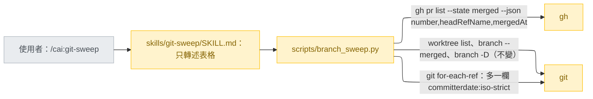
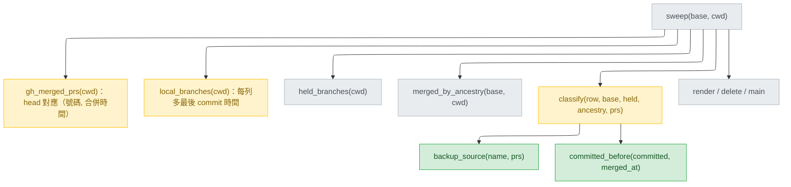
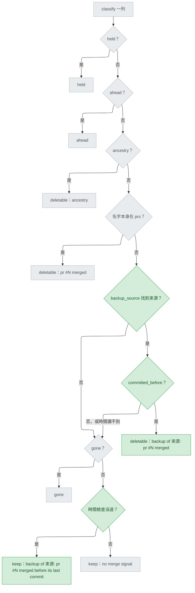
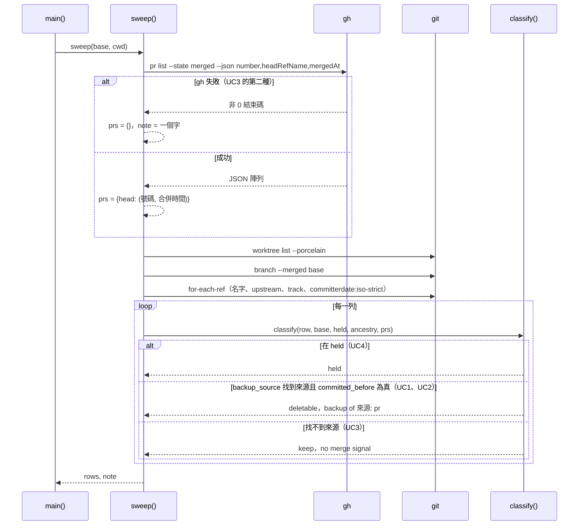
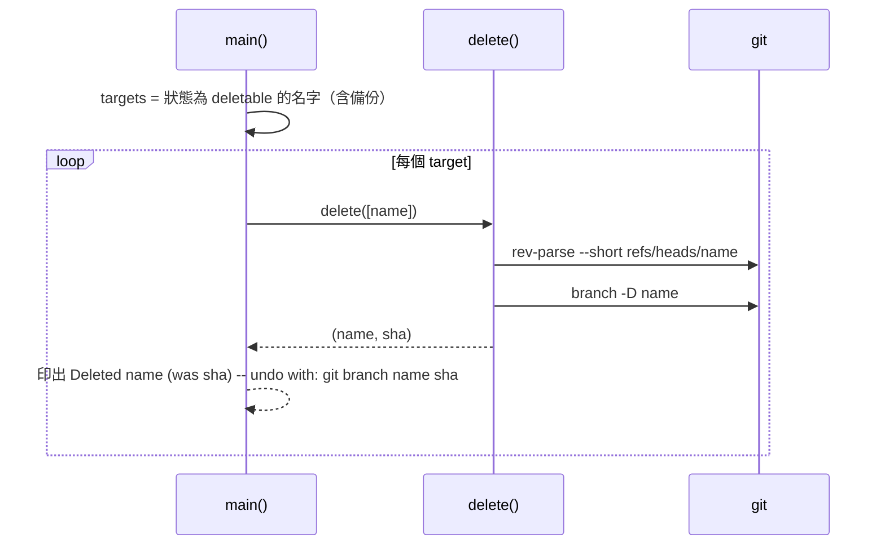

# git-sweep-delete-backups — detail design

## 維護說明（2026-10-27）

本檔是歷史設計紀錄，保留決策、驗收依據與實作偏差；不是待執行計畫。原簽核狀態、版本、行號及未驗證標記描述撰寫當時，整併不代表重新簽核或重做實測。

名詞：設計立場（stance）說明取捨；決策紀錄（decisions）保存選擇理由；細部設計（detail）記錄建造規格；需求盤點（intake）保存驗收條件。下方英文標題與識別碼沿用原文，便於對照歷史。

備份參照的辨識與刪除決策保留；現行工具見 [`plugins/cai/skills/git-sweep/SKILL.md:2`](../../plugins/cai/skills/git-sweep/SKILL.md#L2)。原「本文件不是簽核對象」描述當時流程；現行簽核依程序與設計指紋判斷，不能據此免除。

已併入並移除的同主題文件：`2026-09-26-git-sweep-delete-backups-decisions.md`、`2026-09-26-git-sweep-delete-backups-stance.md`。

補充段落保留原文與原決策編號，避免把不同時點同號的決策當成一項；重複的概覽圖、施工排程與階段交接文字不再複製。

這份是建造規格，寫給沒參與對話、照著就能動工的人。它不是簽核對象：本人簽的是 stance 和 decisions，這份是那兩份授權的施工圖。名詞第一次出現的定義見 `## Glossary`；表外幾個詞：PR（pull request，合併請求）、gh（GitHub 的命令列工具）、head（PR 的來源分支名，gh 欄位 `headRefName`）、WHY（sweep 表格的理由欄）、SHA（commit 識別碼）、squash（把一串 commit 壓成一個）、worktree（另一個工作目錄）、Codex 版（`scripts/gen-codex.py` 從 `plugins/cai/` 產生的 `plugins/cai-codex/`）。

## Reference

Stance doc: docs/design/2026-09-26-git-sweep-delete-backups-detail.md
Decisions doc: docs/design/2026-09-26-git-sweep-delete-backups-detail.md
Status: approved 2026-09-26（stance）；decisions 的 Tier 1 唯一一條 D1 已有 `Decided:`（B，本人 2026-09-26）

### Traceability

| From the referenced document | Satisfied by | Status |
|---|---|---|
| R1 — 備份從不 `deletable` | `classify()` 在 `pr` 之後加備份規則（`### classify`）；測試 T1 | covered |
| UC1 — 來源已從本地刪除 | `backup_source()` 只對已合併 PR 的 head 比對，不看本地分支（S6）；測試 T2 | covered |
| UC2 — presquash 形狀 | 兩種寫法比對（`### backup_source`）＋時間檢查通過（decisions C6：早 50 分鐘）；測試 T3 | covered |
| UC3 — 沒有 PR 時 `keep`；gh 查不到時 `keep` 加 `note:` | `backup_source()` 回 `None` 就往下走到既有的 `gone`／`keep`；`gh_merged_prs()` 失敗時回空表（`branch_sweep.py:134-135`）；測試 T4、T5 | covered |
| UC4 — worktree 占用時 `held` | `held` 仍在最前面（`branch_sweep.py:218-219`，不動）；測試 T6 | covered |
| UC5 — `--delete` 印復原行 | 走既有 `delete()` 與 `main()`（`branch_sweep.py:245-257`、`:319-322`，不動）；測試 T7 | covered |
| UC6 — 說明、Codex 版、驗證 | `## Change points` 的 docstring 與 `SKILL.md` 三處；Unit 3 重產 Codex 版、跑 `validate.py` 與 `pytest` | covered |
| R2 — 多個 head 對得上 | `backup_source()` 的挑選規則（D2）；測試 T9 | covered |
| R3 — 縮小同名重用的誤判 | `committed_before()` 時間檢查（D1＝B）；測試 T8、T11 | covered |
| R4 — 沒有後綴 | `backup_source()` 要求 head 後面還有 `-` 和至少一個字元（D3）；測試 T10 | covered |

## Requirement

ship 在 squash 前建的 `backup/<來源>-<後綴>` 分支從不 push，也不是任何 PR 的 head，所以 sweep 永遠把它判成 `keep / no merge signal`（`branch_sweep.py:228`），要人手動清（issue #188）。做完之後：來源的 PR 已合併、且備份最後一個 commit 不晚於那次合併時，同一次 sweep 就把備份列為 `deletable`，WHY 為 `backup of <來源>: pr #N merged`；來源在不在本地都一樣。怎麼知道做到了：`## Verification` 的 T1–T11 全綠，既有 13 個測試一字不改照樣綠（S9），`validate.py` 與 `pytest` 通過。

## Glossary

| Term | Definition | Where it lives |
|---|---|---|
| sweep | 列出本地分支並替每條判一個狀態的腳本 | plugins/cai/scripts/branch_sweep.py:231 |
| 狀態（status） | `deletable`、`gone`、`ahead`、`held`、`keep` 五個值之一，表格依這個順序排 | plugins/cai/scripts/branch_sweep.py:65 |
| 備份（backup） | 名字以 `backup/` 開頭的本地分支；ship 用 `git branch "backup/${BRANCH}-$(date +%Y%m%d-%H%M%S)"` 建 | plugins/cai/skills/track/references/stage-ship.md:112 |
| 來源（source） | 備份當初備份的那條分支，由 `backup_source()` 從備份名對回某個已合併 PR 的 head | concept |
| 後綴（suffix） | 備份名裡來源之後、`-` 之後的部分，至少一個字元，內容不限 | concept |
| 寫法（spelling） | head 的兩種比對形式：原樣，以及把每個 `/` 換成 `-` | concept |
| 已合併 PR 表（prs） | `gh_merged_prs()` 的回傳：head 對應到（號碼, 合併時間）；同一個 head 只留號碼最大的一筆 | plugins/cai/scripts/branch_sweep.py:126 |
| 合併時間（merged at） | gh 的 `mergedAt` 欄位，UTC、ISO 8601，例如 `2026-09-27T00:05:07Z` | concept |
| 時間檢查 | `committed_before()` 對備份的最後 commit 時間與選中 PR 的合併時間回真 | concept |
| 最後 commit 時間（committed） | `for-each-ref` 的 `%(committerdate:iso-strict)`，例如 `2026-09-26T19:15:13-04:00` | concept |
| 分支列（row） | `local_branches()` 每一列：（名字, upstream, ahead 數, gone, 最後 commit 時間） | plugins/cai/scripts/branch_sweep.py:156 |
| `BACKUP_PREFIX` | 常數 `"backup/"` | new — plugins/cai/scripts/branch_sweep.py |
| `backup_source()` | 從備份名找出來源 head 的函式 | new — plugins/cai/scripts/branch_sweep.py |
| `committed_before()` | 判斷最後 commit 時間不晚於合併時間的函式 | new — plugins/cai/scripts/branch_sweep.py |
| 假 gh | 測試用的假 CLI，原樣輸出環境變數給的 JSON | tests/fake_gh.py:23 |

## Budgets

| What | Number | Where it comes from |
|---|---|---|
| 每次執行新增的子程序呼叫 | 0 | S4（stance:29）；兩個欄位都加在既有的 `gh pr list`（`branch_sweep.py:130-132`）與 `for-each-ref`（`:158-159`）裡 |
| 每條備份最多比對的 head 數 | 200 | `PR_LIMIT`（`branch_sweep.py:52`），每個 head 兩種寫法，最多 400 次 `startswith` |
| 子程序逾時 | 15 秒 | `TIMEOUT_SECONDS`（`branch_sweep.py:41`），不變 |
| 時鐘誤差緩衝 | 0 秒 | decisions Tier 3「時鐘誤差」列 |
| 真實備份離合併的餘裕 | 3000 秒 | decisions C6：19:15:13-04:00 對 00:05:07Z |
| 新增測試數 | 11 | `## Verification` T1–T11 |
| 既有測試的改動行數 | 0 | S9（stance:34）；只擴充 `use_fake_gh()` 這個輔助函式，向後相容 |

## Design decisions

- DD1 — 時間檢查（decisions D1，本人選 B）：備份的最後 commit 時間不晚於選中 PR 的合併時間，才列 `deletable`。服務 R3。
- DD2 — 挑來源（D2）：原樣與 `/`→`-` 兩種寫法都比，取最長；一樣長時原樣優先；還是一樣時取 PR 號碼大的（照 `branch_sweep.py:149-152`「同名留較新的」的既有慣例）。服務 R2。
- DD3 — 後綴必須存在（D3）：head 之後要有 `-` 和至少一個字元。服務 R4。
- DD4 — 規則的位置：`pr` 之後、`gone` 之前；`held`、`ahead` 不動（S1、stance:62 的圖）。
- DD5 — 時間檢查沒過時，不直接回 `keep`，而是照常往下判 `gone`；落到最後的 `keep` 時，WHY 改為 `backup of <來源>: pr #N merged before its last commit`，讓人看得出為什麼沒被刪（decisions Tier 3）。
- DD6 — 任一邊時間缺少或讀不出來，視為時間檢查沒過（decisions Tier 3「讀不到時間」列，S2 的安全方向）。
- DD7 — `note:` 字串不改（`branch_sweep.py:263-264`），只在 `SKILL.md` 補一句備份也會是 `keep`（decisions Tier 3）。

## Diagrams

### Architecture

看的重點：跨出腳本的箭頭數沒有增加，只是兩條既有的呼叫各多要一個欄位（S4）。模型那一層（SKILL.md）仍然只轉述，判斷全在腳本裡。

### Component

看的重點：兩個新函式都是純函式，只被 `classify()` 呼叫，不碰子程序；會變形狀的只有 `gh_merged_prs()` 的回傳值和 `local_branches()` 的列，`sweep()` 的簽名與回傳不變。

### Flow

看的重點：綠色只出現在 `pr` 之後；時間檢查沒過的備份不會被刪，但也不會吞掉 `gone`，只在最後的 `keep` 換一句 WHY（DD5）。

### Sequence — UC1, UC2, UC3, UC4

看的重點：UC1（來源已刪）和 UC2（presquash）走的是同一條呼叫順序，差別只在 `backup_source()` 內部用哪種寫法對上；本地有沒有來源分支從頭到尾不被查詢。

### Sequence — UC5

看的重點：備份走的刪除路徑和其他分支完全相同，沒有任何新呼叫（S8）。UC6 是說明與發版，沒有執行時的呼叫順序，所以不畫。

## Implementation spec

### BACKUP_PREFIX

- Responsibility：定義哪些分支名算備份。
- Interface：`BACKUP_PREFIX = "backup/"`，模組層常數，放在 `PR_LIMIT` 之後。
- Data：字串，小寫、區分大小寫比對（decisions Tier 3「前綴」列）。
- Errors／Concurrency：無。
- Observability：無。
- Where it lives：`plugins/cai/scripts/branch_sweep.py`（檔案存在）。
- What it reuses：值取自 `stage-ship.md:112`；上方註解說明為什麼（ship 建的名字），照 `branch_sweep.py:49-52` 的註解風格。

### gh_merged_prs（修改）

- Responsibility：一次查出所有已合併 PR，回傳 head 對應（號碼, 合併時間）。
- Interface：`def gh_merged_prs(cwd=None) -> tuple[dict[str, tuple[int, str | None]], str | None]`（型別只寫在 docstring，照檔案現況不加 annotation）。
- Data：argv 的 `--json` 改為 `number,headRefName,mergedAt`。每筆：`headRefName` 必須是非空字串、`number` 必須是 int，否則略過（現行規則加上「非空」）；`mergedAt` 是字串才保留，否則存 `None`。同一個 head 仍只留號碼最大的一筆，連同那一筆的 `mergedAt`。
- Errors：不變——非 0 結束碼回 `({}, classify_gh(...))`，JSON 讀不了回 `({}, "unreadable")`（`branch_sweep.py:133-141`）。
- Concurrency：唯讀，可重跑。
- Observability：不變，失敗時的一個字由 `render()` 印成 `note:`。
- Where it lives：`plugins/cai/scripts/branch_sweep.py:126-153`。
- What it reuses：`run()`（`:68-86`）、`gh_prefix()`（`:97-107`）、`classify_gh()`（`:110-123`）。

### local_branches（修改）

- Responsibility：一次列出所有本地分支，每列多帶最後 commit 時間。
- Interface：`def local_branches(cwd=None) -> list[tuple[str, str, int, bool, str]]`。
- Data：`fmt` 改為 `"%(refname:short)\t%(upstream:short)\t%(upstream:track)\t%(committerdate:iso-strict)"`；第五欄取 `parts[3]`，缺少時為 `""`。
- Errors：不變——`for-each-ref` 失敗回 `[]`（`:160-161`）。
- Concurrency：唯讀。
- Observability：無。
- Where it lives：`plugins/cai/scripts/branch_sweep.py:156-173`。
- What it reuses：`git()`（`:89-94`）、`_AHEAD`（`:54`）。

### backup_source（新增）

- Responsibility：給一個分支名，找出它是哪個已合併 PR head 的備份。
- Interface：`def backup_source(name, prs) -> str | None`，回傳 head（原樣，含 `/`），找不到回 `None`。
- Data：`name` 不以 `BACKUP_PREFIX` 開頭就回 `None`。否則 `rest = name[len(BACKUP_PREFIX):]`；對 `prs` 的每個 head、每種寫法（`head`、`head.replace("/", "-")`），當 `rest.startswith(寫法 + "-")` 且 `len(rest) > len(寫法) + 1` 時算對上。多個對上時依序比：寫法長度較長者、原樣寫法優先於 `-` 寫法、PR 號碼較大者（DD2）。
- Errors：不拋例外；空 `prs` 回 `None`。
- Concurrency：純函式。
- Observability：無；結果由 `classify()` 寫進 WHY。
- Where it lives：`plugins/cai/scripts/branch_sweep.py`，放在 `classify()` 之前。
- What it reuses：`prs` 的形狀來自 `gh_merged_prs()`。

### committed_before（新增）

- Responsibility：判斷最後 commit 時間不晚於合併時間。
- Interface：`def committed_before(committed, merged_at) -> bool`。
- Data：兩個都是字串或 `None`。各自先把結尾的 `Z` 換成 `+00:00`，再用 `datetime.datetime.fromisoformat()` 讀；回傳 `committed_dt <= merged_dt`。
- Errors：任一個是 `None`、空字串，或讀取／比較時拋 `ValueError`、`TypeError`，回 `False`（DD6）。
- Concurrency：純函式。
- Observability：無。
- Where it lives：`plugins/cai/scripts/branch_sweep.py`，放在 `backup_source()` 之後；檔頭加 `import datetime`。
- What it reuses：與 `plugins/cai/scripts/viewer.py:1228` 相同的讀法。

### classify（修改）

- Responsibility：替一列判出（狀態, WHY）。
- Interface：`def classify(row, base, held, ancestry, prs) -> tuple[str | None, str | None]`，簽名不變。
- Data：拆列改為 `name, _upstream, ahead, gone, committed = row`。`name in prs` 那一行改用 `prs[name][0]` 取號碼，WHY 字串不變。在它之後加入：`source = backup_source(name, prs)`；有來源時取 `number, merged_at = prs[source]`，`committed_before(committed, merged_at)` 為真就回 `("deletable", "backup of %s: pr #%d merged" % (source, number))`，否則記下 `unproven = "backup of %s: pr #%d merged before its last commit" % (source, number)` 並往下走。`gone` 判斷不變；最後回 `("keep", unproven or "no merge signal")`。docstring 的「Order is the safety policy」照留。
- Errors：不拋例外。
- Concurrency：純函式。
- Observability：WHY 欄是唯一輸出。
- Where it lives：`plugins/cai/scripts/branch_sweep.py:212-228`。
- What it reuses：`backup_source()`、`committed_before()`。

### 模組 docstring 與 SKILL.md（修改）

- Responsibility：讓讀的人知道備份規則存在、依據什麼、弱在哪裡。
- Interface／Data：以下英文句子照抄進檔案（這兩個檔案都是英文）。
  - docstring `branch_sweep.py:18-22`：第一句改為「Only `ancestry` and `pr` are evidence that the work reached <base>, and only those -- plus the backup rule below, which leans on `pr` -- are ever reported `deletable`.」；在 `gone` 那段之後加一段：「A `backup/<source>-<suffix>` branch -- what `ship` leaves behind before it squashes -- is never pushed and is no pull request's head, so none of the three signals can fire for it. It is reported `deletable` when <source> is the head of a merged pull request and the backup's last commit is no later than that merge. The match is by name only; nothing checks the backup's contents. The time check is what keeps a backup made in a later round of a reused branch name from riding on the earlier round's merge.」
  - `SKILL.md:27-28` 的 `deletable` 後面接：「Or it is a `backup/<source>-<suffix>` branch whose source's pull request merged after the backup's last commit; the `WHY` column then reads `backup of <source>: pr #N merged`. That match is by name only -- nothing checks the backup's contents.」
  - `SKILL.md:38` 的 `keep` 後面接：「A backup whose `WHY` ends in `merged before its last commit` has a source whose pull request merged before the backup's last commit, so it is probably left over from a later round on a reused branch name.」
  - `SKILL.md:40-44` 的 `note:` 段，在第一句之後接：「Backup branches can then only read as `keep` too.」
- Errors／Concurrency／Observability：無。
- Where it lives：`plugins/cai/scripts/branch_sweep.py:1-33`、`plugins/cai/skills/git-sweep/SKILL.md`。
- What it reuses：無。

## Naming

| Name | What it is | Chosen by |
|---|---|---|
| `BACKUP_PREFIX` | 值為 `"backup/"` 的模組常數 | follows 大寫常數慣例 `CLI_ENV`、`PR_LIMIT` at plugins/cai/scripts/branch_sweep.py:47；值 follows plugins/cai/skills/track/references/stage-ship.md:112 |
| `backup_source` | 找來源 head 的函式 | follows 小寫底線、描述回傳物的函式名 `merged_by_ancestry` at plugins/cai/scripts/branch_sweep.py:188 |
| `committed_before` | 時間比較函式 | follows 同上 at plugins/cai/scripts/branch_sweep.py:188 |
| `backup of <來源>: pr #N merged` | `deletable` 備份的 WHY | the user, 2026-09-26（intake 驗收條件 `.claude/track/git-sweep-delete-backups/options-intake.md:19`） |
| `backup of <來源>: pr #N merged before its last commit` | 時間檢查沒過、落到 `keep` 時的 WHY | decisions Tier 3「時間檢查沒過時的 WHY」列，隨 Gate 1 簽核；句型 follows 上一列 |
| `mergedAt` | gh 的 JSON 欄位 | gh 自己的欄位名（https://cli.github.com/manual/gh_pr_list ） |
| `%(committerdate:iso-strict)` | for-each-ref 的格式欄位 | git 自己的欄位名（https://git-scm.com/docs/git-for-each-ref ） |
| `test_backup_*` 等 11 個測試名（見 `## Verification`） | 新測試函式 | follows 句子式測試名 at tests/test_branch_sweep.py:92 |

## Change points

| Path | Change | Exists today |
|---|---|---|
| `plugins/cai/scripts/branch_sweep.py` | 加 `import datetime`、`BACKUP_PREFIX`、`backup_source()`、`committed_before()`；改 `gh_merged_prs()`、`local_branches()`、`classify()`、模組 docstring | yes |
| `plugins/cai/skills/git-sweep/SKILL.md` | 三處說明（見 `### 模組 docstring 與 SKILL.md`） | yes |
| `tests/test_branch_sweep.py` | `use_fake_gh()` 的 `merged` 接受（號碼, head）或（號碼, head, 合併時間），第三項存在時才輸出 `mergedAt`；新增 T1–T11；模組 docstring 補一句備份 | yes |
| `plugins/cai-codex/scripts/branch_sweep.py`、`plugins/cai-codex/skills/git-sweep/SKILL.md` | 只由 `python scripts/gen-codex.py` 重產，不手改 | yes |
| `plugins/cai/.claude-plugin/plugin.json`、`scripts/codex-release.json` | 版號與 `gen-codex.py --release`，在 ship 時依 commit 類型處理（decisions Tier 3「版號與 Codex 版」列） | yes |
| 新依賴 | 無；`datetime` 是標準函式庫 | — |

## Failure modes

| Situation | What happens | What the caller sees |
|---|---|---|
| gh 不在、未登入、連不上 | `prs = {}`，所有備份找不到來源 | 備份 `keep / no merge signal`，表格上方照舊有 `note:` 行 |
| gh 回的某筆沒有 `mergedAt` 或不是字串 | 存 `None`；`pr` 規則照常，備份的時間檢查沒過 | 該備份 `keep`，WHY `... merged before its last commit`（DD6） |
| `for-each-ref` 的時間欄空白或讀不出來（例如很舊的 git 不認得 `iso-strict`，UNVERIFIED） | `committed_before()` 回 `False` | 備份 `keep`，WHY 同上；其他分支不受影響 |
| 本機時鐘比 GitHub 慢，使這一輪的 commit 看起來早於上一輪合併 | 時間檢查通過 | 這一輪的備份被列 `deletable`（decisions D1 的已知失敗，Budgets 緩衝 0 秒） |
| 本機時鐘比 GitHub 快，使真正的備份看起來晚於合併 | 時間檢查沒過 | 備份 `keep`；要時鐘快過「最後 commit 到合併」的間隔才會發生（真實例 3000 秒） |
| 分支名正好是 `backup/` 或 `backup/<head>` | 沒有後綴，對不上（DD3） | `keep / no merge signal` |
| 兩個 head 換成 `-` 後同名、一樣長 | 取 PR 號碼大的（DD2） | WHY 指向號碼大的那個 PR |
| 備份名自己就是某個已合併 PR 的 head | 既有 `pr` 規則先命中 | `deletable`，WHY `pr: #N merged` |
| 備份被 worktree 占用、或有沒推上的 commit | `held`／`ahead` 先命中（S1） | 不會被刪 |
| 備份有 upstream 且遠端已刪，時間檢查沒過 | 照常判 `gone`（DD5） | `gone`，WHY 為既有的 upstream 說明 |
| 一個 `backup/*` 都沒有 | 新程式碼只做 `startswith` 判斷 | 表格與今天相同（S9） |
| 分支名或 head 含主控台編碼外的字 | `run()` 已用 UTF-8 讀（`branch_sweep.py:72-77`） | 照常 |

## Rollout

- 分段：一個 PR 出貨。最小可用的一塊就是整個規則加測試；說明與 Codex 版必須同一個 PR，否則 `validate.py` 報 DRIFT。
- 既有資料：不遷移。已經存在的備份在更新後第一次 sweep 就會被重新判定；本 repo 的 `backup/fix-diagnosis-recognition-shape-20260926-presquash` 會變成 `deletable`（decisions C6）。
- 進行中的呼叫：`/cai:git-sweep` 預設只列表不刪（`SKILL.md:19-22`），所以更新當下不會有東西被自動刪掉。
- Rollback：revert 這個 commit，沒有寫入任何狀態；已經用 `--delete` 刪掉的備份，用當時印出的 `git branch <名稱> <SHA>` 建回。

## Verification

測試全在 `tests/test_branch_sweep.py`，用既有的真 bare remote 與假 gh（`tests/test_branch_sweep.py:28-44`、`:66-74`）。「晚於」用 `2999-01-01T00:00:00Z` 當合併時間，「早於」用 `2000-01-01T00:00:00Z`，不依賴測試執行的時刻。備份用 `git branch <備份名> <來源>` 建，起點是本地分支，所以沒有 upstream（decisions C7）。

| Criterion | Level | What it needs | Green before |
|---|---|---|---|
| R1 — T1 `test_backup_of_a_squash_merged_source_is_deletable`：`feat/squashed` 已 push、PR #106 合併於 2999 年，`backup/feat/squashed-20260926-194453` 為 `deletable`，WHY 等於 `backup of feat/squashed: pr #106 merged` | integration | 真 repo、假 gh 三項 tuple | Unit 1 |
| UC1 — T2 `test_backup_is_deletable_after_its_source_was_deleted`：建備份後 `git branch -D feat/squashed`，備份仍 `deletable` | integration | 同上 | Unit 1 |
| UC2 — T3 `test_backup_with_dashes_and_a_word_suffix_is_recognised`：`backup/fix-diagnosis-recognition-shape-20260926-presquash` 對上 head `fix/diagnosis-recognition-shape`，WHY 用含 `/` 的原樣 | integration | 同上 | Unit 1 |
| UC3 — T4 `test_backup_of_an_unmerged_source_is_kept`：假 gh 回空陣列，備份 `keep`、WHY `no merge signal` | integration | 同上 | Unit 1 |
| UC3 — T5 `test_backups_are_kept_when_gh_is_unavailable`：gh 回 127，備份 `keep`，`note` 不是 `None` | integration | 照 `tests/test_branch_sweep.py:175-177` 的寫法 | Unit 1 |
| UC4 — T6 `test_backup_held_by_a_worktree_is_held`：`git worktree add` 備份，狀態 `held` | integration | tmp_path 下的 worktree | Unit 1 |
| UC5 — T7 `test_delete_prints_the_sha_that_undoes_a_backup`：`main(["--repo", ..., "--delete"])` 的輸出含 `git branch backup/feat/squashed-20260926-194453 ` 加 SHA 前 7 碼 | integration | capsys | Unit 1 |
| R3 — T8 `test_backup_made_after_its_source_merged_is_kept`：合併時間 2000 年，備份 `keep`，WHY `backup of feat/squashed: pr #106 merged before its last commit` | integration | 假 gh 三項 tuple | Unit 1 |
| R2 — T9 `test_the_longest_matching_source_names_the_backup`：`feat/a`（#1）與 `feat/a-b`（#2）都合併、合併時間都是 2999 年；本地只建 `feat/a-b` 並以它為起點建備份，`backup/feat/a-b-20260926-120000` 的 WHY 為 `backup of feat/a-b: pr #2 merged` | integration | 兩條來源分支 | Unit 1 |
| R4 — T10 `test_a_backup_with_no_suffix_is_not_a_backup`：`backup/feat/squashed` 為 `keep`、WHY `no merge signal` | integration | 同 T1 | Unit 1 |
| R3 — T11 `test_backup_without_a_merge_time_is_kept`：`feat/squashed` 已 push，假 gh 只給（號碼, head），備份 `keep`，而來源分支本身仍 `deletable`、WHY `pr: #106 merged` | integration | 兩項 tuple | Unit 1 |
| S9 — 既有 13 個測試一字不改照樣綠 | integration | 無 | Unit 1 |
| UC6 — `python scripts/validate.py` 全 PASS、`python -m pytest` 全綠、Codex 版無 DRIFT | integration | 重產後的 `plugins/cai-codex/` | Unit 3 |

## Work breakdown

| Unit | Depends on | Can run alongside | Done when |
|---|---|---|---|
| 1 — `branch_sweep.py` 的規則與 T1–T11：先寫測試看它紅，再改 `gh_merged_prs()`、`local_branches()`、`classify()`，加兩個新函式與常數，改模組 docstring | nothing | Unit 2 | T1–T11 與既有 13 個測試全綠 |
| 2 — `plugins/cai/skills/git-sweep/SKILL.md` 三處說明 | nothing | Unit 1 | 文字與 `### classify` 的行為一致 |
| 3 — `python scripts/gen-codex.py` 重產，然後 `python scripts/validate.py`、`python -m pytest` | Unit 1、Unit 2 | nothing | 兩者都通過；重產要等 PostToolUse 的 validate hook 跑完再做，否則可能報 DRIFT |

最有風險的是 Unit 1（`classify()` 改拆列、`gh_merged_prs()` 改回傳形狀，既有測試會第一個抓到），所以排第一。建造時發現本文件有錯，照 `stage-build.md` 的 Step 5 — Deviations 格式記錄，不另立格式。

### Upstream blockers

| What | Owned by | Needed before |
|---|---|---|
| 無：不需要本 repo 以外的任何東西；版號與 `--release` 在 ship 處理 | — | — |

## 整併補充：git-sweep-delete-backups-decisions

來源為原 `2026-09-26-git-sweep-delete-backups-decisions.md`；以下僅保留上游背景或實作補充，現況以本檔維護說明為準。

#### Feasibility

| Id | Capability | Verdict | Evidence |
|---|---|---|---|
| C1 | sweep 已經用一次 `gh pr list --state merged --json number,headRefName` 拿到全部已合併 PR 的號碼與 head | verified | `plugins/cai/scripts/branch_sweep.py:130-153` |
| C2 | sweep 已經用一次 `git for-each-ref refs/heads` 拿到全部本地分支，`backup/...` 也在其中 | verified | `branch_sweep.py:156-173`；2026-09-26 對本 repo 跑的 `git for-each-ref` 列出 `backup/fix-diagnosis-recognition-shape-20260926-presquash` |
| C3 | `gh pr list --json` 接受 `mergedAt` 欄位 | verified | https://cli.github.com/manual/gh_pr_list 的 JSON FIELDS 清單含「headRefName」「mergedAt」「number」 |
| C4 | `for-each-ref` 的日期欄位可以指定格式，`%(committerdate:iso-strict)` 印出帶時區的時間 | verified | https://git-scm.com/docs/git-for-each-ref ：「As a special case for the date-type fields, you may specify a format for the date by adding `:` followed by date format name」；2026-09-26 的 `git for-each-ref` 以 `%(committerdate:iso-strict)` 印出 `2026-09-26T19:15:13-04:00` |
| C5 | Python 能把兩種時間讀成可比較的值：`Z` 換成 `+00:00` 後用 `fromisoformat` | verified | `plugins/cai/scripts/viewer.py:1228` 已這樣用；實測 `fromisoformat('2026-09-26T19:15:13-04:00')` 與 `fromisoformat('2026-09-26T23:59:00+00:00')` 都讀得出來 |
| C6 | 本 repo 唯一的真實備份，最後一個 commit 早於 PR #178 的合併：備份 2026-09-26T19:15:13-04:00（23:15:13Z），`mergedAt` 2026-09-27T00:05:07Z，相差 50 分鐘；B 之下它仍是 `deletable`，options-intake.md:22 成立 | verified | main session 2026-09-26 實跑：`gh pr view 178 --json mergedAt,headRefName` 回 `{"headRefName":"fix/diagnosis-recognition-shape","mergedAt":"2026-09-27T00:05:07Z"}`；`git log -1 --format="%H %cI" ab50145` 回 `2026-09-26T20:05:07-04:00`（與 mergedAt 同一刻）；`git for-each-ref --format="%(refname:short) %(committerdate:iso-strict)" refs/heads/backup` 回 `backup/fix-diagnosis-recognition-shape-20260926-presquash 2026-09-26T19:15:13-04:00`。來源見 `.claude/track/git-sweep-delete-backups/options-intake.md:15` |
| C7 | ship 的備份沒有 upstream，所以 `ahead` 是 0、`gone` 是否，自然走到新規則 | verified | `stage-ship.md:112` 沒給起點，從目前分支建；https://git-scm.com/docs/git-branch ：「The default option, `true`, behaves as though `--track=direct` were given whenever the start-point is a remote-tracking branch.」；C2 那次輸出中備份的 upstream 欄為空；`branch_sweep.py:170-172` |
| C8 | 每個備份最多比對 200 個 head，不需要額外呼叫 | verified | `PR_LIMIT = 200`，`branch_sweep.py:52` |
| C9 | 測試的假 gh 原樣輸出測試給的 JSON，多放一個欄位不必改假 gh | verified | `tests/fake_gh.py:28`；`tests/test_branch_sweep.py:66-74` |
| C10 | 備份在 PR 還開著時仍有用途：ship 的 Rollback 就是把分支指回它 | verified | `stage-ship.md:159`：`git reset --soft backup/<branch>-<timestamp>` |

#### Ruled out

| Option | Invariant it violates | Evidence |
|---|---|---|
| 用 `git merge-tree` 或比對 tree 來縮小誤判（R3） | S3：不做內容證明 | stance:28 |
| 每個備份另跑一次 `gh pr view` 或 `git log` 查時間（R3） | S4：不新增子程序呼叫；C1、C2 已經有兩次既有呼叫可以多要欄位 | stance:29；C1、C2 |
| 只認後綴是 `\d{8}-\d{6}` 的名字（R2、R4） | S5：presquash 形狀認不出來 | stance:30 |
| 只在本地分支裡找來源（R2） | S6：來源常已被刪，issue 的情境就是這樣 | stance:31；C2 |

#### Requirement gaps

| # | The behavioural assumption | Veto condition, or verification path | Deletes |
|---|---|---|---|

#### Tier 1

##### D1 — 要不要用「備份最後一個 commit 早於 PR 合併」來縮小同名重用的誤判？

兩張圖只差 B 多一道菱形：同名分支上一輪合併之後才寫下的 commit，一定晚於那次合併，所以這一輪的備份停在 `keep`。

| Option | Rests on | What it costs | Fails when |
|---|---|---|---|
| A — 照 stance 接受，不縮小 | C1、C2 | 不多任何程式 | 同名分支上一輪已合併、這一輪 ship 完 PR 還開著時跑 sweep：這一輪的備份被列 `deletable`；照 `--delete` 刪掉，這個 PR 就失去 ship 的 Rollback（C10），只剩印出的 SHA（`branch_sweep.py:319-322`） |
| B — 加時間檢查（recommended） | C3、C4、C5、C6 | `gh pr list` 的 `--json` 多要 `mergedAt`，`for-each-ref` 格式多要 `%(committerdate:iso-strict)`，仍是同兩次呼叫（S4）；約 10–15 行、1–2 個測試；`gh_merged_prs()` 回傳多帶時間，`local_branches()` 每列多一欄 | 上一輪沒合併、這一輪合併的舊備份，以及早於合併的手動 `backup/*`，最後一個 commit 都早於合併，照樣列 `deletable`（和 A 一樣）；本機時鐘比 GitHub 慢超過「最後一個 commit 到合併」的間隔（本 repo 實例是 50 分鐘，C6）時，這一輪的備份會漏網 |

第三種做法是拿備份名後綴裡的日期和 `mergedAt` 比。它明顯較差：只到「日」，`date +%Y%m%d` 用的是本機時區、`mergedAt` 是 UTC，後綴不是日期時就沒得比，所以不列。

- **Blast radius:** 低。兩個選項都只動 `branch_sweep.py` 和它的測試。
- **Found out when:** 高。A 的誤判要等有人在 PR 還開著時想做 Rollback、才發現備份已被刪，是發佈之後的事，也可能永遠沒人發現。B 萬一誤留，要等有人回報「該刪的備份沒被列出」。
- **Undo cost:** 低。A 改 B 是純加法；B 改回 A 是刪掉約 15 行。
- **Decided:** B — 加時間檢查。本人 2026-09-26 以選單回答，問題「D1：要不要加時間檢查（備份最後一個 commit 不晚於 PR 合併時間才列可刪）？」，選的標籤是「B — 加時間檢查 (Recommended)」，選項原文在 `.claude/track/git-sweep-delete-backups/options-D1.md`。C6 隨後由 main session 驗證，真實備份在 B 之下仍是 `deletable`。答完重跑成本測試：D2、D3 不受影響，仍是 Tier 2；Tier 3 標「D1 選 B 時」的五列全部生效。

#### Tier 2

##### D2 — 多個已合併 PR 的 head 都對得上同一個備份時，取哪一個？

Chose：head 原樣（含 `/`）和 `/` 換成 `-` 的寫法都比，取對得上的最長者；一樣長時取原樣；都對不上就是 `keep`（S2，stance:27）。一樣長時原樣優先，因為 ship 寫備份名時直接用 `${BRANCH}`（`plugins/cai/skills/track/references/stage-ship.md:112`）。最長優先，因為 ship 的後綴固定是 `-YYYYMMDD-HHMMSS`：`fix/a` 和 `fix/a-b` 都對得上 `backup/fix/a-b-20260926-120000` 時，取 `fix/a` 就等於說後綴是 `b-20260926-120000`，而 ship 不會產生這種後綴。D1 選 B 時，時間檢查只用選中的這個 PR。**Found out when:** 發佈後，有人在表格上看到 WHY 指向錯的來源時。

##### D3 — 沒有後綴的 `backup/<來源>` 算不算備份？

Chose 不算：來源名後面必須還有 `-` 和至少一個字元。核准的選項原文是「把備份名去掉 `backup/` 前綴和結尾」（`.claude/track/git-sweep-delete-backups/options-intake.md:39`），兩種已知形狀都有後綴（stance:30）。不算的結果是 `keep`，也就是今天的行為，屬於誤留；算的結果是可能刪掉某人為了別的原因留著的分支。**Found out when:** 發佈後，有人發現 `backup/<來源>` 一直沒被列出時。

#### Tier 3

| Decision | Chose | Instead of | Found out when |
|---|---|---|---|
| 規則放在 `classify()` 的哪裡 | `pr` 之後、`gone` 之前（stance:62 的圖；`branch_sweep.py:224-227`）；`held`、`ahead` 仍在最前面（S1） | 放在 ancestry 之前 | 下一次測試 |
| 怎麼推回來源 | 對每個已合併 PR 的 head 試兩種寫法，看 `backup/` 之後的名字是不是以「寫法 + `-`」開頭（C1、C8） | 先用正規式切掉後綴再查表：後綴格式不固定（S5），不知道來源在哪裡結束 | 下一次測試 |
| 前綴 | 只認小寫字面 `backup/`（`stage-ship.md:112`） | 也認 `backups/`、`bak/` | 下一次測試 |
| 沒有 upstream 要不要另外處理 | 不用：`ahead` 是 0、`gone` 是否，本來就會走到新規則（C7） | 另寫一條「沒有 upstream」的判斷 | 下一次測試 |
| 自己也有已合併 PR 的 `backup/*` | 照既有 `pr` 規則，WHY 是 `pr: #N merged`（`branch_sweep.py:224-225`）；S9 不受影響 | 讓備份規則優先 | 下一次測試 |
| gh 查不到時的 `note:` 字串 | 不改（`branch_sweep.py:263-264`），只在 `plugins/cai/skills/git-sweep/SKILL.md:40-44` 補一句「備份也只會是 keep」 | 改 `note:` 字串 | 下一次測試 |
| 說明文字 | docstring `branch_sweep.py:18-22` 改成「ancestry、pr，以及來源有已合併 PR 的備份」；`SKILL.md:27-28` 的 `deletable` 補上備份這一種 | 只改 `SKILL.md` | 下一次 `validate.py` |
| 測試 | 在 `tests/test_branch_sweep.py` 加案例：標準形、presquash 形、來源不在本地、沒有 PR 時 `keep`、`held`、`--delete` 的復原行、gh 失敗時 `keep`、D2 的最長優先；`use_fake_gh` 的 JSON 直接多放欄位（C9） | 另開新測試檔 | 下一次測試 |
| 版號與 Codex 版 | ship 時依 commit 類型升 `plugins/cai/.claude-plugin/plugin.json` 的版號，再跑 `python scripts/gen-codex.py`，必要時加 `--release`（本 repo `CLAUDE.md`） | 在 build 階段先升 | ship 時 `validate.py` 報 DRIFT 或 UNRELEASED |
| （D1＝B）時間怎麼讀 | `%(committerdate:iso-strict)` 與 `mergedAt`，`Z` 換成 `+00:00` 後用 `fromisoformat` 讀（C4、C5，同 `viewer.py:1228`） | `%(committerdate:unix)`：文件只說格式名取自 `--date`，這一輪沒實測 | 下一次測試 |
| （D1＝B）讀不到時間 | 任一邊缺少或讀不出來，就不列 `deletable`（S2 的安全方向） | 跳過時間檢查，照樣列 `deletable` | 下一次測試 |
| （D1＝B）時鐘誤差 | 不加緩衝，直接比「不晚於」（C6 的實例相差 50 分鐘） | 加 N 分鐘緩衝 | 發佈後，有人回報該刪的備份被 `keep` |
| （D1＝B）用哪個 PR 的時間 | D2 選中的那個 PR；同名多個 PR 時，`gh_merged_prs()` 本來就只留號碼最大的一個（`branch_sweep.py:149-152`） | 任何一個對得上的 PR 通過就算 | 下一次測試 |
| （D1＝B）時間檢查沒過時的 WHY | `keep`，WHY 寫 `backup of <來源>: pr #N merged before its last commit`；逐字字串由 Detail 定 | 往下走成 `keep / no merge signal`，看不出為什麼沒被刪 | 下一次測試 |

## 整併補充：git-sweep-delete-backups-stance

來源為原 `2026-09-26-git-sweep-delete-backups-stance.md`；以下僅保留上游背景或實作補充，現況以本檔維護說明為準。

#### Optimises for

來源分支一經已合併的 PR 確認，它留下的備份分支就在同一次 sweep 被列為 `deletable`，不必再手動清。判定只用 sweep 本來就會跑的那一次 `gh pr list` 和那一次 `git for-each-ref` 的結果，不新增任何 git 或 gh 呼叫。怎麼算成功：驗收條件每一條（options-intake.md:19-24）各有一個 `tests/test_branch_sweep.py` 案例指得到。

#### Sacrifices

- **備份本身的內容從不檢查。** 「名字對得上一個已合併 PR」代替了「內容已在 base 上」。被刪掉的是 squash 前的逐筆 commit 歷史；內容本身在 squash 時保留（`stage-ship.md:126`「content must be identical to before the squash」），但沒有人再驗一次。
- **重複使用的分支名會誤判。** 同名分支上一輪沒合併留下的備份，或手動建、名字碰巧對上已合併 PR 的 `backup/*`，會被列為 `deletable`（使用者在 intake 接受，options-intake.md:44）。另一種同類情形 intake 沒點名：同名分支上一輪已合併、這一輪還沒合併時建的備份，也會被上一輪的 PR 判為可刪，因為 PR 對照表每個名字只留最新一個已合併 PR（`branch_sweep.py:149-152`）。唯一的補救是 `--delete` 印出的 SHA（`branch_sweep.py:319-322`）。
- **沒有 PR 的合併不算。** 來源只以祖先關係合併、或它的 PR 比最近 200 個已合併 PR 還舊（`PR_LIMIT`，`branch_sweep.py:49-52`），備份仍是 `keep`。
- **沒有 gh 就全部保留。** gh 查不到時，所有備份和今天一樣是 `keep`，只有既有的 `note:` 行說明原因（`branch_sweep.py:262-264`）。

#### Invariants

**This system's:**

- S1 — 安全順序不變：`held`、`ahead` 在任何合併訊號之前判定（`branch_sweep.py:213-221`），備份規則也排在它們之後。被 worktree 拿去用的備份維持 `held`（options-intake.md:21）。
- S2 — 備份只有在推回的來源名有已合併 PR 時才可能 `deletable`；推不出來源、或來源沒有已合併 PR，一律 `keep`（options-intake.md:21）。
- S3 — 不做內容證明：不跑 `git merge-tree`、不比對 tree 或 diff。使用者否決了選項 B；B 在本 repo 唯一的真實備份上因 13 個檔案的版號衝突判錯（options-intake.md:16）。
- S4 — 不新增子程序呼叫：規則只用 `gh_merged_prs()`（`branch_sweep.py:126-153`）和 `local_branches()`（`:156-173`）那兩次既有呼叫的結果（options-intake.md:42「不多任何 git 呼叫」）。在同一次呼叫裡多要一個欄位不算新增呼叫。
- S5 — 兩種命名都認得：ship 的標準形 `backup/<來源>-<YYYYMMDD-HHMMSS>`（`stage-ship.md:112`），以及 `/` 被寫成 `-`、後綴不是時間的 `backup/fix-diagnosis-recognition-shape-20260926-presquash`（options-intake.md:15, :22）。
- S6 — 來源分支不必存在於本地：來源名拿去對已合併 PR 的 headRefName，不對本地分支清單（options-intake.md:20）。
- S7 — WHY 一字不差寫成 `backup of <來源>: pr #N merged`，`<來源>` 用 PR 的 headRefName 原樣（含 `/`）（options-intake.md:19）。
- S8 — 刪除路徑不變：備份和其他分支一樣走 `delete()`，印出 `git branch <名稱> <SHA>` 復原行（`branch_sweep.py:245-257`、`:319-322`；options-intake.md:23）。
- S9 — 名字不以 `backup/` 開頭的分支，判定結果與今天完全相同；`tests/test_branch_sweep.py` 既有案例不改一字照樣通過。

**Cross-project:**

- 本 repo `CLAUDE.md` 的「Who a file is for」：`branch_sweep.py` 與 `skills/git-sweep/SKILL.md` 是 Theirs，不能假設使用者的 repo 只有 ship 建的備份、或分支名有 `fix/` 這類前綴；`plugins/cai-codex/` 只能重新產生，不能手改。
- `skills/git-sweep/SKILL.md:8-12`：表格由腳本決定，模型只轉述、不自行判斷，所以規則必須寫在腳本裡，不能只寫在 SKILL 的說明文字。
- 使用者的 rules，以本 repo `CLAUDE.md` 匯入的版本為準（`coding.md` 最少程式碼、照檔案原有風格）。

#### Rejected stances

- **選項 B：名字對上之後再做內容證明。** 誤刪風險較低，但在每個 `fix(cai)` PR 都要升版號的流程裡，幾乎每個備份都會撞版號而被誤留；本 repo 唯一的真實備份實測即判錯（options-intake.md:16）。使用者 2026-09-26 沒選。
- **對所有分支做內容比對，當第四種合併訊號。** 超出 #188 範圍、成本最高，且撞上同樣的版號衝突（options-intake.md:54）。
- **只認嚴格命名 `backup/<來源>-<8 位數字>-<6 位數字>`。** 誤判最少，但認不出本 repo 唯一的真實備份，違反驗收條件 options-intake.md:22。
- **維持現狀，備份交給使用者自己刪。** 什麼都不會誤刪，但 issue #188 回報的問題原封不動：備份永遠落在 `keep / no merge signal`（`branch_sweep.py:228`）。

#### Out of scope

- 內容證明、`git merge-tree`、tree 比對：使用者已否決（S3）。
- 修改 ship 的備份命名（`stage-ship.md:112`）或讓 ship 在合併後自己刪備份：這次只動 sweep。
- 名字不以 `backup/` 開頭的分支的任何判定改動（S9）。
- 比對規則的確切寫法、函式名稱、測試怎麼造分支：交給 Decisions 的 Tier 3 或 Detail。
- `docs/` 被 git 忽略；這份文件在 ship 時要用 `git add -f`。

## 原始詞彙與來源補充：git-sweep-delete-backups-decisions

以下來源日期與縮寫沿用原紀錄，補足合併段落的閱讀依據；不代表重新查證外部文件。

名詞（第一次出現的英文詞，先給中文意思）：sweep 是 `plugins/cai/scripts/branch_sweep.py`，替每個本地分支判一個狀態，`deletable` 可刪、`keep` 保留、`held` 被工作目錄（worktree）占用、`ahead` 有沒推上遠端的 commit、`gone` 遠端分支已刪。備份（backup）是 ship 在壓縮（squash）前建的 `backup/...` 分支；來源（source）是它備份的那條分支。PR（pull request）是合併請求；head（headRefName）是 PR 的來源分支名；`mergedAt` 是 PR 的合併時間。gh 是 GitHub 的命令列工具。WHY 是 sweep 表格的理由欄。committer date 是 commit 被寫下的時間，由寫的那台機器的時鐘決定。`iso-strict` 是 `2026-09-26T19:15:13-04:00` 這種帶時區的時間寫法。Rollback 是 ship 的復原步驟，把分支指回備份（`plugins/cai/skills/track/references/stage-ship.md:159`）。Tier 1 要本人回答，Tier 2 列出來給人掃過，Tier 3 只記錄。實測指這一輪用 Python 讀本機檔案，不跑 git、gh。

## 原始詞彙與來源補充：git-sweep-delete-backups-stance

以下來源日期與縮寫沿用原紀錄，補足合併段落的閱讀依據；不代表重新查證外部文件。

依據：`.claude/track/git-sweep-delete-backups/options-intake.md`（issue #188，驗收條件在 :18-24）。使用者在 intake 選單選了選項 A，這份文件不重新選方向，只把 A 的取捨寫成能刪選項的形式，交上去等核准。

名詞：sweep 指 `/cai:git-sweep` 背後的 `plugins/cai/scripts/branch_sweep.py`，它替每個本地分支（branch）判一個狀態：`deletable` 可刪、`keep` 保留、`held` 正被某個工作目錄（worktree）拿去用、`ahead` 有 commit 還沒推上遠端、`gone` 遠端分支已被刪。base 是工作預期要合進去的分支，通常是 main。upstream 是本地分支對應的那條遠端分支。祖先關係（ancestry）指分支的 commit 已經全在 base 的歷史裡。備份分支（backup branch）是 ship 階段在壓縮（squash，把一串 commit 壓成一個）之前建的 `backup/...` 分支。來源分支（source branch）是備份當初備份的那條。PR（pull request）是合併請求；gh 是 GitHub 的命令列工具，sweep 用一次 `gh pr list` 取得「已合併 PR 的號碼與來源分支名（headRefName）」。WHY 是 sweep 表格裡說明判定理由的那一欄。SHA 是 commit 的識別碼。內容證明指把備份試合併到 base、比對結果，確認內容都已在 base 上。Codex 版是 `scripts/gen-codex.py` 從 `plugins/cai/` 產生的 `plugins/cai-codex/`。
