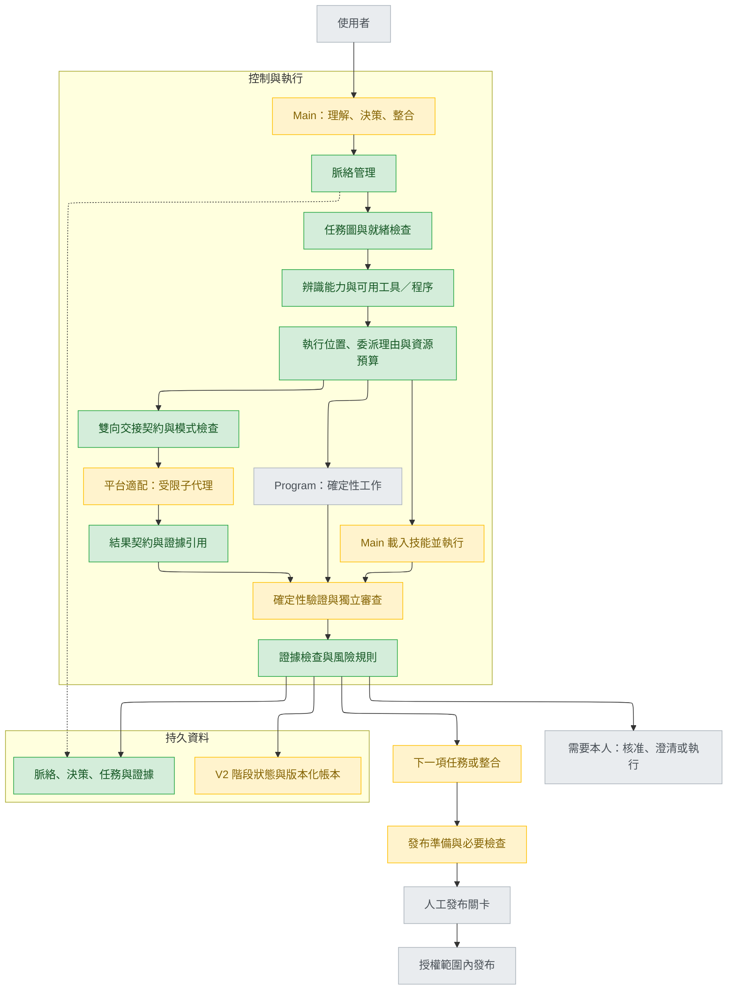
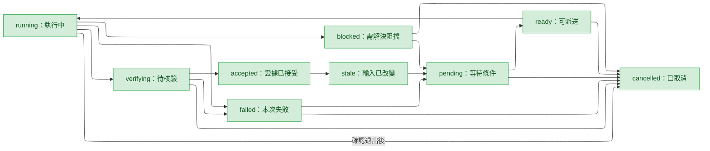
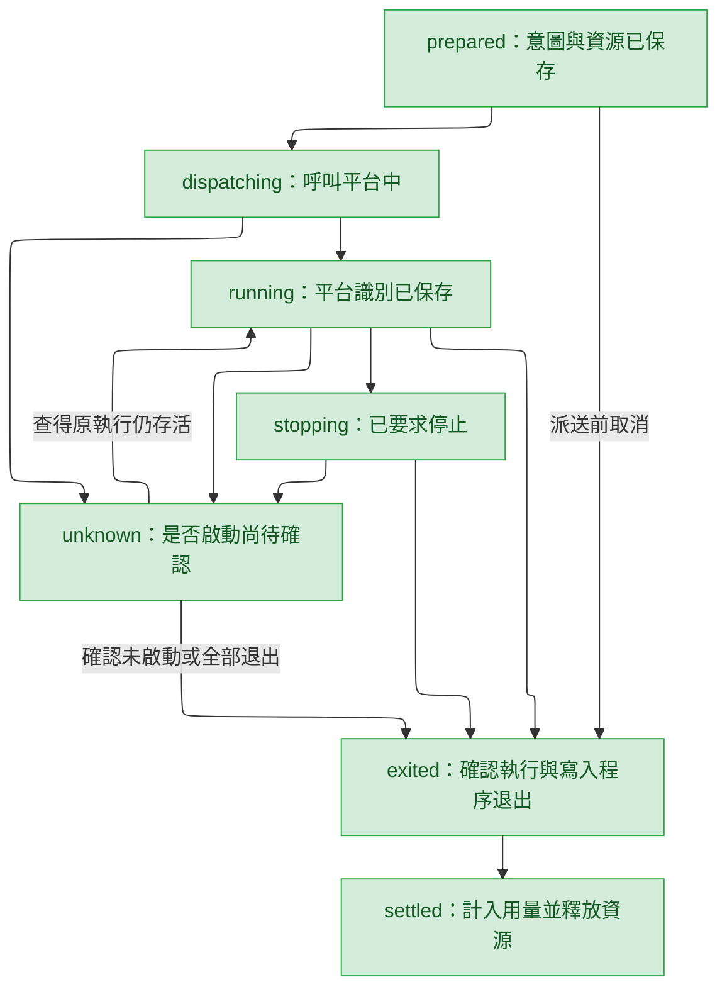
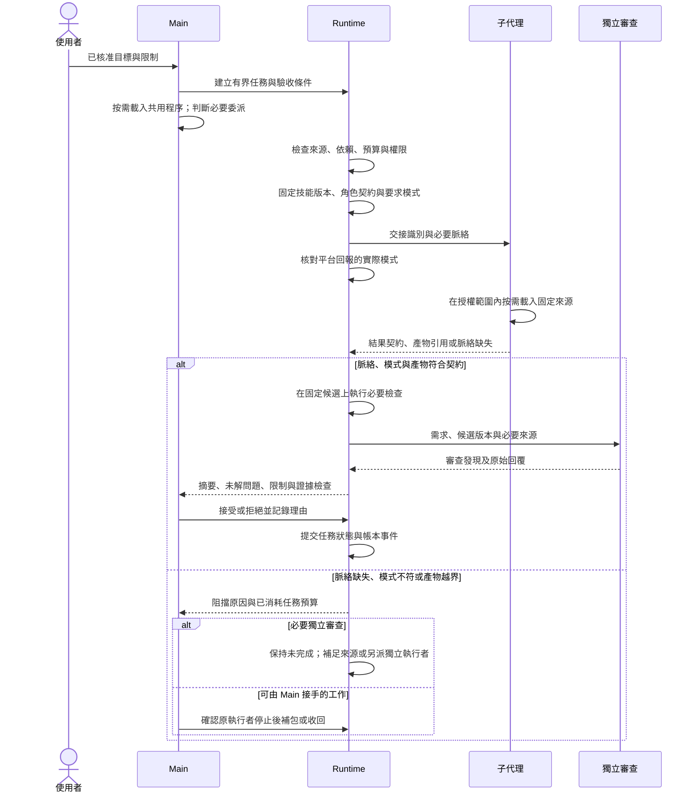

# Claude All-in-One V2 架構設計

**定位：以脈絡為核心的自適應代理軟體開發生命週期執行環境。**

| 項目 | 內容 |
| --- | --- |
| 日期 | 2026-10-30 |
| 版本 | V2，獨立重建；補齊雙平台強制邊界、可信核准與恢復契約 |
| 狀態 | 設計文件已定義；尚未取得實作核准，不代表功能已交付或安全審查已核准 |
| 需求來源 | [原始架構研究](2026-10-30-Context-Centric-Adaptive-Agentic-SDLC-Architecture-Research.md)，Draft v2 |
| 補充來源 | [脈絡交接研究](Architecture-Design-Research.md)，Draft v1；[歷史帳本設計摘要](ledger-design-brief.md)，2026-08-28 |
| 技能／工具研究 | [技能優先、代理可選的執行架構](Architecture-Design-Research-adopt-skill-or-tool.md)，Draft v1；採納與保留項目見 §17 |
| 外部審查輸入 | [Gemini 審查報告](Architecture-DesignV2-ReviewReport.md)；依需求與證據選擇採納，不作實作核准 |
| 適用範圍 | 本專案的 Claude Code 與 Codex 版本，以通過 U0 者為準（§15）；共用語意，分別適配平台能力 |
| 實作策略 | 以作者本人的使用為驗收對象；另建版本庫，以新的 plugin／marketplace 名稱發布；作者本機完成驗收後一次切換。claude-all-in-one 停在最後一版不再更新，只追加搬遷說明，既有安裝者不受影響；不提供舊版相容 |
| 本次交付 | 收斂架構、資料契約、執行規則、重建與替換順序及驗收條件；不修改執行程式 |

## 1. 架構結論

主工作階段持有目標、架構決策與整合責任；程式管理狀態、依賴、資源與證據；子代理只承接有邊界且可驗收的工作。先建立單一代理也能受益的脈絡與證據基礎，再以實測決定委派範圍。

專業流程由技能（Skill）與其參考程序提供；執行位置另外決定。先以確定性程式完成可判定的工作，其餘預設由 Main 按需載入技能並執行。只有需要獨立判斷、隔離大量脈絡、可獲益的平行工作或專門執行能力時，才委派子代理；同一技能可供兩者使用。

核心流程維持「設計 → 人工核准 → 建置 → 驗證 → 發布準備 → 人工核准 → 發布」。建置、階段控制、結果彙整與發布準備預設由 Main 使用程序執行；獨立審查維持隔離，探索按規模評估委派。能力程序、執行位置、模型選擇及風險授權分別判斷，角色名稱與階段數量不決定代理數量。

本設計選擇本機檔案、短生命週期控制命令及執行期間存活的適配程序，在新版本庫按 V2 責任邊界重建；不新增永久排程服務。適配程序在工作期間負責事件接收、期限與退出確認，控制命令結束不代表執行已停止。現有程式、程序與測試是可評估移植的資產，不是必須保留的介面契約。四階段、人工關卡、可追溯證據與雙平台能力保留；舊指令、檔案格式、追蹤資料、安裝設定及內部目錄不要求相容，也不提供轉換器或雙軌執行層。

V2 從全新 Track 與設定開始，不恢復舊工作階段或匯入舊核准。開發期間舊版只供參考與當時使用，V2 完成 §15 的整體驗收後一次替換；不安排逐項切換正式工作，也不維護兩套產品。新版本庫名稱與最終安裝位置於實作開始時固定，本文的目錄是規劃結構，不表示已建立新版本庫。claude-all-in-one 已有公開安裝方式與其他使用者回報（其 `CLAUDE.md`、`README.md` 的安裝段落），因此 V2 不發布到原 repo：原 repo 只追加指向新名稱的搬遷說明，既有安裝者執行更新後仍是 V1。

## 2. 術語與閱讀約定

下列英文名稱與程式識別字在全文採用同一含義。資料範例是**規範性格式示例**，尖括號內容為待執行時填入的值，不是實測結果。

| 中文意義 | 原文／識別字 | 定義 |
| --- | --- | --- |
| 本專案 | Claude All-in-One，CAI | 提供代理開發流程、角色與防護機制的專案 |
| 軟體開發生命週期 | Software Development Life Cycle，SDLC | 設計、建置、驗證與發布流程 |
| 主工作階段 | Main Session／Main | 唯一持有目前任務整合與決策責任的工作階段 |
| 子代理 | Subagent／Worker | 受限於單一任務契約的暫時運算資源 |
| 執行環境 | Runtime | 管理檔案狀態、檢查、排程及平台呼叫的程式集合 |
| 技能與能力程序 | Skill／Procedure | 可按需載入的專業指引、參考資料與腳本；描述如何工作，不自行決定執行者 |
| 角色 | Role | 工作責任，例如實作、審查或彙整；不必各自對應一個子代理 |
| 脈絡 | Context | 目標、限制、來源、決策、目前假設與執行觀察 |
| 追蹤單位 | Track | 一項功能由設計到發布的持續工作紀錄 |
| 任務圖 | Task Graph | 任務與前置依賴形成的有向無環圖；不指定代理數量 |
| 脈絡耦合 | Context Coupling | 任務對主工作階段既有理解及其他任務未定決策的依賴程度 |
| 脈絡包 | Context Pack | 含任務邊界、固定來源版本與輸出契約的委派輸入 |
| 雙向脈絡交接 | Context Handoff | Main 提供任務契約，子代理回傳結果契約，兩者均有版本與來源 |
| 補包 | Handoff Expansion | 子代理回報脈絡缺失後，Main 補入來源或限制並建立新交接與新任務嘗試；授權範圍內的補讀不算 |
| 執行脈絡模式 | main／fresh／fork | 分別使用 Main 脈絡、全新子代理脈絡、繼承主對話的分支脈絡；實際能力由平台確認 |
| 階段嘗試與執行事件 | stage_attempt／runtime_event | 帳本中分別記錄階段結果與任務、交接、驗證等過程事件的兩類紀錄 |
| 工作摘要 | Digest | 可供恢復工作的事實、決策依據、失敗及待解問題摘要 |
| 產物 | Artifact | 程式差異、報告、日誌及其他可定位檔案 |
| 證據清單 | Evidence Manifest | 將檢查結果綁定至特定輸入、環境與產物的結構化紀錄 |
| 人工關卡 | Human Gate | 要求本人對明確版本及動作作出的授權 |
| 僅追加帳本 | Append-only Ledger | 不覆寫已提交事件、可辨識重複事件的紀錄 |
| 候選版本 | Candidate | 包含已追蹤、未追蹤、已暫存、未暫存變更的完整待驗證工作內容 |
| 雜湊 | SHA-256 | 偵測內容變更的摘要值；本身不證明產生者可信 |
| 比較實驗 | Evaluation／Eval | 同條件比較策略品質、成本與耗時的實驗 |
| 模型層級 | chore／build／think | 分別對應機械工作、固定契約內工程判斷、設計權衡 |
| 確定性檢查 | Program | 同樣輸入會產生同樣判定的程式檢查，不消耗模型推論 |
| 工作樹 | Git Worktree | 同一版本庫的隔離工作目錄，用於避免並行寫入互相污染 |
| 驗收條件 | Acceptance Criteria／AC | 可觀察的成功條件，以下以 AC1 等識別 |
| 操作介面 | CLI／API | 命令列／程式呼叫契約；本文列出的新介面尚未實作 |
| 持續整合 | CI | 自動執行版本庫驗證的環境 |
| 變更集 | Diff／Patch | 相對指定基準的程式與檔案變更 |
| 檢查點 | Checkpoint | 可恢復的已提交狀態；不等同於版本提交 |
| 單一事實來源 | Source of Truth | 發生衝突時用來判定權威資料的來源 |
| 驗證器角色 | Verifier | 彙整審查與修復建議的代理角色，不是確定性證據檢查程式 |
| 結構化文字格式 | JSON／YAML | 表達清單與欄位的資料格式；新增機器資料選用前者 |
| 程式語言與標準工具 | Python／Git | 分別用於執行檢查程式與管理程式版本 |
| 圖表描述與配置工具 | Mermaid／ELK | 分別將文字轉為圖表與安排流程圖節點位置 |
| 文字編碼與時間基準 | UTF-8／UTC | 分別用於儲存文字與記錄可比較的事件時間 |
| 二進位容量單位 | KiB／MiB | 分別為 1,024 與 1,048,576 位元組 |
| 控制資料與可信操作入口 | Control Data／Trusted Entry | 狀態、核准、證據及資源占用由受保護程式管理；模型只能提出受約束操作，不能直接寫入或冒充本人答覆 |
| 執行監督程序 | Execution Supervisor | 一次執行期間存活的適配程序，負責平台識別、事件、期限、取消及退出確認；不是新增的主管代理 |
| 執行識別與提交識別 | run_id／transition_id | 分別識別一次平台執行與一次本機資料交易，兩者不能互相代替 |
| 平台權限設定與生命週期掛鉤 | permissionMode／hooks | Claude Code 的權限模式與執行事件處理設定；是否生效依入口查核 |
| 統一核准請求與核准識別 | approval_request_id／approval_id | 分別關聯固定待答請求與經可信來源確認的本人決定 |

資料欄位在各契約後說明；路徑、檔名、狀態值與錯誤碼是精確拼寫，中文定義以所在表格為準。

## 3. 需求、取捨與不變條件

### 3.1 需求與驗收

| 需求 | 原研究章節 | 最終設計要求 | 驗收條件 |
| --- | --- | --- | --- |
| R1 脈絡持續性 | §4–8、31–37 | 新工作階段能恢復目標、決策、失敗與下一步 | AC1：跨工作階段恢復測試，不遺漏測試題指定的限制與未解問題 |
| R2 選擇性委派 | §13–24、43–47 | 預設 Main；先排除可由 Program 完成的工作 | AC2：高耦合、低可平行性及欄位未知案例均不啟動實作子代理 |
| R3 證據可追溯 | §26–30、38–39 | 每項接受結果有來源、輸入版本與實際輸出 | AC3：錯版本、缺日誌、被修改產物與失敗退出碼均無法標為完成 |
| R4 確定性執行 | §19–21、41–42、59–60 | 相依、狀態轉移及資源限制由程式判斷 | AC4：循環、未完成依賴、重複回報與並行衝突測試通過 |
| R5 風險授權 | §48–57、71 | 有界重試；設計與不可逆發布保留人工關卡 | AC5：無核准、過期核准、權限拒絕與預算耗盡均停止相依動作 |
| R6 獨立重建與一次替換 | 使用者最新決定，取代原研究漸進相容假設 | 新版本庫、新名稱、新資料與設定；完成後作者本機一次切換，原 repo 凍結且不推送 V2 給既有安裝者；不建立相容或資料遷移層 | AC6：不安裝、不匯入或讀取舊版執行資料即可完成雙平台端到端流程；舊資料拒絕或不參與狀態與核准判定 |
| R7 效益實測 | §70–81；外部審查的評測成本提醒 | 基礎可用性與委派效益分開驗證；顯示品質、成本、時間及缺失資料 | AC7：兩平台基礎案例可重現並輸出真實指標；未取得完整比較證據時維持保守執行，不以 24 題評測阻擋基本路徑驗收 |
| R8 安全邊界 | §40–41、46、57 | 不信任輸入不得擴大檔案、工具或核准權限 | AC8：越界路徑、偽造核准、指令注入與過期工作結果測試遭拒 |
| R9 雙向交接 | 補充研究 §18–28、31–32、42–52 | 任務與結果契約可追溯，按角色選取脈絡並檢查實際模式 | AC9：缺來源、混淆假設、缺未解問題、錯交接版本或審查脈絡模式不符時，結果不能直接接受 |
| R10 技能與執行分離 | 本次技能優先設計要求；§4.1 官方技能指引 | 可重用能力不綁定代理；Main 預設執行，委派須有理由且保留必要獨立性 | AC10：相同程序可由 Main 或有界子代理使用；無委派理由時不啟動額外代理，技能載入與換角色不增加任務嘗試或授權 |
| R11 操作自動化 | 本次採納外部審查的輕量化建議 | 正常操作與受支援的故障恢復由工具封裝，使用者只提供任務、決策與授權 | AC11：建立、續行、檢查、取消及可恢復的中斷案例均無須手改 JSON；不可恢復時工具回報證據與阻擋原因，不要求偽造狀態 |
| R12 日常指令移植 | 本人 2026-10-31 逐項決定 | V1 的 `chore`、`git`、`git-sweep`、`codemap`、`fix`、`options` 以 V2 入口重建；依 V2 的控制根、模型層級與核准規則改寫，不保留 V1 路徑或別名 | AC12：雙平台各指令以 V2 入口完成一個代表案例；推送與開 PR 只在本人指令涵蓋的範圍內發生，`fix` 不合併；`codemap` 不寫入受保護控制區 |
| R13 跨平台接續與工作目錄綁定 | 本人 2026-10-31 決定 | 同一 Track 可在原平台的執行確認停止後由另一平台續行；一個工作目錄同時只綁定一個進行中的 Track，另一個 Track 須在不同工作樹進行 | AC13：Claude Code 執行 track-a 時，Codex 在同一工作目錄建立或續行 track-b 遭拒並提示改用新工作樹，在新工作樹可建立；Claude Code 仍在執行時 Codex 續行 track-a 遭拒，確認退出後可續行並讀到相同狀態 |
| R14 Token 不高於 V1 | 本人 2026-10-31 決定；V1 最近 30 天 19.35B token、其中子代理占 61.9%（`usage_report.py range --days 30`） | 同一批任務上，V2 的總 token 不高於 V1；每回合固定載入的文字不大於 V1 | AC14：U0 固定的成對任務中，V2／V1 逐題總 token 比值的中位數不大於 1.0，輸入、輸出、快取讀取與快取寫入分列；固定載入文字的位元組數不大於 V1 實測值；缺用量資料的題目判為未通過 |

R8 是實現原研究資源限制、集中決策與人工關卡所需的工程約束，並非新增外部安全產品。

R12 的指令套用 V2 規則的方式：本人經平台使用者通道下達的指令（例如 `fix <issue URL>`、`git` 的推送要求）即為 §10.1 對該指令所列範圍的具體核准，範圍限於推送新分支與開 PR，不含合併；此對應須在 U0 證實該指令是可核對來源的使用者事件，否則改為指令開始時取得一次 §10.1 核准。`git-sweep` 只刪除內容已在基準分支上的本地分支，屬 `high` 而非不可逆資料刪除，仍逐一經本人確認。`codemap` 索引是可拋棄的衍生資料，存放於 V2 控制根之外。`fix` 的工作認領須能自行到期，不依賴已放棄的 `fix-unclaim`。

### 3.2 取捨與不變條件

1. **Main 持有整合權**：子代理不能核准設計、改寫共享狀態、接受自己的證據或自行發布。
2. **程式先行**：檔案存在、圖是否有環、指令退出碼、版本是否相同，由程式判斷。
3. **委派可為零**：不得以固定代理數作為成功條件；程式排程不得繞過平台或使用者限制。
4. **權限不隨模型升級**：更強模型不增加工具、網路、檔案或發布授權。
5. **完成須有證據**：代理說「完成」不直接改變任務完成狀態。
6. **摘要不是權威來源**：衝突時重新讀取目前程式、核准文件與原始證據。
7. **人工授權不可推導**：等待逾時、沒有回覆及一般性同意，不構成特定動作授權。
8. **保留防護目的**：重建仍須驗證建置、整合、授權及發布；舊檢查工具與文案可改寫，不能因放棄相容而取消安全性與證據要求。
9. **技能不等於新代理**：載入技能不建立新工作階段；實際平台設定若會派送子代理，須進入相同委派與預算檢查。
10. **自審不代替獨立審查**：Main 可執行實作技能與自我檢查，但不能僅切換角色指令就宣稱完成必要的獨立審查。

此取捨犧牲高耦合實作的最大平行度，換取理解延續性、可追溯性與可恢復性。Main 是邏輯責任者，可以跨工作階段交接；不要求某個模型永久在線。

不納入首版：多層主管代理、代理互聊網路、遠端工作佇列服務、向量資料庫、自動訓練策略、跨專案知識自動共用、未經授權的自動提交或發布。研究中的委派效益公式保留作分析概念，不實作缺乏量測基準的分數模型。

另不納入：舊指令別名、舊 Track／帳本／設定讀取、格式偵測回退、舊版核准信任、歷史用量匯入、舊插件自動升級及 V1／V2 並行運作協定。這些是使用者已排除的範圍，不列為待補功能。V1 的 `fix-unclaim`、`goal`、`quiz`、`refactor`（含 Codex 版的個別重構手法技能）與 `plan-review` 於切換後不再提供（本人 2026-10-31 決定）。多名設計者並行提案再比較（原 ARENA 分支）同日決定不納入：沒有需求對應，且 §14 題組沒有設計題，無法達到啟用門檻。

## 4. 研究證據與現有基線

### 4.1 已核對的研究與適用限制

文獻支持設計方向；以下從文獻到 CAI 的策略均為工程推論，不能當作已驗證的專案效益。

| 來源 | 已核對重點 | 在本設計中的使用 |
| --- | --- | --- |
| [Google Research，2026-01-28](https://research.google/blog/towards-a-science-of-scaling-agent-systems-when-and-why-agent-systems-work/) | 180 種配置的實驗顯示效果取決於任務與協調方式，循序任務可能退化 | 高耦合實作留在 Main；不將非程式開發測試結果直接換算成 CAI 效益 |
| [Anthropic，2025-06-13](https://www.anthropic.com/research/multi-agent-research-system) | 獨立研究方向適合平行探索；共享脈絡及依賴限制程式工作平行化，運算成本也會上升 | 優先探索與審查，實作委派最後導入 |
| [SWE-AGILE，ACL 2026](https://aclanthology.org/2026.findings-acl.868/) | 近期詳細脈絡與歷史摘要共同管理，可減少重複分析 | 採用近期工作紀錄加可追溯摘要；不要求保存模型隱藏思考 |
| [VeriMAP，EACL 2026](https://aclanthology.org/2026.eacl-long.353/) | 任務理解、格式與交接錯位也會造成失敗；規劃時定義通過條件 | 任務先有驗收與檢查，再開始執行 |
| [CodeDelegator，IJCAI 2026](https://ijcai.org/proceedings/2026/12) | 探討角色分離與脈絡污染 | 支持策略與執行資料分層；不據此要求所有建置都委派 |
| [Google Cloud 架構指南](https://docs.cloud.google.com/architecture/choose-design-pattern-agentic-ai-system) | 依任務需求選擇循序、平行等模式 | 固定狀態與排程採程式，開放判斷交給模型 |
| [補充脈絡交接研究 §18–28、42–52](Architecture-Design-Research.md:706) | 主張雙向交接、來源引用、按需載入與角色隔離 | 本專案的設計輸入；其效益仍須實測，不視為外部實驗結論 |
| [Claude Code 子代理官方文件](https://code.claude.com/docs/en/sub-agents#what-loads-at-startup) | 非分支子代理從獨立脈絡開始；分支繼承主對話 | 記錄要求與實際模式；不假設所有平台、角色均自動載入相同專案規則 |
| [Claude Code 技能生命週期](https://code.claude.com/docs/en/skills#skill-content-lifecycle) | 技能按需載入，已載入指引仍可能留在後續對話 | 控制載入範圍，總成本納入後續脈絡與壓縮，不假設載入完即釋放 |
| [技能的子代理執行方式](https://code.claude.com/docs/en/skills#run-skills-in-a-subagent) | `context: fork` 建立隔離子代理，不繼承主對話 | 此設定映射為本文 `fresh`，不映射為繼承主對話的 `fork` |
| [主對話與子代理選擇指引](https://code.claude.com/docs/en/sub-agents#choose-between-subagents-and-main-conversation) | 共用脈絡的流程可使用技能；大量輸出及獨立工作適合隔離 | 能力由技能提供，執行位置按任務需要選擇；節省幅度另行實測 |
| [技能／工具研究 §6–8、25–30、34–50](Architecture-Design-Research-adopt-skill-or-tool.md:1) | 提出能力、工具、技能與執行位置分離，交接只在跨脈絡時啟動 | 納入角色分類、能力欄位與工具契約；其比例及收益公式為概念，不作已校準數值 |
| [Gemini 審查報告](Architecture-DesignV2-ReviewReport.md:63) | 提醒操作負擔、平台能力不確定與評測集建置成本 | 納入操作契約、U0 平台驗證及分層評測；不採納未附證據的效益比例、效能硬門檻及審查降級方式 |

### 4.2 來源資產與新系統界線

以下路徑指向 claude-all-in-one 的來源版本庫，為 2026-10-30 讀檔基線；僅供移植盤點，不是新系統的執行依賴。移植須同時檢查直接依賴、行為測試及授權資訊；記錄來源版本與內容指紋，不能假設複製單檔即可運作。

| 來源 | 可參考的責任 | V2 處理 |
| --- | --- | --- |
| [stages.json](../../plugins/cai/skills/track/stages.json:2) | 四階段與關卡 | 保留概念，重新定義入口與資料，不保留固定階段代理對應 |
| [track_state.py](../../plugins/cai/scripts/track_state.py:2) | 狀態解析與恢復 | 重建結構化狀態讀取，不移植舊 Markdown 狀態解析 |
| [preflight.py](../../plugins/cai/scripts/preflight.py:2) | 程式化前置條件與關卡 | 依 V2 契約重建，按需要移植具體檢查與測試 |
| [cai_paths.py](../../plugins/cai/scripts/cai_paths.py:30) | 資料路徑與舊位置遷移 | 只評估路徑隔離邏輯，不移植舊位置遷移與搜尋回退 |
| [models.json](../../plugins/cai/models.json:28) | 模型層級集中配置 | 移植分層概念，建立 V2 自己的配置契約 |
| [security_design.py](../../plugins/cai/scripts/security_design.py:2) | 安全審查與輸入指紋 | 保留防護目的，移植可用檢查及案例；只接受 V2 產生的核准 |
| [viewer.py](../../plugins/cai/scripts/viewer.py:1) | 唯讀檢視 | 按 V2 狀態及證據重建，不讀取舊 Track |
| [validate.yml](../../.github/workflows/validate.yml:40) | 自動檢查與測試配置 | 移植相關行為測試與平台案例，新版本庫自行宣告檢查命令 |
| [ledger.py](../../plugins/cai/scripts/ledger.py:231) | 階段結果、原始位元組指紋與核准種類 | 以 §6.4 的新格式重建，不讀取無版本的舊紀錄 |
| [usage_report.py](../../plugins/cai/scripts/usage_report.py:218) | 用量聚合與嘗試計數 | 移植有效案例，按新紀錄種類與原始用量去重，不複製舊計數假設 |
| [preflight.py](../../plugins/cai/scripts/preflight.py:361) | 壞行警示 | 參考故障案例；V2 依交易及必要證據是否可確認決定阻擋範圍 |
| [stage-build.md](../../plugins/cai/skills/track/references/stage-build.md:3) | 可共用建置程序 | 萃取有價值步驟，重新安排 Main／子代理執行，不保留舊入口 |
| [verifier.md](../../plugins/cai/agents/verifier.md:12) | 多面向獨立審查 | 保留必要面向，由 Main 直接彙整，移除固定中間代理 |
| [gen-codex.py](../../scripts/gen-codex.py:3) | 雙平台生成與轉換 | 評估可移植部分，按 V2 共用語意產生兩種適配，不要求保留舊生成錨點與檔案清單 |

歷史帳本摘要只作需求及失敗案例來源，不構成格式相容承諾。原始脈絡與結果存於 V2 產物檔案，帳本只保存事件、關聯及指紋。

## 5. 整體架構與責任邊界

能力層保存技能與共用程序，執行層選擇 Program、Main 或受限子代理，控制層管理狀態、證據及授權。三者在新系統中共用檔案與函式，不新增能力註冊服務或第二套排程系統。

圖中綠色為重建或新增能力、黃色為重新組織的既有概念、灰色為保留的角色與工作概念；顏色不表示已移植任何程式。流程圖指定降低交叉線的自動配置器（ELK）；交付前以 Mermaid 11.16.0 實際轉圖。目標 Markdown 閱讀器若忽略配置，採用的上下流向與分組仍應可讀；不宣稱所有平台都支援 ELK。



| 元件 | 權責與輸入／輸出 | 禁止事項 |
| --- | --- | --- |
| Main | 解讀需求，確認任務分類，接受或拒絕證據，決定整合 | 將未執行檢查寫為通過 |
| 技能與共用程序 | 提供角色指引、必要參考與腳本，由選定執行者載入 | 自行啟動第二層代理、擴權，或用角色指令宣稱獨立性 |
| 脈絡管理 | 固定來源與摘要版本，恢復最近工作 | 將摘要升格為核准或自動保存隱藏思考 |
| 雙向交接契約 | 選取角色所需來源，建立任務契約，核對模式、補包及結果契約 | 把來源路徑當成已載入，或把子代理自述完成當成已接受 |
| 任務圖 | 檢查唯一任務識別、依賴、循環、狀態 | 以任務數推導代理數 |
| 排程 | 取得就緒任務，鎖定資源，依預算派送 | 在執行中修改任務契約 |
| 委派規則 | 對已確認的任務特性產生執行建議及理由碼 | 把模型估計當確定事實 |
| 平台適配 | 呼叫現有工具，回報能力、限制與結果引用 | 繞過平台許可或自行產生核准 |
| 證據檢查 | 比對輸入版本、原始日誌、產物與所需審查 | 以代理信心取代輸出 |
| 風險規則 | 判定繼續、補審、人工核准或阻擋 | 自動接受新增安全風險 |
| 檢視介面 | 呈現來源、狀態與待本人項目 | 成為第二個狀態寫入端 |

Main 的整合權是提出與確認工作決定，不包含偽造核准或直接修改控制資料的能力。Main、子代理及候選程式的測試程序均視為可能受到不信任內容影響的執行者；只有固定版本的 Runtime 經受約束入口可以提交控制資料。一般檔案與命令工具不得寫入控制目錄、修改正在執行的 Runtime，或取得本人核准入口。Runtime 的安裝版本獨立於被驗證候選；開發 Runtime 自身時，也不能讓候選測試替換正在判定其證據的控制程式。

平台適配須將上述限制施加於所有可產生副作用的工具路徑，包括命令執行與間接工具；只攔截檔案編輯工具不算完成。模型可呼叫的操作與本人專用入口分開提供，拒絕由任意命令參數切換成「本人」。保護可由平台沙箱及受約束工具入口共同實現，不要求新增遠端服務；若目標啟動方式無法強制此邊界，U0 不得判為可用。§11 排除本機管理者攻擊，不排除模型或測試程序利用其已授權工具繞過邊界。

受約束入口須具備模型工具無法複製的區辨性質；本文不預設哪一種機制成立，只定義何者不算：

- **控制資料提交**：提交程序須在模型命令工具的沙箱之外執行，模型命令工具對控制根只有讀取權。由 Main 的一般命令工具啟動的 Runtime 命令列不符合：它與同一工具中任意 `python -c` 寫檔共用同一權限，沙箱允許前者就允許後者，拒絕後者也拒絕前者。候選做法（由平台啟動、不受該沙箱管轄的工具伺服器或生命週期程序）均屬待 U0 實測的假設。
- **本人答覆**：入口須要求模型工具無法提供的條件，例如只顯示在本人終端的一次性值，或由平台以使用者事件送達、模型無法合成的答覆。模型能以相同參數呼叫的命令，不論如何命名，都不算本人入口。

U0 對每個平台／啟動方式以三項負向測試證明上述性質：以 Main 的一般命令工具直接寫控制根、以相同參數呼叫提交入口繞過格式檢查、呼叫本人入口；三者均須被拒。模型與 §11 排除的「本機同一使用者」在作業系統上是同一使用者，兩者的差別只來自平台沙箱；沙箱不可用的啟動方式不得宣稱滿足 AC5 的核准案例或 AC8。

## 6. 資料架構與狀態權威

### 6.1 持久目錄

下列檔案均為新系統的規劃，沒有必須沿用的舊格式。機器資料採 JSON，使用 Python 標準函式庫。V2 控制根為 `.cai/v2/`：V1 已使用 `.cai/track/<feature>/ledger.jsonl`（[cai_paths.py](../../plugins/cai/scripts/cai_paths.py:27)、[ledger.py](../../plugins/cai/scripts/ledger.py:45)），開發期間 V1 仍在同一版本庫使用（§15），共用該路徑會讓 V2 讀到無版本的 V1 帳本行而阻擋，或讓 V1 寫入器把舊格式行追加進 V2 帳本。Runtime 只讀寫 `.cai/v2/`，不搜尋其他位置，也不據此辨識或接續 V1 資料；建立 Track 時目標目錄已存在而非 V2 建立者，回報錯誤而不覆寫。`.cai/v2/` 是受保護控制區，不列入模型或候選測試的直接可寫範圍；必要產物透過 Runtime 收取。雙平台共用同一控制根目錄，不能各建一套資源占用紀錄。

```text
.cai/v2/track/<feature>/
  state.json                  V2：版本化 Track 與階段狀態
  ledger.jsonl                V2：每筆明定版本與種類的帳本
  intake.md / design.md       V2：需求與設計產物
  context/                    新增：版本化脈絡
    index.json                已發布的脈絡版本與來源摘要
    revisions/<revision>/
      current.md              目前任務、假設、下一步
      digest.md               已核對事實與歷史摘要
      discoveries.md          發現與來源
      failures.md             失敗、反證、適用範圍
      constraints.md          核准限制的引用
  decisions/                  新增：正式決策原文
    decision-001.md
  tasks/                      新增：單一任務圖快照
    graph.json
  evidence/                   新增：每次嘗試各自保存
    task-001/attempt-001/
      manifest.json
      execution.json          實際執行者、模式、程序版本與模型紀錄
      handoff.json            固定任務契約、角色與要求模式
      result.json             結構化發現、證據引用及未解問題
      checks/<check-id>.log
      reviews/<review-id>.json
      result.md
  approvals/                  新增：核准請求、本人答覆來源及撤銷紀錄
  runtime/                    新增：執行協調與恢復
    writer.lock
    transactions/<transition-id>.json
    attempts/<task-id>/<attempt-id>.json
    runs/<run-id>.json          派送意圖、平台識別與執行生命週期
```

跨 Track 的資源占用另存於同一控制根下的 `.cai/v2/runtime/resources/`，由 Runtime 統一取得與釋放；不混入某個 Track 的狀態鎖。安裝時須確保同一版本庫的不同工作樹及兩平台入口解析到同一資源登記位置，不能以目前工作目錄各自推導出互不相見的鎖。

每個候選版本快照（採 §9.1 複製方式時）、脈絡包與原始審查回覆，放在所屬嘗試目錄下，並由清單引用。檔名與路徑皆由 Runtime 產生，禁止從子代理回覆直接拼接可寫路徑。

### 6.2 單一事實來源

| 資料 | 權威來源 | 寫入者 | 衝突處理 |
| --- | --- | --- | --- |
| 使用者要求與核准 | V2 需求產物、核准紀錄與原始答覆 | Main 提出請求；可信入口記錄本人答覆 | 依 §10.1 驗證答覆來源及範圍；不信任模型自述或舊版核准 |
| 階段進度 | `state.json`，與 V2 帳本交叉確認 | Runtime | 階段完成仍須檢查核准與證據，不由任務圖直接推導 |
| 任務與相依 | `tasks/graph.json` 最新已提交版本 | Runtime 單一寫入者 | 修訂號不符即拒絕更新 |
| 已接受決策 | `decisions/` 原文 | Main 提案，經 Runtime 保存 | 摘要只有引用，不維護第二份可獨立編輯的決策內容；不以決策文字代替本人核准 |
| 工作脈絡 | `context/index.json` 指向的完整版本 | Main 提案、Runtime 發布 | 未完成版本不切換索引 |
| 實際程式內容 | 目前候選版本的檔案及內容摘要 | 所屬實作責任者 | 與脈絡衝突時重讀程式 |
| 檢查結果 | 原始日誌與固定候選版本的清單 | Runtime 記錄檢查 | 代理僅可引用，不能自行宣告接受 |
| 實際執行方式 | `execution.json` 與平台工具紀錄 | Runtime 記錄，Main 確認決定 | 區分載入程序、Main 執行與實際派送，不以技能名稱推測模式 |
| 事件與統計 | V2 帳本及可歸屬的原始用量 | Runtime 單一追加者 | 以事件與請求識別去重；不將帳本視為可完整重建程式碼的資料庫 |

`state.json` 必含格式版本、Track 識別、修訂號、綁定的工作目錄（§8.3）、目前階段，以及四個階段的狀態、產物與證據引用。階段狀態為未開始 `pending`、執行中 `running`、受阻 `blocked`、完成 `completed` 或經明確授權略過 `skipped`；不同於 §8.4 的任務狀態，不由模型自由填字。缺檔只允許在明確建立全新 Track 時初始化；恢復時缺檔、缺版本或格式未知皆回報錯誤，不從舊 Markdown 或帳本猜測重建。

### 6.3 寫入、並行與恢復

一個 Track 同時只有一個控制寫入者；以獨占建立鎖檔實現，鎖內含工作階段、程序識別、程序啟動識別與執行識別，不能只靠可能重用的程序編號辨識擁有者。另一個工作階段只能經 Runtime 讀取；首版讀取與提交使用同一把短期獨占鎖，在鎖內確認交易完成並複製所需一致資料後釋放，不在模型等待期間持有此鎖。不可用「鎖很舊」直接搶佔；接管須先確認原控制程序已停止，本人確認只授權執行接管檢查，不代替程序退出證據。執行中的寫入資源另依 §8.3 保留，不能因控制程序死亡而釋放。同一 Track 可由另一平台續行（R13）：續行前依 §8.6 確認原平台的執行與寫入程序均已退出，再取得寫入鎖；原執行仍存活或無法確認退出時續行遭拒，不讓兩個平台同時寫入同一 Track。

跨檔案轉移採小型交易紀錄：先寫入含預期修訂號、事件識別、受影響檔案及完整前後狀態的交易檔；以同磁碟暫存檔及原子替換更新受影響檔案；追加對應帳本紀錄；最後原子發布交易完成標記。**完成標記是唯一提交點**；所有控制資料讀取、核准判定及檢視均經 Runtime，未提交事件不具有核准或完成效力。各步使用同一轉移識別，依下表恢復後才提供正常讀取或派送；恢復不得重做外部動作。

| 中斷位置 | 恢復判定與動作 | 讀取端行為 |
| --- | --- | --- |
| 交易檔尚未完整發布 | 正式資料保持原版；未發布暫存檔不參與判定 | 回傳原已提交版本 |
| 交易已發布，部分檔案或帳本未完成 | 在鎖內逐項核對前／後指紋；只接受這兩種預期內容，補齊後狀態與缺少的同識別事件，再發布完成標記 | 恢復前回報暫不可用，不暴露混合版本 |
| 帳本已追加，完成標記未發布 | 核對同識別事件內容及全部後狀態，不能重複追加；符合才發布完成標記 | 標記發布前不採信新結果 |
| 已完成但檔案、事件或標記損壞 | 保留證據並阻擋；不得以先前完成推定目前仍完整 | 唯讀診斷可用，正常判定不可用 |

每個步驟的必要檔案先刷新至磁碟，再進入下一步；原子替換只提供單檔可見性，不宣稱等同斷電耐久性。首版自動恢復保證涵蓋程序中止；突然斷電後須重新核對所有受影響內容，無法證明完整時安全阻擋，不承諾必能自動恢復。兩平台及實際 Windows 檔案系統均需逐步中止測試，並測試損壞資料不被當作成功。

原始帳本不得刪行、改寫或截斷。寫入前若有殘缺尾行，先保存原始內容，再追加必要換行，使下一筆成為獨立完整紀錄；檢視仍保留壞行位置。壞行、未知紀錄或必要帳本缺席須明示；必要核准無法證明、受影響交易無法恢復或目前任務的事件完整性無法確認時，阻擋相依動作。唯讀診斷仍可進行；無法判定受影響範圍時停止新派送，不能把未知當成完整。新 Track 的空帳本由建立程序明確初始化，不等同恢復時帳本遺失。

階段狀態與任務圖各含 `revision` 修訂號；每次變更須比對預期值。首版不新增資料庫，也不建立通用事件重建系統。V2 只讀寫自身宣告的格式版本，無舊紀錄降級或自動升級路徑。

### 6.4 帳本紀錄分類與計數契約

V2 使用單一 `ledger.jsonl` 與寫入者，每筆明定 `schema_version` 與 `record_type`。缺版本、缺種類、未知版本或未知種類均為不支援紀錄，不推斷為階段嘗試，也不產生核准效力；不讀取或改寫 V1 帳本。

| 種類 | 記錄內容 | 計數、用量及授權 |
| --- | --- | --- |
| `stage_attempt` | 一次階段結果，明定階段、嘗試識別、結果、關卡、產物指紋與證據引用 | 只有此類參與階段嘗試、結果及核准判定；用量由去重後原始紀錄聚合 |
| `runtime_event` | 任務、交接、脈絡版本與驗證過程，透過任務及嘗試識別關聯產物 | 不增加階段嘗試或失敗次數，不重設重試連續段，也不產生核准 |

階段嘗試在開始時分配 `stage_attempt_id`，完成時寫入階段結果；其內執行事件引用同一識別。階段結果 `outcome` 為通過 `passed`、失敗 `failed`、受阻 `blocked`、略過 `skipped` 或未取得服務 `unavailable`。所有正式結果均可計為一次階段紀錄，但重試上限只計最近一次通過或授權略過之後的 `failed`／`blocked`；過程事件不影響此數字。首版階段重試上限為 5，沿用 V1 的預設值（[preflight.py](../../plugins/cai/scripts/preflight.py:41)）；`unavailable` 不計入，理由同 V1：服務拒絕回應並未產生一次失敗的嘗試（[ledger.py](../../plugins/cai/scripts/ledger.py:50)）。達上限時階段狀態為 `blocked`，只有授權略過或本人調整上限能解除。事件的最小範例如下：

```json
{
  "schema_version": 1,
  "record_type": "runtime_event",
  "event_id": "event-001",
  "transition_id": "transition-001",
  "event_type": "CONTEXT_MISSING",
  "ts": "<UTC 事件時間>",
  "stage": "build",
  "stage_attempt_id": "build-001",
  "task_id": "task-001",
  "attempt_id": "attempt-001",
  "handoff_id": "handoff-001",
  "session_id": "<實際工作階段識別>",
  "actor": "runtime",
  "artifact_ref": "evidence/task-001/attempt-001/result.json",
  "artifact_sha256": "<磁碟原始位元組摘要>"
}
```

`event_id` 在 Track 內唯一，供交易恢復及重送去重；同一識別對應不同內容時拒絕提交，不覆蓋原紀錄。`event_type` 是事件種類，`ts` 是時間。`stage`、`stage_attempt_id`、`task_id`、`attempt_id`、`handoff_id`、`session_id` 分別關聯階段、階段嘗試、任務、任務嘗試、交接與實際工作階段；事件不適用的關聯填 `null`。`actor` 是 Runtime 識別的產生者。`artifact_ref` 與 `artifact_sha256` 指向已落盤原始產物，沒有產物時兩者均為 `null`；不得先正規化文字再計算指紋。

事件不能帶有階段結果 `outcome`、人工關卡 `gate` 或作為核准指紋的頂層 `sha256`；即使偽造這些欄位也須拒絕寫入，核准讀取端仍須先篩選種類。首版每筆上限 4,096 位元組作為有界紀錄預算，完整交接內容寫入產物，以引用替代；必要識別與指紋放不下時拒絕寫入，不截斷關聯。此上限不是舊寫入器或格式相容要求。

帳本的分類讀取、階段重試、人工核准、完整性檢查與報表從第一版按此契約實作，不存在先升級舊讀取端的工作。用量採平台原始請求紀錄，以平台、工作階段及請求識別去重；無可靠識別或缺資料時顯示未知。任務與階段成本為同一批原始用量的不同聚合，不能相加；追加過程事件不再次蒐集或計費，也不要求 V1 的中央用量帳本。能清楚歸屬的用量才分配到任務或階段，不能猜測。

兩種紀錄均必含 `transition_id`，引用 §6.3 已提交交易；階段核准另外引用 §10.1 的核准識別與可信來源，不因 `stage_attempt` 種類或人工關卡標籤而直接成立。帳本掃描可顯示未提交紀錄供診斷，正常統計與授權判定只使用已確認提交的紀錄。

### 6.5 操作封裝與恢復介面

使用者以任務、來源、決策及明確授權操作系統，不直接編輯 `.cai/v2/track/` 的狀態、圖、帳本或證據 JSON。命令介面至少涵蓋建立、查看、續行、記錄檢查、取消、診斷及恢復；具體命令名稱於 U0 固定。Main 同樣呼叫這些受約束操作，且經 §5 定義的受約束入口呼叫，不經自己的一般命令工具，也不自行拼寫機械欄位後繞過 Runtime 寫檔。

同一次命令內完成格式檢查、必要鎖定、修訂號比對與交易提交，返回結構化結果、轉移識別及證據引用。這是對既有核心函式的薄封裝，不新增常駐服務或另一套狀態引擎；不可逆外部動作仍遵守授權與去重規則。

可恢復的中斷以同一轉移識別安全重播；不可恢復的損壞、未停止程序或無法證明的核准，工具輸出具體阻擋原因與保留證據，不指示使用者手改 JSON 或將狀態改成完成。人工決策與授權仍由本人提供，操作自動化不代答關卡。

## 7. 脈絡生命週期

### 7.1 三層資料

| 層 | 內容 | 載入規則 |
| --- | --- | --- |
| 專案層 | 使用者／專案規則、架構文件、程式導覽 | 啟動時讀取；任務開始前檢查來源版本 |
| Track 層 | 核准目標、決策、摘要、失敗與未解問題 | 恢復時載入；按來源變更標示失效 |
| 工作層 | 目前任務、近期檔案、差異、最近實際觀察 | 限定當前任務；完成後只將有用結論寫入摘要 |

每筆摘要項目包含識別、陳述、來源引用、來源摘要、記錄日期、有效範圍及是否仍為假設。來源變更後先標示待重驗；不因過去被摘要過就省略必要的讀檔。

陳述種類明列為事實 `fact`、已接受決策 `decision`、待驗證假說 `hypothesis` 或暫時假設 `assumption`。後兩類不能因被摘要或轉交就升格為事實；決策須引用正式決策原文，不能只引用另一份摘要。

摘要保存可檢查的結論與簡短依據，不保存或要求模型隱藏推理逐字紀錄。原始檢查日誌留在證據目錄；從工作層移除日誌不等於刪除證據。

### 7.2 壓縮與恢復規則

1. 在任務完成、交接、來源失效或達到脈絡預算時建立檢查點。
2. Main 產生摘要草稿，明列保留的目標、限制、決策引用、失敗及未解項目。
3. 程式檢查來源可讀、摘要引用可解析、必要識別未遺漏；語意忠實度由 Main 核對，不能由存在性檢查宣稱已證明。
4. 寫入新版本目錄，全部完成後才原子切換索引。中斷時繼續使用舊版本。
5. 恢復時依序確認目前版本庫、核准指紋、未完成交易、任務、有效脈絡及下一步。來源改變只重讀受影響內容。

預算只套用於 Runtime 組裝與保存的檔案：工作脈絡指一個 `context/revisions/<revision>/` 下五個檔案的合計，脈絡包指一份 `handoff.json` 及其要求先載入的來源內容合計，摘要指 `digest.md`。Main 對話本身的長度不由 Runtime 量測或截斷；第 1 項的「達到脈絡預算」指上述檔案超限，或平台回報的視窗剩餘量不足。首版工作脈絡目標上限 24,000 個模型計量單位（token），脈絡包 8,000，摘要 4,000；這些是待實測的工程預設。平台回報的視窗剩餘量不足時採更小值。沒有可靠計量時，分別使用 64、24、12 KiB 的 UTF-8 位元組上限作保守限制，並標示計量未知；不能把位元組數當成 token 數展示。

超限先縮小任務與來源範圍，不能刪除限制或未解問題來符合數字。這些必要資訊仍放不下時停止委派，由 Main 處理或回到設計拆解。

### 7.3 脈絡包契約

每包必須包含：交接、任務及嘗試識別、目標、角色、可讀來源與版本、核准限制、已知事實／假設、被否決方法與失敗證據、必要決策引用、可寫範圍、工具權限引用、驗收條件、結果契約、要求脈絡模式、時間與成本限制。不得預設完整複製對話歷史。

任務契約存為 `handoff.json`，引用已固定的來源、內容指紋與脈絡版本。安全限制、工作邊界、驗收與必要決策必須先載入並確認，不能延後到實作後才補讀。其餘來源先引用，再依需要讀取；來源路徑存在不代表子代理已載入，也不保證降低總 token 成本。

優先讀取核准限制及必要決策，再讀工作摘要、相關程式導覽與詳細檔案；導覽過期或不涵蓋範圍時，回到受限搜尋。已授權範圍內的補讀不算補包；新增來源或限制則建立新交接與新任務嘗試，保留舊版，不在執行中修改契約。

子代理發現缺少生命週期或介面決策時，回報「脈絡缺失」及所需來源，不自行推斷後擴大工作。Main 補包一次仍不能形成邊界時，收回 Main 執行；已耗用成本仍計入原任務。

### 7.4 按角色選取與確認脈絡模式

| 角色 | 必須提供 | 隔離要求 |
| --- | --- | --- |
| 探索者 | 目標、範圍、限制、已知發現及來源 | 小範圍留在 Main；獲准委派時預設 `fresh`；分支探索另依下述條件確認 |
| 實作者 | 核准設計、介面、責任範圍、決策、失敗方法與驗收 | 不擅自補作未定架構決策 |
| 一般審查者 | 需求、設計、固定候選、相關程式、測試與限制 | 使用 `fresh`；不注入實作者完整推理或未經驗證的自我評價 |
| 安全審查者 | 威脅邊界、限制、固定候選與必要安全來源 | 使用 `fresh`；維持既有獨立審查及核准程序 |

執行模式是獨立於代理角色與模型層級的選擇。高耦合工作維持 `main`；獲准委派的有界探索及獨立審查要求 `fresh`；依賴目前大量脈絡的隔離探索，僅在平台確認支援且不影響獨立性時允許 `fork`。分支仍不取得額外寫入或核准權限。

平台適配須記錄平台版本、要求模式 `requested_context_mode`、實際模式 `actual_context_mode` 與其工具回報來源；不能以模型自述確認繼承行為。實際模式未知或不符時，該次輸出不得作為符合隔離要求的證據。獨立審查不能悄悄改為 `fork` 或 Main 自審；須使用可確認的 `fresh` 能力，否則標示必要審查未完成。一般探索可在停止該次派送後改由 Main 處理。

U0 即對 Claude Code 與 Codex 各執行最小能力驗證，保存平台／工具版本、呼叫設定、可取得的啟動輸入及回傳紀錄。能力逐項標為已確認、未支援或無法確認，不以單一「隔離成功」欄位包辦。平台版本或相關設定變更後，受影響項目須重新驗證；未知能力不能自動標為支援。

| 能力項目 | U0 必須確認的內容 | 無法確認時 |
| --- | --- | --- |
| 對話繼承 | 指定執行方式是否帶入 Main 對話、實作推理或非指定來源；證據包括可取得的實際輸入與平台明定語意 | 不接受為必要獨立審查脈絡 |
| 工具與檔案範圍 | 允許／拒絕工具及可寫範圍是否由平台或 Runtime 機制執行 | 不執行需要該限制的任務，不因 `fresh` 標籤推定具備檔案隔離 |
| 完成與結果回傳 | 能否取得執行識別、完成狀態、原始回覆及產物引用 | 不據摘要宣告完成 |
| 取消與程序退出 | 停止要求是否能確認執行者及寫入程序已退出 | 維持資源占用，不派送新的寫入者 |

U0 必須為每個支援的平台／啟動方式固定一份能力證據，至少包含版本、入口、實際權限設定、對話來源、受保護控制根、工具限制、完成及取消操作與負向測試結果。以下是必要路徑的設計選擇，不是已完成驗證：

| 平台 | 必要獨立審查的執行路徑 | 必須強制驗證的限制 |
| --- | --- | --- |
| Claude Code | 優先使用全新脈絡的受限審查代理；只有實際工具限制通過時才接受插件代理路徑 | 插件代理的 `permissionMode`、`hooks` 等欄位會被忽略，不能作隔離依據；須驗證有效工具清單與主平台限制，包含透過命令間接寫檔及派送。見[官方限制](https://code.claude.com/docs/en/sub-agents) |
| Codex | 必要唯讀審查採獨立工作階段，以 §18 的整合介面新建對話並施加唯讀政策 | 原生子代理繼承父工作階段權限，角色檔不能覆寫成獨立唯讀沙箱；故不以可寫 Main 下的原生子代理充當唯讀審查。見[官方權限繼承說明](https://learn.chatgpt.com/docs/agent-configuration/subagents#approvals-and-sandbox-controls) |

兩路徑均須拒絕審查者修改候選、控制資料、核准與執行政策；同時證明能取得必要來源、完成結果及退出資訊。若 Claude 的受限代理路徑失敗，U0 可驗證獨立唯讀工作階段作為替代入口，但不得僅修改角色文字後宣稱通過。實際入口、最低可用版本與有效設定在 U0 固定；設定或版本變更後重驗，不把本文的官方文件查核當作實機證據。兩平台的必要路徑與 §5 的 Main 控制邊界、§10.1 的本人核准入口及 §8.6 的中斷恢復均通過，U1 才能開始。

這些是執行方式與限制的可核對證據，不宣稱可證明供應商內部實作或所有攻擊都不可能。對話脈絡隔離與工具／檔案隔離分別驗證；測試提示詞未觀察到資訊外洩，不足以單獨證明未繼承歷史。

模式未知或不符時記錄 `CONTEXT_MODE_UNVERIFIED`，綁定要求模式、實際可觀測結果及原始回報。一般探索或可自行實作的工作，可在確認原執行者停止後建立 Main 接手嘗試；必要獨立審查維持未完成，直到取得可確認的獨立執行證據。可以改用序列的獨立子代理，但不能把 Main 序列自審當作隔離降級的成功結果。該事件不構成階段通過或人工核准。

平台設定名稱須先轉換成上述脈絡語意。Claude Code 技能的 `context: fork` 會啟動全新隔離子代理，因此在本文記為 `fresh`；只有確實繼承主對話的分支才記為 `fork`。技能入口若包含派送或另一層代理，必須先展開其執行方式並接受 §8.2 與 §10 的限制，不能將技能呼叫當成 Main 內執行的證據。Codex 依其可確認能力對應，不直接套用同名設定。

### 7.5 結果契約與漸進讀取

子代理回傳結構化結果，由 Runtime 留存原始回覆並寫入 `result.json`；唯讀子代理不需取得檔案寫入權限。格式必須包含：

| 欄位 | 定義與接受前檢查 |
| --- | --- |
| `task_id`、`attempt_id`、`handoff_id`、`handoff_sha256` | 回答哪一份交接；必須符合目前嘗試及磁碟契約指紋 |
| `status`、`summary` | 狀態為已回傳 `complete`、受阻 `blocked` 或失敗 `failed`；摘要只說本次可支持的結論 |
| `findings` | 發現識別、陳述種類、位置及證據引用；沒有發現時為空陣列，不虛構成功 |
| `source_refs` | 實際使用的來源與版本；由工具紀錄可確認的載入另行標記，無紀錄不得推定 |
| `evidence_refs`、`changes` | 原始證據及產物引用、已變更檔案；不能只有自述通過 |
| `required_context` | 受阻時所缺資訊及原因；無缺失時為空陣列 |
| `open_questions`、`limitations` | 未解問題與已知限制；均須明填，即使為空陣列 |
| `recommended_next_step` | 下一步建議；Main 決定是否執行，不構成新授權 |

未知結論、尚未完成的驗收或可能改變接受決定的問題，不得在回傳時省略。程式驗證欄位、引用與版本；語意是否忠實仍由 Main 根據必要證據判斷。子代理信心分數不是通過條件，`complete` 僅代表本次回傳完成，不等於任務 `accepted`。

Main 先讀完整性檢查結果、摘要、未解問題與限制，再按風險或衝突讀取詳細證據；底層原始輸出仍須留存並可核對。結果引用或必要來源無效時不能僅依摘要接受。此雙向交接契約可先服務單一委派，不依賴完整任務圖或自動排程。

### 7.6 技能與共用程序的載入契約

每項能力從現有程序移植有效步驟或依 V2 重寫，保存一份權威程序；Main 與子代理引用同一版本，不另維護兩套流程正文，也不保留舊指令別名。技能入口只保留觸發條件、必要步驟與來源連結，長參考資料按需讀取；可判定部分交給腳本，避免把全部角色指引預載到 Main。

Runtime 在 `execution.json` 記錄任務及嘗試識別、實際執行者、角色、程序路徑與原始位元組指紋、載入來源、要求／實際模式、委派理由及可取得的模型版本。程序未使用技能時清單可為空；文件不可讀、來源已變更或載入版本無法確認時，標示待重驗，不假裝使用最新指引。已變更指引需明確重新載入；若平台無法消除影響判斷的舊指引衝突，先保存檢查點再交接工作階段。

已載入技能與其後產生的輸出都納入 §7.2 的工作脈絡預算。不能假設技能完成後即從對話移除；也不能把短技能入口當作整項工作的 token 成本。需要隔離大量輸出時，先由腳本將原始資料存為產物並返回界定範圍的結果；只有仍需要模型判讀時才評估子代理。

載入技能、切換角色或再次引用相同程序，皆不建立新任務嘗試，也不產生人工授權。程序中的發布、工具或派送要求仍受現行權限及關卡限制；技能文件不作為擴權或放行來源。Main 自行執行時保留相同驗收、產物與證據要求，`handoff` 可為 `null`，不製造虛構交接紀錄。

## 8. 任務、委派與排程

### 8.1 任務圖契約

```json
{
  "schema_version": 1,
  "revision": 1,
  "tasks": [{
    "id": "task-001",
    "title": "建立脈絡版本索引",
    "type": "implementation",
    "capability": "implementation",
    "dependencies": [],
    "context_coupling": "medium",
    "parallelizability": "low",
    "verifiability": "high",
    "risk": "medium",
    "assessment_refs": ["design:R1"],
    "procedure_refs": [{"path": "procedures/build.md", "sha256": "<程序原始位元組摘要>"}],
    "read_scope": ["src/paths.py"],
    "write_scope": ["src/context_manager.py"],
    "resource_claims": ["workspace:main-checkout"],
    "acceptance": [{"id": "AC1", "condition": "未完成版本不會成為目前版本"}],
    "verification": [{"id": "check-001", "command_ref": "project-tests", "required": true}],
    "execution": {"preferred": "main", "delegation_allowed": false, "context_mode": "main", "delegation_reason": null},
    "status": "pending",
    "active_attempt": null,
    "accepted_evidence": null
  }]
}
```

`schema_version` 是格式版本；`revision` 是快照修訂號；`tasks` 是唯一任務清單。任務包含識別 `id`、標題 `title`、種類 `type`、前置依賴 `dependencies`，以及耦合、可平行性、可驗證性與風險分類。`assessment_refs` 引用分類依據；`read_scope`、`write_scope` 是允許的檔案範圍；`resource_claims` 是工作目錄、測試資料庫等互斥資源。

`acceptance` 定義通過條件，`verification` 引用已確認的專案檢查；示例的 `project-tests` 必須在執行前解析為實際參數陣列、工作目錄及環境。`execution` 是偏好、委派許可與要求脈絡模式，不代表已派送；其中 `context_mode` 使用 `main`、`fresh` 或 `fork`，實際模式另依 §7.4 記錄。`status`、`active_attempt`、`accepted_evidence` 分別記錄狀態、目前嘗試及已接受證據。程式讀取時拒絕未知格式主版本、無效列舉、缺少必要欄位、重複識別、缺少依賴及循環。

`capability` 是需要完成的能力，例為實作 `implementation`；`type` 是工作種類，可不同於能力分類。`procedure_refs` 是使用的技能／共用程序及其內容指紋；程序選擇與執行者分開保存。`delegation_reason` 在 Main 執行時為 `null`；委派時記錄獨立判斷 `independence`、脈絡隔離 `context_isolation`、額外脈絡容量 `context_capacity`、平行效益 `parallelism` 或專門能力 `specialization`，並由 `assessment_refs` 指向具體依據。更換程序或執行者不得改變任務驗收，也不能繞過原核准。

範例中的 `src/`、`procedures/` 路徑是 §12 定義的新版本庫規劃，並非要求從 claude-all-in-one 的工作目錄讀取檔案；執行前必須已在 V2 建立並固定內容版本。

### 8.2 分類與委派規則

Main 依來源判斷任務特性，寫下理由；程式先檢查權限、核准、依賴與預算，再按以下順序選擇執行方式。未知特性用 `unknown` 明列，按保守路徑處理。技能是程序來源，不是與 Main、Program 並列的執行者。

| 優先序 | 條件 | 決定 |
| --- | --- | --- |
| 1 | 可由既有程式完全決定，且不含必要的獨立語意審查 | 直接 Program；不啟動模型 |
| 2 | 未核准動作、權限不足、預算不可用、必要欄位未知 | 不啟動子代理；Main 解決阻擋或交人工 |
| 3 | 必要的獨立審查，題目及版本已固定 | `PARALLEL_REVIEW`：Main 直接派送必要面向；並行不可用時依規範序列執行，仍須獨立 |
| 4 | 除必要獨立審查外，工作需延續既有理解、高／極高脈絡耦合或低可平行性 | `MAIN`：載入相關技能／程序執行 |
| 5 | 有界工作符合脈絡隔離、額外容量、平行效益或專門能力之一，且交接與驗證代價可接受 | `DELEGATE`：附理由與來源，子代理按需使用相同程序 |
| 6 | 其餘，包含僅需沿用可重用流程或切換角色 | `MAIN`：按需載入技能；不額外建立代理 |

高耦合的大型變更可以先抽出低耦合的審查或探索任務，不能只將標籤改為低耦合。獨立審查須取得需求、候選版本與必要來源；「獨立」不是只讀差異而忽略契約。

小範圍查找、局部實作與短流程彙整預設留在 Main；資料量大到會污染工作脈絡、真正可獨立平行或需要受限工具環境時，才有委派理由。角色專業指引本身由技能提供，不足以單獨證明需要新代理。必要獨立審查先於 Main 偏好判定，避免將高耦合標籤用來省略獨立性。

Main 已載入大量歷史、但目前任務只需少量可固定來源時，評估隔離或額外容量是否有益。先考慮摘要與按需載入；任務仍能界定、交接後不遺失必要限制時，才使用 `fresh`。高耦合工作不因主脈絡很大就直接委派。可量測時記錄主脈絡大小與任務來源大小；真正「相關脈絡占比」需要語意判斷，無可靠計量即為未知，不用檔案大小代替或設置自動門檻。

能力名稱可提示程序選擇，但耦合、隔離收益與可平行性以當次任務證據為準，不能把研究中「探索者預設低耦合」當成固定事實。能力選擇、執行位置、模型及並行是分開的決定；`fresh` 任務可以序列執行，Program 也可在資源允許時平行。

模型選擇依 Program → chore → build → think 的順序；固定測試命令由程式執行，只有輸出無法直接判定時才需要模型。模型配置從 V2 集中設定及平台適配取得，不讀取舊版設定。分類有理由而缺乏實測成本時，記錄估計未知；不製造數學分數證明委派划算。

Main 載入技能不保證切換到該角色的較便宜模型；實際模型與費率須由平台紀錄確認。總 token、總費用、耗時與驗收品質分開比較，不能將少一個代理等同成本必然下降。

### 8.3 就緒與並行條件

任務須全部依賴已接受完成、核准有效、沒有執行中嘗試、資源足夠及來源未過期，才可就緒。依任務識別排序提供穩定順序；無法執行的任務列出阻擋原因，不靠 Main 猜測下一項。

首版預設最多兩個子代理同時執行，實作子代理最多一個；實際上限取設定、平台及本人限制的最小值，Main 另佔一個平台工作階段。研究建議的四個研究／審查代理、兩個實作代理保留為後續實驗配置，不作首版保證。

相同工作目錄只允許一個寫入者。即使檔案不重疊，也可能共享產物、鎖檔或測試服務；必須同時檢查檔案範圍與資源宣告。未知共享資源按衝突處理。審查與測試對固定快照執行，不能一邊修改同一候選版本一邊採信檢查。

上述互斥跨 Track、跨 Claude Code／Codex 生效。一個工作目錄同時只綁定一個進行中的 Track（R13）：Track 建立時取得所在工作目錄的綁定並記入 `state.json`，直到 Track 完成、取消或本人明確釋放才解除，任務結束不解除；只以任務為單位互斥時，兩個 Track 的任務仍可在同一目錄輪流寫入，未提交變更會混入彼此的候選內容。另一個 Track（不論哪個平台）要在已綁定的工作目錄建立或續行即遭拒，錯誤訊息指出占用的 Track 與平台，並提示改用新工作樹；Track 從非綁定的工作目錄續行同樣遭拒。綁定內同時最多一項寫入任務；工作目錄識別採解析連結及平台路徑等價性後的實際位置，不能直接使用模型提供的 `resource_claims` 字串。Runtime 另由操作推導共用 Git 目錄及測試服務資源；不同工作樹仍可能共用版本控制資料（例如同一版本庫的工作樹共用 `refs/stash`），這類操作按共用資源互斥。無法判斷資源等價性時不並行。

資源登記在共用資源鎖內一次取得；依固定資源識別排序，任一不可用即不保留部分占用，不持鎖等待模型。Track 提交不得持有 Track 鎖再反向等待資源鎖；同時需要兩者時一律先資源、後 Track。資源占用綁定 `run_id`，控制命令退出、鎖檔變舊或收到取消答覆均不代表可釋放；須按 §8.6 確認原執行者及其寫入程序已停止。非 V2 程式的修改無法靠協作鎖排除，仍由固定快照及接受前指紋檢查攔截。

後續開放兩個實作子代理的必要條件：各自工作樹、固定基準、不同寫入責任、獨立環境、Main 逐一整合，以及整合版本重新驗證。不能直接同時寫入 Main 工作目錄。

### 8.4 任務狀態與嘗試



僅 Runtime 可提交轉移；圖中的回到 `pending` 必須先滿足重試規則。取消執行中任務，先要求停止並確認執行者退出，再釋放資源及標記取消；逾時不能當作已停止。相依輸入或核准變更時，相關 `accepted` 任務及其下游標為 `stale`，不再滿足就緒條件。

每次派送建立獨立嘗試識別、基準版本、期限與授權引用；嘗試以「Track、任務、嘗試」三者共同識別。補包、重試、換模型及 Main 接手都留下新嘗試；同一結果重複送達只記一次。舊嘗試的遲到結果保存供診斷，但不能覆蓋目前狀態。所有任務均已接受也不直接讓階段完成：仍須通過既有階段與整合關卡。

### 8.5 工具執行與模型判讀的邊界

能力先拆出可直接執行的部分，例如查找、結構檢查、測試或版本比較；已有專案命令與結果契約時，直接呼叫工具，不為了啟動同一命令而建立測試代理。程序負責無法由既有契約判定的選擇、解釋與修復；不能因工具名稱熟悉就假設它能證明整項驗收。

工具結果沿用 §9 的參數陣列、工作目錄、環境、起訖時間、退出碼、原始日誌與候選版本契約，並核對預期輸出形狀與蒐集範圍。搜尋無結果、工具錯誤及測試零蒐集必須分開表示。固定命令可直接執行，不代表外部輸入、測試或環境永遠可重現；不穩定結果仍依失敗分類處理。現有工具已能完成的工作，不因本設計新增 `test_runner.py`、靜態分析套件或命令包裝器。

### 8.6 執行生命週期與中斷恢復

任務狀態與平台執行狀態分開。每次 Main、Program 或子代理執行均由 Runtime 分配 `run_id`，記錄契約指紋、資源、期限、監督程序啟動識別，以及平台的對話／回合／程序識別。模型可繼續同一次任務嘗試，但不能跳過執行登記與預算檢查；不能由 Main 自述「正在執行」取代平台紀錄。



準備時先持久保存執行意圖，再以同一 `run_id` 原子取得資源，最後標記 `prepared`；準備中斷只補齊或撤回該識別的資源占用，不呼叫平台。記錄 `dispatching` 後才呼叫平台，再保存平台回傳識別。平台已接受但識別尚未落盤的中斷視為 `unknown`，不能當作未派送重試。適配層須能以已保存的執行關聯查核原工作，或保證連線／監督程序死亡會終止所屬執行並提供可核對退出證據；兩者都做不到的啟動方式不通過 U0。不得假設平台接受自訂去重識別，須保存實際支援的關聯機制。

監督程序在該次工作期間接收原始事件、記錄平台識別、檢查期限並提出取消；結束前確認相關命令程序退出。Main 原生工作階段也須由其平台生命週期機制或適配程序監督，不能只在建立子代理時才計時。控制命令返回或使用者關閉視窗後，由已確認的存活監督者繼續負責；監督者失聯時停止新派送，續行命令先查核原執行，不能直接接手寫入。

`exited` 只代表停止，`settled` 只代表資源已釋放及用量已計入，不代表測試通過或任務接受。未知用量標示待核對，不回填零；取得來源或本人明確調整前，該 Track 不派送新的委派。資源釋放與用量計入各自使用可重播的 `run_id` 操作；中途故障可補做一次，同一 `run_id` 的用量只計入一次。無法恢復的外部狀態保留阻擋與診斷，但 U0 必須實測支援路徑的派送前、接收後未落盤、執行中斷線及取消中斷四個案例，不能全部以人工阻擋取代恢復能力。

## 9. 證據與驗證設計

### 9.1 證據清單契約

```json
{
  "schema_version": 1,
  "task_id": "task-001",
  "attempt_id": "attempt-001",
  "producer": "runtime",
  "run_id": "run-001",
  "inputs_ref": "inputs.json",
  "inputs_sha256": "<固定輸入清單摘要>",
  "configuration_ref": "configuration.json",
  "configuration_sha256": "<有效設定清單摘要>",
  "implementation_actor": "main",
  "execution_ref": "execution.json",
  "execution_sha256": "<執行紀錄原始位元組摘要>",
  "handoff": null,
  "candidate": {
    "base_commit": "<Git 基準版本>",
    "snapshot_ref": "<固定快照路徑>",
    "content_sha256": "<完整候選內容摘要>",
    "design_sha256": "<核准設計摘要>",
    "context_revision": "<脈絡版本>"
  },
  "checks": [{
    "id": "check-001",
    "kind": "test",
    "argv": ["<專案指定執行檔>", "<檢查參數>"],
    "cwd": "<工作目錄>",
    "environment_ref": "<工具版本與已遮蔽的環境描述>",
    "started_at": "<UTC 開始時間>",
    "finished_at": "<UTC 結束時間>",
    "exit_code": 0,
    "log_ref": "checks/check-001.log",
    "log_sha256": "<日誌摘要>",
    "status": "pass"
  }],
  "reviews": [],
  "decision": {"status": "pending", "actor": null, "reason": null}
}
```

`producer` 是證據記錄者；`implementation_actor` 是實作者。`candidate` 固定候選版本、核准設計與脈絡版本；`checks` 記錄檢查識別、種類、實際參數、目錄、環境引用、起訖時間、退出碼與原始日誌。`reviews` 保存獨立審查者、範圍、候選摘要、原始回覆引用及發現；空陣列僅在該任務不要求審查時有效。`decision` 是 Main 經程式檢查後的接受決定，子代理不得提供已接受狀態。

`execution_ref`、`execution_sha256` 綁定 §7.6 的實際執行紀錄，Main 使用技能也須提供；技能載入成功不代表任務成功。實際使用程序與固定版本不符時，相關結果待重新確認，必要時重驗；不能只因驗收命令仍通過就宣稱已依指定程序完成。

`handoff` 在未委派時為 `null`；委派時必須記錄交接識別、任務契約與結果契約的路徑及原始位元組指紋，另附要求／實際模式和平台回報引用。參與審查的子代理也須各自有此交接紀錄，不能以 Main 的 `handoff: null` 省略審查隔離證據。

`pass` 表示實際執行且符合該檢查契約；其餘狀態為失敗 `fail`、執行錯誤 `error`、未執行 `not_run`。退出碼為零只是必要條件之一；還要確認執行到預期檢查，例如測試蒐集數不為零。不能用解析到「passed」文字取代真正的程序結果。

候選摘要涵蓋規定範圍內全部輸入檔案、相對路徑、刪除、執行權限及連結目標；不能只用基準提交號或已暫存差異。依賴版本、鎖定檔、驗證腳本及必要環境描述同樣綁定。驗證期間內容改變即失效；無法固定輸入時，不得複用該次結果。

候選快照與執行設定依下表分開固定，輸入清單由 Runtime 產生並在執行前確認；不能一律納入全部未追蹤檔，或一律排除被 Git 忽略的檔案。

| 分類 | 納入與保存規則 | 變更後的處置 |
| --- | --- | --- |
| 產品與驗證輸入 | 程式、測試、建置及驗證腳本、必要未追蹤檔、依賴鎖定檔；記錄相對路徑與檔案種類 | 候選指紋改變，相關證據失效 |
| 被忽略但影響執行的檔案 | 明列必要設定及選取理由；機密值不複製到快照，保存受控來源／版本識別；不能穩定辨識則不複用證據 | 重驗，不能因被忽略就漏算輸入 |
| 平台與環境設定 | 實際載入的使用者／專案指示、技能、代理設定、工具及權限政策、Runtime 與依賴版本；以獨立設定清單及指紋綁定 | 設定變更令相關審查或執行證據失效，必要能力重驗 |
| 控制資料與執行輸出 | `.cai/v2/` 狀態、帳本、日誌、證據、候選快照自身，以及宣告的測試暫存與建置產物 | 排除於候選輸入指紋；設計、正式決策等必要控制產物以固定引用另行綁定，不能全部忽略其變更 |

固定方式有兩種，證據效力相同，均在持有 §8.3 工作目錄寫入資源期間進行：（一）複製已列明輸入並核對來源與副本指紋，偵測到變動即重新固定；（二）在原工作目錄執行，執行前後各核對一次輸入清單指紋，任一不同即作廢該次結果。依賴裝在被忽略目錄（例如 `node_modules/`、`.venv/`）而複製後無法執行時採（二），不在副本中重新安裝。快照完成或原位固定後輸入唯讀，測試需要可寫區時使用該次執行專屬的輸出／暫存區，不能修改被審查輸入。測試及審查使用同一候選識別；有效設定清單分別綁定各執行角色的實際設定，並不要求測試與審查具有相同工具權限。不能測試副本卻讓審查者讀目前工作目錄。外部連結、子模組及外部依賴須明列固定來源；不能固定或越出允許範圍時阻擋，不隱式下載。接受與發布前另比對實際目標候選，避免副本通過後套用到已改變的工作內容。

證據清單須新增 `inputs_ref`／`inputs_sha256`（輸入清單）、`configuration_ref`／`configuration_sha256`（有效設定清單）及 `run_id`（實際執行關聯）。設定中的敏感內容仍受 §11 遮蔽規則；無法觀測的供應商內部設定明列限制，不虛構指紋。必要而不可確認的本機設定則阻擋；不能藉「限制」欄位接受缺少必要輸入的結果。

### 9.2 接受規則與重驗邊界

接受必須同時具備：有效核准、正確任務及目前嘗試、內容匹配、適用的交接與結果契約有效、實際脈絡模式符合要求、必要檢查實際通過、適用的必要獨立審查完成（任務層預設不要求，見 §9.3）、沒有未解的阻擋性發現，以及 Main 的理由。會影響驗收的未解問題或限制必須先解決，不能藏在摘要外；與本次驗收無關的後續問題保留列示。安全風險接受必須另經 §11 的具體審查及本人答覆；任務接受不能代替它。

有效證據可以複用相同候選與相同環境的局部檢查；Main 讀取證據及必要變更，不預設重做全部探索。以下情況必須重新驗證：輸入變更、證據衝突、環境改變、整合後版本不同、影響面無法界定，或現行關卡要求。高風險項目按已定義的額外檢查執行，不能只看工作者報告。

首版失效採保守策略：完整候選摘要一旦不同，相關候選證據全部失效；不先實作難以證明正確的細粒度增量快取。原研究「避免重複驗證」指避免無理由的重做，並不取消完整整合檢查。

### 9.3 委派與證據交接



此圖表示需要委派的分支；無委派理由時 Main 使用相同程序直接執行並保存證據，不建立交接紀錄。必要獨立審查沿用 V1 的粒度：驗證階段對整合後的 Track 候選執行一次（平台審查加各審查面向，見 [stage-verify.md](../../plugins/cai/skills/track/references/stage-verify.md:1)），每次驗證嘗試一輪；任務層的接受不預設獨立審查。逐任務派審查者會讓一個五項任務的 Track 付出五輪審查的 token，而 V1 只付一輪；低風險機械工作不憑空增加模型審查者。需要獨立審查時由 Main 直接派送，彙整流程由 Main 技能承載，不經另一個主管代理。

## 10. 風險、故障與資源預算

### 10.1 授權規則

| 風險 | 定義示例 | 必要條件 |
| --- | --- | --- |
| 低 `low` | 已核准範圍內、局部且可回復的變更 | 證據通過後自動繼續 |
| 中 `medium` | 多模組、介面或整合行為影響 | 規劃的整合證據與必要審查通過 |
| 高 `high` | 權限、認證、安全邊界、資料遷移 | 除設計關卡外，執行相應敏感動作前須有具體核准 |
| 極高 `critical` | 不可逆資料刪除或正式環境破壞性操作 | 系統準備可審查產物，由本人執行敏感動作 |

發布類動作（推送、合併、標記版本、發行）屬 `high`：取得本節核准後由 Runtime 執行，沿用 V1 在本人核准後由發布階段推送並開 PR 的做法（[stage-ship.md](../../plugins/cai/skills/track/references/stage-ship.md:174)）。`critical` 只限上表的資料刪除與正式環境破壞性操作，由本人執行。

風險由 Main 提案並引用依據；未知風險不得視為低。對高風險動作若設計核准已明確涵蓋同一版本與動作，沿用有效授權，避免重問。提交、推送、合併、標記版本及發布各自遵守現有授權，不從「完成設計」推導許可。

風險規則輸出固定四值：自動繼續 `AUTO_CONTINUE`、補足審查 `REVIEW`、需要具體核准 `HUMAN_APPROVAL`、阻擋 `BLOCK`。規則不能產生人類授權紀錄。

人工核准分成「Main 提出請求」與「可信入口取得本人答覆」兩步。Runtime 固定請求識別 `approval_request_id`、Track、關卡、具體動作、目標、產物及有效設定指紋、授權範圍與使用條件後，才向本人展示。回覆須引用同一請求及原始訊息／互動來源，由平台可核對的使用者通道或本人直接操作的受保護入口記錄；一般模型工具不得傳入 `actor: human`、核准種類或一段答覆文字就建立授權。

兩平台均須在 U0 選定並驗證實際核准通道。若平台不能提供足以核對身分與請求的事件，改用本人直接操作的受保護入口；該入口不提供給模型工具或候選測試呼叫，也不能透過一般命令提升權限後存取。模型可取得待核准狀態與已完成答覆的引用，不能持有可冒充本人送答覆的憑證。平台對工具操作的許可與設計／發布授權分開保存；前者不能充當後者。

核准紀錄含 `approval_id`、請求指紋、答覆來源、決定、時間及撤銷／消耗狀態。接受前核對來源與請求、目前範圍、產物及設定版本；錯請求、偽造來源、已撤銷或超出使用條件均拒絕。設計核准可在綁定版本與範圍內供多個任務引用；不可逆動作的核准綁定固定請求中的動作與目標，於第一次派送時消耗並記錄該次 `run_id`，之後不能以其他 `run_id` 再用；等待本人答覆期間不建立 `run_id`，也不預留資源。動作結果未知時先查外部狀態，不以核准尚存或期限未到自動重送。過期依明定使用條件或來源版本改變判定，不任意要求仍有效的設計核准重問。

### 10.2 有界重試與故障處置

每項任務預設最多三次模型執行嘗試，包含補包、換模型及 Main 接手；額外嘗試須明確增加預算及記錄原因。已有有效設計與證據的整合驗證不計為模型重試，但受同一成本與時間上限約束。

三次是任務層的模型派送上限，階段重試另依 §6.4 計數。一次模型執行內的多次工具讀取不增加派送次數；因補包重新派送則計一次新任務嘗試。`CONTEXT_MISSING` 是執行事件，沒有階段 `outcome`；只有階段真的無法繼續並產生正式結果時，才記錄階段阻擋或失敗。事件重送、摘要壓縮與證據載入均不得增加階段重試次數。

Main 載入實作、除錯或彙整技能，以及依同一契約繼續下一輪對話，仍屬目前任務嘗試；因失敗而正式重啟、修改契約或接手被收回的委派，才建立新嘗試。按次數的上限之外，全部模型呼叫仍受任務總時間與成本限制，不能透過同一次技能執行無限迴圈。

| 錯誤碼 | 意義 | 固定處置 |
| --- | --- | --- |
| `IMPLEMENTATION_ERROR` | 行為不符驗收 | 保存失敗重現，再修改及重測；不得只反覆執行原檢查 |
| `ENVIRONMENT_ERROR` | 工具、權限或環境不足 | 標記阻擋；缺權限用既有核准機制；缺套件不自行安裝 |
| `DEPENDENCY_ERROR` | 前置任務或外部依賴不可用 | 停止相依任務；其他獨立任務仍可繼續 |
| `CONTEXT_MISSING` | 委派輸入不足 | 補包一次；仍無邊界則 Main 收回 |
| `AMBIGUOUS_REQUIREMENT` | 不同解釋會做出不同工作 | 提出單一待決問題；不可靠模型升級猜答案 |
| `ARCHITECTURE_ERROR` | 契約或設計矛盾 | 回到設計；受影響核准與任務須重新確認 |
| `TEST_FLAKE` | 疑似非確定性測試失敗 | 相同輸入至多重跑一次作診斷，保留兩次結果；不得把偶然通過等同解決 |
| `TOOL_ERROR` | 工具傳輸或程序呼叫失敗 | 僅無副作用讀取可自動重試一次；有副作用先確認是否已執行 |
| `STALE_INPUT` | 來源或候選內容改變 | 隔離過期結果，建立新嘗試及重驗 |
| `BUDGET_EXHAUSTED` | 時間、嘗試或成本耗盡 | 停止新派送，保存檢查點，列入待人工處理 |

升級模型只適用於有證據顯示判斷能力不足的情況；不以更強模型處理權限拒絕或不明需求。Main 能在既有授權內解決的失敗，不立刻打擾本人。

### 10.3 預算與中斷

單次子代理預設期限 20 分鐘；整項任務預設 60 分鐘。平台能安全停止時停止，否則標記停止待確認並持續占用資源，不讓新的寫入者進場。受委派執行者不得再建立子代理；技能正文含有巢狀派送也須拒絕，必要子任務回報 Main 決定，避免隱藏的第二層成本。

可計價時，每次 Track 開始前沿用已設定成本上限；未設定則只做 Main／Program，委派前取得具體上限。無可靠價格資料時，以呼叫次數、時間及可取得的 token 限制執行，明示金額未知。派送前檢查已計入用量未達上限，執行結束後依 `run_id` 計入實際用量；達上限即停止新派送；未知用量不當作零。

成本上限以事後加總執行，不是硬上限：派送時仍在途的執行可能讓總額超出上限，超出幅度不另設界線，只受 §8.3 的並行上限與本節期限限制（本人 2026-10-31 接受此風險，換取不實作預留與結算）。Main 的後續回合、重試及必要審查同樣先檢查已計入用量；沒有成本設定只允許使用既定的時間與可執行呼叫上限，不代表 Main 無限執行。執行期限到達由 §8.6 的監督者要求停止，停止前的費用仍計入；缺少可靠計量時不得宣稱預算控制已驗收。

以上數值是首版保守預設，經第 14 節實驗後才調整。不可逆操作不在中斷後自動重送；先查核外部實際狀態，無法確認時交本人處理。

## 11. 安全模型與信任邊界

本設計處理本機檔案寫入、外部文件、命令執行及人工核准，因此安全模型適用。安全資產為工作程式、核准權、憑證、證據及帳本。信任邊界依序為外部資料／子代理 → Main 與 Runtime → 工具權限／檔案系統 → 發布目標。

| 威脅 | 攻擊條件、步驟與影響 | 設計控制 | 驗收 |
| --- | --- | --- | --- |
| 偽造身分與核准 | 可控制文件或代理回覆者誘導模型透過工具提交「本人已批准」，誘使發布 | §5 保護控制區與本人入口；§10.1 核對本人答覆來源及固定請求，模型不能自訂核准者 | AC5、AC8：偽造來源、錯請求、撤銷、跨執行重播與直接寫控制區均遭拒 |
| 竄改證據與否認 | 可修改報告者替換成功日誌或隱藏失敗，造成錯誤接受 | Runtime 留存原始程序結果、產物摘要、決定者與版本；修改後失效 | AC3、AC8：替換日誌、錯候選版本無法接受 |
| 資料外洩 | 惡意文件要求讀取憑證並寫入脈絡包／日誌 | 來源與工具依最小權限；不自動讀取敏感檔；保存及傳送前遮蔽機密 | AC8：誘導讀取未授權檔案遭拒，日誌遮蔽測試通過 |
| 指令注入與越權 | 外部文字或代理回覆夾帶命令、絕對路徑或父目錄，覆寫任務外檔案 | 檢查指令參數陣列與核准引用；解析真實路徑，拒絕越界及連結逃逸；維持平台沙箱 | AC8：惡意參數、父目錄與符號連結逃逸測試遭拒 |
| 技能間接越權 | 可修改程序者加入額外派送、擴權或發布步驟，誘使執行者繞過原限制 | 固定程序版本，檢查實際工具及派送路徑；技能不能取代核准或獨立審查 | AC8、AC10：隱藏派送、過期程序、技能自述授權均無法放行 |
| 資源耗盡與濫用 | 工作無限重試、跨平台並行、監督者失聯或大量產物造成花費及磁碟耗盡 | §8.3 共用資源登記、§8.6 執行監督、禁巢狀代理、產物上限與 §10.3 成本上限 | AC4、AC5：同一 `run_id` 用量不重複計入；Main 納入預算，達上限停止新派送 |
| 競態、重播與業務邏輯錯誤 | 舊工作結果重送，或核准後內容改變，錯誤完成任務 | 嘗試識別、修訂號、候選摘要、關卡有效性與單一寫入者 | AC3、AC4、AC8：遲到、重複及變更後回覆不更新完成狀態 |
| 供應鏈輸入 | 工作建議新依賴或更改鎖定檔，檢查在不同環境執行 | 不自動安裝；依賴變更進入核准範圍及環境指紋；沿用專案檢查 | AC5、AC8：未授權安裝不執行，環境變更令證據失效 |

首版每次嘗試產物總量上限 100 MiB，單份日誌上限 10 MiB。超限標記檢查錯誤並停止寫入，不把截斷日誌標為完整證據。已接受證據在 Track 保留期間不自動清除；刪除依本人明確要求，引用失效後相關結果不得再用於完成判定。

本機同一使用者若完全控制程式、帳本及檔案，可一起偽造雜湊；此設計不提供對該攻擊者的獨立鑑識保證。雜湊只用於一致性及版本綁定，工具隔離仍由平台提供。模型的命令工具同樣以該使用者身分執行，因此上表各項對模型的控制全部依賴 §5 的平台沙箱與受約束入口；沙箱不成立時，模型即屬此處排除的攻擊者。

**審查狀態：** 本節是設計階段威脅模型。本文不產生人工風險接受或實作核准；進入正式實作前，須固定輸入、取得獨立回覆並完成就緒檢查。現有[安全設計程序](../../plugins/cai/skills/track/references/threat-modeling.md)是可移植的程序來源，不是 V2 安裝後必須回頭讀取的舊版依賴。

## 12. 介面與程式變更邊界

以下為新版本庫的最小契約草案，核心只使用標準函式庫。建議目錄為 `src/`（核心及工具）、`procedures/`（共用程序）、`platforms/`（雙平台適配及技能入口）、`tests/`（V2 行為與移植案例）。範例中的 `src/paths.py`、`src/context_manager.py` 與 `procedures/build.md` 均為待建立檔案；其他下列核心模組也置於 `src/`。它們是同一執行程式中的函式邊界，不是獨立服務，目錄不承諾與舊插件一致。

| 新系統元件 | 最小介面 | 輸出與錯誤 |
| --- | --- | --- |
| 新增 `context_manager.py` | `load_context(track_dir)`、`publish_context(track_dir, expected_revision, draft)` | 固定版本及來源；缺來源、超限、修訂衝突拒絕發布 |
| 同模組內的交接契約函式 | `build_pack(task, sources)`、`validate_result(handoff, result, mode_evidence)` | §7.3–7.5 的雙向格式、角色與模式檢查；不依賴任務圖排程 |
| 新增 `task_graph.py` | `validate_graph(graph)`、`ready_tasks(graph)`、`transition(graph, task_id, expected_revision, action)` | 新圖或具體阻擋原因；無效圖不能派送 |
| 新增 `scheduler.py` | `plan_ready(graph, claims, budgets, capabilities)` | 可派送清單與未派送理由；無副作用，執行前再次取得鎖 |
| 新增 `delegation.py` | `decide_execution(task, capabilities, budgets)` | `MAIN`、`DELEGATE`、`PARALLEL_REVIEW` 與理由碼 |
| 技能／階段程序與平台適配 | 按任務引用載入程序，解析實際執行位置與派送行為 | Main 預設執行；拒絕未檢查的間接派送；不新增技能註冊服務 |
| Runtime 可信核准操作 | 建立固定請求、取得本人入口回覆、驗證來源與範圍、撤銷及消耗核准 | 模型只可提出請求及查狀態；核准來源不足、錯請求或重播拒絕 |
| Runtime 資源與執行操作 | 取得共享資源、保存派送意圖、關聯平台執行、查核／停止、計入用量及釋放資源 | 所有操作綁定 `run_id`；不提供任意改寫執行狀態的入口 |
| 新增 `evidence.py` | `validate_evidence(task, manifest, candidate)` | 完整性、失效項目與未滿足驗收；不接受任務 |
| 新增 `policy.py` | `decide_next(task, evidence_report, approvals)` | 第 10 節四種風險結果；無副作用 |
| 新增 `ledger.py` 與格式讀取 | `append_event(track_dir, event)`、`commit_transition(...)` 的共用責任 | §6.4 分類、鎖定、去重、恢復與統計；拒絕 V1 或未知紀錄 |
| Runtime 命令薄封裝 | §6.5 的建立、查看、續行、檢查、取消、診斷與恢復操作 | 呼叫同一套核心函式，返回可追溯結果；使用者與 Main 均無須手改機器資料 |
| V2 平台入口與生成工具 | 讀取平台能力、派送、等待完成通知、取消、取得產物；執行期間由監督程序維持 §8.6 的生命週期 | 能力缺少依 §7.4 阻擋；核准通道與受限工具分開，必要路徑須先通過 U0 |
| V2 檢視介面 | 讀取已提交快照及證據 | 缺失／過期明示，唯讀；不讀取 V1 資料 |

共同參數中，`track_dir` 是已解析追蹤路徑，`expected_revision` 是預期修訂號，`draft` 是待發布資料，`sources` 是固定來源，`claims` 是資源占用，`budgets` 是成本上限與已計入用量，`capabilities` 是平台能力，`approvals` 是既有核准引用。決策函式回傳結構化資料，不直接啟動模型或執行外部指令；平台副作用集中由受約束的執行操作負責。

交接介面中的 `handoff`、`result` 是任務與結果契約，`mode_evidence` 是平台回報的實際模式證據；`event` 是由 Runtime 產生的事件內容，機械欄位不由模型計算。帳本／狀態提交、脈絡發布及核准／資源／執行操作是明確的副作用邊界，其餘決策函式保持無副作用。

不新增獨立 `events.py`：階段與執行事件由 V2 帳本統一保存，避免第二套事件來源。命令與安裝入口在 U0 按新系統固定，不保留舊命令別名；禁止將本文範例介面宣稱為目前可執行命令。

雙向交接與 Main 脈絡持續性是不同責任，但首版先在同一模組內以函式分開；不因補充研究列出檔名就立即新增 `context_handoff.py`。後續若兩者獨立演進確實需要拆檔，再於已核准單位的具體設計中決定。

重建範圍包括狀態與帳本、技能／程序、執行選擇、階段控制、證據、雙平台入口及檢視。移植以能力與行為測試為單位，不整批複製舊階段代理、設定與生成覆寫。四階段由 V2 程式控制；共用程序保持單一來源，代理定義只保留必要工具、模型與隔離要求，不產生「每階段一代理」的固定管線。

能力及工具選擇先由 Main 依 V2 程序確認；`delegation.py` 保持執行位置決策的單一函式入口，模型選擇使用 V2 的集中配置，並行仍由排程檢查。補充研究建議的 `skill_router.py`、`execution_router.py`、`model_router.py` 與評分模型不在首版另建；名稱分開不代表需要多個模組。執行紀錄的執行者為 Main、Program 或實際子代理識別，技能只列在程序引用，不能記為一個虛構執行者。

U0 的移植盤點依下表驗證來源程序、工具限制與依賴，U1b 才移植有效內容或重寫共用程序；下表是規劃分類，不表示本次已建立新版本庫或轉換任何代理檔案。

| 現有角色責任 | V2 預設能力提供方式 | 保留子代理的條件 |
| --- | --- | --- |
| 架構師、設計者 | Main 載入設計程序並持有決策 | 必要獨立設計審查或有界替代方案探索 |
| 實作者、除錯者 | Main 載入實作／除錯程序 | 介面明確、低耦合、隔離且可驗證的工作 |
| 探索者 | 先查找工具；Main 處理小範圍判讀 | 大量來源、獨立方向、脈絡隔離或容量收益 |
| 一般及安全審查者 | 共用審查程序，必要獨立審查使用 `fresh` | 不以小修改或換技能取消既有獨立性要求 |
| 測試執行者 | 已確認的專案命令與結果契約 | 大量失敗資料仍需獨立模型判讀，且有隔離收益 |
| 驗證彙整者、發布準備者 | Main 執行共用程序並直接呼叫工具 | 必要獨立語意審查另派，不為彙整本身建立主管代理 |
| 重構偵測者 | 使用已有分析工具找候選，再由 Main 依程序判斷 | 大範圍、可分離模組需要隔離調查；不自動新增分析套件 |

## 13. 各階段的落地行為

| 階段／能力 | V2 行為 | 退出條件 |
| --- | --- | --- |
| 探索 | 先程式查找；小範圍由 Main 使用探索程序，大量來源或獨立方向才委派 | Main 已整理已知、未知及設計影響 |
| 設計 | Main 使用設計技能綜合需求；必要獨立調查與重大歧異比較才委派 | 需求與驗收對應完成，既有設計及安全核准有效 |
| 建置 | Main 使用實作／除錯技能，按任務圖實作與整合；隔離且可驗證的子任務才委派 | 單元證據接受，整合版本可供驗證 |
| 驗證 | Main 使用驗證程序，直接派送既有必要平台審查及獨立面向，彙整衝突與修復；不固定建立中間驗證器代理 | 所有必要檢查完成，阻擋性與重大問題已解決；Main 自查不取代獨立審查 |
| 發布 | Main 使用發布準備程序並呼叫確定性檢查，直接準備可審查產物 | 本人對具體操作授權；成功後保留實際發布結果 |

執行事件依 §6.4 封裝，首版種類明定如下；事件名稱本身不能推導任務接受或人工核准。

| 事件種類 | 中文意義與觸發點 |
| --- | --- |
| `TASK_CREATED`、`TASK_STARTED`、`TASK_COMPLETED`、`TASK_INVALIDATED` | 任務建立、開始、已接受完成及輸入變更後失效 |
| `CONTEXT_PUBLISHED` | 新版脈絡索引已原子發布 |
| `PROCEDURE_LOADED` | 已確認特定程序版本載入，事件引用 `execution.json`；重複通知去重，不增加任務或階段嘗試數 |
| `HANDOFF_CREATED`、`HANDOFF_EXPANDED` | 初始任務契約已落盤、補包後的新交接已建立 |
| `CONTEXT_MISSING`、`DELEGATION_RECLAIMED` | 回報必要資訊缺失、停止委派並由 Main 接回 |
| `CONTEXT_MODE_UNVERIFIED` | 實際脈絡模式未知或不符；依 §7.4 區分一般工作接手與獨立審查阻擋 |
| `RESULT_RETURNED` | 結果契約已落盤；尚未代表任務通過 |
| `VERIFY_STARTED`、`VERIFY_PASSED`、`VERIFY_FAILED` | 檢查開始、符合檢查契約、失敗或執行錯誤 |
| `HUMAN_REQUIRED`、`DECISION_RECORDED` | 需要本人處理、正式決策已落盤；均不自動形成核准 |

完成通知由執行期間存活的適配程序接收，再驅動下一次短命令，不建立永久事件服務。平台沒有通知時使用其既有等待工具；等待不重複啟動模型，亦不藉輪詢推導工作成功。原生工具若只能由模型回合呼叫，必須另確認誰維持期限與斷線恢復；不能將「Main 稍後會再呼叫工具」當作監督機制。

## 14. 可觀察性與比較實驗

檢視介面優先顯示「需要你處理」：未決需求、具體高風險動作、無法自行修復的驗證失敗、架構衝突與不可逆操作。每項顯示問題、影響、固定產物版本及可採取動作；不要求本人持續監看代理。

### 14.1 基礎驗收與比較實驗分層

基礎驗收驗證功能與安全契約；比較實驗決定是否啟用更積極的委派。兩者資料可共用，但不能因尚未建立完整比較題組，就略過必要驗收或延後已可驗收的 Main 路徑。

U0 從實際使用流程固定以下六類基礎案例；各平台在相關功能完成後執行，U7 至少各有一組完整重現證據。這些端到端案例是起步範圍，不取代每個 AC 的單元、故障與安全測試。

| 案例 | 可觀察結果 |
| --- | --- |
| B1 Main 與工具完成小任務 | 新 Track 經設計核准、技能執行、實際檢查及必要獨立審查後接受證據；無多餘代理 |
| B2 中斷後恢復 | 覆蓋交易各步及平台已接受但識別未落盤；工具查核原執行後恢復，讀取不混用版本、重播不重複副作用，不要求手改 JSON |
| B3 失敗與過期證據 | 檢查失敗、候選改變或日誌被修改後，相關任務不能接受 |
| B4 權限與人工關卡 | 未核准、過期、錯請求及偽造來源遭拒；Main、子代理及候選測試不能直接改控制資料或呼叫本人入口；兩平台不同 Track 爭用同一資源不能同時取得寫入權 |
| B5 隔離模式未知 | 一般工作在原執行者停止後可回 Main；必要獨立審查保持未完成，不能誤報通過 |
| B6 用量與事件去重 | 事件重送及重複用量來源不重計，缺失資料顯示未知，階段重試不被過程事件增加 |

R14 的成對任務與 B1–B6 分開：B2、B4、B5 驗證的是 V1 沒有的機制，無法成對比較。U0 固定至少 6 題兩版都能從設計走到發布準備的實際任務，每題在每個納入平台上兩版各執行一次；題數與次數受量測成本限制，單次結果有模型隨機性，所以用逐題比值的中位數判定，而不是單題。

| 指標 | 精確定義與限制 |
| --- | --- |
| 任務成功率 | 在指定驗收與預算內完成的比較任務數／全部比較任務數，含失敗與中斷 |
| 每單位用量的驗證產出 | 在固定題組內通過全部驗收的任務數／所有嘗試 token；跨難度題組不直接相比 |
| 每完成任務的人工分鐘 | 主動決策與審查時間／完成任務數；等待回覆時間另列，未量測顯示未知 |
| 委派撤回率 | 委派後因邊界或脈絡問題改回 Main 的任務數／已委派任務數 |
| 脈絡缺失率 | 發生 `CONTEXT_MISSING` 的委派嘗試數／全部委派嘗試數 |
| 交接與重建成本 | 按任務／嘗試關聯脈絡包大小、實際模式、讀取來源及補包次數；token 及耗時只使用可觀測紀錄，無法歸屬時為未知 |
| 技能執行成本 | 程序載入、後續對話輸入、讀檔、壓縮、輸出與重試的實際用量；已計入總用量者不再次相加，不能只計技能文字長度 |
| 脈絡容量與有效範圍 | 分列主脈絡、固定任務來源與後續實際載入量；相關性判斷附理由，未知時不生成「效率比例」數字 |
| 重驗率 | 同候選、同環境、同檢查的額外執行數／全部檢查數，必要整合重驗另列 |
| 重複讀檔率 | 相同內容摘要重複讀取次數／可觀測讀取總次數；無工具紀錄時不推估 |
| 成本與時間 | 全部嘗試、摘要、審查及重試都計入；總經過時間與模型工作時間分開 |
| 重複推理與重建 | 僅用明確回報或標記題人工評估，不把讀檔次數直接當作認知活動 |

擴大可選委派前，完整比較題組至少 24 題：低耦合探索、獨立審查、有界實作、高耦合除錯各 6 題；每個設定每題執行 3 次。此題組不作 Main／Program 與必要獨立審查基本路徑的替換前提。固定版本庫、模型版本、工具、預算與環境，保存實際請求設定；模型無法固定版本時註明限制，不合併成同一可重現結果。

比較順序為 Main 基線、Main 加脈絡、再加證據、再加選擇性委派；另外比較完整工作紀錄與摘要加近期紀錄。研究／審查代理數的增加單獨實驗，不與模型升級同時改變。

固定脈絡與證據能力後，增加技能與執行位置比較：既有階段代理流程、Main 執行相同技能／程序、Main 直接委派必要子任務。題目、程序版本、模型、工具、驗收、必要審查與總預算相同，先比較執行結構；若其中設定無法使用同模型，另列為部署配置比較，不能將差異全歸因技能。

驗證流程另比較「Main → 驗證器代理 → 必要審查者」與「Main 執行彙整程序 → 必要審查者」，兩者保留相同獨立審查及修復要求。記錄總 token、實際費用、總耗時、全部失敗與缺陷漏失；測試通過不足以證明審查品質相同。模型輸入的快取命中由平台用量計價資料辨識，無資料時標示費用未知，不把每次對話長度直接當作實際帳單。

缺陷漏失以固定已知缺陷題及後續確認結果判定；無此資料不能報為零。必要審查題不得用 Main 自查取代審查當作等價基線。比較資料從 U0 開始蒐集，各能力導入後更新，不能到最後才補基線。

委派比較另外固定要求／實際脈絡模式，分列 `fresh` 與 `fork`；不能把繼承完整脈絡的結果當成精簡交接的效益。脈絡包變小只代表傳送內容較少，總成本仍須加上後續讀檔、補包、結果整理、驗證與所有重試。任務層歸屬成本與階段總量分開顯示，不能相加。

啟用判定以「平台、啟動方式、策略及適用任務類型」為單位；同一題目的基線與候選策略成對比較，兩平台及不同任務類型不能合併平均後抵銷退化。完整題組仍須執行；策略不適用的題目在執行前固定為維持 Main 路徑，不能事後排除失敗。每個擬啟用範圍須同時滿足：

1. 任務成功率不低於同範圍基線，安全與授權案例零繞過。
2. 在固定已知缺陷題及相同判讀方式下，缺陷漏失率不高於基線；缺少此資料不能啟用。漏失率為未辨識的已知缺陷數／該組已知缺陷總數，嚴重程度在執行前固定；分母為零表示該嚴重程度未覆蓋，不報為零漏失。阻擋性及重大缺陷須各有案例並各自比較，不能用較多輕微發現抵銷嚴重漏失。
3. 成對比較的總 token 或總經過時間，逐題比值的中位數至少改善 10%；另一項中位數退化不得超過 10%，所有執行仍須符合核准預算。基線為零而比值無定義時明列原值，不能據該項宣稱達標。
4. 保存全部失敗、中斷、人工介入及缺失資料；有費用資料時另檢查已核准費用上限，不能用 token 改善代替實際費用。安全與品質資料不全即維持停用。

這些是首版保守啟用門檻，不宣稱統計顯著，也不是整個 V2 替換的效益前提。未完成比較或未達門檻時，維持 Main 預設與必要獨立審查；只停用未達標的平台／策略範圍。門檻須在比較前固定；若要改變可接受退化範圍，先記錄本人決定並重新判定，不能事後調整到通過。

候選策略可在隔離的比較實驗環境內執行，以取得啟用前證據；不能因要量測而先對正式任務默認開啟，實驗也不豁免工具權限、預算與必要安全控制。

### 14.2 本機操作效能量測

在 U1 開始量測建立、狀態讀取與提交，後續單位補上任務圖及證據操作。每次記錄平台、作業系統、Python 版本、磁碟環境、輸入資料量與重複次數，分列已啟動程序內的操作耗時、完整 CLI 起迄時間，以及有鎖競爭時的等待時間，報告中位數與第 95 百分位數（P95）。不把模型等待或外部測試耗時混算為本機寫入耗時。

報告提出的 100 毫秒僅作已啟動程序內單次本機狀態提交的初始觀測目標，不列為 AC 或 U7 硬性門檻。提交計時涵蓋實際格式檢查、必要指紋計算、鎖定、交易及落盤；完整 CLI 的程序啟動成本另列，不能移出必要工作以製造達標結果。未達目標先分析實際耗時，不為追求數字省略核准、必要寫入、交易或證據檢查。

## 15. 重建順序與一次替換

| 單位 | 新版本庫內的範圍 | 前置 | 完成證據 | 未完成時的處置 |
| --- | --- | --- | --- | --- |
| U0 新系統骨架與必要能力驗證 | 固定新版本庫名稱、入口、配置、目錄、V2 格式與驗收命令；以最小原型驗證 §5 控制邊界、§7.4 唯讀獨立審查、§10.1 可信核准及 §8.6 派送恢復；盤點移植資產，固定 B1–B6 輸入；固定 R14 的成對任務並以 V1 量測 token 基準與固定載入文字大小 | 無 | 雙平台各有實際入口、有效設定、負向測試與四個中斷案例的原始證據；來源與依賴紀錄及案例輸入固定，不要求完整 V2 功能先通過 | 任一必要路徑無法確認，不開始 U1；縮小或更換該平台入口並重驗，不能以持續阻擋代替可用性。某平台所有啟動方式均無法通過 §5 的三項負向測試時，該平台不納入 V2：本文的「雙平台」改讀為「通過 U0 的平台」，平台補上能力後重跑 U0 再加回；兩平台皆不通過則 V2 停在 U0 |
| U1 狀態與脈絡層 | V2 狀態、帳本、可信核准紀錄、版本目錄、摘要、來源失效、工具操作及交易恢復 | U0 必要能力全部確認 | AC1；AC5 的核准子案例（偽造來源、錯請求、撤銷、過期、無答覆）；AC6 的舊／缺版本／未知格式拒絕子案例；AC11 的建立、續行及交易中斷子案例；分類計數、單一提交點、並行讀取一致性、逐步中斷與無手改 JSON 案例；保存效能基線 | 修正 V2 契約與恢復；不加入舊格式回退，不為效能省略必要檢查 |
| U1b 技能與執行分離 | 移植或重寫共用程序，建立雙平台受限入口、單次執行監督及最小資源互斥；Main 直接執行並編排必要審查 | U1 | AC10 及單次執行所需 AC4／AC5／AC11；輸出契約、必要獨立性、間接派送與中斷恢復檢查 | 修復新入口；單次資源／監督未完成不能先啟動委派，不保留舊命令包裝層 |
| U1a 雙向交接 | 單一有界任務的契約、固定引用、角色隔離、實際模式與結果回傳 | U1b | AC9；缺脈絡、補包、收回、結果不完整與模式不符案例 | 停止新委派，保留證據並修復 |
| U2 證據層 | 實際檢查記錄、固定輸入與有效設定清單、候選摘要、交接與結果指紋、證據有效性 | U1a | AC3、AC8、AC9；證據寫入不自我失效，必要忽略檔及設定變更會失效，測試與審查使用同快照；不接受偽造、過期或缺失證據 | 不接受任務，修復必要檢查 |
| U3 任務圖與執行協調 | 圖驗證、跨 Track／平台資源登記、執行監督及生命週期、交易恢復 | U1a、U2 | AC4、AC13；AC11 的取消及平台中斷子案例；兩平台同時爭用工作目錄／共用 Git 資源、平台接收後中斷、停止確認與用量計入重播測試 | 停止受影響派送，查核原執行並恢復 V2 交易；未證明退出不釋放資源 |
| U4 執行選擇 | 根據能力與任務證據選工具／程序及執行位置；預算、能力限制與風險判定 | U3 | AC2、AC5、AC10；Main 後續回合及必要審查均受限，未知用量停止新委派，達上限停止新派送 | 縮小 V2 委派範圍；不能取消必要審查或宣稱成本上限是硬上限 |
| U5 探索、審查與檢視 | Main／Program 路徑、必要獨立審查、唯讀檢視及雙平台整合；可選平行探索另受 §14 門檻限制 | U4 | AC7；兩平台 B1–B6 與必要功能／安全案例通過，指標及缺失資料正確；不要求先完成 24 題比較 | 必要審查不完成就阻擋；可選委派無比較證據時停用，不部分替換舊產品 |
| U5b 日常指令移植 | 依 R12 重建 `chore`、`git`、`git-sweep`、`codemap`、`fix`、`options` 的 V2 入口 | U5 | AC12；`fix` 的推送與開 PR 只在本人指令範圍內、不合併，認領自行到期；`codemap` 不寫入控制區 | 未通過的指令不隨 U7 啟用；U7 前須全部通過 |
| U6 選擇性實作 | 僅在需要啟用時實作有界隔離實作者，再評估兩個工作樹；否則記錄維持 Main 路徑 | U5；啟用策略另需完整比較達 §14 門檻 | 啟用時通過範圍、資源、整合及遲到回報測試；未啟用時有設定與理由，不能宣稱已交付實作委派 | 未完成比較或未達效益就維持 Main，不把可選子代理當上線前提 |
| U7 整體驗收與替換 | 驗證全新安裝、兩平台核心流程、工作階段恢復、核准、證據、用量及工具操作；完成後一次停用舊入口並啟用 V2 | 必要能力完成；U6 可明確採 Main 路徑 | 必要 AC、B1–B6 及雙平台驗收通過，含 AC14 的 token 門檻；只有未啟用的可選策略可標不適用，不能豁免獨立審查或安全要求；無舊版依賴且只有 V2 接收新任務 | 驗收未通過就不替換；不以缺少可選策略比較資料阻擋已驗收的基本路徑 |

建置順序為 U0 → U1 → U1b → U1a → U2 → U3 → U4 → U5 → U5b → U6 → U7。「完成證據」列出 AC 子案例時，該單位只以這些子案例判定完成；完整 AC 依 §16 的判定內容，在最後一個提供所需機制的單位關閉（AC5 於 U4、AC11 於 U3、AC6 於 U7），U7 重跑全部 AC。各單位是新系統內的開發檢查點，不是舊產品的漸進遷移階段；正式替換只在 U7 發生。先讓 Main 正確使用技能與工具，再驗證跨脈絡交接；有界單任務無須等待完整任務圖或自動排程。U2 前的開發驗證也須保存必要證據，不能將未完成基礎設施當作免驗收理由。

U0 至 U5 優先完成 Main／Program 主路徑與必要的獨立審查；審查可以序列執行，仍須符合 `fresh` 及角色獨立性要求。可選平行探索與實作委派初始停用，完成相關比較與測試後才逐項啟用。U7 不要求這些策略全部實作，也不要求 Main 取代獨立審查。

移植只搬能力、經確認的程式及有價值的測試案例，不搬 Track、執行帳本、歷史核准、工作階段、使用者設定或安裝位置回退。測試依 V2 契約重接；固定舊文案、目錄或代理階層的斷言不作相容門檻，但其背後的安全與行為要求須由新測試覆蓋。移植後新系統不得以來源版本庫為執行依賴。

開發與驗證使用 V2 專屬安裝及設定位置，不改動目前使用中的舊版。U7 執行已決定的一次切換：確認沒有執行中寫入者，停用舊插件入口與掛鉤，從 V2 新設定啟動新工作階段，驗證兩平台只有新入口執行，並建立全新 Track。舊工作不轉入 V2，歷史資料不作新系統狀態來源；保留原始來源與歷史檔案不代表仍維護舊版產品。切換只發生在作者本機；claude-all-in-one 同時追加搬遷說明並停止發版，不在原 repo 發布 V2 內容。

## 16. 驗證計畫與需求對照

以下是**實作後必須執行的驗收計畫**，不是本次文件工作已通過的測試結果。驗證程式與既有測試命令沿用專案環境，不為測試繞過包裝命令或安裝依賴。

| 條件 | 設計位置 | 計畫驗證與判定 |
| --- | --- | --- |
| AC1 | §6、§7 | 新工作階段只讀持久資料恢復指定目標；壓縮中斷仍指向完整舊版；矛盾來源標記失效 |
| AC2 | §8.2 | 表格案例覆蓋各決策分支及未知值；高耦合除錯不派送，程式能完成的工作不呼叫模型 |
| AC3 | §6.3–6.4、§9 | 真實程序退出、零測試、錯日誌、原始位元組指紋；證據輸出不改候選摘要、必要忽略檔與有效設定變更使證據失效；測試及審查同快照，實際整合目標改變不得接受 |
| AC4 | §6.3、§8.3、§8.6 | 循環、缺依賴、兩個控制寫入者、交易各步中斷與並行讀取無混合版本；跨平台／Track 資源爭用、路徑別名、共用 Git 目錄、平台接收後未落盤、逾時未停止及用量計入重播 |
| AC5 | §5、§10 | 三次嘗試上限、Main 後續回合與審查預算、已計入用量達上限停止新派送、未知用量停止新委派；偽造答覆來源、錯請求、撤銷、過期、無答覆及跨執行重播均拒絕；不可逆動作未知結果不自動重送 |
| AC6 | §1、§4.2、§6、§12、§15 U7 | 全新環境無舊安裝與資料時，雙平台可完成建立、設計核准、建置、獨立審查、證據接受、恢復及發布準備；舊／缺版本／未知格式拒絕且不產生核准；過程事件不改變階段重試或重複計費；切換後舊掛鉤不再執行 |
| AC7 | §14、§15 U0／U5／U7 | 兩平台 B1–B6 可重現，指標可追溯、缺資料顯示未知；未完成比較仍可驗收基本路徑。策略依平台／入口／任務類型成對判定；加入總成功率持平但重大缺陷漏失增加、跨類型抵銷及另一項成本退化超標的拒絕案例 |
| AC8 | §5、§7.4、§10.1、§11 | Main、子代理及候選測試以檔案、命令與間接工具寫控制區、改 Runtime 或存取本人入口均遭拒；另測不信任回覆、路徑／連結逃逸、命令注入、偽造／重播、機密遮蔽及依賴變更失效 |
| AC9 | §7.3–7.5、§9、§15 U1a | 任務與結果契約往返、來源失效、假設種類、必填未解問題、模式未知／不符、審查誤用分支、補包與收回案例；結果回傳不等於任務接受 |
| AC10 | §5、§7.6、§8.1–8.2、§8.5、§12–15 | 相同程序在 Main／有界子代理的輸出契約一致；無理由不派送；工具足以判定時不啟動模型；技能載入不增加嘗試或核准；技能 `context: fork` 映射 `fresh`，隱藏巢狀派送遭拒；直接彙整仍保留全部必要獨立審查；雙平台生成檢查通過 |
| AC11 | §6.3、§6.5、§8.6、§12、§14.2、§15 U0／U1／U3／U7 | 建立、續行、檢查、取消、交易中斷及四個平台中斷案例均透過工具操作，原始檔不需人工修改；不重複派送或計入用量。無法恢復時保存阻擋證據，不能以所有案例均阻擋當可用性通過；保存本機及完整 CLI 效能量測 |
| AC12 | §3.1 R12、§10.1、§15 U5b | 六個指令在雙平台各完成一個代表案例；`fix` 推送超出指令範圍或嘗試合併遭拒，認領到期後可重新認領；`git-sweep` 未經確認不刪除、只刪已合併分支；`codemap` 寫入控制區遭拒 |
| AC13 | §3.1 R13、§6.3、§8.3、§8.6、§15 U3 | 兩平台各為一方的四個案例：同目錄開另一 Track 遭拒且訊息指出占用者、新工作樹可開、原執行存活時跨平台續行遭拒、確認退出後續行讀到相同修訂號；Track 完成、取消或本人釋放後綁定解除 |
| AC14 | §3.1 R14、§14.1、§15 U0／U7 | 成對任務在每個納入平台上兩版各執行一次，取 V2／V1 逐題比值中位數不大於 1.0；四類 token 分列，缺資料判未通過；固定載入文字（規則、技能與代理描述、啟動掛鉤注入內容）逐平台量位元組，不大於 V1 |

新版本庫於 U0 宣告自己的建置、驗證與測試命令，正式合併及 U7 均執行該套完整檢查並保留實際輸出。來源版本庫的 `python scripts/validate.py`、`python -m pytest` 與 CI 設定僅供挑選可移植案例，不要求搬入整套舊驗證器或讓舊斷言全部通過。涉及圖表的文件仍須實際轉圖；平台權限與能力需以各自實際隔離環境驗證，未能執行則列為未驗證，不以模擬通過代替正式替換門檻。

## 17. 收斂紀錄與核准邊界

相較研究草案，這份設計完成以下必要收斂：

| 研究中的未定點 | 最終選擇 | 理由 |
| --- | --- | --- |
| 舊狀態解析與 V2 格式 | 新建 `state.json` 與任務圖，各自持有不同責任 | 不讀取舊 `state.md`，不建立同一資料的雙重權威 |
| 多份任務／圖與決策摘要 | 任務只在一份圖；決策原文只在 `decisions/` | 消除同一資料可各自編輯的衝突 |
| YAML 範例與新事件模組 | JSON 加 V2 單一版本化帳本 | 不增加解析依賴或第二套事件來源 |
| 依概念公式估算委派收益 | 可解釋規則加比較實驗 | 沒有校準資料時不製造分數 |
| 避免 Main 重驗 | 僅複用同版本有效局部證據 | 整合、環境與安全要求仍需實際驗證 |
| 以固定代理數提供平行 | 首版兩個子代理、單一實作者，上限服從平台 | 控制脈絡重建、資源競爭與授權成本 |
| 歷史推理全部壓縮 | 保存事實、依據、來源及未解問題 | 可恢復工作，同時不要求隱藏思考紀錄 |
| 自動事件驅動執行 | 完成通知加短命令、執行期間存活的監督程序及交易恢復 | 控制命令可短暫，但執行中的期限與停止確認須有存活負責者；不新增永久服務 |
| 新研究要求雙向交接 | 增加 U1a、角色契約、實際模式與結構化結果 | 單次委派即有資訊流失，無須等待完整任務圖 |
| 所有帳本行都當作階段嘗試 | V2 首版即明定格式版本與紀錄種類 | 防止重試、核准及用量統計受到交接事件污染，不提供舊格式推斷 |
| 將補包視為階段阻擋 | 計入任務派送預算；只有正式階段結果才進入階段重試 | 計數按 §6.4 的 V2 契約定義 |
| 帳本損壞處理 | 保存原行與診斷，不能證明必要證據或交易完整性時停止相依動作 | 新系統按安全性判定，不受舊讀取容錯規則限制 |
| 所有子代理都從全新脈絡開始 | 區分要求／實際 `main`、`fresh`、`fork` | 平台能力不同，獨立審查不能只相信要求模式 |
| 補充研究提出新交接模組 | 先明確分開函式責任，不立即增加檔案 | 先落實契約，避免為尚無獨立變更需求的責任建立額外模組 |
| 角色名稱固定對應代理 | 程序由技能提供，Main 預設執行；新增 U1b 抽離程序與派送 | 避免重建既有理解與只負責轉交的代理階層 |
| 技能一定比子代理省 token | 以相同模型、驗收與必要審查比較總用量、費用、耗時及缺陷漏失 | 技能載入與後續歷史也有成本，不能由檔案名稱推導效益 |
| 使用者已排除相容與漸進替換 | 新版本庫重建，U7 驗收後一次取代舊版；R6／AC6 改為獨立運作驗收 | 作者本機不需舊資料、指令及設定相容；V2 以新名稱發布，既有安裝者繼續使用凍結的 V1；保留的是必要能力與防護 |
| 評測集成本可能延後替換 | R7／AC7 區分基礎案例與 24 題策略比較 | 必要功能與安全照常驗收；可選委派未證明效益就保持停用 |

對[技能／工具研究](Architecture-Design-Research-adopt-skill-or-tool.md)的採納範圍如下，均對應 R2、R6、R7、R9、R10；未採用的形式不會隱含成為實作需求。

| 研究內容 | 處置與設計位置 | 理由／限制 |
| --- | --- | --- |
| §6–8 工具、技能、代理分離 | 採納，§5、§8.2、§8.5 | Program 先處理可判定工作，技能提供程序，執行位置另選 |
| §13–18 脈絡容量、隔離收益與相關占比 | 採納任務層判斷與可觀測資料，§8.2、§14 | 不將角色預設標籤當任務事實，不使用未校準比例或收益分數自動派送 |
| §25–30 角色重分類與共用程序 | 採納，§12、§15 U0／U1b | 測試先用工具，Main 彙整及準備發布；來源代理定義可萃取內容，不要求保留 |
| §33 將技能列為執行者 | 調整，§7.6、§8.1、§12 | 執行者記錄 Main、Program 或實際子代理；技能記錄為程序來源 |
| §23、§48 小修改由 Main 自查 | 限於補充自查，§3.2、§7.4、§9.2 | 不取代既有必要獨立審查，不將同脈絡切換角色當作獨立性 |
| §31、§56–59 新增多個選擇模組 | 保留責任分離，暫不新增模組，§12 | 使用 V2 的簡單函式入口與集中配置，無需先建註冊服務或通用策略平台 |
| §61–65 角色盤點與比較 | 採納盤點及比較，改為新版本庫內的分段建置，§14–16 | 基線從 U0 開始；正式產品不逐步遷移，完成後一次替換 |

對 [Gemini 審查報告](Architecture-DesignV2-ReviewReport.md)的處置如下；原報告保持原文，本表是 V2 採用的設計決定。

| 報告內容 | 處置與設計位置 | 理由／限制 |
| --- | --- | --- |
| 行政負擔與手改 JSON 風險 | 採納，R11／AC11、§6.5、§12 | 以命令薄封裝核心操作；可恢復故障由工具處理，人工仍負責決策與授權 |
| 平台隔離行為不確定 | 採納風險，§7.4、U0 | 提前驗證對話繼承、工具／檔案權限、完成與取消；未知能力不視為已支援 |
| 隔離無法確認時一律回 Main | 限制適用範圍，§7.4、§9.3 | 一般工作可接回；必要獨立審查保持未完成，序列 Main 自審不能代替 |
| U0–U5 預設全由 Main 執行 | 採納主路徑優先，保留必要獨立審查，§15 | 可選平行策略非上線前提；獨立性要求不因開發階段而取消 |
| 24 題評測建置成本 | 採納，R7／AC7、§14、U5／U7 | 基礎案例先行，完整比較在擴大可選委派前完成 |
| 每次寫入低於 100 毫秒 | 改為待實測的觀測目標，§14.2 | 量測邊界、環境及程序啟動成本分列，不列為硬性驗收，也不省略必要落盤 |
| 約 80% 任務由 Main 最有效、成本指數增加 | 不採納為事實或選擇規則 | 報告未提供來源、條件與實驗資料；效益由本專案比較證明 |
| 一次替換與不相容 V1 | 維持 R6／AC6 與 U7 | 已是使用者明確決定，沒有增加舊版相容機制 |
| 已可直接給予實作核准 | 不當作核准證據 | 評論不能取代具體實作契約、獨立安全審查及本人核准，本文狀態保持未核准 |

架構提案無需為上述可回復的文件選擇中斷討論；進入實作前仍須完成既有設計關卡、安全程序及每一單位的具體檔案／測試契約。尚未證實的項目是委派效益、平台取消／隔離能力與各項工程預算是否合適；U0、U5 與 U6 分別提供驗證，不將其寫成現有保證。

2026-10-30 的嚴格架構審查新增以下修訂；均落在既有 R1–R11 範圍，未新增舊版相容、永久服務或代理階層。此表記錄設計變更，不表示控制機制已實作或取得獨立安全審查核准。

| 發現 | 本次設計修訂 | 實作後證明位置 |
| --- | --- | --- |
| F1 必要審查隔離缺少強制路徑 | §5 保護控制區；§7.4 固定雙平台受限審查入口，Codex 必要唯讀審查使用獨立工作階段 | U0 前置能力門檻，AC8–AC10 |
| F2 核准來源不可認證 | §10.1 分離模型請求與本人入口，綁定原始答覆、範圍、版本及使用條件 | U0／U1，AC5、AC8，B4 |
| F3 執行中斷缺少負責者 | §8.6 定義監督程序與平台執行生命週期，§10.3 納入 Main 預算及在途限制 | U0 四個中斷案例、U1b／U3，AC4、AC5、AC11 |
| F4 跨 Track／平台資源衝突 | §6.1 共用控制根，§8.3 共用資源識別、鎖順序及退出後釋放 | U1b／U3，AC4、B4 |
| F5 多檔提交與讀取不一致 | §6.3 單一提交點、受鎖讀取、逐步恢復及斷電保證邊界 | U1，AC3、AC4、AC11、B2 |
| F6 候選輸入未閉合 | §9.1 區分產品輸入、有效設定、控制資料與輸出；快照及實際驗收目標分別核對 | U2，AC3、AC8、AC9、B3 |
| F7 啟用門檻可能接受品質退化 | §14.1 按平台與策略成對比較，加入缺陷漏失及另一項成本退化門檻 | U5／U6，AC7；未達標策略保持停用 |

2026-10-31 的計畫審查另修訂以下項目；G1–G8 落在 R1–R11 範圍內，G9–G14、G16 是本人的範圍決定（G10、G14、G16 分別新增 R12、R13、R14）。本表不表示已實作或取得安全審查核准。

| 發現 | 本次設計修訂 | 實作後證明位置 |
| --- | --- | --- |
| G1 受約束入口與本人入口未定義區辨性質 | §5 定義何者不算受約束入口及三項 U0 負向測試；§6.5、§11 註明對模型的控制依賴平台沙箱 | U0，AC5、AC8，B4 |
| G2 V2 控制根與 V1 `.cai/track/` 相同 | §6.1 改用 `.cai/v2/`，非 V2 建立的目錄拒絕覆寫 | U1，AC6 |
| G3 單位完成證據引用後續單位才有的 AC | §15 U1、U3 改列 AC 子案例，並定義完整 AC 的關閉單位 | §15 |
| G4 候選快照複製後無法執行依賴 | §9.1 加入原位執行加前後指紋的固定方式 | U2，AC3 |
| G5 脈絡預算的量測對象未定義 | §7.2 限定為 Runtime 組裝的檔案 | U1，AC1 |
| G6 階段重試上限未定、`unavailable` 計數不明 | §6.4 定為 5 且不計 `unavailable` | U1，AC5 |
| G7 發布類動作風險等級與核准綁定時點不明 | §10.1 發布類屬 `high` 由 Runtime 執行；核准於第一次派送時消耗 | U4，AC5 |
| G8 任務狀態圖缺執行中／待核驗取消 | §8.4 補上兩條轉移 | U3，AC11 |
| G9 「單一使用者」與原 repo 已有公開安裝者不符 | 本人於 2026-10-31 決定 V2 以新名稱發布，原 repo 凍結並加搬遷說明；改寫文件資訊表、§1、R6、§15 U7 | U7 |

| G10 V1 的 11 個日常指令不在 R1–R11 範圍、去留未定 | 本人於 2026-10-31 逐項決定：六個列為 R12／AC12 並新增 U5b，五個寫入 §3.2 不納入 | U5b，AC12 |
| G11 U0 判定平台無法強制邊界時沒有停損條件 | 本人於 2026-10-31 決定該平台不納入 V2、補上能力後重驗加回；兩平台皆不通過則停在 U0；改寫文件資訊表與 §15 U0 | U0 |
| G12 ARENA 分支沒有需求對應且無法啟用 | 本人於 2026-10-31 決定移除：§8.2 第 5 列、詞彙表、§12 回傳值；§3.2 記為不納入 | — |
| G13 配額預留與結算沒有需求對應 | 本人於 2026-10-31 決定簡化為事後加總：派送前檢查、按 `run_id` 計入一次、達上限停止新派送，接受在途執行可能超出；改寫 §8.3、§8.6、§10.3、§11、§12、§15–16 | U3／U4，AC5 |
| G14 跨平台寫入的實際需求 | 本人於 2026-10-31 說明並新增 R13：同 Track 可跨平台接續，工作目錄改以 Track 為單位綁定；改寫 §6.3、§8.3，新增 AC13 | U3，AC13 |
| G15 「必要獨立審查」未定粒度，可被實作為逐任務審查 | §9.3 定為驗證階段對整合候選一輪，任務層預設不要求；§9.2 對應改寫 | U5，AC9、AC10 |
| G16 沒有任何 token 需求，V2 比 V1 更耗也能切換 | 本人於 2026-10-31 決定新增 R14：成對任務 token 不高於 V1、固定載入文字不大於 V1，列為 U7 門檻 | U0 基準，U7，AC14 |

最終架構的成功條件是：在可追溯驗證下產出軟體，減少重複理解與人工監督；即使實作委派沒有改善效益，脈絡、證據與任務管理仍可獨立保留。

## 18. 補充說明

### 18.1 Codex 可行性與適用範圍

**結論：V2 核心機制可在本機 Codex 落地；需要專用的平台適配層（Adapter），並通過實際環境驗證，才能宣稱整套系統可用。** 本節為 2026-10-30 的官方文件與來源程式查核，未執行 V2 原型或端到端驗收；不將本機能力推定為所有 Codex 用戶端、雲端環境或帳號均可使用。

維持共用 V2 核心與能力程序，由 Claude Code、Codex 各自適配啟動、權限、結果、用量及取消語意。Codex 不需要另一套任務圖、帳本或核准模型，也不能只翻譯 Claude Code 的設定名稱就視為完成支援。

| V2 機制 | Codex 的實作依據 | 適配責任與限制 |
| --- | --- | --- |
| Main 按需使用技能與工具 | 官方支援技能指令、參考資料與腳本，先載入名稱及說明，再按需讀取完整技能 | 共用程序可由 Main 執行；技能本身不建立獨立判斷或新增授權。見[技能官方文件](https://learn.chatgpt.com/docs/build-skills) |
| 有界子代理 | 官方支援子代理及自訂角色配置，但原生子代理繼承父工作階段權限 | 角色檔的沙箱設定不能提供獨立唯讀環境；必要審查使用 §7.4 的獨立唯讀工作階段。其他派送仍須符合 §8.2，不能推定歷史繼承行為。見[子代理官方文件](https://learn.chatgpt.com/docs/agent-configuration/subagents) |
| `main`、`fresh`、`fork` 脈絡語意 | 程式整合介面（App Server）提供新建對話 `thread/start` 與複製既有歷史 `thread/fork` | Main 使用現有對話；`fresh` 路徑新建對話且不注入主對話歷史；`fork` 明確繼承歷史。原生子代理路徑須另驗證，不能直接套用此對應。見[整合介面官方文件](https://learn.chatgpt.com/docs/app-server) |
| 狀態、帳本、證據及恢復 | §6、§9 的 Python 與檔案契約不依賴特定模型平台 | 由 Runtime 實作與驗證；Codex 的回覆或對話恢復功能不代替 V2 狀態交易及證據接受 |
| 工具權限與操作核准 | 官方提供沙箱（Sandbox）及權限核准機制 | 使用實際平台政策限制工具、檔案與網路；技能文字不是權限邊界。平台操作核准與 §10 的設計／發布人工關卡分別檢查，不能互相推導。見[權限官方文件](https://learn.chatgpt.com/docs/agent-approvals-security) |

App Server 是必要審查獨立工作階段的預定適配介面，不新增永久服務；具體版本、呼叫與權限設定於 U0 實測固定。平台程序及事件連線在執行期間由 §8.6 監督程序維持，不能每次短命令返回便任意終止。若所選版本不能提供必要唯讀、可信核准或可恢復執行，停止 U1 並修訂入口，不把一般能力文件當作通過證據。

### 18.2 三項必須明確處理的能力

**獨立審查。** 官方整合介面的 `review/start` 預設可在既有對話執行，因此呼叫審查功能不等於已滿足 `fresh`。符合本設計的路徑須建立新對話，依 §7.3 提供需求、候選版本、來源及必要證據，不複製 Main 的完整歷史；同時保存啟動設定及可取得的輸入與回傳紀錄。新對話仍可能載入專案指示，且不代表檔案或工具權限已隔離，這些項目依 §7.4 分開確認。必要的角色獨立性與唯讀限制仍須成立；Main 載入審查技能或切換角色不能代替。見[官方審查介面說明](https://learn.chatgpt.com/docs/app-server#review)。

**用量歸屬。** 官方整合介面提供對話用量更新 `thread/tokenUsage/updated`，但僅有對話用量不表示已取得每筆模型請求、任務或實際帳單的完整資料。適配層須標明來源、量測範圍及可用識別資訊，依 §6.4 去重；缺少的任務歸屬、用量或費用顯示未知，估算與實際資料分列，不能把對話總量重複計入每個任務。現有 [Codex 產生器](../../scripts/gen-codex.py:47) 排除舊用量技能及 [報表腳本](../../scripts/gen-codex.py:65)，只證明既有移植未涵蓋該功能，不證明 Codex 無法取得用量。V2 須重新適配，不能直接沿用 Claude Code 的紀錄格式假設。見[官方事件說明](https://learn.chatgpt.com/docs/app-server)。

**取消與接手。** 官方介面提供工作回合取消 `turn/interrupt`；沙箱內命令使用 `command/exec` 及其終止操作 `command/exec/terminate`。另有 `process/*` 程序控制介面在沙箱外執行，不可為方便監督而當成等價替代。適配層不能把取消成功回應視為所有相關程序均已退出；須依 §8.6 保存回合與相關寫入程序結束的證據。無法確認停止時不釋放資源，也不讓 Main 或新子代理接手。U0 尤須在實際 Windows 環境測試平台接收後未落盤、斷線及取消中斷。見[官方取消與命令執行說明](https://learn.chatgpt.com/docs/app-server)。

技能按需載入支持控制脈絡的方向，但完整技能、後續對話及必要審查仍有用量成本；子代理也會各自執行模型及工具工作。因此，本節不宣稱技能必然較省 token，節省幅度仍依 §14 在相同驗收條件下比較。

### 18.3 與既有建置及驗收的對應

本節不新增建置單位或提前核准，將可行性依據落到既有驗證位置：

| 待確認項目 | 既有位置 | 必須保存的證據／判定 |
| --- | --- | --- |
| 實際用戶端與啟動路徑能力 | §5、§7.4、§10.1、U0 | 平台／工具版本、有效設定、啟動輸入與原始回報；必要唯讀審查、控制區保護及可信核准均通過才開始 U1 |
| 必要審查的獨立性 | AC9、AC10、B1、B5 | 可確認的 `fresh`、角色與權限證據；未知或不符時記錄 `CONTEXT_MODE_UNVERIFIED`，必要審查維持未完成 |
| 用量、事件與重送處理 | §6.4、AC6、AC7、B6 | 來源及量測範圍可追溯，重送不重計，缺失資料顯示未知；不要求平台未提供的細度 |
| 取消、中斷與安全接手 | §8.3、§8.6、AC4、AC11、B2、B5 | 原執行查核、回合與程序停止、跨平台資源釋放及用量計入重播；無法確認停止時阻擋，支援的中斷案例須能恢復 |
| 完整可用性及效益 | U5、U7、§14 | Codex 的 B1–B6 與全部適用必要 AC 通過；Claude Code 仍須分別驗收。可選委派的效益另以比較實驗判定 |

目前結論是「已有實作依據，尚未完成 V2 在 Codex 的實測驗收」。實作時若目標版本不支援或無法確認必要能力，依 §7.4 保持阻擋，不以其他平台的成功或官方文件的一般描述代替該環境證據。
