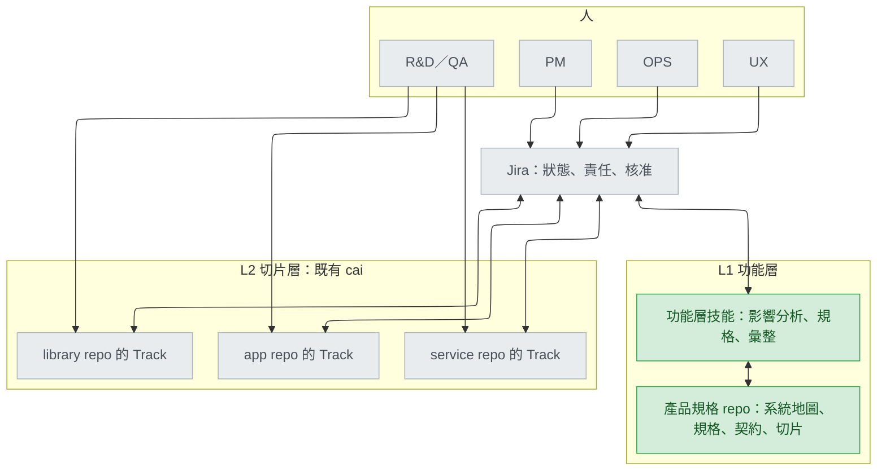
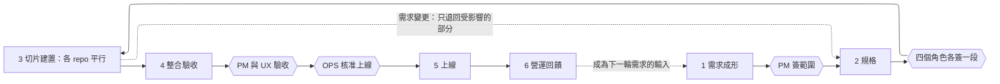

# 企業級 AI SDLC 設計提案

**定位：在現有 `/cai:track` 之上加一層跨 repo、跨角色的「功能層」，讓 PM、UX、R&D、OPS 以同一份規格協作，並以 Jira 作為各角色的共同看板。**

| 項目 | 內容 |
| --- | --- |
| 日期 | 2026-11-13 |
| 狀態 | 提案；尚未取得實作核准，不代表任何功能已交付 |
| 需求來源 | 本人 2026-11-13 的兩則要求：企業用法的整體設計；不排除另建版本庫並以子模組引用 claude-all-in-one |
| 讀檔基線 | claude-all-in-one `main`，`678807a`（v2.2.0 之後） |
| 本次交付 | 設計文件一份；不修改任何執行程式 |
| 與第二版架構的關係 | [第二版架構](architecture-v2.md) 處理「單人、單 repo」的執行環境重建；本文處理它之上的一層，兩者範圍不重疊（§11） |

## 1. 結論

現有 cai 的工作單位是「一個人在一個 repo 裡完成一項功能」。企業的工作單位是「多個角色、多個團隊、跨多個 repo 交付一項產品能力」。兩者差一層，不是差幾個功能。

本設計新增這一層，稱為**功能層**；現有的 Track 原封不動，降為功能層底下「單一 repo 的執行單元」，稱為**切片**。

需求到實作的落差，根源是**工程知識回饋太慢**：PM 寫需求時不知道會動到哪些 repo、會撞到哪些既有行為，要等工程師有空開會才知道，一來一回以天計。功能層用四件事縮短它：

- **影響分析提前**：PM 寫完需求後，AI 對照系統地圖回報影響哪些 repo 與團隊、與哪些既有行為衝突、還缺哪些答案。工程師的時間從「找出答案」變成「確認答案」。
- **一份規格，各角色簽自己那一段**：共同語言是範例式的驗收條件，不是設計文件。
- **問題派給對的角色**：行為問 PM、流程問 UX、技術取捨問 R&D、上線問 OPS，只擋住相依的切片。
- **狀態由證據推導，再投影到 Jira**：Jira 的狀態不由人手動搬動，因此可信。

兩層之間以**工單**交接（§9）：功能層為每個切片開一張 Story，工程師以既有的 `/cai:track <工單>` 入口開工，cai 把階段狀態投影回同一張工單。功能層不讀 cai 的內部檔案，所以 cai 換成第二版時，功能層只需要這個交接點維持不變。

## 2. 術語

| 中文意義 | 原文／識別字 | 定義 |
| --- | --- | --- |
| 軟體開發生命週期 | Software Development Life Cycle，SDLC | 從需求到上線、營運的整個流程 |
| 產品經理 | Product Manager，PM | 決定要做什麼產品能力、為誰而做的人 |
| 使用者體驗設計 | User Experience，UX | 決定使用者看到什麼、怎麼操作的人 |
| 研發與測試 | R&D／QA | 寫程式與驗證程式的團隊 |
| 營運 | Operations，OPS | 負責上線、監控、事故處理的團隊 |
| 版本庫 | repo | 一個 git 專案 |
| 功能 | Feature | 一項使用者感受得到的產品能力，可能橫跨多個 repo |
| 切片 | Slice | 一項功能落在單一 repo、單一團隊的那一部分；一個切片對應一個 cai Track |
| 追蹤單位 | Track | cai 現有的工作紀錄，承載一項工作由設計到發布（`plugins/cai/skills/track/SKILL.md`） |
| 驗收條件 | Acceptance Criteria，AC | 可觀察的成功條件，以「在什麼情況下、做了什麼、應該看到什麼」的範例寫成 |
| 系統地圖 | catalog | 記錄每個 repo 屬於哪個團隊、提供與使用哪些介面的清單 |
| 介面契約 | contract | 兩個 repo 之間約定的介面：API、事件、資料格式或函式庫的公開介面 |
| 產品規格 repo | product repo | 存放一個產品的系統地圖、功能規格與契約的 git 專案 |
| 史詩、故事 | Epic、Story | Jira 的兩層工作項目：前者是一項大工作，後者是它底下的一件可交付工作 |
| 投影 | projection | 把一處的狀態單向寫到另一處顯示；被寫入的那一處不是資料來源 |
| 人工關卡 | gate | 必須由特定的人對特定版本明確同意才能往下走的點 |
| 指紋 | SHA-256 | 內容的摘要值，內容一變就不同，用來判斷核准是否仍對應同一版本 |
| 預覽環境 | preview environment | 部署了尚未上線版本、供驗收的環境 |
| 功能開關 | feature flag | 程式已部署但可以不啟用的切換點 |
| 子模組 | git submodule | 一個 repo 裡指向另一個 repo 某個提交的連結 |
| 插件市集清單 | marketplace.json | 列出可安裝插件及其來源的檔案 |
| 無人值守執行 | headless | 沒有人坐在終端機前，由事件觸發 AI 執行 |
| 圖表描述與配置工具 | Mermaid／ELK | 分別把文字轉成圖表、安排流程圖節點的位置 |
| 技術負責人 | Tech Lead | R&D 中對一項功能的技術方案負責的人；跨團隊時由功能的主責團隊指派一位 |
| 合併請求 | Pull Request，PR | 請他人審查後把變更併入主線的請求 |
| 程式導覽索引 | codemap | cai 為單一 repo 建立的檔案與符號索引 |
| 持續整合 | Continuous Integration，CI | 每次變更自動執行檢查與測試的系統 |
| 工作樹 | git worktree | 同一個 repo 的另一個獨立工作目錄 |
| 契約測試 | contract test | 檢查兩個元件之間約定的格式沒有被任一方單獨改掉的測試 |
| 非功能需求 | non-functional requirement | 不屬於「功能做什麼」的要求：容量、效能、可用性、監控、回滾方式 |

## 3. 問題與現況差距

### 3.1 落差發生在哪裡

以「訂單可以部分退款」為例。PM 看到的是一項能力；實際上它要動手機 app、訂單服務、付款函式庫與訊息佇列的設定，分屬三個團隊。傳統流程中，這些事實在下列時間點才逐一浮現：

| 時間點 | 浮現的事實 | 代價 |
| --- | --- | --- |
| 需求審查會 | 「這要動付款函式庫，那是別的團隊的」 | 等另一個團隊排會議 |
| 設計中 | 「部分退款跟現有的優惠券折抵規則衝突」 | 退回 PM 補規則，UX 重畫 |
| 開發中 | 「設計稿沒有退款失敗的畫面」 | 工程師自行決定，或停下來等 |
| 上線前 | 「退款事件量會讓佇列超過目前容量」 | 延後上線 |

每一項都是**早就存在於程式碼與現有系統裡的知識**，只是在需要它的時候，知道的人不在場。這是本設計針對的對象。

### 3.2 現有 cai 與企業需求的差距

| 現況 | 依據 | 企業需要 |
| --- | --- | --- |
| 一個 Track 對應一個 repo、一個工作目錄 | `plugins/cai/skills/track/SKILL.md:38` | 一項功能橫跨多個 repo 與團隊 |
| 狀態在本機 `.cai/track/`，不進 git | 專案 `CLAUDE.md`「Not everything belongs in git」 | 所有角色都看得到的共享狀態 |
| 兩個人工關卡，由同一個人回答 | `SKILL.md:100-105` | 依角色分權的核准 |
| 工單後端只有 GitHub 與測試用替身 | `plugins/cai/scripts/ticket_backend.py:370` | Jira |
| GitHub 後端由 git remote 推導工單所在 repo，註明不支援跨 repo 工單 | `ticket_backend.py:262-266` | 工單與程式 repo 無關 |
| 工單狀態轉換只有「關閉」一種，且只在歸檔後依本人答覆執行 | `ticket_backend.py:337-342`、`docs/workflow.md:53` | 隨階段推進的多個狀態 |
| Jira 只在 `/cai:fix` 唯讀，站台欄位尚未對真實工具驗證 | `plugins/cai/scripts/fix_jira.py:19`、`:45` | 讀、寫、狀態推進 |
| 流程從設計階段開始，假設使用者了解該 repo | `plugins/cai/skills/track/stages.json` | 前面補「需求到規格」，後面補「上線到營運」 |

已經具備、可以直接承接的部分：

- 設計階段產生編號的驗收條件，驗證階段逐條對應測試（`plugins/cai/skills/track/references/stage-verify.md:186-187`、`:326`）。功能層的 AC 可以一路對到切片的測試。
- 以工單開工的入口與狀態投影（`plugins/cai/skills/track/references/ticket-mirror.md`）。
- 核准綁定產物指紋的帳本（`plugins/cai/scripts/ledger.py`）。
- 待答問題的保存與續問（`plugins/cai/scripts/pending.py`）。
- 單一 repo 的程式導覽索引（`plugins/cai/scripts/codemap_*.py`），是系統地圖的輸入。

### 3.3 需求與驗證

| 編號 | 需求（本人原話的摘要） | 設計位置 | 如何驗證 |
| --- | --- | --- | --- |
| R1 | PM、UX、R&D、OPS 等真實的人共同參與；有些公司角色更多 | §6 的規格分段與 `roles.yaml`、§7、§8 | P1：一項真實功能的每一段都由對應角色核准；新增一個角色只需新增一段規格與一列設定 |
| R2 | 以 Jira 或其他工具追蹤功能與專案 | §9.1、§9.2 | P2：Epic 的進度不經人手更新，即與各切片的狀態一致 |
| R3 | 一項功能涵蓋多個 repo（app、tool、library、infra） | §5、§6 的系統地圖與切片、§10 | P2：一項功能的每個切片各自由 Story 開工 |
| R4 | 跨團隊合作開發 | §7 的契約先行、§9.1、§10 | P2：使用介面的切片在提供介面的切片完成之前開工，並通過驗證 |
| R5 | 縮短需求、規格、實作之間的落差；這是最重要的一項 | §8.3 影響分析、§8.2 問題派送、§7 變更規則 | P0 的漏報率與誤報率；§13 的時間與變更率，需有導入前的基準 |
| R6 | 提出流程、追蹤方式與角色協作的設計 | §7、§9、§8 | 本文件經本人審閱 |
| R7 | 可另建 repo，並以子模組引用 claude-all-in-one | §11 | 本人就 §15 的決定 1 作出選擇 |

本文中沒有任何一項需求直接要求、而由設計自行加入的元素，列在 §15 的「待本人確認的隱含需求」。

## 4. 設計原則

| 原則 | 含義 | 排除的做法 |
| --- | --- | --- |
| 內容在 git，狀態在 Jira | 規格、契約、決策放產品規格 repo，可審查、有版本；Jira 放狀態、責任與排程 | 同一段內容在兩邊都能編輯 |
| 狀態由證據推導 | Story 的狀態由切片的階段結果推進，不由人手動拖動 | 以「PR 已合併」當作功能完成 |
| 核准綁定版本與角色 | 每個核准記錄誰、以什麼角色、對哪一段的哪個指紋同意；內容改了，該段與其下游的核准失效 | 一次性的口頭同意、留言裡的「LGTM」 |
| 每個角色留在自己的工具 | PM 與 OPS 在 Jira，UX 在設計工具與 Jira，R&D 在 Claude Code | 要求非工程角色使用 git 或終端機 |
| AI 的判斷要附依據 | 影響分析的每一項標明依據與確定程度，不知道就列為未知 | 把猜測寫成結論 |
| 切片層不變 | 單一 repo 內的設計、建置、驗證、發布仍由 cai 現有流程負責 | 在功能層重做一套建置流程 |
| 兩層以工單交接 | 功能層不讀寫 cai 的內部檔案 | 依賴 `.cai/track/` 的檔案格式 |

這些原則明知放棄的東西：

- **PM 不能直接改規格本體。** 規格在 git 裡；PM 能做的是改 Epic 描述、回答問題、核准或退回。想改一句 AC，要經過一次重新產生與重新核准。
- **Jira 上被投影的區塊不能手改。** 手改的內容會在下一次投影被覆蓋。
- **功能層看不到切片內部。** 它只看到 Story 上的投影；切片卡在哪一步的細節，要到該 repo 的 Track 才看得到。
- **每個團隊多一項維護工作。** 系統地圖中屬於自己 repo 的那幾列，要由該團隊保持正確。
- **無人值守執行上線之前沒有即時回饋。** 影響分析要等人執行指令（§14）。

## 5. 分層模型

| 層 | 單位 | 負責人 | 存放位置 | 狀態 |
| --- | --- | --- | --- | --- |
| L0 路線圖 | 多項功能的排序 | PM、主管 | Jira | 既有，AI 不介入，只提供規模與影響的依據 |
| L1 功能 | 一項跨 repo、跨角色的產品能力 | PM 與各角色 | 產品規格 repo，投影到 Epic | **新增** |
| L2 切片 | 功能落在一個 repo 的部分 | 該 repo 的團隊 | 該 repo 的 cai Track，投影到 Story | 既有 `/cai:track` |
| L3 任務 | 切片內的建置單元 | 工程師與 AI | Track 內 | 既有建置階段 |

綠色為新增，灰色為既有。本文兩張圖都指定 ELK 配置，並已用 Mermaid 11.16.0 實際轉圖；閱讀器若忽略這項設定（例如 GitHub 的預覽），圖仍可依流向閱讀。



## 6. 產品規格 repo

每個產品一個，內容是 Markdown 與 YAML，由功能層技能讀寫，人透過合併請求審查。

```text
product-<name>/
  catalog/
    repos.yaml           系統地圖
    roles.yaml           誰以什麼角色核准哪一段
  features/<JIRA-KEY>-<slug>/
    brief.md             PM：問題、使用者、成效指標、範例
    impact.md            AI：影響的 repo 與團隊、衝突、未知、規模
    spec.md              驗收條件、UX 流程連結、非功能需求
    contracts/           repo 之間的介面變更
    slices.yaml          切片與依賴
    questions.yaml       待答問題
    approvals/           核准紀錄，一筆一檔，只新增不修改
    evidence.md          每條 AC 的證據索引，由切片的工單投影彙整而成
    release.md           OPS：上線計畫、開關、回滾、監控
```

`spec.md` 分成數段，每一段有一個負責角色，核准與指紋都以段為單位：

| 段落 | 負責角色 | 內容 | 指紋涵蓋的範圍 |
| --- | --- | --- | --- |
| `## Acceptance` | PM | 編號的 AC，每條一個範例 | 這一段的文字 |
| `## UX` | UX | 流程與畫面狀態清單、設計稿連結 | 這一段的文字；設計稿本身不在指紋內，連結需指向固定版本 |
| `## Contracts and slices` | 技術負責人 | 對 `contracts/` 與 `slices.yaml` 的說明 | 這一段的文字，加上 `contracts/` 全部檔案與 `slices.yaml` |
| `## Non-functional` | OPS | 容量、可用性、監控、回滾的要求 | 這一段的文字 |

角色不寫死在程式裡：`roles.yaml` 的每一列是一個角色、它負責的段落、以及對應的 Jira 群組。公司有資安、法務或資料團隊時，新增一段與一列即可。

以下為格式示例，內容以「訂單可以部分退款」（`PAY-120`）為例。

**系統地圖** `catalog/repos.yaml`：每個 repo 宣告自己提供與使用的介面。團隊與類型由人維護；介面清單由各 repo 的程式導覽索引產生後，由該 repo 的團隊確認。`provides` 列出的路徑是**該 repo 內**的檔案，不是產品規格 repo 內的檔案。

```yaml
repos:
  - name: order-api
    kind: service
    team: orders
    jira_project: ORD
    provides: [contracts/order-api.openapi.yaml, events/order-refunded]
    consumes: [payment-sdk]
  - name: payment-sdk
    kind: library
    team: payments
    jira_project: PAYSDK
    provides: [contracts/payment-sdk.public-api.md]
    consumes: []
```

**影響分析** `impact.md` 的核心是一張表，每一列都有依據與確定程度：

```markdown
| repo | 判定 | 依據 | 負責團隊 |
| --- | --- | --- | --- |
| order-api | 確定受影響 | 退款目前只接受整筆金額（`RefundService.refund`）；`order-refunded` 事件沒有金額欄位 | orders |
| payment-sdk | 確定受影響 | 公開介面 `refund(orderId)` 沒有金額參數 | payments |
| shop-app | 確定受影響 | 訂單詳情頁的退款按鈕直接呼叫整筆退款 | app |
| platform-infra | 未知 | 退款事件量是否超過佇列目前容量，系統地圖沒有容量資料 | platform |

與既有行為的衝突：優惠券折抵是以整筆訂單計算（`CouponPolicy`），部分退款時折抵如何分攤，需求沒有說明。

規模：3 個 repo 確定受影響、1 個未知；涉及 3 個團隊；2 個介面契約需要變更。
```

「規模」只報可以數的東西：受影響的 repo 數、團隊數、需要變更的契約數。本設計不讓 AI 估工時。

**介面契約的權威來源**：一項功能進行期間，`features/<KEY>-<slug>/contracts/` 中已核准的版本是各切片共同依據的版本；提供介面的切片必須在自己的驗證階段證明實作與這個版本一致。該切片合併之後，權威來源回到提供介面的 repo 內的契約檔（即系統地圖 `provides` 指向的檔案），功能目錄下的版本只留作紀錄。

**切片** `slices.yaml`：每個切片對應一個 repo、一個團隊、一張 Story，並指明它滿足哪幾條 AC、依賴哪些切片。

```yaml
feature: PAY-120
slices:
  - id: S1
    repo: payment-sdk
    story: PAYSDK-88
    acs: [AC2]
    contracts: [contracts/payment-sdk.public-api.md]
    depends_on: []
  - id: S2
    repo: order-api
    story: ORD-311
    acs: [AC1, AC2, AC3]
    contracts: [contracts/order-api.openapi.yaml, events/order-refunded]
    depends_on: [S1]
  - id: S3
    repo: shop-app
    story: APP-540
    acs: [AC1, AC4]
    contracts: [contracts/order-api.openapi.yaml]
    depends_on: []
```

`depends_on` 只用在「沒有對方的產物就無法建置」的情況：`S2` 要用到付款函式庫發布的新版本，所以依賴 `S1`。`S3` 不依賴 `S2` 完成，只依賴契約已核准：契約定了，app 團隊就能對著契約開工。

**待答問題** `questions.yaml`：每個問題有負責角色，並指明它擋住什麼。

```yaml
- id: Q1
  owner_role: pm
  question: 部分退款時，優惠券折抵按比例退回，還是不退？
  blocks: [AC3, S2]
  jira: PAY-121
  status: open
- id: Q2
  owner_role: ops
  question: 退款事件量的預估上限是多少？目前佇列容量是否足夠？
  blocks: [release]
  jira: PAY-122
  status: open
```

**核准紀錄** `approvals/<段落>-<UTC 時間>.json`：一筆一檔。不用單一檔案逐行追加，是因為兩個角色的核准若同時寫入同一個檔案的結尾，git 合併時必然衝突。

```json
{"feature": "PAY-120", "section": "Acceptance", "sha256": "<該段內容的指紋>", "commit": "<產品規格 repo 的提交識別>", "role": "pm", "approver": "<Jira 帳號識別>", "source": "<Jira 狀態轉換的紀錄識別>", "ts": "<UTC 時間>"}
```

## 7. 流程與關卡



| 階段 | 主導 | AI 做什麼 | 產物 | 關卡 |
| --- | --- | --- | --- | --- |
| 1 需求成形 | PM | 訪談補足缺漏；對照系統地圖產生影響分析；把未決事項列成問題 | `brief.md`、`impact.md`、`questions.yaml` | PM 確認問題與範圍 |
| 2 規格 | PM、UX、技術負責人、OPS | 把需求改寫成範例式 AC；從 AC 推導 UX 必須涵蓋的所有畫面狀態；起草介面契約與切片；技術負責人確認影響分析 | `spec.md`、`contracts/`、`slices.yaml` | PM 簽 AC；UX 簽流程；技術負責人簽契約與切片；OPS 簽非功能需求 |
| 3 切片建置 | 各 repo 的 R&D | cai 現有的設計、建置、驗證、發布準備，契約與 AC 為固定輸入 | 各 repo 的合併請求 | 該 repo 負責人（cai 既有的設計關卡與發布關卡） |
| 4 整合驗收 | QA、PM、UX | 逐條 AC 彙整各切片的證據；指出沒有任何證據覆蓋的 AC | `evidence.md` | PM 依 AC 驗收；UX 在預覽環境比對設計稿 |
| 5 上線 | OPS | 依非功能需求檢查上線準備；起草上線計畫 | `release.md` | OPS 核准上線 |
| 6 營運回饋 | OPS、PM | 把事故與指標連回功能與 AC | 下一輪 `brief.md` 的輸入 | 無 |

三項規則：

- **契約先行。** 階段 2 先定下 repo 之間的介面，階段 3 各團隊對著契約平行開工，不必互相等待。契約由提供介面的團隊負責，使用介面的團隊參與審查。
- **變更只重驗受影響的部分。** 需求在建置中途改變時，程式比對 `spec.md` 前後版本，算出哪幾條 AC 變了，再由 `slices.yaml` 找出對應的切片，只有這些切片退回重驗。這是確定性的比對，不需要模型判斷。
- **核准按段失效。** 改了 AC 的文字，只有 PM 的 AC 核准與依賴該 AC 的切片受影響；UX 的流程核准與不相關的契約核准仍然有效。

## 8. 角色協作

### 8.1 各角色的日常

| 角色 | 使用的工具 | 不再需要做的事 | 新得到的東西 |
| --- | --- | --- | --- |
| PM | Jira | 開會詢問「這要動多少東西」；追問每個團隊的進度 | 影響分析；指派給自己的具體問題；每條 AC 的進度與證據 |
| UX | 設計工具、Jira | 開發中才被告知漏畫錯誤、空白、載入、權限不足的畫面 | 由 AC 推導的畫面狀態清單；現有元件庫中可重用的元件 |
| 技術負責人 | Claude Code、產品規格 repo | 從零調查影響範圍 | 一份待確認的影響分析與契約草稿 |
| R&D／QA | Claude Code 與 cai | 開發中回頭追問需求 | 已指明契約、AC 與已答問題的 Story |
| OPS | Jira、`release.md` | 上線前才得知新功能 | 規格階段就簽非功能需求；事故可以追溯到功能與 AC |

### 8.2 問題的派送

問題是協作的主要單位。AI 在任何階段遇到無法由現有資料回答的事，不自行假設，而是：

- 依問題性質判定負責角色：產品行為與範圍歸 PM；畫面與流程歸 UX；技術取捨歸技術負責人；容量、上線方式與監控歸 OPS。
- 在 Jira 開一個指派給該角色的子項，內容是一個可以直接回答的問題與它擋住的 AC 或切片。
- 只暫停被擋住的部分，其餘照常進行。
- 回答寫回 `questions.yaml`，並成為規格的一部分；規格因此改變的段落，依 §7 的規則重新取得核准。

### 8.3 影響分析如何產生

| 輸入 | 來源 |
| --- | --- |
| 需求文字 | Epic 的描述與 `brief.md` |
| 系統地圖 | `catalog/repos.yaml` |
| 各 repo 的結構 | 各 repo 的程式導覽索引 |
| 現有契約 | 產品規格 repo 中已核准的契約 |

執行影響分析的 AI 對所有 repo 只有讀取權。輸出的每一項標為「確定受影響」「可能受影響」「不受影響」或「未知」，前兩者必須附程式或契約上的依據。技術負責人在階段 2 確認這份分析；確認之前，它是草稿，不能作為排程承諾。

## 9. 專案追蹤與兩層之間的交接

### 9.1 Jira 對應

| Jira 項目 | 對應 | 誰建立 | 誰更新狀態 |
| --- | --- | --- | --- |
| 路線圖項目 | L0，多項功能 | PM | PM |
| Epic | 一項功能，對應一個 `features/<KEY>-<slug>/` 目錄 | PM | 功能層依關卡與證據推進 |
| Story | 一個切片 | 功能層依 `slices.yaml` 建立，落在該團隊自己的 Jira 專案 | cai 依切片的階段結果推進 |
| 指派給角色的子項 | 一個待答問題 | 功能層 | 回答的人 |
| 狀態轉換 | 一次關卡核准 | 具備該角色的人 | 人 |

本文以 Jira 的名詞描述，但功能層只需要工單系統具備兩層項目、留言、狀態轉換與指派四種能力；其他工單系統以另一個後端接入，做法與 `ticket_backend.py` 現有的後端介面相同。

各團隊保留自己的 Jira 專案、看板與流程。Epic 跨專案連結 Story；切片之間的依賴以 `slices.yaml` 為準，並投影為 Jira 的連結。各團隊的 Jira 流程狀態名稱不同，階段與狀態的對照放在設定中，不寫死在程式裡。

### 9.2 同步方向

| 資料 | 來源 | 投影到 | 另一邊可否編輯 |
| --- | --- | --- | --- |
| 需求原文 | Epic 描述 | `brief.md` | 規格 repo 這邊不改原文 |
| 影響分析、規格、契約 | 產品規格 repo | Epic 的一則固定留言，附連結 | Jira 這邊不改 |
| 切片說明 | `slices.yaml` 與 `spec.md` | Story 描述中的一個固定區塊 | Jira 這邊不改該區塊 |
| 切片狀態與證據 | 切片所在 repo 的 cai 帳本 | Story 的一則固定留言與狀態 | Jira 這邊不改 |
| 問題的答案 | 子項的回覆 | `questions.yaml` | 規格 repo 這邊不改 |
| 核准 | 狀態轉換 | `approvals/` | 規格 repo 這邊只新增檔案，不修改既有的 |

固定留言以標記尋回並就地更新，不重複張貼；這是 `ticket_backend.py:261-283` 現有的做法。

### 9.3 Story 是兩層之間唯一的交接點

功能層寫入 Story 描述的切片說明，格式示例：

```markdown
<!-- cai-slice: v1 -->
feature: PAY-120
slice: S2
spec: product-shop@<提交識別>:features/PAY-120-partial-refund/spec.md
acs: AC1, AC2, AC3
contracts: contracts/order-api.openapi.yaml, events/order-refunded
depends_on: S1
<!-- /cai-slice -->
```

工程師在該 repo 以 Story 的網址執行 `/cai:track <Story 網址>`。cai 讀取工單、開始設計階段，並把階段狀態投影回同一張 Story。現行入口只把含 `://` 或純數字的參數當作工單（`SKILL.md:34-35`），`ORD-311` 這種編號會被當成 Track 名稱，所以這裡用網址；是否也接受編號屬於 C1 的範圍。功能層讀取各 Story 的投影，彙整成 `evidence.md` 與 Epic 的進度。

這個交接方式的結果是：功能層不知道 cai 把狀態存在哪裡、用什麼格式，只認 Story 上的兩個區塊。

### 9.4 切片層需要的最小變更

以下五項落在 cai 本身，各自需要獨立的設計；本文只界定範圍。

| 編號 | 變更 | 現況 |
| --- | --- | --- |
| C1 | 工單後端增加 Jira：讀取、更新固定留言、狀態轉換 | 只有 GitHub 與測試用替身（`ticket_backend.py:370`） |
| C2 | 讀取工單時辨識切片說明區塊，把其中的 AC 編號與契約引用帶進設計階段的需求文件，編號不重排 | 設計階段自行編號 AC |
| C3 | 狀態投影加上機器可讀的區塊，含每條 AC 對應的測試與結果 | 投影是給人讀的表格；逐條 AC 的對照已存在於驗證階段（`stage-verify.md:326`），尚未投影 |
| C4 | 狀態轉換支援多個狀態，由設定對照階段與 Jira 狀態 | 只有關閉（`ticket_backend.py:337-342`） |
| C5 | 契約引用固定到產品規格 repo 的提交識別；契約變更後，功能層更新 Story，cai 於下次續行時發現引用已變並回到設計階段 | 無此概念 |

Jira 的工單編號不依附於任何 git repo，因此 `ticket_backend.py:262-266` 所述「不支援跨 repo 工單」的限制，推斷不適用於 Jira 後端；這是推論，C1 的設計需要驗證。

### 9.5 核准綁定哪一個版本

人在 Jira 上按下核准時，Jira 並不知道規格的指紋。規則如下：

- 功能層每次把規格投影到 Epic 的固定留言時，留言中帶有各段的指紋與產品規格 repo 的提交識別。
- 記錄一筆核准時，綁定的是**該次狀態轉換之前最後一次投影**的版本。
- 記錄當下，若產品規格 repo 中該段的指紋已經與那次投影不同，這筆核准不成立：功能層重新投影，並在 Jira 上請同一個人再核准一次。

這條規則排除的情況是：PM 讀的是上午的版本，下午規格被改了一句，PM 傍晚按下核准，結果被記成同意了他沒讀過的那一句。

### 9.6 失敗時的行為

| 情況 | 行為 |
| --- | --- |
| 為一項功能建立多張 Story，中途失敗 | 每建立一張就把編號寫回 `slices.yaml` 的 `story` 欄位；重新執行時只建立該欄位仍為空的切片，不重複建立 |
| 切片的狀態投影失敗（Jira 無法連線、權限被拒） | 不讓切片的工作停下來，這是 cai 現有的規則（`ticket_backend.py:9-11`）。代價是 Epic 的進度可能落後；`evidence.md` 的每一列標明該切片最後一次成功投影的時間，超過設定的時限就標為「狀態可能過期」 |
| 功能層讀到的 Story 區塊格式不符或版本未知 | 該切片標為「無法判讀」，不當作未開始，也不當作完成 |
| 兩個人對產品規格 repo 的同一段同時提出修改 | 由 git 的合併請求處理；功能層不另做鎖定 |

### 9.7 已知限制：切片的狀態在一台機器上

cai 的 Track 狀態存在執行者本機、不進 git 的目錄；工單上的投影只是顯示，本機紀錄才是流程來源，而且工單上的認領只是提醒，不保證兩台機器不會同時開工（`docs/workflow.md:51`）。在企業環境，這代表：

- 一位工程師請假或換人接手時，接手的人無法從另一台機器續行同一個 Track，只能以該切片的分支與 Story 上的投影為起點重新開一個。
- 兩位工程師可能同時對同一張 Story 開工，只有認領留言提醒他們。

本設計不解決這兩點，因為解法屬於切片層本身的狀態設計。它是否需要在導入前解決，列在 §15。

## 10. 多 repo 與跨團隊

| 議題 | 做法 |
| --- | --- |
| 誰知道功能涉及哪些 repo | 系統地圖加影響分析；技術負責人確認 |
| 團隊之間如何不互等 | 契約先行；切片依賴的是「契約已核准」，不是「對方已完成」 |
| 建置順序 | `slices.yaml` 的 `depends_on` 構成有向無環圖；程式檢查是否有環、哪些切片可以開工 |
| 函式庫與使用者不同步上線 | 提供介面的切片先合併並發布版本；使用介面的切片在契約中引用該版本 |
| 尚未全部完成時如何合併 | 各切片以功能開關包住，預設關閉；整合驗收在預覽環境開啟 |
| 整合驗證在哪裡跑 | 預覽環境的建立方式因公司而異，本設計只規定驗收依 AC 進行、證據連回 AC，不規定環境如何搭建 |
| 跨團隊的優先順序衝突 | 留在 L0，由人決定；功能層只呈現哪些切片在等哪個團隊 |
| 同一個 repo 同時被兩項功能改動 | 首版不合併：每項功能各開一張 Story、各有一個 Track，在不同的工作樹進行；兩者改到同一段程式時，由該 repo 的團隊決定先後 |

## 11. 版本庫策略

功能層的程式放在哪裡，以及它如何取得 cai，有三種做法。比較的面向：

- **版本如何固定**：功能層如何確定自己搭配的是哪一版 cai。
- **安裝後執行時拿得到什麼**：使用者機器上，功能層能不能讀到 cai 的檔案。
- **第二版取代現行版時要改多少**：[第二版架構](architecture-v2.md) 規劃另建版本庫、claude-all-in-one 凍結（該文件第 15、28 行）；該提案尚未核准（[設計文件索引](README.md)）。
- **維護成本**：日常開發與發版多出哪些步驟。

已查證的事實：

- claude-all-in-one 自己的市集清單就是以「另一個 git repo 的子目錄加版本標籤」引用 cai：`.claude-plugin/marketplace.json:11-16`，來源種類 `git-subdir`，`ref` 為 `v2.2.0`。
- cai 的腳本是彼此以 `sys.path` 互相引用的平面模組，沒有對外承諾的程式介面（例：`plugins/cai/scripts/fix_jira.py:32-38`）。
- 下列三項來自 Claude Code 官方文件，由子代理以摘要方式讀取，採用前需對原文複核：插件安裝時只複製插件目錄，目錄外的檔案不會複製；repo 根目錄下、不在插件目錄內的子模組不會被抓取；插件可在 `plugin.json` 以 `dependencies` 宣告相依另一個插件，版本範圍對應的標籤格式為 `<插件名>--v<版本>`。
- claude-all-in-one 目前的標籤格式是 `v2.2.0`（`git tag`），不符合上述相依宣告所需的格式。

| 面向 | A 留在 claude-all-in-one | B 新 repo 加子模組 | C 新 repo 加市集清單釘版 |
| --- | --- | --- | --- |
| 版本如何固定 | 同一個提交，不需要固定 | 子模組指向的提交 | 市集清單的 `ref` 或 `sha` |
| 安裝後執行時拿得到什麼 | 兩個插件各自安裝，互相讀不到對方的檔案 | 子模組內容不會隨插件安裝；只有開發者的工作目錄裡有 | cai 以獨立插件安裝，互相讀不到對方的檔案 |
| 第二版取代時要改多少 | 功能層跟著 claude-all-in-one 一起凍結，必須搬家 | 子模組改指向新 repo；若曾引用內部腳本，全部要改 | 改市集清單的一個來源 |
| 維護成本 | 最低；共用驗證與測試 | 每次升級 cai 是兩步；持續整合與每位開發者都要處理子模組 | 升級 cai 是改一行；契約測試需自行取得指定版本 |

### 選項 A — 留在 claude-all-in-one，新增第二個插件

1. **是什麼**：在這個 repo 的 `plugins/` 下新增功能層插件，與 cai 並列，同一份市集清單列出兩者。
2. **打個比方**：在現在住的房子裡加蓋一個房間，水電共用、同一扇門進出，但這棟房子已經排定要搬離。
3. **實際改變什麼**：新增 `plugins/<功能層>/` 目錄；`.claude-plugin/marketplace.json` 多一筆；`scripts/validate.py` 與 `tests/` 要涵蓋新插件；`scripts/gen-codex.py` 是否為它產生 Codex 版本需要決定。
4. **代價**：起步最快。之後接事件的常駐元件與產品規格 repo 的樣板都不屬於「個人的插件市集」，會讓這個 repo 的定位混雜。
5. **可逆程度**：中。之後搬出去要重建驗證、測試與發版流程，使用者要改安裝來源。
6. **適用時機**：只想先做階段 1、2 的技能來驗證想法，且確定短期內不會執行第二版的搬遷。

### 選項 B — 新 repo，把 claude-all-in-one 掛成子模組

1. **是什麼**：新建一個 repo 放功能層，裡面用子模組連結到 claude-all-in-one 的某個提交。
2. **打個比方**：把別人的整本書影印一份夾進自己的資料夾，隨時翻得到每一頁；書改版時要自己重印，而且交給讀者的那一份不會附上這份影印。
3. **實際改變什麼**：新 repo 出現 `.gitmodules` 與一個子模組目錄；開發者要以 `git clone --recurse-submodules` 取得；持續整合要設定抓取子模組；升級 cai 是先更新子模組指標、再提交。使用者安裝功能層插件時，子模組內容不會到他的機器上，cai 仍須另外安裝。
4. **代價**：子模組的日常操作成本，在 Windows 與多個工作樹並用時更容易出錯。最大的風險是它讓「直接引用 cai 的內部腳本」變得很方便，而那些腳本沒有對外承諾的介面，cai 一改就壞。
5. **可逆程度**：中到低。沒有引用內部腳本時，移除子模組很便宜；一旦引用，改掉的成本隨引用數量成長，第二版取代時全部失效。
6. **適用時機**：功能層需要與 cai 的原始碼同步修改，並在同一個工作目錄裡對尚未發版的 cai 提交做整合測試。

### 選項 C — 新 repo，以市集清單固定版本（recommended）

1. **是什麼**：新建一個 repo 放功能層，它的市集清單同時列出功能層插件與 cai，cai 那一筆指向 claude-all-in-one 的指定版本。
2. **打個比方**：食譜上寫明「用某一款醬油的第三版」，不把醬油工廠搬進廚房，只指定要哪一瓶；想換版本就改那一行字。
3. **實際改變什麼**：新 repo 的 `.claude-plugin/marketplace.json` 有兩筆，cai 那一筆與 claude-all-in-one 現有的寫法相同，只是放在另一個 repo。使用者加入這一個市集，就會得到互相搭配的兩個插件。新 repo 沒有 cai 的原始碼；兩層只透過 §9.3 的 Story 區塊溝通，並以契約測試固定該區塊的格式。
4. **代價**：要先把 §9.3 的交接格式定清楚，並在兩邊各寫一組契約測試。若要用 `dependencies` 讓安裝時自動帶入 cai，claude-all-in-one 的發版腳本需要多打一種格式的標籤；不用它也可以，只是使用者要安裝兩個插件。
5. **可逆程度**：高。之後想改成 A 或 B，功能層的程式不需要改，因為它本來就不引用 cai 的檔案。
6. **適用時機**：功能層與 cai 會各自演進，且第二版有可能取代現行版。

若不想逐項比較，選 C：依據是安裝後子模組的內容本來就不會到使用者機器上，子模組能提供的只剩「開發時讀得到原始碼」，而這正是應該避免依賴的東西；C 用的是這個 repo 已經在用的機制。讓 C 變成錯誤選擇的條件是：功能層的常駐元件必須直接匯入 cai 的 Python 模組才能運作。若真的走到那一步，應先把那些模組整理成有版本的套件，而不是改用子模組。

不論選哪一個，功能層暫名為 `cai-ent`，正式名稱於實作開始時固定。

## 12. 安全、權限與稽核

| 議題 | 設計 |
| --- | --- |
| 工單文字是不可信輸入 | PM 與其他人寫在 Jira 的文字會流入有寫入權的 AI。沿用現有做法：工單的標題與描述存成檔案並標示為第三方文字，不直接印出（`fix_jira.py:11-13`）；功能層另外規定這些文字只能當作資料，不能當作指令。切片說明區塊由功能層產生，其來源以產品規格 repo 的提交識別核對，不以區塊文字本身為準 |
| 核准不能由文字推導 | 核准只認 Jira 介面回報的帳號與狀態轉換紀錄，不認留言或描述中的任何文字。這延續第二版架構的不變條件「人工授權不可推導」 |
| 角色與身分 | `roles.yaml` 把角色對應到 Jira 的群組；狀態轉換的權限同時在 Jira 流程中設定。兩者不一致時以較嚴格者為準 |
| 最小權限 | 影響分析對所有 repo 唯讀；切片的 AI 只能寫自己的 repo；功能層只能寫產品規格 repo 與 Jira |
| 稽核 | `approvals/`、產品規格 repo 的提交歷史、Jira 的變更歷史三者互相對照 |
| 資料邊界 | 系統地圖與影響分析揭露跨 repo 的架構；能讀產品規格 repo 的人，等於能看到這些資訊。存取控制以產品規格 repo 的權限為準 |
| 成本歸屬 | 用量需要能歸到功能與團隊。cai 現有的用量報表以單一 Track 或日期區間為單位（`plugins/cai/scripts/usage_report.py:12`、`:444`），按功能或團隊彙總尚無設計，列為待辦 |

本節只列方向。任何會接收 Jira 事件並自動執行 AI 的元件，動工前需要獨立的威脅分析。

## 13. 成效量測

目標是縮短落差，因此量測落差本身，而不是產出量。

| 指標 | 定義 | 用途 |
| --- | --- | --- |
| 影響分析的漏報率 | 實際動到、但分析沒有列為「確定」或「可能」的 repo 數／實際動到的 repo 數 | 核心假設是否成立 |
| 影響分析的誤報率 | 列為「確定」但實際沒動到的 repo 數／列為「確定」的 repo 數 | 分析是否可信到值得讀 |
| 需求到規格核准的時間 | Epic 建立到階段 2 四段核准齊備 | 落差的主要度量 |
| 澄清來回次數 | 每項功能的問題數，以及每個問題的等待時間，按角色分列 | 找出等待集中在哪個角色 |
| 建置開始後的規格變更率 | 階段 3 開始後有變更的 AC 數／全部 AC 數 | 規格品質；越早發現的變更越便宜 |
| AC 一次驗收通過率 | 階段 4 第一次驗收即通過的 AC 數／全部 AC 數 | 規格與實作是否一致 |

所有指標都需要導入前的基準才有意義。沒有基準時只報告數值，不宣稱改善幅度。

## 14. 導入順序

| 步驟 | 內容 | 需要什麼 | 完成的判定 | 未達標時 |
| --- | --- | --- | --- | --- |
| P0 驗證核心假設 | 挑數項已完成的跨 repo 功能，只給 AI 當時的需求文字與系統地圖，把影響分析與實際動到的 repo 對照 | 一份手寫的系統地圖；不寫任何程式 | 漏報率與誤報率低於實驗前固定的門檻 | 停止；先改善系統地圖的資料來源，再重做 |
| P1 規格層 | 產品規格 repo 的樣板；階段 1、2 的技能；Jira 讀取與留言投影。由技術負責人在 Claude Code 執行，PM 在 Jira 看結果 | 版本庫策略已定（§11）；C1 的讀取與留言部分 | 一項真實功能走完階段 1、2，四段核准都有紀錄 | 修正規格格式與問題派送 |
| P2 切片交接 | 由 `slices.yaml` 建立 Story；C2 到 C5；Epic 進度由 Story 投影彙整 | P1 | 一項功能的所有切片由 Story 開工，Epic 進度不經人手更新 | 保留人工更新，修正交接格式 |
| P3 驗收與上線 | 階段 4、5：逐條 AC 的證據彙整、OPS 關卡 | P2 | 一項功能依 AC 驗收並上線，`evidence.md` 每條 AC 都有證據 | 回到 P2 補證據投影 |
| P4 無人值守 | 由 Jira 事件觸發階段 1 的影響分析，PM 不必等人執行。優先以既有的持續整合系統執行，不自建服務 | P1 到 P3 穩定；威脅分析完成 | PM 建立 Epic 後，影響分析在無人介入下出現 | 維持由人觸發 |
| P5 營運回饋 | 階段 6：事故與指標連回功能 | P3 | 一次事故可以追溯到功能與 AC | 維持人工連結 |

P1 到 P3 沒有常駐元件：所有動作由人在 Claude Code 中觸發。這代表 P4 之前，PM 得到影響分析的延遲是「等技術負責人執行一個指令」，不是幾分鐘。這個延遲是否可接受，決定 P4 的優先順序。

## 15. 未驗證的假設與待決事項

未驗證的假設：

- **影響分析的品質。** 整個設計最大的假設。它取決於系統地圖是否完整、各 repo 的程式導覽是否足以讓 AI 判斷行為衝突。P0 就是為了在投入之前驗證它。
- **是否有可用於 P0 的資料。** P0 需要已完成的跨 repo 功能及其當時的需求文字。目前不知道手邊是否有這樣的資料。
- **Jira 的寫入與狀態轉換。** 現有程式只有唯讀路徑，且其中站台欄位標為未驗證（`fix_jira.py:45`）。各公司的 Jira 流程與權限設定差異很大。核准紀錄需要從 Jira 取得「誰執行了哪一次狀態轉換」，這一點尚未對實際的 Jira 介面驗證。
- **Claude Code 插件機制的三項事實**（§11）來自摘要讀取，尚未對原文複核。
- **P0 的門檻數值。** 本文沒有提出具體數字；沒有實測資料時提出的數字只是猜測。門檻需在實驗前由本人固定。

待本人決定，依先後順序：

| 順序 | 決定 | 本文的建議 | 它限制了什麼 |
| --- | --- | --- | --- |
| 1 | 版本庫策略（§11） | 選項 C | 之後所有程式放在哪裡 |
| 2 | C1 到 C5 落在現行版還是第二版 | 先落在現行版，並列為第二版必須保留的交接點 | 第二版的需求清單要不要增加一項 |
| 3 | P0 用哪些功能、門檻多少 | 無；需要本人提供資料 | 是否繼續 P1 |
| 4 | 第一個導入的產品與 Jira 專案 | 無 | P1 的規格格式與狀態對照 |
| 5 | 切片狀態只在一台機器上的限制（§9.7），是否要在導入前解決 | 先不解決；P2 實際遇到換人接手時再評估 | 是否要為切片層另開一項狀態共享的設計 |

待本人確認的隱含需求。以下元素沒有任何一項原始需求直接要求，是設計時自行加入的；每一項寫成一句可以接受或拒絕的需求：

| 元素 | 它隱含的需求 | 接受則 | 拒絕則 |
| --- | --- | --- | --- |
| 按段、綁定指紋的核准紀錄（§6、§9.5） | 「每一次核准都必須能在事後證明是誰、對哪個版本同意的」 | 寫入需求；保留設計 | 核准只看 Jira 狀態；刪去 `approvals/`、§9.5 與按段失效的規則 |
| 權限與稽核（§12） | 「功能層必須符合企業的最小權限與稽核要求」 | 寫入需求；動工前做威脅分析 | §12 縮為一段注意事項 |
| 功能開關與預覽環境（§10） | 「尚未全部完成的功能必須能分批合併，且在上線前由 PM 與 UX 實際操作驗收」 | 寫入需求 | 階段 4 的驗收改為只看各切片的測試證據 |
| 無人值守執行（P4） | 「PM 不需要等任何人，就能得到影響分析」 | P4 維持在導入順序內 | 刪去 P4；功能層永遠由人觸發，也就不需要常駐元件 |
| 營運回饋（階段 6、P5） | 「上線後的事故與指標必須能追溯到功能與 AC」 | 保留 | 流程止於階段 5 |
| 成效量測（§13） | 「必須能以數字證明落差縮短了」 | 導入前先量基準 | 只保留 P0 的漏報率與誤報率 |

另有一項與文件形式有關：本文採用與 [第二版架構](architecture-v2.md) 相同的獨立提案形式，不是 `/cai:track` 設計階段的文件格式，因此無法通過該流程的格式檢查（`design_probe.py --kind hld` 回報缺少 `Status`、`Feasibility` 等標題）。若這項提案之後要以 `/cai:track` 推進，需要以設計階段重新寫成該格式。

本文只規劃 Claude Code 上的功能層；cai 另有 Codex 版本（`plugins/cai-codex/`），功能層是否也提供 Codex 版本尚未討論。

不納入本設計：取代 Jira 或路線圖工具；預覽環境的搭建方式；跨產品的知識共用；AI 自動決定優先順序；未經角色核准的自動上線。
